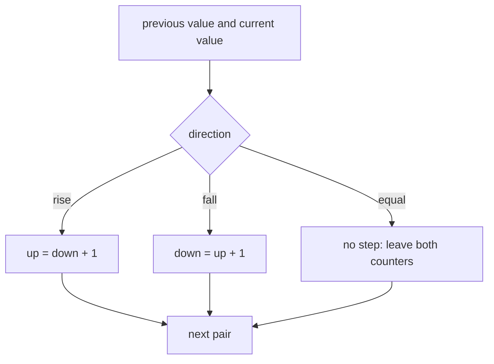
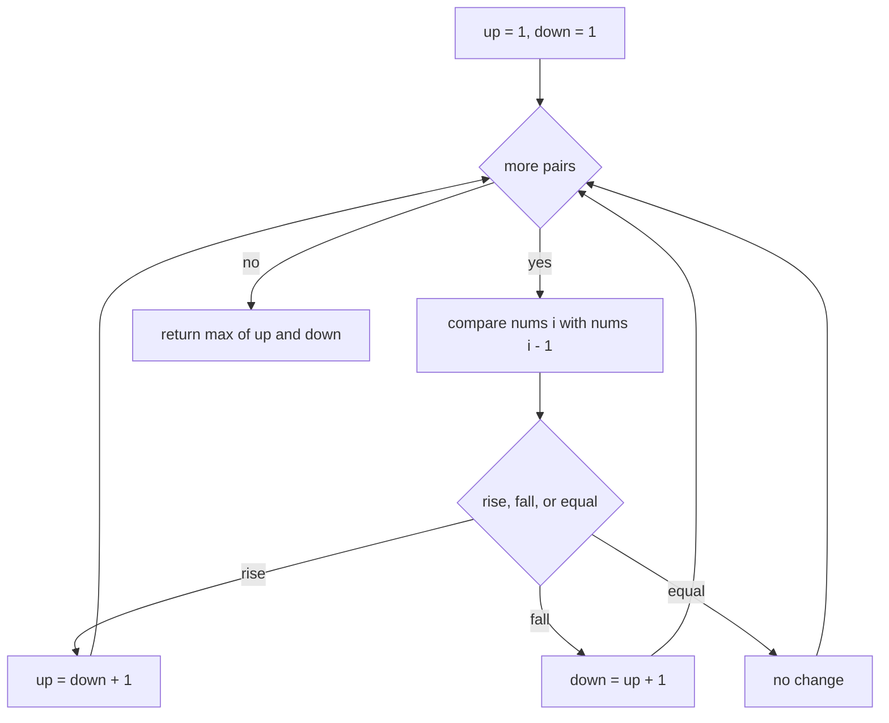
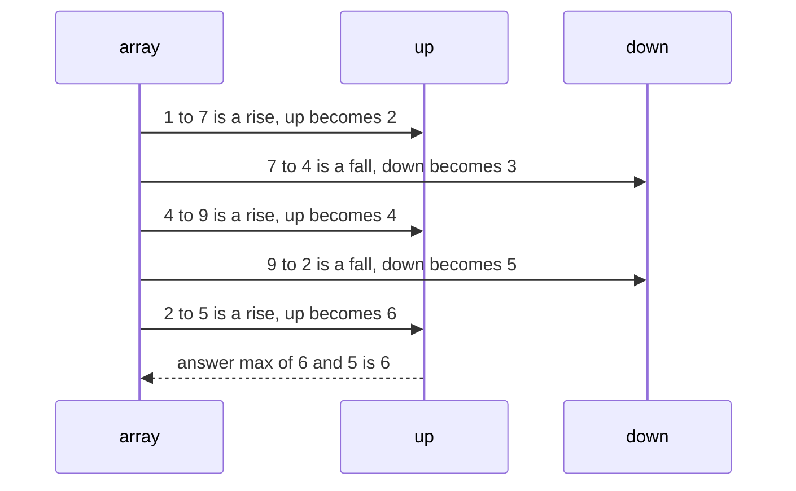

# 229 — Longest alternating subsequence.

> **Tier:** Intermediate · **CTCI chapter:** Ch 8 — Recursion and Dynamic Programming
> **Task spec:** [229-longest-alternating-subsequence.md](../../../tasks/intermediate/229-longest-alternating-subsequence.md)
> **Solutions:** [Python](../../../solutions/python/intermediate/229-longest-alternating-subsequence/solution.py) ·
> [Java](../../../solutions/java/intermediate/229-longest-alternating-subsequence/Solution.java) ·
> [JavaScript](../../../solutions/javascript/intermediate/229-longest-alternating-subsequence/solution.js) ·
> [C#](../../../solutions/csharp/intermediate/229-longest-alternating-subsequence/Solution.cs)

## 1. Problem restatement

**Input:** an array of integers `nums`.

**Output:** the length of the longest **alternating** (up-down, "wiggle") subsequence: a
sequence of elements taken in index order whose consecutive differences strictly alternate
between positive and negative. Equal neighbours are not a step, so a run of equal values
contributes one element. The empty input answers `0` and a single element answers `1`.

The Python docstring states the three conventions the assertions rely on: *"Greedy: any
direction change between two consecutive elements adds one to the best alternating length so
far, because a late turning point can always stand in for a whole monotone stretch. Equal
neighbours are skipped (the subsequence must be strictly alternating)."*

| Call | Result | Why |
| --- | --- | --- |
| `longest_alternating_subsequence([1, 7, 4, 9, 2, 5])` | `6` | every consecutive pair flips direction |
| `longest_alternating_subsequence([1, 17, 5, 10, 13, 15, 10, 5, 16, 8])` | `7` | the monotone stretch `10, 13, 15` contributes once |
| `longest_alternating_subsequence([8])` | `1` | one element |
| `longest_alternating_subsequence([])` | `0` | nothing to pick |
| `longest_alternating_subsequence([1, 2, 3, 4])` | `2` | monotone: one up step only |
| `longest_alternating_subsequence([2, 1])` | `2` | one down step |
| `longest_alternating_subsequence([3, 3])` | `1` | equal is not a step |
| `longest_alternating_subsequence([3, 3, 3, 2])` | `2` | the equals are skipped, then a down step |

The contrast between the first two rows is the heart of the task: in the first array every
adjacent pair changes direction, so all six elements count; in the second the long climb
`10, 13, 15` yields a single step to the running total.

## 2. Intuition

The `O(n^2)` DP is the natural starting point and mirrors the other chain DPs in this chapter:
define `up[i]` as the longest alternating subsequence ending at `i` whose last step is a rise,
and `down[i]` the same for a fall. Then

```text
up[i]   = 1 + max(down[j]) over all j < i with nums[j] < nums[i]
down[i] = 1 + max(up[j])   over all j < i with nums[j] > nums[i]
```

That is correct but it looks at every earlier index for every `i`. The saving observation is
that only the *immediately preceding* element matters, because of a greedy exchange:

- if `nums[i] > nums[i - 1]`, then any alternating chain ending with a fall at `i - 1` (or at
  any earlier index) can be extended by `nums[i]`;
- and if the array has been rising for a while, the *last* element of the rise is the best
  turning point — a later turning point always stands in for a whole monotone stretch.

So the state collapses to two counters that are updated from the previous element only:

```text
up   = length of the best alternating chain whose last step rises
down = length of the best alternating chain whose last step falls
```



Why the update is `up = down + 1` and not `max(up, down + 1)`: on a rise, the chain that
gives `up` could always drop its last element to become a shorter down-ending chain, so
`down + 1` can never be worse than the previous `up`. The code relies on that inequality, and
it is what keeps the loop to two assignments.

## 3. Algorithm

1. If the array is empty, return `0`.
2. Set `up = 1` and `down = 1` — a single element is a chain with no step yet, and it can serve
   as either kind of endpoint.
3. For `i` from `1` to `n - 1`:
   - If `nums[i] > nums[i - 1]`, set `up = down + 1`.
   - Else if `nums[i] < nums[i - 1]`, set `down = up + 1`.
   - Otherwise (equal values) leave both counters alone.
4. Return `max(up, down)`.

```text
function longest_alternating_subsequence(nums)
    if length(nums) = 0 then return 0 end
    up ← 1
    down ← 1
    for i ← 1 to length(nums) - 1 do
        if nums[i] > nums[i - 1] then
            up ← down + 1
        else
            if nums[i] < nums[i - 1] then
                down ← up + 1
            end
        end
    end
    return max(up, down)
end
```

Three properties make the two counters enough:

- a chain alternates, so its next step is fully determined by the previous step's direction;
- the chain may skip elements, so "the best previous endpoint" is what matters, not where it
  was;
- equal neighbours are neutral, so skipping them costs nothing.



The final `max` is needed because the last step may be a rise or a fall; without it, an array
that ends on a climb would report the `down` value.

## 4. Worked example

Trace `longest_alternating_subsequence([1, 7, 4, 9, 2, 5])`, the first asserted case:

| `i` | pair | direction | `up` | `down` | chain the counters describe |
| --- | --- | --- | --- | --- | --- |
| — | — | — | 1 | 1 | a single element |
| 1 | `1 → 7` | rise | 2 | 1 | `1, 7` |
| 2 | `7 → 4` | fall | 2 | 3 | `1, 7, 4` |
| 3 | `4 → 9` | rise | 4 | 3 | `1, 7, 4, 9` |
| 4 | `9 → 2` | fall | 4 | 5 | `1, 7, 4, 9, 2` |
| 5 | `2 → 5` | rise | 6 | 5 | `1, 7, 4, 9, 2, 5` |

The answer is `max(6, 5) = 6`, the whole array, matching the assertion.



The second asserted array shows the collapsing of a monotone stretch:

| `i` | pair | direction | `up` | `down` |
| --- | --- | --- | --- | --- |
| — | — | — | 1 | 1 |
| 1 | `1 → 17` | rise | 2 | 1 |
| 2 | `17 → 5` | fall | 2 | 3 |
| 3 | `5 → 10` | rise | 4 | 3 |
| 4 | `10 → 13` | rise | 4 | 3 |
| 5 | `13 → 15` | rise | 4 | 3 |
| 6 | `15 → 10` | fall | 4 | 5 |
| 7 | `10 → 5` | fall | 4 | 5 |
| 8 | `5 → 16` | rise | 6 | 5 |
| 9 | `16 → 8` | fall | 4 | 7 |

The answer is `max(6, 7) = 7`, as asserted. One chain of that length is
`1, 17, 5, 13, 10, 16, 8` (indices `0, 1, 2, 4, 6, 8, 9`), whose steps are
up, down, up, down, up, down. Note what the middle rows show: the climbs `10 → 13` and
`13 → 15`, and the falls `15 → 10` and `10 → 5`, each contribute a *single* direction change
between them, because `10` and `15` can serve as the turning points.

The equal-value rule shows up on `[3, 3, 3, 2]`: the first three pairs are equal and change
nothing, so the counters stay `1` and `1` until the final `3 → 2` falls and sets `down = 2`.
The asserted answer is `2`.

## 5. Complexity

With `n = len(nums)`:

| Measure | Bound | Why it holds |
| --- | --- | --- |
| Time, best | O(n) | the loop always visits every adjacent pair; only `n = 0` returns in O(1) |
| Time, average | O(n) | one comparison and at most one assignment per pair |
| Time, worst | O(n) | two counters, no inner loop |
| Space | O(1) | two integers, independent of `n` |
| `O(n^2)` chain DP for comparison | O(n^2) time, O(n) space | `up[i]` / `down[i]` with a scan over all `j < i` |
| Enumerating alternating subsequences | O(2^n · n) | every index subset checked for alternation |

The gap between the counters and the `O(n^2)` DP is the whole lesson: the direction-change
formulation makes the predecessor irrelevant, so the second dimension disappears. Both are
correct; the solution files implement the `O(n)` version.

## 6. Pitfalls and edge cases

- **Empty array.** `0`, asserted. There is no subsequence at all, so the initial `1` must not
  be returned — the guard comes first.
- **Single element.** `1`, asserted: a chain of one element has no step and is trivially
  alternating.
- **Equal neighbours.** They are neutral: the counters do not change, which is how
  `[3, 3] → 1` and `[3, 3, 3, 2] → 2` come out. Treating equality as a rise or a fall would
  break both assertions.
- **Monotone arrays.** `[1, 2, 3, 4] → 2` and `[2, 1] → 2`: you can take two elements, but a
  third would repeat the direction. This is the case where the greedy "late turning point"
  argument does all the work — the counter is not incremented for the middle of a climb.
- **Answer is `max(up, down)`.** `[1, 17, 5, 10, 13, 15, 10, 5, 16, 8]` ends with a fall, so
  `down = 7` exceeds `up = 6`; reading only `up` would answer `6`.
- **Greedy versus DP.** The `O(n^2)` recurrence `up[i] = 1 + max(down[j])` over earlier
  smaller values is also correct; the shipped code replaces the max with `down + 1` because
  dropping the last element of an up-ending chain yields a down-ending chain one shorter, so
  the immediate predecessor is always good enough.
- **Subsequence, not subarray.** Skips are allowed; on `[1, 17, 5, 10, 13, 15, 10, 5, 16, 8]`
  the optimal chain skips nothing, but nothing in the algorithm requires adjacency.
- **Direction of the first step.** The counters start equal, so the first strictly unequal
  pair sets the first direction without a special case.
- **Duplicates with a later change.** `[3, 3, 3, 2]` shows that collapsing equal runs is
  handled naturally: the run is skipped and the eventual fall still counts.
- **Overflow.** No sums are computed, so only the counters grow — and they cannot exceed `n`;
  the comparisons are on the input values, which are never added.

## 7. Variants and follow-ups

- **Maximum sum increasing subsequence.** [228-maximum-sum-increasing-subsequence.md](../../../tasks/intermediate/228-maximum-sum-increasing-subsequence.md)
  keeps a chain DP because a sum objective has no direction-only shortcut; the contrast with
  this task's two counters is the fastest way to see why the shortcut works here.
- **A single direction change.** [227-longest-bitonic-subarray.md](../../../tasks/intermediate/227-longest-bitonic-subarray.md)
  allows exactly one turn and is a *subarray* problem, so it needs two passes rather than two
  counters.
- **Constant differences.** [226-longest-arithmetic-progression-subsequence-dp.md](../../../tasks/intermediate/226-longest-arithmetic-progression-subsequence-dp.md)
  needs a difference-keyed table, which is the most expensive of the three structural
  constraints.
- **Contiguous increasing runs.** [118-longest-increasing-subarray-contiguous.md](../../../tasks/beginner/118-longest-increasing-subarray-contiguous.md)
  is the single-direction, adjacency-required version.
- The chapter walkthrough in [Recursion and Dynamic Programming](../../ctci/08-recursion-and-dp.md)
  presents this as the smallest possible state ("last step direction") that still supports an
  induction.

## 8. Check yourself

1. Why does the algorithm only compare `nums[i]` with `nums[i - 1]` instead of scanning all
   earlier elements?

<details><summary>Show answer</summary>

Because the direction change is what matters, and it can always be detected on the
immediately preceding element. If the array rises into `nums[i]`, the best down-ending chain
available is `down`, and the last element of any intervening climb is the best place to turn;
skipping earlier candidates cannot improve the count. That is the "late turning point can
stand in for a monotone stretch" argument in the docstring.

</details>

2. What does `[1, 2, 3, 4]` return, and why not `4`?

<details><summary>Show answer</summary>

`2`. Once the chain has gone up, the next step must go down; a monotone climb provides no
turn, so only the first step counts. Any two elements of this array form an alternating
sequence, and no third element can.

</details>

3. Why is the answer `max(up, down)` instead of one of the counters?

<details><summary>Show answer</summary>

Because the optimal chain may end with either an increase or a decrease, depending on the
array. On `[1, 17, 5, 10, 13, 15, 10, 5, 16, 8]` the last step is a fall, giving `down = 7`
while `up = 6`; returning `up` alone would understate the answer.

</details>

4. How are equal neighbours handled, and what would break if they were treated as steps?

<details><summary>Show answer</summary>

They are skipped: neither counter changes, so a run of equal values behaves like a single
element. Treating `nums[i] == nums[i - 1]` as a rise would give `[3, 3] → 2` instead of the
asserted `1`, and `[3, 3, 3, 2] → 4` instead of `2`.

</details>

5. Why is the greedy update `up = down + 1` safe, when a `max` would be the "obvious" form?

<details><summary>Show answer</summary>

Because on a rise you may always extend the best down-ending chain: if the previous `up`
value were larger than `down + 1`, dropping the last element of its chain would produce a
down-ending chain of length `up - 1` at an earlier index, contradicting the definition of
`down` as the best such length. So `down + 1 >= up` whenever a rise occurs, and the plain
assignment is enough.

</details>
