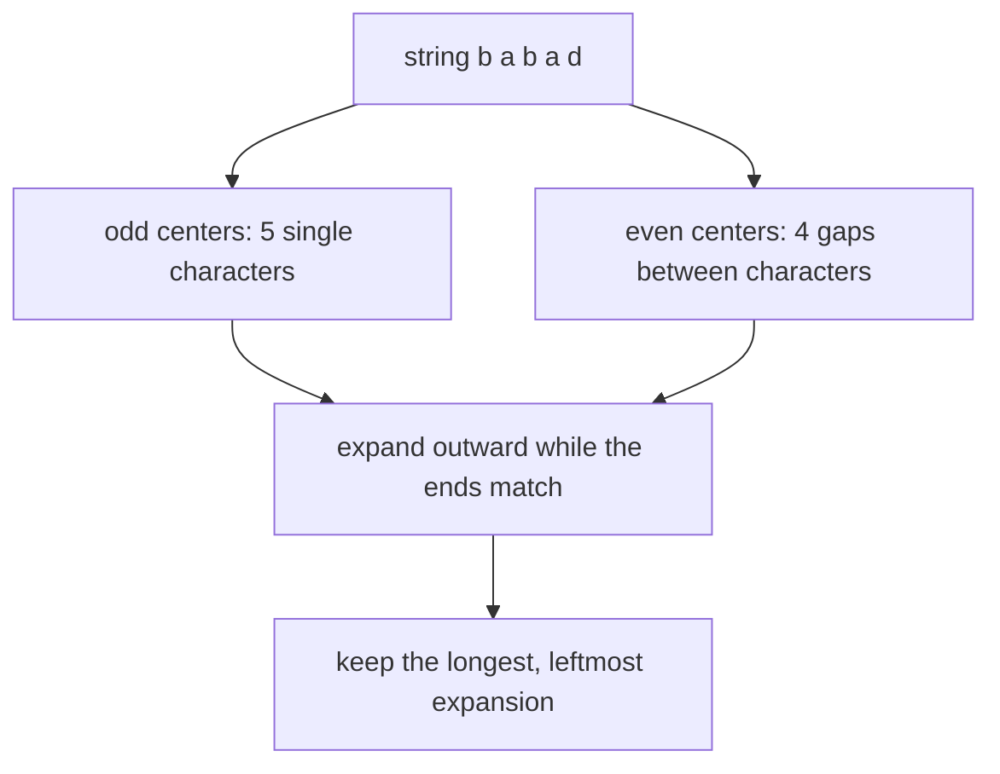
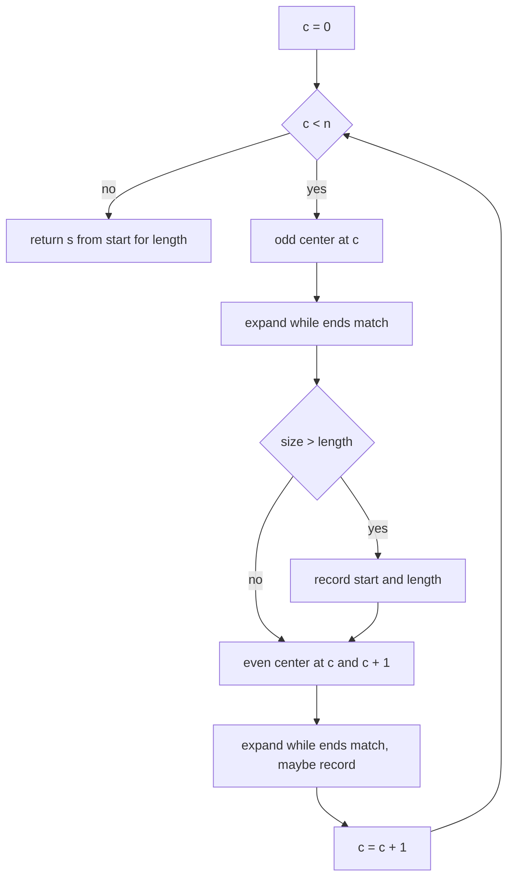
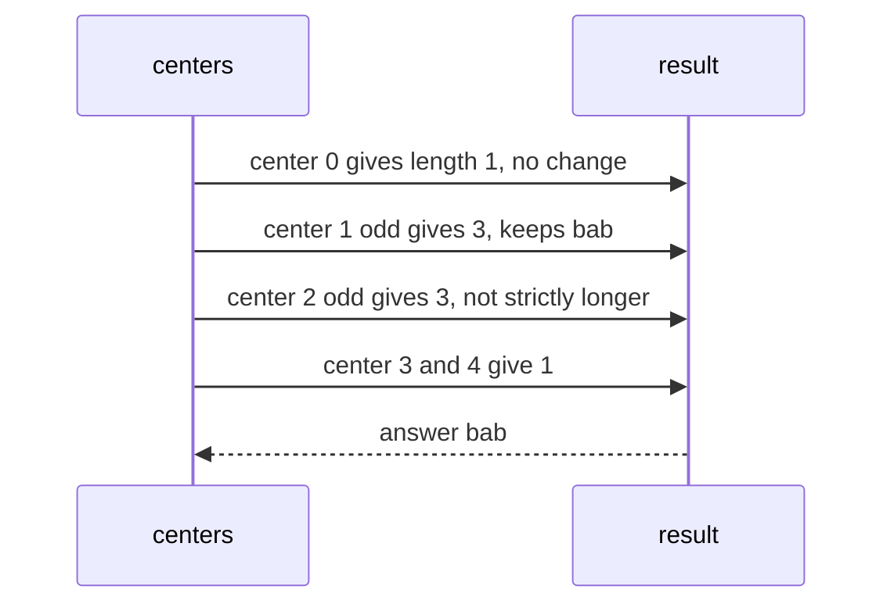

# 230 — Longest palindrome substring (expand center).

> **Tier:** Intermediate · **CTCI chapter:** Ch 1 — Arrays and Strings
> **Task spec:** [230-longest-palindrome-substring-expand-center.md](../../../tasks/intermediate/230-longest-palindrome-substring-expand-center.md)
> **Solutions:** [Python](../../../solutions/python/intermediate/230-longest-palindrome-substring-expand-center/solution.py) ·
> [Java](../../../solutions/java/intermediate/230-longest-palindrome-substring-expand-center/Solution.java) ·
> [JavaScript](../../../solutions/javascript/intermediate/230-longest-palindrome-substring-expand-center/solution.js) ·
> [C#](../../../solutions/csharp/intermediate/230-longest-palindrome-substring-expand-center/Solution.cs)

## 1. Problem restatement

**Input:** a string `s`.

**Output:** a **contiguous** substring of `s` that reads the same forwards and backwards, of
maximum length. When several substrings share the maximum length, the leftmost one is
returned — this is a real part of the contract here, not a free choice, because the assertions
depend on it. The empty string answers `""`.

The Python docstring spells out the tie rule and the scan order: *"The scan visits centers left
to right and tries the odd center before the even center; the first palindrome of maximal
length wins ties, so `babad` returns `bab` (seen at center 1) and not `aba` (center 2)."*

| Call | Result | Why |
| --- | --- | --- |
| `longest_palindrome_substring("babad")` | `"bab"` | tie broken in favour of the earlier center |
| `longest_palindrome_substring("cbbd")` | `"bb"` | an even-length palindrome |
| `longest_palindrome_substring("a")` | `"a"` | single character |
| `longest_palindrome_substring("")` | `""` | nothing to expand |
| `longest_palindrome_substring("aaaa")` | `"aaaa"` | the whole string |
| `longest_palindrome_substring("forgeeksskeegfor")` | `"geeksskeeg"` | long even palindrome |
| `longest_palindrome_substring("abaxyzzyxf")` | `"xyzzyx"` | long even palindrome inside |
| `longest_palindrome_substring("ac")` | `"a"` | no pair, so the first single character |
| `longest_palindrome_substring("aac")` | `"aa"` | the prefix pair |
| `longest_palindrome_substring("z")` | `"z"` | the other single-character case |

The `babad` versus `cbbd` pair is the interesting half of the contract: the first exercises
the tie rule, the second forces the algorithm to consider centers *between* characters.

## 2. Intuition

The brute-force reading checks every substring for palindromicity: `O(n^2)` substrings, each
verified in `O(n)`, so `O(n^3)`.

```text
function brute_force(s)
    best ← ""
    for start ← 0 to n - 1 do
        for end ← start to n - 1 do
            candidate ← s[start .. end]
            if candidate reads the same backwards and candidate is longer than best then
                best ← candidate
            end
        end
    end
    return best
end
```

The key insight that removes the substring enumeration is that palindromes are **defined by
their center**. Every palindrome is determined by a middle position and a radius: characters
match outward from the middle until they stop matching.

- a palindrome of odd length has one center character: `b a b` is centered on `a`;
- a palindrome of even length has a center between two characters: `b b` is centered between
  the two `b`s.

An array of `n` characters therefore has exactly `2n - 1` centers: `n` single-character centers
and `n - 1` gaps between characters. Expanding each center gives the answer in `O(n^2)` for the
whole string and `O(1)` extra space, which is a factor of `n` better than the brute force.



The tie rule falls out of the loop order: centers are visited left to right, the odd center of
each position is tried before its even center, and only *strictly* longer expansions replace
the current best. So the first expansion to reach a given length is the one that survives.

## 3. Algorithm

1. If `s` is empty, return `""`.
2. Set `start = 0` and `length = 1` — a single character is always a palindrome, and this
   seeding is what makes `"ac"` answer `"a"`.
3. For each center index `c` from `0` to `n - 1`:
   - Try the odd center: expand from `(c, c)`.
   - Try the even center: expand from `(c, c + 1)`.
   - For each expansion, if its length exceeds the stored `length`, record its start and
     length.
4. Return `s[start .. start + length)`.

The expansion helper itself is a two-pointer walk:

```text
function expand(s, l, r)
    while l >= 0 and r < length(s) and s[l] = s[r] do
        l ← l - 1
        r ← r + 1
    end
    return (l + 1, r - l - 1)
end
```

`(l, r)` start on the center and move outward one character at a time. When the loop stops,
the last matched pair is one step inside `l` and `r`, so the palindrome starts at `l + 1` and
its length is `r - l - 1`. For a center that matches nothing at all — the even center `(c,
c + 1)` with unequal characters — that arithmetic yields length `0`, which is smaller than the
seeded `1` and is therefore ignored.

```text
function longest_palindrome_substring(s)
    if length(s) = 0 then return "" end
    start ← 0
    length ← 1
    for c ← 0 to length(s) - 1 do
        for each center in ((c, c), (c, c + 1)) do
            (l, r) ← center
            while l >= 0 and r < length(s) and s[l] = s[r] do
                l ← l - 1
                r ← r + 1
            end
            size ← r - l - 1
            if size > length then
                start ← l + 1
                length ← size
            end
        end
    end
    return s[start .. start + length)
end
```

Java and C# factor the expansion into a helper returning a `(start, length)` pair; the Python
and JavaScript files inline it as the pair of centers `((c, c), (c, c + 1))`. All four keep the
strict `>` comparison, which is the tie rule.



## 4. Worked example

Trace `longest_palindrome_substring("babad")`. `n = 5`, so there are nine centers, and
`start = 0`, `length = 1` to begin with.

| Center `c` | Which center | Expansion | Final `size` | Recorded? |
| --- | --- | --- | --- | --- |
| 0 | `(0, 0)` `b` | matches nothing to the left | 1 | no (`1 > 1` is false) |
| 0 | `(0, 1)` `b`/`a` | unequal, empty expansion | 0 | no |
| 1 | `(1, 1)` `a` | `a` matches, then `b`/`b` match, then out of range | **3** | **yes → start 0, length 3** |
| 1 | `(1, 2)` `a`/`b` | unequal | 0 | no |
| 2 | `(2, 2)` `b` | `a`/`a` match, then `b`/`d` do not | 3 | no (`3 > 3` is false) |
| 2 | `(2, 3)` `b`/`a` | unequal | 0 | no |
| 3 | `(3, 3)` `a` | `b`/`d` do not match | 1 | no |
| 3 | `(3, 4)` `a`/`d` | unequal | 0 | no |
| 4 | `(4, 4)` `d` | nothing to expand into | 1 | no |
| 4 | `(4, 5)` `d`/out of range | `r = n` kills the loop immediately | 0 | no |

The result is `s[0 .. 3)` = `"bab"`. The row for center 2 is the tie: expanding around `b`
at index 2 finds `aba`, also of length 3, but the comparison is strictly `>`, so the earlier
`bab` is kept. That is the asserted behaviour.



The even-center path needs its own case. On `"aaaa"` the interesting expansion is the one
around the gap at index 2.5:

| Center `c` | Which center | Expansion | Final `size` | Recorded? |
| --- | --- | --- | --- | --- |
| 0 | `(0, 0)` | out of range after one match | 1 | no |
| 1 | `(1, 1)` | `a`/`a` matches, then out of range | 3 | yes → `"aaa"` |
| 2 | `(2, 2)` | `a`/`a` matches, then out of range | 3 | no |
| 2 | `(2, 3)` | `a`/`a` matches, `a`/`a` matches, then out of range | **4** | **yes → `"aaaa"`** |

Only the even center can produce an even-length palindrome, and the tie rule is not involved
here because `4 > 3` is strict.

## 5. Complexity

With `n = len(s)`:

| Measure | Bound | Why it holds |
| --- | --- | --- |
| Time, best | O(n) | if no character matches its neighbour, every expansion stops after one comparison |
| Time, average | O(n^2) | `2n - 1` centers, each expanding up to `O(n)` steps |
| Time, worst | O(n^2) | a string like `"aaaa"` expands the full radius from every center |
| Space | O(1) | five scalars: two pointers, a start, a length, the center index |
| Brute force for comparison | O(n^3) | `O(n^2)` substrings, each checked in `O(n)` |
| Manacher for comparison | O(n) time, O(n) space | the linear-time sibling, [task 231](../../../tasks/intermediate/231-manacher-s-algorithm-for-longest-palindromic-substring.md) |

Expansion is memory-free, which is its advantage over the linear-time algorithm: Manacher
needs a transformed copy of the string and a radius array, both of length `O(n)`. For the input
sizes in this repository the `O(n^2)` scan is the simpler trade.

## 6. Pitfalls and edge cases

- **Empty string.** `""`, asserted, and the guard comes before any indexing.
- **Single character.** `"a"` and `"z"` are asserted. They fall out of the seed
  `length = 1`, `start = 0`; without the seed, a string with no matches would answer `""`.
- **Even centers.** `"cbbd" → "bb"` and `"abaxyzzyxf" → "xyzzyx"` cannot be found by odd
  centers at all. Forgetting the `(c, c + 1)` centers is the most common bug in this exercise.
- **The last even center.** At `c = n - 1` the even center is `(n - 1, n)`; `r = n` fails the
  bounds test immediately, the expansion is empty, and `size` computes to `0`. No special case
  is needed, and the `"babad"` trace shows the row.
- **Tie-breaking.** `"babad" → "bab"` (not `"aba"`) and `"ac" → "a"` (not `"c"`) both depend on
  the strict `>` and on the center visit order (left to right, odd before even). Changing
  either gives a different, wrong answer for these rows.
- **The `size` arithmetic.** `size = r - l - 1` and `start = l + 1` are correct only because
  the loop overshoots by one on both sides. Writing `size = r - l + 1` reports lengths that are
  two too large.
- **All-equal strings.** `"aaaa" → "aaaa"` is the quadratic worst case; the algorithm is
  correct there but does the most work.
- **No validation.** Every character counts, including digits, spaces and punctuation; the
  comparison is a plain character equality, so case matters (`"Aa"` has no pair). No trimming
  or normalisation happens.
- **Unicode.** Python indexes code points and JavaScript indexes UTF-16 code units in a
  string, so an astral character (emoji) behaves differently between those two; Java and C#
  index UTF-16 code units. None of the four normalises, and every solution returns a substring
  by index, so a code-unit split cannot be avoided by choosing a different expansion order.
- **The result is a substring, not a length.** The helper in Java and C# returns
  `(start, length)` pairs, and the final `substring(start, start + length)` is what the
  assertions compare. Returning the length is not enough.
- **Deleting the empty guard.** With `s = ""` the loop body never runs, so `s[0 .. 1)` would
  still be avoided — but only by luck of the seed; the guard makes the contract explicit.

## 7. Variants and follow-ups

- **Linear time.** [231-manacher-s-algorithm-for-longest-palindromic-substring.md](../../../tasks/intermediate/231-manacher-s-algorithm-for-longest-palindromic-substring.md)
  removes the `n` factor by reusing previously computed mirrors; it returns the same leftmost
  longest palindrome and the solutions cross-check it against this task's expansion helper.
- **Checking one string.** [002-check-if-a-string-is-a-palindrome.md](../../../tasks/beginner/002-check-if-a-string-is-a-palindrome.md)
  is the two-pointer walk from the outside in, i.e. the same matching rule without a choice of
  center.
- **Counting them all.** [303-count-palindromic-substrings-dp.md](../../../tasks/intermediate/303-count-palindromic-substrings-dp.md)
  uses the same 2n - 1 centers but sums the radii instead of keeping the maximum.
- **Subsequences instead of substrings.** [307-longest-palindromic-subsequence-dp.md](../../../tasks/intermediate/307-longest-palindromic-subsequence-dp.md)
  drops contiguity and needs an `O(n^2)` table, and
  [304-minimum-deletion-to-make-palindrome-lcs-trick.md](../../../tasks/intermediate/304-minimum-deletion-to-make-palindrome-lcs-trick.md)
  reuses that table for a deletion objective.
- **Cutting the string up.** [171-minimum-cuts-for-palindrome-partitioning-dp.md](../../../tasks/beginner/171-minimum-cuts-for-palindrome-partitioning-dp.md)
  combines palindrome testing with a DP over prefixes.
- The chapter walkthrough in [Arrays and Strings](../../ctci/01-arrays-and-strings.md) treats
  the two-pointer expansion as the chapter's main string technique.

## 8. Check yourself

1. Why are there `2n - 1` centers rather than `n`?

<details><summary>Show answer</summary>

Because palindromes come in two shapes. An odd-length palindrome is centered on a character
(`n` such centers), and an even-length palindrome is centered on the gap between two adjacent
characters (`n - 1` gaps). Adding them gives `2n - 1`, which is why every solution iterates
over both `(c, c)` and `(c, c + 1)`.

</details>

2. Why does `"babad"` return `"bab"` and not `"aba"`?

<details><summary>Show answer</summary>

Both have length 3. The centers are visited left to right and only a strictly longer expansion
replaces the stored answer, so the palindrome found first — `bab`, centered at index 1 —
survives the later tie at index 2.

</details>

3. What does the expansion of an even center with unequal characters return, and why is that
   harmless?

<details><summary>Show answer</summary>

An empty expansion: `l` and `r` never move, so `size = r - l - 1 = 0`. It is harmless because
the answer is seeded with `length = 1` and only strictly larger sizes are recorded, so the
zero is always ignored.

</details>

4. Why is the seed `length = 1`, `start = 0` needed?

<details><summary>Show answer</summary>

Because a non-empty string always contains a palindrome (a single character), but an
expansion might never record anything — on `"ac"` no expansion beyond length 1 happens, and on
a string where the first pair is unequal the loop records nothing. Seeding guarantees the
function returns a legal substring, and it is what makes `"ac" → "a"` hold.

</details>

5. When is the `O(n)` best case reached?

<details><summary>Show answer</summary>

When no character ever equals its neighbour, for example in a string of distinct characters.
Every expansion then stops after the first comparison, so the total work is `O(n)` centers ×
`O(1)` comparisons. The worst case is the opposite extreme — a string of equal characters —
where each center expands to its full radius.

</details>
