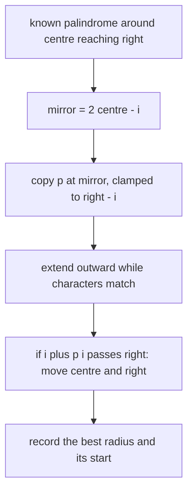
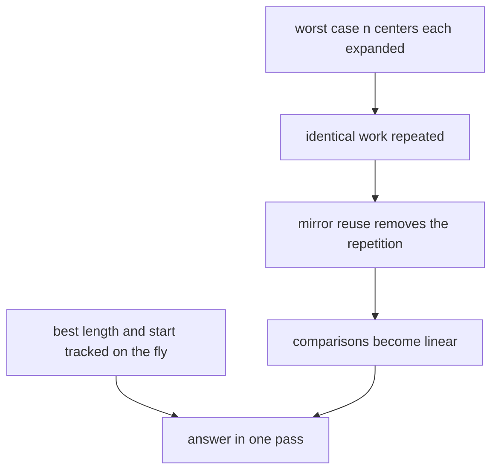
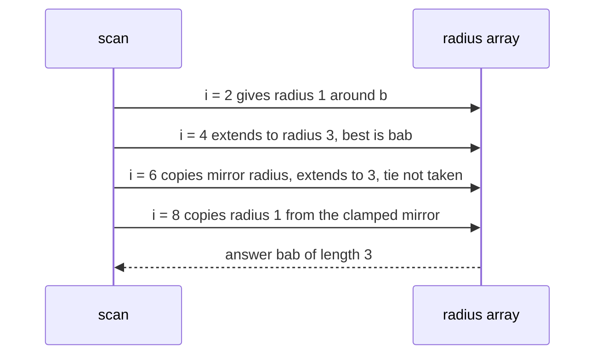

# 231 — Manacher's algorithm for longest palindromic substring.

> **Tier:** Intermediate · **CTCI chapter:** Ch 1 — Arrays and Strings
> **Task spec:** [231-manacher-s-algorithm-for-longest-palindromic-substring.md](../../../tasks/intermediate/231-manacher-s-algorithm-for-longest-palindromic-substring.md)
> **Solutions:** [Python](../../../solutions/python/intermediate/231-manacher-s-algorithm-for-longest-palindromic-substring/solution.py) ·
> [Java](../../../solutions/java/intermediate/231-manacher-s-algorithm-for-longest-palindromic-substring/Solution.java) ·
> [JavaScript](../../../solutions/javascript/intermediate/231-manacher-s-algorithm-for-longest-palindromic-substring/solution.js) ·
> [C#](../../../solutions/csharp/intermediate/231-manacher-s-algorithm-for-longest-palindromic-substring/Solution.cs)

## 1. Problem restatement

**Input:** a string `s`.

**Output:** the longest palindromic **substring**, with ties broken in favour of the
**leftmost** one. The empty string answers `""`. This is the same contract as
[task 230](../../../tasks/intermediate/230-longest-palindrome-substring-expand-center.md), but
the task is the `O(n)` algorithm rather than the `O(n^2)` expansion.

The Python docstring states the two ideas the tutorial follows: *"Transforming `s` into
`^#` + `#`.join(s) + `#$` makes every palindrome odd length, so a single radius array suffices:
`p[i]` equals the length of the longest palindrome in `s` centred at transformed position `i`.
Reusing the mirror of the current right-most palindrome keeps the scan linear."* It also fixes
the tie rule: *"when several palindromes share the maximum length the LEFTMOST one is
returned (the strict `>` comparison keeps the earliest centre)."*

| Call | Result | Why |
| --- | --- | --- |
| `longest_palindromic_substring("babad")` | `"bab"` | leftmost of `bab` / `aba` |
| `longest_palindromic_substring("cbbd")` | `"bb"` | even palindrome |
| `longest_palindromic_substring("forgeeksskeegfor")` | `"geeksskeeg"` | long even palindrome |
| `longest_palindromic_substring("abacaba")` | `"abacaba"` | the whole string |
| `longest_palindromic_substring("bananas")` | `"anana"` | odd palindrome inside |
| `longest_palindromic_substring("abcde")` | `"a"` | no repeats, first character wins |
| `longest_palindromic_substring("ccc")` | `"ccc"` | all equal |
| `longest_palindromic_substring("")` | `""` | nothing to scan |
| `longest_palindromic_substring("a")` | `"a"` | single character |

The solutions also run 300 random `a`/`b` strings of length `0..40` through three checks:
the result is a palindrome, its length equals the `O(n^2)` expansion helper's answer, and it is
the leftmost substring of that length that is a palindrome.

## 2. Intuition

The expansion algorithm of task 230 re-derives every palindrome from scratch, and that is what
costs the extra factor of `n`: a long palindrome contains many smaller ones, each of which is
expanded again. Manacher's algorithm removes that redundancy by exploiting a single symmetry
fact.

First, the two center types are unified. Insert a separator between every pair of characters,
and wrap the result in two different sentinels:

```text
s = b a b a d
t = ^ # b # a # b # a # d # $
```

In `t`, **every** palindrome is odd length and centered on a single position, because the
separators guarantee that matching always alternates between real characters and separators.
Better still, the radius of the palindrome in `t` around position `i` equals the longest
palindrome radius in `s` around the corresponding center — the two cases of task 230 collapse
into one array `p`.

Second, and this is the linear-time part, suppose the scan already knows the palindrome with
the furthest right edge: centered at `centre`, reaching index `right`. For a position `i`
inside that palindrome, the mirror position `2 * centre - i` lies to the left of the center, and
**its radius is available**. The mirror's palindrome is reflected into `i`:

```text
p[i] = min(right - i, p[mirror])
```

The `min` with `right - i` is the clamp that keeps the copied radius inside the known
palindrome; beyond `right` nothing is known, so the scan continues by comparing characters one
by one — and only then does `right` move.



The result is that character comparisons never re-trace a stretch that a previous expansion
already covered: each successful comparison pushes `right` forward by one, and `right` only
moves right, so there are `O(n)` of them in total.



## 3. Algorithm

1. If `s` is empty, return `""`.
2. Build `t = "^#" + "#".join(s) + "#$"`, so `t` has length `2n + 3`.
3. Allocate `p`, an integer array of the same length as `t`, all zeros.
4. Set `centre = 0`, `right = 0`, `best_len = 0`, `best_start = 0`.
5. For `i` from `1` to `len(t) - 2` (the two sentinels are never centers):
   - `mirror = 2 * centre - i`;
   - if `i < right`, set `p[i] = min(right - i, p[mirror])`, otherwise leave `p[i] = 0`;
   - while `t[i + 1 + p[i]] = t[i - 1 - p[i]]`, increment `p[i]`;
   - if `i + p[i] > right`, set `centre = i` and `right = i + p[i]`;
   - if `p[i] > best_len`, set `best_len = p[i]` and
     `best_start = (i - p[i]) / 2` using integer division.
6. Return `s[best_start .. best_start + best_len)`.

```text
function longest_palindromic_substring(s)
    if length(s) = 0 then return "" end
    t ← "^#" joined with the characters of s separated by "#" then "#$"
    n ← length(t)
    p ← array of n zeros
    centre ← 0
    right ← 0
    best_len ← 0
    best_start ← 0
    for i ← 1 to n - 2 do
        mirror ← 2 * centre - i
        if i < right then p[i] ← min(right - i, p[mirror]) end
        while t[i + 1 + p[i]] = t[i - 1 - p[i]] do
            p[i] ← p[i] + 1
        end
        if i + p[i] > right then
            centre ← i
            right ← i + p[i]
        end
        if p[i] > best_len then
            best_len ← p[i]
            best_start ← (i - p[i]) / 2
        end
    end
    return s[best_start .. best_start + best_len)
end
```

Three details are load-bearing:

- the `while` loop has **no bounds check**: the sentinels `^` and `$` can never match a
  separator or a real character, so the comparison always terminates. In Java, JavaScript and
  C# that is what prevents an out-of-range index; in Python, where negative indices wrap
  around instead of failing, it is what prevents a silent wrong answer.
- `p[i]` is measured in `s` characters, not in `t` characters: it is the number of real
  characters matched on each side, which is exactly the length of the palindrome in `s`.
- `best_start = (i - p[i]) / 2` maps the transformed center and radius back to a start index in
  `s` — the division by two is what undoes the inserted separators.

## 4. Worked example

Trace `longest_palindromic_substring("babad")`. The transform is
`t = ^ # b # a # b # a # d # $`, with indices `0..12`, so the loop runs `i = 1..11`.
`centre = 0`, `right = 0`, `best_len = 0`.

| `i` | `t[i]` | `i < right` | `p[i]` before extending | `p[i]` after | `centre`, `right` after | `best_len` |
| --- | --- | --- | --- | --- | --- | --- |
| 1 | `#` | no (`1 < 0`) | 0 | 0 | 1, 1 | 0 |
| 2 | `b` | no | 0 | 1 | 2, 3 | 1 (`b`) |
| 3 | `#` | no (`3 < 3`) | 0 | 0 | 2, 3 | 1 |
| 4 | `a` | no | 0 | 3 | 4, 7 | 3 (`bab`) |
| 5 | `#` | yes, mirror 3 | `min(2, p[3] = 0) = 0` | 0 | 4, 7 | 3 |
| 6 | `b` | yes, mirror 2 | `min(1, p[2] = 1) = 1` | 3 | 6, 9 | 3 (tie, kept) |
| 7 | `#` | yes, mirror 5 | `min(2, p[5] = 0) = 0` | 0 | 6, 9 | 3 |
| 8 | `a` | yes, mirror 4 | `min(1, p[4] = 3) = 1` | 1 | 6, 9 | 3 |
| 9 | `#` | no (`9 < 9`) | 0 | 0 | 6, 9 | 3 |
| 10 | `d` | no | 0 | 1 | 10, 11 | 3 |
| 11 | `#` | no | 0 | 0 | 10, 11 | 3 |

Row `i = 4` finds the answer: `p[4] = 3` means a palindrome of length 3 in `s` around the
transformed position 4, and `(4 - 3) / 2 = 0` gives start `0`, i.e. `"bab"`.

Row `i = 6` is the mirror mechanism in action. Because `6 < right = 7`, the radius of the mirror
position `2` (`p[2] = 1`) is copied, clamped to `right - i = 1`; the scan then extends it to
`3`, discovering `"aba"`. Its start would be `(6 - 3) / 2 = 1`, but the comparison
`p[i] > best_len` is `3 > 3` — false — so the leftmost `"bab"` keeps the answer. That strict
comparison is the entire tie-breaking rule.



The two clamps are both visible in the table: at `i = 5` the copy is `min(2, 0) = 0`, and at
`i = 8` it is `min(1, 3) = 1` — the mirror's radius `3` is larger than the space between `i`
and `right`, so it is cut down. Without that clamp the algorithm would claim knowledge beyond
the palindrome it has actually verified, and the answer could come out too large.

## 5. Complexity

With `n = len(s)` and `m = 2n + 3 = len(t)`:

| Measure | Bound | Why it holds |
| --- | --- | --- |
| Time, all cases | O(n) | the loop runs `m - 2` times; each successful comparison increases `p[i]` and the right edge is advanced to `i + p[i]`, so the total number of successful comparisons over the whole scan is at most `m` |
| Space | O(n) | the transformed string and the radius array, both `O(n)` |
| Expansion algorithm for comparison | O(n^2) time, O(1) space | [task 230](../../../tasks/intermediate/230-longest-palindrome-substring-expand-center.md); it re-derives nested palindromes |
| Brute force for comparison | O(n^3) time | every substring checked for palindromicity |

The linear bound is an amortised argument rather than a per-iteration one: a single iteration
can still do many comparisons (row `i = 4` does three), but the sum over all iterations is
bounded because each comparison that succeeds moves `right` one position to the right, and
`right` is capped by `m`. This is exactly the trade the task is about — `O(n)` time paid for
with `O(n)` extra memory.

## 6. Pitfalls and edge cases

- **Empty string.** `""`, asserted, and the guard avoids building a transform with no real
  characters. It also keeps `best_len = 0` from producing an out-of-range slice.
- **Single character.** `"a" → "a"`: `t = ^#a#$`, the loop covers `i = 1, 2`, and row `i = 2`
  records radius `1` with start `(2 - 1) / 2 = 0`.
- **The sentinels are mandatory.** They are what lets the `while` condition compare
  `t[i + 1 + p[i]]` and `t[i - 1 - p[i]]` without bounds tests. In Java, JavaScript and C# a
  missing sentinel is an out-of-range error; in Python it is worse, because a negative index
  silently addresses the end of the string.
- **The `min(right - i, p[mirror])` clamp.** Dropping the clamp (or the `i < right` guard)
  makes the algorithm claim radii it has not verified and can produce a non-palindromic answer.
  Both the `i = 5` and `i = 8` rows above show the clamp binding.
- **Strict `>` for the tie-break.** `"babad" → "bab"` relies on it, as does `"abcde" → "a"`.
  Using `>=` would return the *rightmost* longest palindrome instead.
- **The index mapping.** `best_start = (i - p[i]) / 2` must use integer division, and `p[i]` is
  a count of `s` characters. Treating `p[i]` as a radius in `t` doubles the reported length.
- **The loop bounds.** The sentinel positions `0` and `m - 1` must not be treated as centers,
  which is why the loop is `1 .. m - 2`. Including them adds no information and shifts the
  radius arithmetic.
- **Separator collisions.** The transform assumes the separator `#` and the sentinels `^` / `$`
  do not appear in the input, since they are compared like ordinary characters. The assertions
  and the 300 random cross-checks use lowercase `a`/`b` strings, so the assumption holds there;
  a general-purpose port should either verify it or pick characters that cannot occur.
- **Unicode.** Python iterates code points and JavaScript iterates UTF-16 code units of a
  string, while Java and C# index UTF-16 code units; astral characters therefore give different
  results across the four implementations, and none of them normalises composed or decomposed
  forms.
- **Memory.** Two `O(n)` structures, versus one scalar set for the expanding algorithm. On
  short strings the expansion version is usually faster in practice despite the worse bound —
  but that is a constant-factor argument, and the code here claims only the asymptotic bound.
- **What the random cross-check actually verifies.** Three properties per random string:
  the returned substring is a palindrome, its length matches the `O(n^2)` helper, and its index
  is the first occurrence of a palindrome of that length — the last check is what pins the
  leftmost tie rule.

## 7. Variants and follow-ups

- **Expansion instead of Manacher.** [230-longest-palindrome-substring-expand-center.md](../../../tasks/intermediate/230-longest-palindrome-substring-expand-center.md)
  is the same contract at `O(n^2)` with `O(1)` space, and it is the oracle the solutions use to
  test this one.
- **Counting palindromic substrings.** [303-count-palindromic-substrings-dp.md](../../../tasks/intermediate/303-count-palindromic-substrings-dp.md)
  needs the sum of all radii rather than the maximum, which is a one-line change on top of
  Manacher's array.
- **Palindromic subsequences.** [307-longest-palindromic-subsequence-dp.md](../../../tasks/intermediate/307-longest-palindromic-subsequence-dp.md)
  drops contiguity and therefore cannot use centers at all.
- **Checking a single palindrome.** [002-check-if-a-string-is-a-palindrome.md](../../../tasks/beginner/002-check-if-a-string-is-a-palindrome.md)
  is the two-pointer test that both palindrome tasks are built on.
- **Deeper palindromic structures.** [340-implement-palindrome-tree-eertree-overview-small-test.md](../../../tasks/intermediate/340-implement-palindrome-tree-eertree-overview-small-test.md)
  generalises the same symmetry ideas into a tree of distinct palindromic substrings.
- The chapter walkthrough in [Arrays and Strings](../../ctci/01-arrays-and-strings.md)
  introduces the expansion technique that this task then speeds up.

## 8. Check yourself

1. What does the transform `^#` + `#`.join(s) + `#$` accomplish?

<details><summary>Show answer</summary>

It makes every palindrome in the transformed string odd length and centered on a single
position, because real characters and separators alternate. That removes the even/odd center
split of task 230: one radius array `p` handles both cases, and `p[i]` equals the length in `s`
of the palindrome centered at transformed position `i`.

</details>

2. Why can the `while` loop omit bounds checks?

<details><summary>Show answer</summary>

Because of the sentinels. `^` at index 0 and `$` at the last index can never equal a separator
or any character the transform produces, so the comparison fails before an index can leave the
string. In languages with checked indexing this avoids an exception; in Python it avoids a
negative index silently wrapping to the end of the string.

</details>

3. What is the role of `min(right - i, p[mirror])`?

<details><summary>Show answer</summary>

It copies the mirror's radius into `p[i]` but only as far as the currently known right edge
`right`. Anything beyond `right` has not been verified, so the scan must extend it with real
comparisons; the clamp is what keeps the copied value honest, and the two traces at `i = 5` and
`i = 8` show it binding.

</details>

4. Why does `"babad"` return `"bab"` rather than `"aba"`?

<details><summary>Show answer</summary>

Both have radius `3` in the transformed string, but `"bab"` is found first (center `4`, before
center `6`), and the update test is strictly `p[i] > best_len`. The tie is therefore discarded
and the leftmost palindrome survives.

</details>

5. Why is the algorithm linear when individual iterations can perform several comparisons?

<details><summary>Show answer</summary>

Because the work is charged to `right`. Every comparison that succeeds increases `p[i]`, and
the update `i + p[i] > right` moves `right` to `i + p[i]`; `right` never decreases and is
bounded by the length of the transformed string, so the total number of successful comparisons
over the whole scan is `O(n)`. Comparisons that fail cost `O(1)` per iteration.

</details>

6. What does the algorithm trade away compared with the expansion version?

<details><summary>Show answer</summary>

Space. Manacher uses `O(n)` extra memory for the transformed string and the radius array,
whereas the expansion scan uses `O(1)` extra space and no copy of the input. Both return the
same leftmost longest palindrome, which the solutions verify by cross-checking the two against
each other on 300 random strings.

</details>
