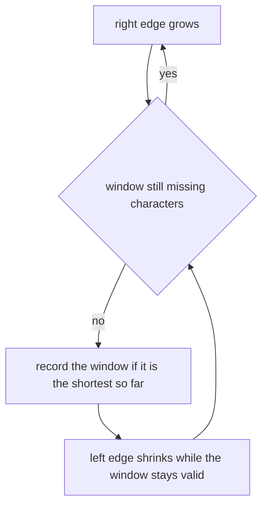
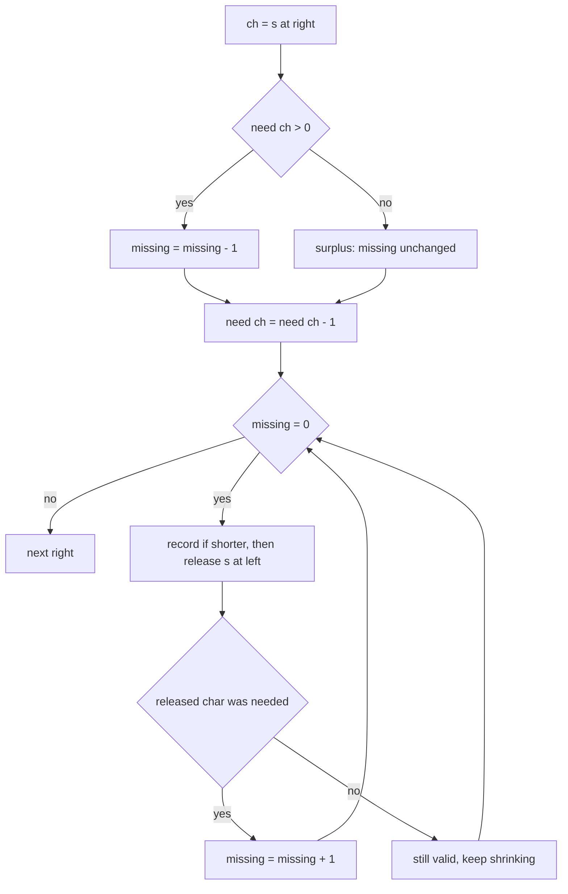
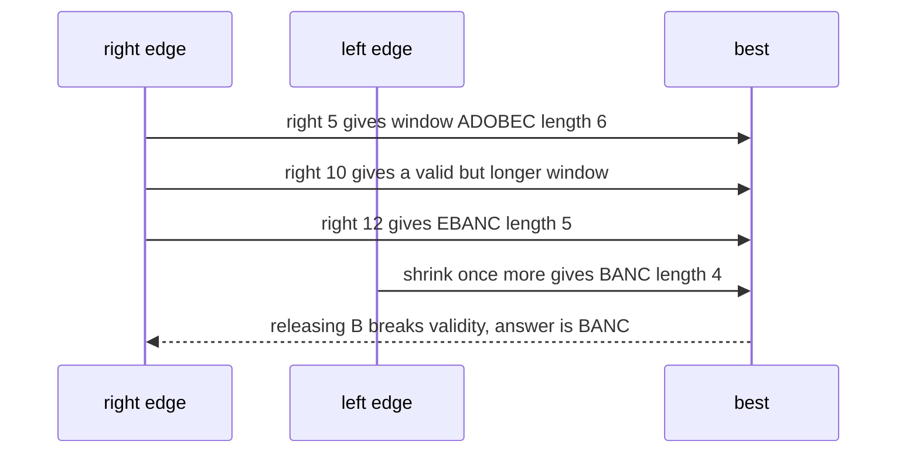

# 232 — Minimum window substring covering all chars of pattern.

> **Tier:** Intermediate · **CTCI chapter:** Ch 1 — Arrays and Strings
> **Task spec:** [232-minimum-window-substring-covering-all-chars-of-pattern.md](../../../tasks/intermediate/232-minimum-window-substring-covering-all-chars-of-pattern.md)
> **Solutions:** [Python](../../../solutions/python/intermediate/232-minimum-window-substring-covering-all-chars-of-pattern/solution.py) ·
> [Java](../../../solutions/java/intermediate/232-minimum-window-substring-covering-all-chars-of-pattern/Solution.java) ·
> [JavaScript](../../../solutions/javascript/intermediate/232-minimum-window-substring-covering-all-chars-of-pattern/solution.js) ·
> [C#](../../../solutions/csharp/intermediate/232-minimum-window-substring-covering-all-chars-of-pattern/Solution.cs)

## 1. Problem restatement

**Input:** a string `s` and a pattern `t`.

**Output:** the shortest **contiguous** substring of `s` that contains every character of `t`
**with its multiplicity** — if `t` has two `a`s, the window needs two `a`s. Among windows of
equal minimal length, the leftmost is returned. If no such window exists (including when `t`
is empty or longer than `s`), the answer is `""`.

The Python docstring fixes the contract: *"Sliding window with a need/have counter: `need[ch]`
counts how many copies of `ch` the window still has to supply and `missing` is their total.
Grow the window with `right`; once `missing == 0`, shrink from the left while the window stays
valid, recording the smallest window seen. `O(|s| + |t|)` time, `O(k)` space for an alphabet of
size `k`."* and *"Tie behaviour: among equal-length minimal windows the LEFTMOST one is
returned."*

| Call | Result | Why |
| --- | --- | --- |
| `min_window("ADOBECODEBANC", "ABC")` | `"BANC"` | length 4 beats the earlier `"ADOBEC"` (6) |
| `min_window("cabwefgewcwaefgcf", "cae")` | `"cwae"` | the second classic case |
| `min_window("a", "a")` | `"a"` | exact match |
| `min_window("a", "aa")` | `""` | pattern longer than `s` |
| `min_window("abc", "abcd")` | `""` | pattern longer than `s` again |
| `min_window("ab", "cd")` | `""` | no window contains `c` |
| `min_window("aa", "aa")` | `"aa"` | multiplicity: two `a`s are required |
| `min_window("abaab", "aa")` | `"aa"` | multiplicity again |
| `min_window("bba", "ab")` | `"ba"` | the shorter suffix |
| `min_window("aabc", "aabc")` | `"aabc"` | the whole string |
| `min_window("abc", "")` | `""` | empty pattern |
| `min_window("", "a")` | `""` | empty string |

The solutions also cross-check against a brute-force reference on 200 random `a`/`b` strings
(`s` of length `0..14`, `t` of length `0..4`), which is what pins the tie rule and the
multiplicity handling.

## 2. Intuition

The brute-force reference in the solutions is the honest statement of the problem: for every
start position, extend the end until the window covers `t`, and keep the smallest such window.

```text
function brute_min_window(s, t)
    if s or t is empty, or length(t) > length(s) then return "" end
    want ← character counts of t
    best ← ""
    for left ← 0 to length(s) - 1 do
        for right ← left + length(t) to length(s) do
            have ← character counts of s[left .. right)
            if have covers want then
                if best is empty or the window is shorter than best then best ← window end
                stop extending this left
            end
        end
    end
    return best
end
```

It is correct and quadratic-or-worse, and its waste is easy to see: when a window is valid,
extending it further only makes it longer, so the entire tail of the inner loop is pointless;
and when the window is invalid, the only useful next step is to grow it by one character.

The key insight is that **both** ends only ever move forward, so no window has to be
re-examined:

- grow `right` until the window covers `t`;
- then shrink `left` as far as possible while it still covers `t`, recording the best window;
- then push `right` again.

Each index enters and leaves the window at most once, which is what turns the `O(n^2)`
enumeration into a linear scan.



Validity is tracked by two counters instead of by re-counting the window:

- `need[ch]` — how many copies of `ch` the window still has to supply; it goes **negative** for
  characters that appear more often than required;
- `missing` — the sum of the positive parts of `need`, i.e. how many required copies are still
  absent.

The window is valid exactly when `missing == 0`, and both counters are updated in `O(1)` per
character as the window edges move.

## 3. Algorithm

1. If `s` is empty, `t` is empty, or `len(t) > len(s)`, return `""`.
2. Build `need` from `t`: one count per character, and set `missing = len(t)`.
3. Set `left = 0`, `best_start = 0`, `best_len = infinity`.
4. For each `right` from `0` to `len(s) - 1`:
   - `ch = s[right]`;
   - if `need[ch] > 0`, decrement `missing` (this character fills a deficit);
   - decrement `need[ch]` (the window now supplies one more copy);
   - while `missing == 0`:
     - if `right - left + 1 < best_len`, record `best_start = left`, `best_len = right - left + 1`;
     - let `lc = s[left]`; increment `need[lc]` (the copy leaves the window);
     - if `need[lc] > 0`, increment `missing` (the window is now short of `lc` again);
     - increment `left`.
5. Return `""` if `best_len` is still infinity, otherwise `s[best_start .. best_start +
   best_len)`.

```text
function min_window(s, t)
    if length(s) = 0 or length(t) = 0 or length(t) > length(s) then return "" end
    need ← character counts of t
    missing ← length(t)
    left ← 0
    best_start ← 0
    best_len ← infinity
    for right ← 0 to length(s) - 1 do
        ch ← s[right]
        if need[ch] > 0 then missing ← missing - 1 end
        need[ch] ← need[ch] - 1
        while missing = 0 do
            if right - left + 1 < best_len then
                best_start ← left
                best_len ← right - left + 1
            end
            lc ← s[left]
            need[lc] ← need[lc] + 1
            if need[lc] > 0 then missing ← missing + 1 end
            left ← left + 1
        end
    end
    if best_len = infinity then return "" end
    return s[best_start .. best_start + best_len)
end
```

The `need[ch] > 0` tests are the whole trick for multiplicity. A character that appears more
often than `t` requires drives its count negative and is simply ignored when it enters; when it
leaves, the count is still negative, so `missing` does not change either. Only the copy that
takes the count from `1` to `0` on entry, or from `0` to `1` on exit, affects `missing`.



## 4. Worked example

Trace `min_window("ADOBECODEBANC", "ABC")`, the first asserted case. The string is indexed
`0..12` as `A D O B E C O D E B A N C`; `need = {A: 1, B: 1, C: 1}` and `missing = 3`.

| `right` | `s[right]` | `missing` after entry | window state |
| --- | --- | --- | --- |
| 0 | `A` | 2 | `[0, 0]` |
| 1 | `D` | 2 | `[0, 1]` |
| 2 | `O` | 2 | `[0, 2]` |
| 3 | `B` | 1 | `[0, 3]` |
| 4 | `E` | 1 | `[0, 4]` |
| 5 | `C` | 0 | `[0, 5]` valid → record `"ADOBEC"` (6); shrink to `[1, 5]` and stop |
| 6 | `O` | 1 | `[1, 6]` |
| 7 | `D` | 1 | `[1, 7]` |
| 8 | `E` | 1 | `[1, 8]` |
| 9 | `B` | 1 | `[1, 9]` |
| 10 | `A` | 0 | `[1, 10]` valid → shrink 1→2→3→4→5, no shorter window; the release of `C` at index 5 breaks validity |
| 11 | `N` | 1 | `[6, 11]` |
| 12 | `C` | 0 | `[6, 12]` valid → shrink to `[8, 12]` records `"EBANC"` (5), then to `[9, 12]` records `"BANC"` (4), then releasing `B` breaks validity |

The shrink phases are where the answer is decided:

- at `right = 5`, the first valid window is `"ADOBEC"` (length 6). Shrinking releases `A`
  first, which is a required character, so `missing` returns to `1` and the shrink stops.
- at `right = 10`, the window is `"DOBECODEBA"` (length 10). Shrinking releases `D`, `O`, `B`
  and `E` without breaking validity — those characters are surplus — but releasing the `C` at
  index 5 pushes `missing` to `1`, and the shrink stops. The best window is still length 6, so
  nothing is recorded.
- at `right = 12`, the window reaches `C` and becomes valid again. Shrinking now releases `O`
  and `D` (both surplus), giving `"EBANC"` (length 5) and then `"BANC"` (length 4); releasing
  the `B` at index 9 breaks validity and ends the shrink.



Three of the assertions test boundary cases rather than the window mechanics:

- `min_window("aa", "aa") == "aa"` and `min_window("abaab", "aa") == "aa"`: with a duplicated
  pattern character, `missing` starts at `2`, so a single `a` is not enough. The
  `need[ch] > 0` test is what makes the first `a` fill one deficit and the second fill the
  other.
- `min_window("ab", "cd") == ""`: `missing` never reaches `0`, `best_len` stays infinite, and
  the function returns `""`. There is no exception and no `null` result.
- `min_window("bba", "ab") == "ba"`: the leftmost minimal window is chosen; the strict `<`
  comparison keeps the first window of length `2` that is recorded.

## 5. Complexity

With `n = len(s)`, `m = len(t)` and `k` the size of the alphabet:

| Measure | Bound | Why it holds |
| --- | --- | --- |
| Time, best | O(n + m) | the `right` loop always runs `n` times and the grow/shrink work is constant per step; there is no input that makes it cheaper, only the early guards |
| Time, average | O(n + m) | building `need` is `O(m)`, then `right` advances `n` times and `left` advances at most `n` times overall |
| Time, worst | O(n + m) | amortised: each index is added to the window once and removed at most once, so the inner `while` totals `O(n)` iterations |
| Space | O(k) | one counter per distinct character; Java and C# use a fixed `int[128]`, Python a `Counter`, JavaScript a `Map` |
| Brute force for comparison | O(n^2 · k) | the shipped reference re-counts each candidate window |

The amortisation is the point worth repeating: the inner `while` loop can run many times for a
single `right` (five times at `right = 10` in the trace), but `left` never moves backwards and
is bounded by `n`, so the sum of all those iterations over the whole scan is at most `n`. That
is why two nested loops still add up to a linear algorithm.

## 6. Pitfalls and edge cases

- **Empty `s` or empty `t`.** Both answer `""`, asserted. An empty pattern vacuously covers
  everything, but the contract returns `""`, and the guard makes that explicit rather than
  incidental.
- **Pattern longer than `s`.** `min_window("a", "aa")` and `min_window("abc", "abcd")` are
  asserted `""`. The guard `len(t) > len(s)` handles it directly, so the scan never runs.
- **No valid window.** `min_window("ab", "cd") == ""`. `best_len` stays infinite and the
  return converts it to the empty string; returning a sentinel index or throwing would break
  the assertions.
- **Multiplicity.** `min_window("aa", "aa") == "aa"` and `min_window("abaab", "aa") == "aa"`
  are the cases a "distinct characters only" implementation fails. `missing` must start at
  `len(t)`, not at the number of distinct characters.
- **Surplus characters and negative counts.** `need[ch]` is allowed to go negative, and the
  `> 0` tests are what keep `missing` correct. Replacing them with `need[ch] == 0`, or clamping
  `need` at zero, silently changes the answer on inputs with repeated characters.
- **Order inside the shrink body.** The best window is recorded *before* the left character is
  released, so the recorded window is the current valid one; releasing first would lose the
  candidate window at the moment it is minimal.
- **Tie-breaking.** Only strictly shorter windows replace the best, and windows are discovered
  in increasing `right` order, so equal-length candidates keep the leftmost one, as the
  docstring promises.
- **The window length formula.** `right - left + 1` is inclusive on both ends; using
  `right - left` reports lengths one too small.
- **The alphabet assumption in Java and C#.** Those two solutions use a fixed `int[128]`
  counter array, so a character above the ASCII range would index out of bounds. Python's
  `Counter` and JavaScript's `Map` have no such limit. The assertions and the random
  cross-checks use `a`/`b` and ASCII patterns, so the constraint is latent rather than
  triggered.
- **Whole-string windows.** `min_window("aabc", "aabc") == "aabc"` shows that the answer can be
  the entire input, which is the case where `best_len` equals `n`.
- **Case sensitivity and exact matching.** No normalisation happens; `"A"` and `"a"` are
  different characters, and the assertions rely on that (`"ADOBECODEBANC"` needs the uppercase
  `A`, `B`, `C`).
- **What the brute-force cross-check covers.** 200 random `a`/`b` instances of small size
  compare the sliding window against the reference that re-derives each window's counts. That
  is what catches an off-by-one in `missing` or a lost tie.

## 7. Variants and follow-ups

- **Minimum window *subsequence*.** [318-minimum-window-subsequence-not-necessarily-contiguous.md](../../../tasks/intermediate/318-minimum-window-subsequence-not-necessarily-contiguous.md)
  drops contiguity, which forbids the two-pointer shrink and needs per-character next-occurrence
  tables instead.
- **Sliding-window minimum.** [208-implement-sliding-window-minimum-using-deque.md](../../../tasks/intermediate/208-implement-sliding-window-minimum-using-deque.md)
  is the other classic two-pointer exercise: the window size is fixed and a deque supplies the
  aggregate.
- **Longest window with unique characters.** [169-implement-sliding-window-for-unique-characters-longest-unique-su.md](../../../tasks/beginner/169-implement-sliding-window-for-unique-characters-longest-unique-su.md)
  is the same grow/shrink skeleton with a different validity predicate (no duplicates instead of
  "covers the pattern").
- **Fixed-size windows.** [090-implement-sliding-window-sum-of-size-k.md](../../../tasks/beginner/090-implement-sliding-window-sum-of-size-k.md)
  and [092-max-over-sliding-window-using-deque.md](../../../tasks/beginner/092-max-over-sliding-window-using-deque.md)
  show the additive and the deque-based variants of the same idea.
- **Character counting elsewhere.** [015-check-if-two-strings-are-anagrams.md](../../../tasks/beginner/015-check-if-two-strings-are-anagrams.md)
  and [233-group-anagrams-hashmap-with-sorted-key.md](../../../tasks/intermediate/233-group-anagrams-hashmap-with-sorted-key.md)
  build the same kind of count table for a static comparison rather than a moving window.
- The chapter walkthrough in [Arrays and Strings](../../ctci/01-arrays-and-strings.md) puts the
  two-pointer window next to sorting and hashing as the three workhorses for string problems.

## 8. Check yourself

1. Why does the inner `while` loop not make the algorithm quadratic?

<details><summary>Show answer</summary>

Because `left` only moves forward and never exceeds `n`. Each iteration of the inner loop
advances `left` by one, so over the entire run the inner loop body executes at most `n` times
in total, no matter how unevenly they are distributed across the outer iterations. The outer
loop contributes `n` more steps, so the total is `O(n)` plus the `O(m)` count table.

</details>

2. Why is `missing` initialised to `len(t)` rather than to the number of distinct characters?

<details><summary>Show answer</summary>

Because the window must supply every *copy*, not just every distinct character. For
`t = "aa"` a single `a` must not satisfy the window: `missing` starts at `2`, so the first `a`
reduces it to `1` and the window is valid only after the second `a` arrives. The asserted
`min_window("aa", "aa") == "aa"` depends on that.

</details>

3. What happens to `need[ch]` for characters that appear more often than required, and why is
   that safe?

<details><summary>Show answer</summary>

`need[ch]` goes negative: the window holds surplus copies. It is safe because both tests are
`need[ch] > 0`, so a negative count neither decreases `missing` when the character enters nor
increases it when the character leaves. Only the transition through `0` marks a genuine
deficit being filled or opened.

</details>

4. Why is the best window recorded before the `left` character is released?

<details><summary>Show answer</summary>

Because at that moment the window is valid and as small as this `right` allows. Releasing first
would either record a window before its validity is checked or skip the minimal candidate
entirely; the code records, then releases, then re-tests `missing` to decide whether it may
shrink again.

</details>

5. When do `min_window("a", "aa")` and `min_window("ab", "cd")` return `""`, and how does the
   code arrive there?

<details><summary>Show answer</summary>

For `("a", "aa")` the guard `len(t) > len(s)` returns immediately. For `("ab", "cd")` the scan
runs to the end because `missing` never reaches `0` (`c` and `d` never appear), so `best_len`
stays infinite and the final conversion returns `""`. Two different paths, one contract.

</details>

6. Where does the tie rule live in the code?

<details><summary>Show answer</summary>

In the strict comparison `right - left + 1 < best_len` combined with the scan order: `right`
increases monotonically and the shrink proceeds from the current `left`, so equal-length
windows are encountered from left to right and only a strictly shorter one replaces the record.
That is why `"bba"` with `"ab"` answers `"ba"`.

</details>
