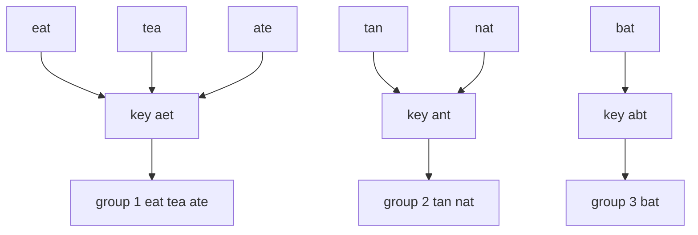
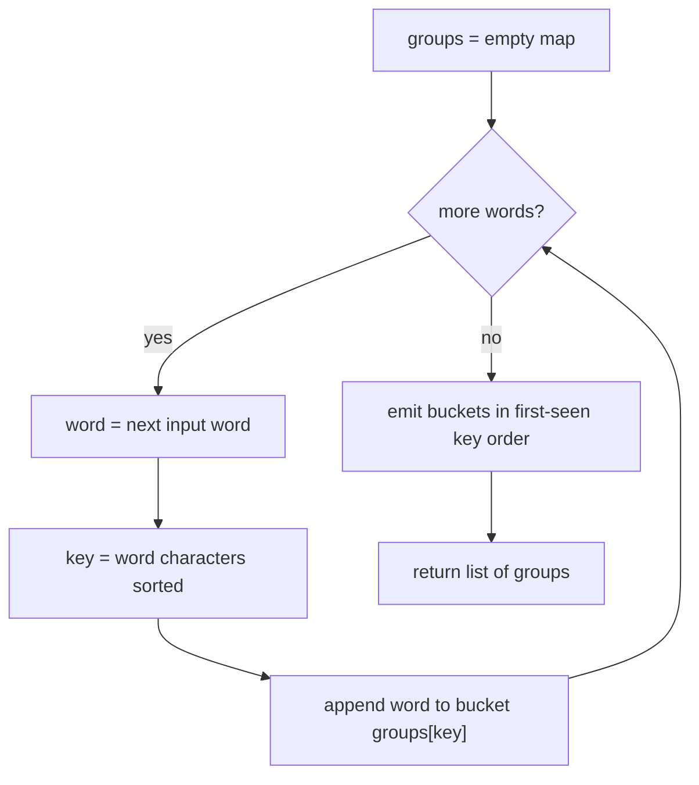
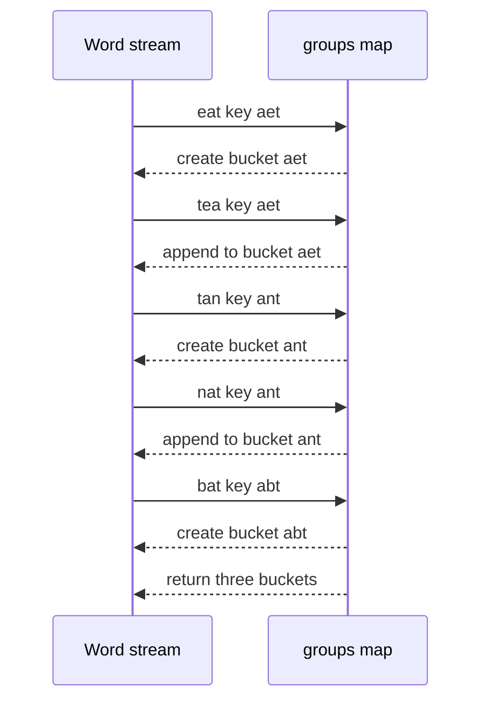

# 233 — Group anagrams (hashmap with sorted key).

> **Tier:** Intermediate · **CTCI chapter:** Ch 10 — Sorting and Searching
> **Task spec:** [233-group-anagrams-hashmap-with-sorted-key.md](../../../tasks/intermediate/233-group-anagrams-hashmap-with-sorted-key.md)
> **Solutions:** [Python](../../../solutions/python/intermediate/233-group-anagrams-hashmap-with-sorted-key/solution.py) ·
> [Java](../../../solutions/java/intermediate/233-group-anagrams-hashmap-with-sorted-key/Solution.java) ·
> [JavaScript](../../../solutions/javascript/intermediate/233-group-anagrams-hashmap-with-sorted-key/solution.js) ·
> [C#](../../../solutions/csharp/intermediate/233-group-anagrams-hashmap-with-sorted-key/Solution.cs)

## 1. Problem restatement

**Input:** a list of `n` words, each of length `L`. Words may repeat, and the empty string is a
legal word.

**Output:** the words partitioned into groups, where two words share a group exactly when one is
an anagram of the other (same characters with the same multiplicities, in any order). The four
solution files pin down two ordering rules that the task title alone does not:

| Rule | Meaning | Where it is asserted |
| --- | --- | --- |
| group order | groups appear in the order their key is **first seen** in the input | `["a", "b", "a"]` gives `[["a", "a"], ["b"]]` |
| word order | inside a group, words keep their **input order** | `["ab", "ba"]` stays `["ab", "ba"]` |

Concrete examples, all taken from the assertions in the solution files:

| Call | Result |
| --- | --- |
| `group_anagrams(["eat", "tea", "tan", "ate", "nat", "bat"])` | `[["eat", "tea", "ate"], ["tan", "nat"], ["bat"]]` |
| `group_anagrams(["listen", "silent", "enlist", "google"])` | `[["listen", "silent", "enlist"], ["google"]]` |
| `group_anagrams(["a", "b", "a"])` | `[["a", "a"], ["b"]]` |
| `group_anagrams([])` | `[]` |
| `group_anagrams([""])` | `[[""]]` |
| `group_anagrams(["ab", "ba", "abc", "cab", "bca"])` | `[["ab", "ba"], ["abc", "cab", "bca"]]` |

The output is deliberately *not* sorted lexicographically: the classic input returns
`tan/nat` before `bat`, because `tan` appears at index 2 while `bat` appears at index 5.

## 2. Intuition

The naive idea is to compare every pair of words: for each word, scan the already built groups and
test membership with a character-count comparison. That is correct but quadratic — `n` words
against up to `n` groups, each test costing `O(L)` or `O(L log L)`, i.e. `O(n² · L)`.

The insight is that "is an anagram of" is an **equivalence relation**, and every equivalence
relation can be implemented with a canonical representative: map each word to a value that is
identical for all anagrams and different otherwise. Sorting the characters is the simplest such
map — `"eat"`, `"tea"` and `"ate"` all sort to `"aet"`, while `"tan"` sorts to `"ant"`. Once you
have that key, grouping is one pass of "append to the bucket named by the key".



The sorting never has to touch the original words: `O(L log L)` work per word buys an `O(1)`
average hash lookup, which turns the pairwise scan into a single pass.

## 3. Algorithm

1. Create an empty map from key (a string of the word's characters in sorted order) to a list of
   words.
2. For each word in input order:
   1. Sort its characters to build the key.
   2. Append the word at the end of the list stored under that key, creating the list first if the
      key is new.
3. Return the lists. The map keeps keys in first-seen order, so the group order is deterministic.

```text
procedure group_anagrams(words)
    groups ← empty map from string to list of strings
    for each word in words do
        key ← characters of word sorted ascending, concatenated
        if key is not in groups then
            groups[key] ← new empty list
        end
        append word to groups[key]
    end
    return the values of groups as a list of lists
end
```

The four languages reach step 3 differently, and the difference is worth knowing:

- Python's `dict` preserves insertion order, so `list(groups.values())` is enough.
- Java uses `LinkedHashMap` for the same guarantee.
- JavaScript's `Map` iterates in insertion order, so `[...groups.values()]` is enough.
- C# `Dictionary` enumerates in an unspecified order, so the C# solution keeps an extra
  `keyOrder` list of keys and emits the groups through it.



## 4. Worked example

Trace the classic input `["eat", "tea", "tan", "ate", "nat", "bat"]`. Each row shows the state
after the word has been placed:

| Step | Word | Key | Groups after the step |
| --- | --- | --- | --- |
| 1 | `eat` | `aet` | `{aet: [eat]}` |
| 2 | `tea` | `aet` | `{aet: [eat, tea]}` |
| 3 | `tan` | `ant` | `{aet: [eat, tea], ant: [tan]}` |
| 4 | `ate` | `aet` | `{aet: [eat, tea, ate], ant: [tan]}` |
| 5 | `nat` | `ant` | `{aet: [eat, tea, ate], ant: [tan, nat]}` |
| 6 | `bat` | `abt` | `{aet: [eat, tea, ate], ant: [tan, nat], abt: [bat]}` |

Returning the buckets in insertion order gives
`[["eat", "tea", "ate"], ["tan", "nat"], ["bat"]]`. Note that step 3 creates the second bucket
before the first bucket is finished — the interleaving is exactly why the output is not sorted.



## 5. Complexity

Let `n` be the number of words and `L` the maximum word length.

| Measure | Bound | Why it holds |
| --- | --- | --- |
| Time, best | O(n · L) | even when every word is already sorted, the sort step still reads all `L` characters |
| Time, average | O(n · L log L) | per word: `O(L log L)` to sort plus `O(L)` to hash the key, and hashing is `O(1)` expected |
| Time, worst | O(n · L log L) | comparison sorting; the solution files quote exactly this bound |
| Space, output | O(n · L) | every input word appears in exactly one group |
| Space, extra | O(n · L) | the map stores one key per distinct group; in the worst case (all words distinct keys) that is `n` keys of length `L` |
| Naive pairwise scan | O(n² · L log L) | for each word, test against every group built so far |

The key itself is where the `log L` comes from, and that is what task 234 removes: a 26-entry
count signature is `O(L)` to build and `O(26)` to hash, which drops the sort entirely. The
trade-off is that the signature assumes a fixed lowercase alphabet.

## 6. Pitfalls and edge cases

- **Empty list.** `n = 0` returns `[]`. The Java file asserts `groupAnagrams(new String[]{}).isEmpty()`.
- **Empty string as a word.** `""` sorts to `""` and forms its own legitimate group; two empty
  words land in the *same* group (`[["", ""]]`), which all four files assert.
- **Duplicates are kept.** Grouping is not deduplication: `["abc", "abc"]` returns
  `[["abc", "abc"]]`, and `["a", "b", "a"]` returns `[["a", "a"], ["b"]]`.
- **Case sensitivity.** Keys are compared by code unit, so `"Eat"` sorts to `"Eat"` and lands in
  a different group from `"eat"` (key `aet`). No case folding, no `toLowerCase` call anywhere in
  the four solutions.
- **Different lengths never mix.** `"ab"` (key `ab`) and `"abc"` (key `abc`) are separate groups
  even though the shorter is a prefix of the longer; the
  `["ab", "ba", "abc", "cab", "bca"]` assertion covers this.
- **The key is a string, not a multiset.** Sorting `"aab"` and `"aba"` both give `"aab"`, but
  sorting is not normalisation for whitespace or punctuation: `"a b"` and `"ab "` are anagrams
  under this key, and the space is just another character.
- **Non-ASCII input.** Java and C# sort UTF-16 code units, JavaScript's spread sorts code points,
  and Python sorts code points; a surrogate pair (emoji) can therefore produce a key that is not
  comparable across languages, but within one language it stays consistent.
- **Null entries.** None of the four files guards against a null word (`Arrays.sort(null)` throws).
  The contract is "a list of strings", so malformed input is out of scope.

## 7. Variants and follow-ups

- **Count signature instead of sorting.** The direct sequel
  [234-group-anagrams-count-signature-as-key.md](../../../tasks/intermediate/234-group-anagrams-count-signature-as-key.md)
  replaces step 2.1 with a 26-slot histogram, which is `O(L)` per word and makes the two
  approaches provably equivalent on lowercase input.
- **Pairwise anagram test.** The beginner task
  [015-check-if-two-strings-are-anagrams.md](../../../tasks/beginner/015-check-if-two-strings-are-anagrams.md)
  is the same canonical-key idea with a single key instead of a map.
- **Hashmap-from-prefix patterns.** Counting keys in a map is also the engine of
  [211-subarray-sum-equals-k-count-hashmap.md](../../../tasks/intermediate/211-subarray-sum-equals-k-count-hashmap.md)
  and
  [210-longest-subarray-with-sum-equal-to-k-with-negatives-using-hashma.md](../../../tasks/intermediate/210-longest-subarray-with-sum-equal-to-k-with-negatives-using-hashma.md),
  where the key is a running sum rather than a sorted word.
- **Frequency counting beyond words.** [389-implement-huffman-coding-for-characters-frequency.md](../../../tasks/intermediate/389-implement-huffman-coding-for-characters-frequency.md)
  builds the same 26-slot histogram for a whole text.
- The chapter walkthrough in [Sorting and Searching](../../ctci/10-sorting-and-searching.md) places
  key-based grouping next to comparison sorting and bucket sort.

## 8. Check yourself

1. Why is the group order "first-seen key order" rather than sorted by key?

<details><summary>Show answer</summary>

Because the map is an insertion-ordered structure (`dict`, `LinkedHashMap`, `Map`, or the explicit
`keyOrder` list in the C# solution) and the result is its `values()` in iteration order. Nothing in
any of the four files sorts the keys, and the asserted output for the classic input —
`tan/nat` before `bat` — proves it.

</details>

2. What is the key for `"listen"`, and why is `"google"` in a separate group?

<details><summary>Show answer</summary>

`"listen"` sorts to `"eilnst"`. `"silent"` and `"enlist"` also sort to `"eilnst"`, so all three
share a bucket. `"google"` sorts to `"eggloo"` (two `g`s, two `o`s), which is a different key, so
it forms its own group — exactly the assertion `[["listen", "silent", "enlist"], ["google"]]`.

</details>

3. Where does the `O(L log L)` factor come from, and which task removes it?

<details><summary>Show answer</summary>

From sorting each word's characters to build the key. Task 234 removes it by using a 26-entry
count signature, which is `O(L)` to compute, leaving `O(n · L)` total — but only for inputs drawn
from a fixed lowercase alphabet.

</details>

4. The four implementations use four different map types. Which one needs extra bookkeeping, and
why?

<details><summary>Show answer</summary>

The C# solution is the only one that needs the extra `keyOrder` list, because
`System.Collections.Generic.Dictionary` does not guarantee enumeration order. Python's `dict`,
Java's `LinkedHashMap` and JavaScript's `Map` all iterate in insertion order on their own.

</details>

5. Does `group_anagrams(["ab", "abc"])` put both words in one group?

<details><summary>Show answer</summary>

No. The keys are `"ab"` and `"abc"`, which differ, so the result is `[["ab"], ["abc"]]`. Anagrams
must have equal length, and the key comparison enforces that automatically because sorting
preserves the character count.

</details>
