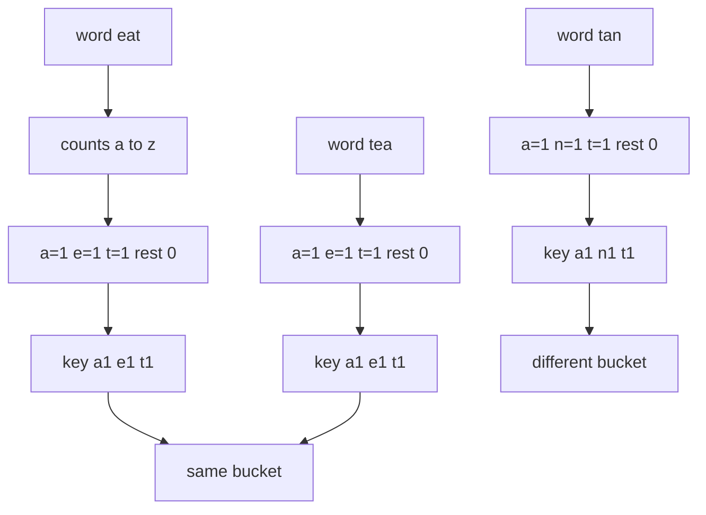
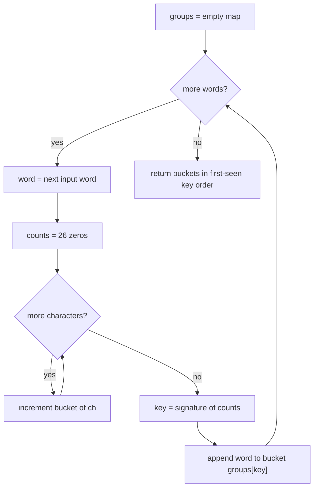
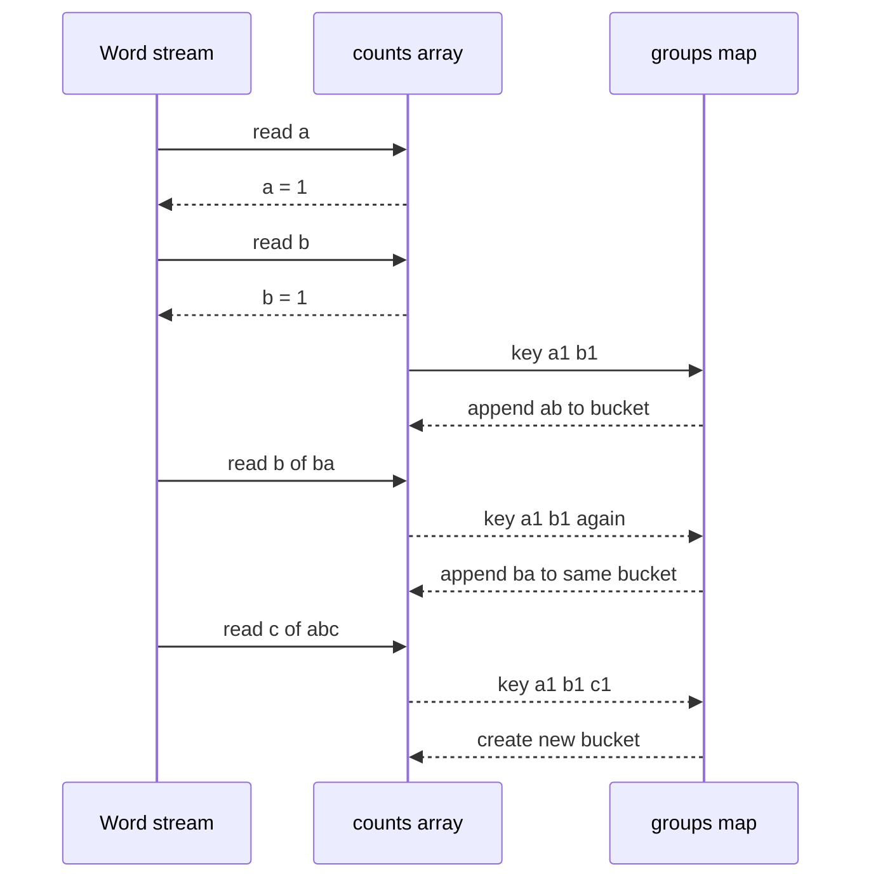

# 234 — Group anagrams (count signature as key).

> **Tier:** Intermediate · **CTCI chapter:** Ch 1 — Arrays and Strings
> **Task spec:** [234-group-anagrams-count-signature-as-key.md](../../../tasks/intermediate/234-group-anagrams-count-signature-as-key.md)
> **Solutions:** [Python](../../../solutions/python/intermediate/234-group-anagrams-count-signature-as-key/solution.py) ·
> [Java](../../../solutions/java/intermediate/234-group-anagrams-count-signature-as-key/Solution.java) ·
> [JavaScript](../../../solutions/javascript/intermediate/234-group-anagrams-count-signature-as-key/solution.js) ·
> [C#](../../../solutions/csharp/intermediate/234-group-anagrams-count-signature-as-key/Solution.cs)

## 1. Problem restatement

**Input:** a list of `n` words over the lowercase alphabet `a`–`z`, each of length `L`. The empty
string is allowed.

**Output:** the words partitioned into anagram groups, with exactly the same ordering rules as
[233-group-anagrams-hashmap-with-sorted-key.md](../../../tasks/intermediate/233-group-anagrams-hashmap-with-sorted-key.md):
groups appear in first-seen key order and words keep their input order inside a group. What changes
is only the key: instead of the word's characters sorted, the key is a 26-entry **count
signature** — how many `a`s, `b`s, … `z`s the word contains.

Because both approaches must be observationally identical, the solution files test them against
each other rather than only against literals:

| Call | Result |
| --- | --- |
| `group_anagrams_signature(["eat", "tea", "tan", "ate", "nat", "bat"])` | `[["eat", "tea", "ate"], ["tan", "nat"], ["bat"]]` |
| `group_anagrams_signature(["ab", "ba", "abc", "cab", "bca"])` | `[["ab", "ba"], ["abc", "cab", "bca"]]` |
| `group_anagrams_signature(["a", "b", "a"])` | `[["a", "a"], ["b"]]` |
| `group_anagrams_signature([""])` | `[[""]]` |
| `group_anagrams_signature([])` | `[]` |

The Python file additionally runs 200 seeded random cases (seed `234`, words over `{a, b, c}`,
lengths `0..6`) asserting `group_anagrams_signature(words) == group_anagrams_sorted(words)`; the
Java, JavaScript and C# files assert the same agreement on a fixed list of inputs.

## 2. Intuition

The previous task's key works because sorting is a canonical form for "multiset of characters".
But building that form costs `O(L log L)` per word, and the comparison of sorted characters is
`O(L)` — work that the anagram test never actually needs. What the test needs is only *equality
of character counts*.

So take the multiset directly: 26 counters, incremented once per character. Two words are
anagrams exactly when their counter arrays are equal, and the array can be hashed as a key just
like the sorted string. Counting is one linear pass per word, and no ordering information is ever
created.



## 3. Algorithm

1. Create an empty map from signature to list of words.
2. For each word in input order:
   1. Allocate 26 zeroed counters.
   2. For each character, increment the counter at `character - 'a'`.
   3. Convert the counter array into a hashable key (a tuple in Python, a comma-joined string in
      Java, JavaScript and C#).
   4. Append the word to the list under that key, creating the list on first sight.
3. Return the lists in first-seen key order.

```text
procedure group_anagrams_signature(words)
    groups ← empty map from signature to list of strings
    for each word in words do
        counts ← array of 26 zeros
        for each character ch in word do
            counts[index_of(ch) - index_of('a')] ← counts[index_of(ch) - index_of('a')] + 1
        end
        key ← signature built from counts
        if key is not in groups then
            groups[key] ← new empty list
        end
        append word to groups[key]
    end
    return the values of groups as a list of lists
end
```

`signature built from counts` is the one place the languages diverge, and it matters for hashing
cost: Python keys on the immutable `tuple(counts)`; Java appends each count plus a `,` to a
`StringBuilder`; JavaScript uses `counts.join(",")`; C# appends to a `StringBuilder` the same way.
A comma-joined string is unambiguous because 26 separate decimal numbers are separated by
delimiters, so `[1, 12]` and `[11, 2]` cannot collide.



## 4. Worked example

Trace `["ab", "ba", "abc"]` with the signature built as a comma-joined lowercase run. Only the
non-zero slots are shown:

| Step | Word | Counters touched | Key fragment | Groups after the step |
| --- | --- | --- | --- | --- |
| 1 | `ab` | `a=1, b=1` | `a1 b1` | `{a1b1: [ab]}` |
| 2 | `ba` | `a=1, b=1` | `a1 b1` | `{a1b1: [ab, ba]}` |
| 3 | `abc` | `a=1, b=1, c=1` | `a1 b1 c1` | `{a1b1: [ab, ba], a1b1c1: [abc]}` |

The result is `[["ab", "ba"], ["abc"]]` — and the sorted-key variant produces the identical answer,
which is the whole point of the agreement assertions: `"ab"` sorts to `"ab"` and `"abc"` sorts to
`"abc"`, so the two keys partition the input the same way.



## 5. Complexity

Let `n` be the number of words, `L` the maximum word length and `A = 26` the alphabet size.

| Measure | Bound | Why it holds |
| --- | --- | --- |
| Time, best | O(n · A) | even one-character words each pay the full signature construction over 26 slots |
| Time, average | O(n · (L + A)) | counting is `O(L)`, key construction is `O(A)`, and the map lookup is `O(A)` expected |
| Time, worst | O(n · (L + A)) | no comparisons and no sorting, so the bound does not degrade |
| Space, output | O(n · L) | every word is stored in exactly one group |
| Space, extra | O(n · A) | one signature per distinct group, plus the map |
| Sorted-key variant (task 233) | O(n · L log L) | the `log L` factor of comparison sorting per word |

With a fixed lowercase alphabet the signature beats sorting for any word longer than a couple of
characters, which is the trade recorded in the file docstrings: "`O(n * L)` time, no sorting".
The honest price is the assumption — see the pitfalls below.

## 6. Pitfalls and edge cases

- **Lowercase only.** The signature models `a`–`z`; the Python file states "Inputs are assumed to
  be lowercase (the signature models only 'a'..'z')". Uppercase would index out of range in Java,
  JavaScript and C#, and would silently wrap in Python, because `counts[ord("A") - ord("a")]` is
  `counts[-31]`.
- **The whole signature is the key.** Two words of different length can never share a signature
  (the counts sum to the length), so `"ab"` and `"abc"` stay apart without an explicit length check.
- **Empty words.** All counters stay zero, the key is the all-zero signature, and every empty
  string lands in one bucket — `["", ""]` gives `[["", ""]]` in both approaches.
- **Duplicates.** `["abc", "abc"]` returns `[["abc", "abc"]]`; nothing deduplicates.
- **Delimiter choice.** Joining counts with `,` is safe; concatenating without a delimiter is not,
  because `[1, 11]` and `[11, 1]` would collide. The Java, JavaScript and C# files all insert the
  separator; Python avoids the issue by keying on a tuple.
- **Ordering is not re-derived.** Because the signature destroys character order, the group order
  and the in-group order both have to come from the map and the input, exactly as in task 233.
- **Signatures are not comparable.** They are equality keys only — you cannot sort words by their
  signature and get anything meaningful back.
- **Randomised agreement checks.** The Python file's 200 random cases are the closest thing to a
  proof of equivalence in the repository; if you change the counting loop, those assertions are
  what catches a mismatch with task 233.

## 7. Variants and follow-ups

- **Sorted key instead of counting.** [233-group-anagrams-hashmap-with-sorted-key.md](../../../tasks/intermediate/233-group-anagrams-hashmap-with-sorted-key.md)
  is the same algorithm with an `O(L log L)` key; the C# and Java files for this task keep a
  second entry point for it purely to run the agreement checks.
- **Single-pair anagram test.** [015-check-if-two-strings-are-anagrams.md](../../../tasks/beginner/015-check-if-two-strings-are-anagrams.md)
  compares two count arrays and never builds a map at all.
- **Signature keys over a moving window.** [211-subarray-sum-equals-k-count-hashmap.md](../../../tasks/intermediate/211-subarray-sum-equals-k-count-hashmap.md)
  uses the same "hashable summary as a key" trick on prefix sums.
- **Histograms at scale.** [389-implement-huffman-coding-for-characters-frequency.md](../../../tasks/intermediate/389-implement-huffman-coding-for-characters-frequency.md)
  builds the identical 26-slot table, and [353-implement-concurrent-hashmap-simplified-sharding.md](../../../tasks/intermediate/353-implement-concurrent-hashmap-simplified-sharding.md)
  shows what happens when the map itself has to be sharded.
- The chapter walkthrough in [Arrays and Strings](../../ctci/01-arrays-and-strings.md) groups this
  task with the other canonical-key problems.

## 8. Check yourself

1. Why does the signature make the group order identical to task 233's sorted-key output?

<details><summary>Show answer</summary>

Because the grouping itself is decided by an equivalence relation that the two keys implement
identically, and both files put the *first* word of a key into the map first. Two words are in the
same group in both variants exactly when they are anagrams, so the sequence of insertions — and
therefore the first-seen order of buckets — is the same. The only difference is the key value.

</details>

2. What happens to the word `"hi!"` in each language?

<details><summary>Show answer</summary>

It is out of contract. In Java, JavaScript and C# the index `'!' - 'a'` is negative, which either
throws (`ArrayIndexOutOfBoundsException` / `IndexOutOfBoundsException`) or writes an unexpected
slot; in Python, `counts[ord('!') - 97]` is `counts[-26]`, which silently wraps around to the last
slot. Task 233's sorted key handles such input correctly, so the two approaches only agree on the
documented lowercase alphabet.

</details>

3. A five-letter word and a four-letter word have identical signatures. Is that possible?

<details><summary>Show answer</summary>

No. The 26 counters sum to the word length, so signatures with different sums cannot be equal. That
is why the signature key encodes length for free, and why the `["ab", "ba", "abc", "cab", "bca"]`
assertion splits into two groups without any explicit length test.

</details>

4. How much extra memory does each word's signature cost, and does it depend on `L`?

<details><summary>Show answer</summary>

26 counters, i.e. `O(A)` with `A = 26`, independent of the word length. The key stored in the map
is the serialised signature — a tuple of 26 ints in Python, or a short comma-joined string in the
other three — so the map holds `O(n · A)` extra space in the worst case of all-distinct keys.

</details>

5. Why is a dictionary-order comparison of the two variants not enough of a test?

<details><summary>Show answer</summary>

Because the outputs are lists of lists in first-seen order, and both variants must produce the same
*order*, not just the same partition. The solution files therefore compare the two functions
directly — on fixed inputs and on 200 seeded random ones — instead of comparing each against a
sorted normalisation.

</details>
