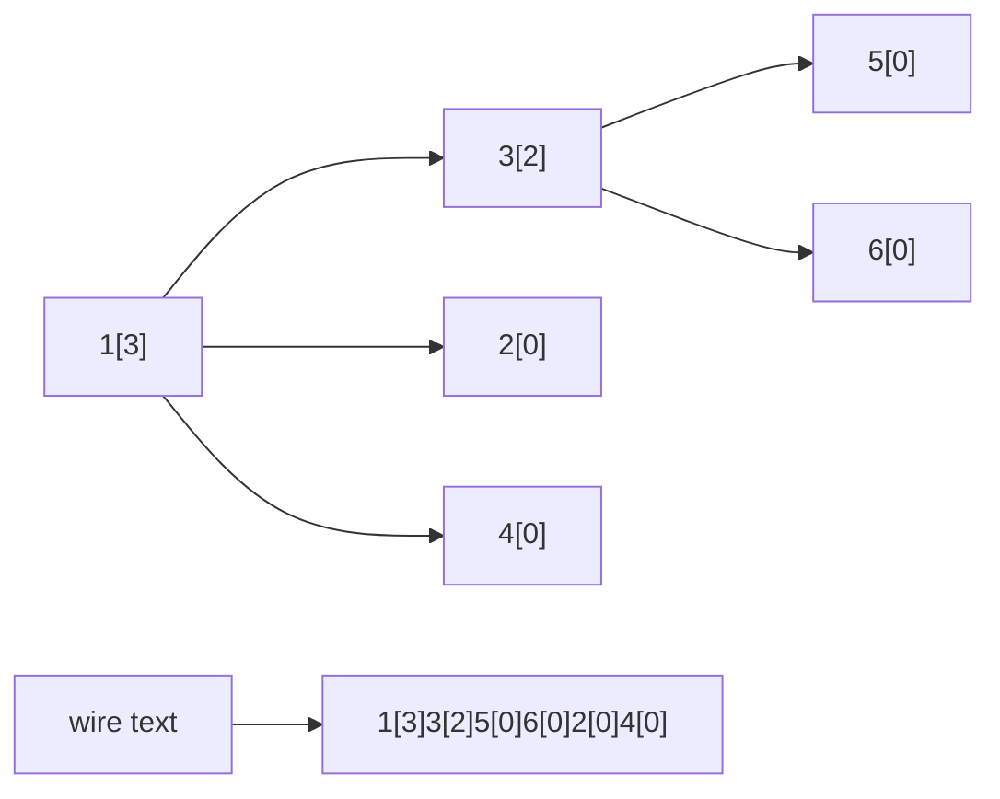
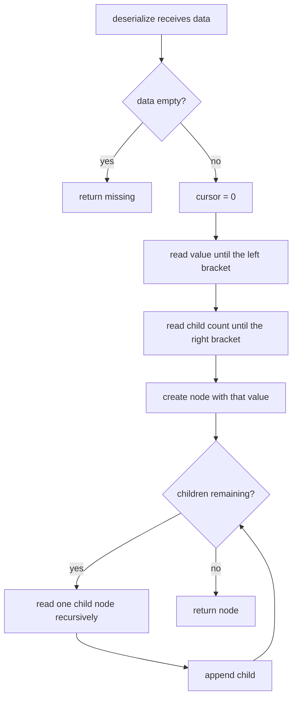
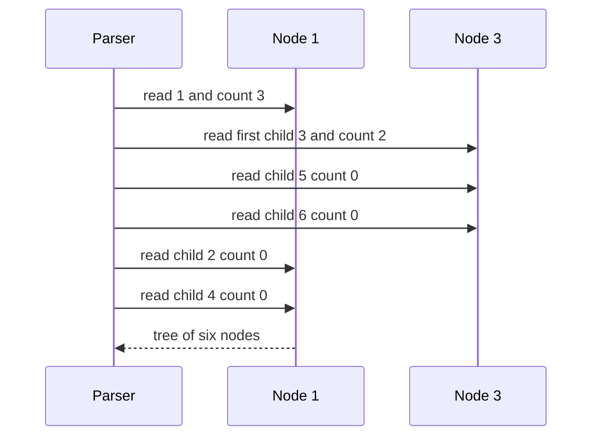

# 235 — Serialize and deserialize N-ary tree.

> **Tier:** Intermediate · **CTCI chapter:** Ch 4 — Trees and Graphs
> **Task spec:** [235-serialize-and-deserialize-n-ary-tree.md](../../../tasks/intermediate/235-serialize-and-deserialize-n-ary-tree.md)
> **Solutions:** [Python](../../../solutions/python/intermediate/235-serialize-and-deserialize-n-ary-tree/solution.py) ·
> [Java](../../../solutions/java/intermediate/235-serialize-and-deserialize-n-ary-tree/Solution.java) ·
> [JavaScript](../../../solutions/javascript/intermediate/235-serialize-and-deserialize-n-ary-tree/solution.js) ·
> [C#](../../../solutions/csharp/intermediate/235-serialize-and-deserialize-n-ary-tree/Solution.cs)

## 1. Problem restatement

**Input:** the root of an N-ary tree (each node holds an integer `val` and an ordered list of
children). Both `serialize` and `deserialize` exist, and `deserialize(serialize(tree))` must
reproduce the tree exactly, children included.

**Output:** `serialize` returns a string; `deserialize` returns the root of an equal tree (or
`None` for the empty tree). The wire format is identical in all four solutions:

    preorder, each node written as value[childCount], then its children in order

| Call | Result |
| --- | --- |
| `serialize(root 1 with children 3, 2, 4, where 3 has children 5, 6)` | `"1[3]3[2]5[0]6[0]2[0]4[0]"` |
| `serialize(None)` | `""` |
| `deserialize("")` | `None` |
| `serialize(single node 42)` | `"42[0]"` |
| `serialize(chain 1 to 50)` | starts with `"1[1]2[1]3[1]"` |
| `serialize(node 1 with ten children 0..9)` | `"1[10]" + "0[0]1[0]2[0]…9[0]"` |
| `serialize(node -5 with child -7)` | `"-5[1]-7[0]"` |

The assertions also check the round trip directly with a `trees_equal` helper that compares values
and children positionally, and a `depth` helper used to confirm that a 50-node chain survives with
depth exactly 50.

## 2. Intuition

The naive serialisation writes a separator between everything — commas between siblings and
explicit null markers for missing children, the way a binary tree needs them. For an N-ary tree
that is wasteful: the child list is bounded by a *written count*, so the format does not have to
be ambiguous in the first place.

Once each node declares how many children follow, a single left-to-right scan is enough: read the
value, read the count, then recursively read exactly that many child subtrees. No separators, no
markers, no lookahead.



The brackets do double duty: they mark where the value ends and, because the count is a finite
token, they make the whole stream self-delimiting.

## 3. Algorithm

Serialisation:

1. If the node is missing, return the empty string.
2. Emit the value, then `[`, then the child count, then `]`.
3. For every child in order, append its serialisation.

Deserialisation:

1. If the input string is empty, return a missing node.
2. Keep a cursor at the current position in the string.
3. Read the value: consume characters until the next `[`.
4. Consume the `[`, then read digits until the next `]`; that number is the child count.
5. Create the node and, for each of the `count` children, recursively read a node.
6. Return the node.

```text
procedure serialize(node)
    if node is missing then
        return ""
    end
    text ← value of node as text followed by "[" followed by child count as text followed by "]"
    for each child in children of node do
        text ← text followed by serialize(child)
    end
    return text
end

procedure deserialize(data)
    if data is empty then
        return missing
    end
    cursor ← 0
    return read_node(data, cursor)

procedure read_node(data, cursor)
    value ← text read from cursor up to the next "["
    cursor ← position after that "["
    count ← number read from cursor up to the next "]"
    cursor ← position after that "]"
    node ← new node with value
    repeat count times
        child ← read_node(data, cursor)
        append child to children of node
    end
    return node
end
```

`cursor` is a mutable position shared by the recursion. Python and Java pass an array or a
one-element holder so the update is visible to the caller; JavaScript uses a closure variable;
C# passes an `int` by reference. The value token is read *up to* the delimiter rather than as a
fixed number of characters, which is what makes multi-digit and negative values work.



## 4. Worked example

Serialise the tree from the docstring: root `1` with children `[3, 2, 4]`, and `3` with children
`[5, 6]`. The parts are emitted in preorder, so the string grows strictly left to right:

| Step | Node visited | Fragment appended | Text so far |
| --- | --- | --- | --- |
| 1 | `1` | `1[3]` | `1[3]` |
| 2 | `3` | `3[2]` | `1[3]3[2]` |
| 3 | `5` | `5[0]` | `1[3]3[2]5[0]` |
| 4 | `6` | `6[0]` | `1[3]3[2]5[0]6[0]` |
| 5 | `2` | `2[0]` | `1[3]3[2]5[0]6[0]2[0]` |
| 6 | `4` | `4[0]` | `1[3]3[2]5[0]6[0]2[0]4[0]` |

Parsing that string back visits the tokens in the same order, and the counts drive the recursion:



Every node is written once and read once, so the two passes are exact inverses; the assertions
`serialize(deserialize(serialize(example))) == serialize(example)` and `trees_equal(...)` pin down
both directions.

## 5. Complexity

Let `n` be the number of nodes and `h` the tree height.

| Measure | Bound | Why it holds |
| --- | --- | --- |
| Time, serialize | O(n) | one append per node plus one concatenation per edge; the docstring states "`O(n)` over the node count" |
| Time, deserialize | O(n) | the cursor only moves forward, and each node consumes one value token and one count token |
| Space, serialize | O(n) | the string length is proportional to the node count (times the width of the values) |
| Space, deserialize | O(n) | one node object per token pair, plus the children lists |
| Recursion depth | O(h) | one frame per level in either direction; the 50-node chain exercises `h = 50` |
| A null-marked format | O(n · h) worst case | binary-style `#` markers cost two extra tokens per node, and a chain of `n` nodes still serialises to `3n` tokens |

The four languages build the string differently — Python joins a list of parts, Java and C# append
to a `StringBuilder`, JavaScript concatenates — but all of them avoid quadratic string growth by
not re-copying the whole result per node.

## 6. Pitfalls and edge cases

- **The empty tree.** `serialize(None)` is `""` and `deserialize("")` is `None`, asserted in all
  four files. Returning `"0[0]"` or throwing here would break the round trip for the empty input.
- **A single node.** `"42[0]"` — the `[0]` is mandatory, otherwise the parser has no way to know
  that the node is a leaf.
- **Multi-digit values and counts.** `50[0]` and `1[10]` are both asserted; a parser that reads a
  fixed-width token (say one character) breaks on them. Reading up to the delimiter is required.
- **Negative values.** `-5[1]-7[0]` is asserted; the minus sign is simply part of the value token.
- **Child order.** Children are emitted and rebuilt in list order, so `[3, 2, 4]` stays
  `[3, 2, 4]`. A `trees_equal` that ignored order would pass a broken implementation.
- **Deep chains.** The 50-node chain checks that recursion depth equal to the tree height is
  acceptable; a million-node chain would blow the stack in every one of the four languages.
- **Malformed input is unguarded.** `"1[2]"` claims two children that are not present; the scanner
  runs off the end of the string and raises an index error rather than returning a partial tree.
  None of the files validates the format, and the contract does not ask for it.
- **No escaping problem.** Values are integers, so the delimiters `[` and `]` can never appear
  inside a token — the ambiguity that would otherwise need escaping simply cannot arise.

## 7. Variants and follow-ups

- **Binary trees with explicit null markers.** [245-reconstruct-binary-tree-from-preorder-with-null-markers.md](../../../tasks/intermediate/245-reconstruct-binary-tree-from-preorder-with-null-markers.md)
  parses the preorder-plus-`#` form, the format you need when child slots are fixed at two.
- **The naive binary serialiser.** [148-serialize-and-deserialize-binary-tree-preorder.md](../../../tasks/beginner/148-serialize-and-deserialize-binary-tree-preorder.md)
  is the same idea with markers instead of counts.
- **Omitting markers entirely.** [246-serialize-deserialize-binary-search-tree-compactly.md](../../../tasks/intermediate/246-serialize-deserialize-binary-search-tree-compactly.md)
  shows that a BST needs neither counts nor markers, because the value range bounds each subtree.
- **Traversal order.** [139-level-order-traversal-bfs-of-tree.md](../../../tasks/beginner/139-level-order-traversal-bfs-of-tree.md)
  is the breadth-first counterpart that would serialise the same tree level by level.
- The chapter walkthrough in [Trees and Graphs](../../ctci/04-trees-and-graphs.md) places
  serialisation next to the traversal and reconstruction tasks.

## 8. Check yourself

1. Why is the child count written even when it is zero?

<details><summary>Show answer</summary>

Because the parser decides whether to recurse purely from that number. Without `[0]`, a leaf and a
node whose subtree follows are indistinguishable, and the scan would have no stopping condition
for the child list. All four files emit the count unconditionally.

</details>

2. How does the parser handle `1[10]` without a separator between `1` and `10`?

<details><summary>Show answer</summary>

The value token ends at the first `[`, and the count token ends at the first `]`. Reading "up to
the delimiter" rather than a fixed width means `10[0]` parses as the value `10` with count `0`,
while `1[10]` parses as the value `1` with count `10`.

</details>

3. What is the recursion depth of `serialize` on a chain of 50 nodes, and why does the file test
that case?

<details><summary>Show answer</summary>

50 frames, one per node, because each call returns only after its children (here a single child)
are serialised. The test asserts `depth(chain) == 50` and that
`depth(deserialize(serialize(chain))) == 50`, which is the assertion that catches an off-by-one or a
lost tail of a deep chain.

</details>

4. Does the format need a separator such as a comma?

<details><summary>Show answer</summary>

No. Every token boundary is a bracket, and the number of children is explicit, so the stream is
self-delimiting. Adding commas would only inflate the string — a point the binary-tree variant in
task 245 cannot make, since it must distinguish a missing child from a value.

</details>

5. The 10-child assertion is `"1[10]" + "0[0]1[0]…9[0]"`. What would an implementation that
special-cases single-digit counts do here?

<details><summary>Show answer</summary>

It would misread `1[10]` — either treating the count as `1` and leaving `0[0]` to be parsed as a
child, or reading the value as `1` and then failing on the stray `0`. The assertion exists exactly
to force multi-digit count handling, and it also re-checks that all ten children come back in
ascending order.

</details>
