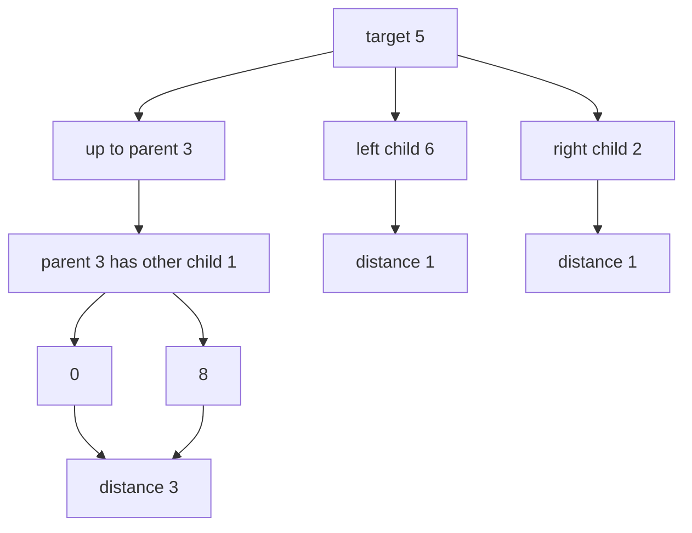
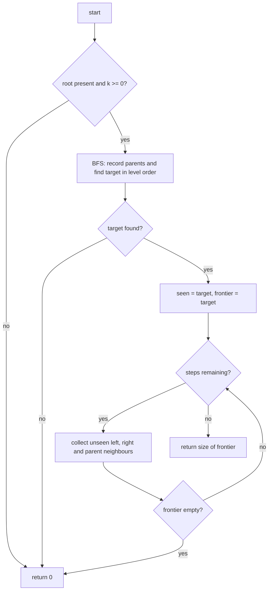
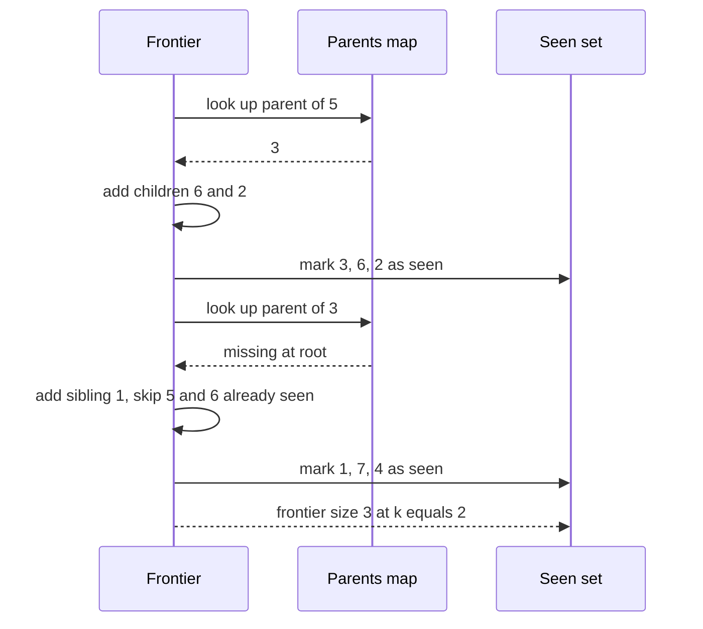

# 236 — Count nodes at distance K from target in binary tree.

> **Tier:** Intermediate · **CTCI chapter:** Ch 4 — Trees and Graphs
> **Task spec:** [236-count-nodes-at-distance-k-from-target-in-binary-tree.md](../../../tasks/intermediate/236-count-nodes-at-distance-k-from-target-in-binary-tree.md)
> **Solutions:** [Python](../../../solutions/python/intermediate/236-count-nodes-at-distance-k-from-target-in-binary-tree/solution.py) ·
> [Java](../../../solutions/java/intermediate/236-count-nodes-at-distance-k-from-target-in-binary-tree/Solution.java) ·
> [JavaScript](../../../solutions/javascript/intermediate/236-count-nodes-at-distance-k-from-target-in-binary-tree/solution.js) ·
> [C#](../../../solutions/csharp/intermediate/236-count-nodes-at-distance-k-from-target-in-binary-tree/Solution.cs)

## 1. Problem restatement

**Input:** the root of a binary tree, a `target` value, and a non-negative integer `k`. Distance
counts **edges**, so `k = 0` means the target itself.

**Output:** how many nodes sit exactly `k` edges away from the target. In a tree there is exactly
one simple path between any two nodes, so "distance" is unambiguous — but the path may go *up*
through ancestors and then *down* into a sibling subtree, not just downward.

The solution files fix three conventions that the one-line task title does not state:

| Convention | Behaviour |
| --- | --- |
| repeated values | the **first** node with `val == target` in level order is used |
| missing target | return `0` |
| `k` beyond the tree diameter | return `0` (no node is that far) |

Examples from the assertions, all on the classic tree
`[3, 5, 1, 6, 2, 0, 8, null, null, 7, 4]`:

| Call | Result | Why |
| --- | --- | --- |
| `count(root, 5, 0)` | `1` | the target itself |
| `count(root, 5, 1)` | `3` | `{3, 6, 2}` — parent plus two children |
| `count(root, 5, 2)` | `3` | `{1, 7, 4}` — one up then down, and both grandchildren |
| `count(root, 5, 3)` | `2` | `{0, 8}` — reached through `1` |
| `count(root, 3, 2)` | `4` | `{6, 2, 0, 8}` |
| `count(root, 99, 1)` | `0` | target not present |
| `count(skewed chain, 1, 3)` | `1` | deepest node of the chain `1-2-3-4` |
| `count(null, 1, 0)` | `0` | empty tree |

## 2. Intuition

The naive reading is "walk `k` edges down from the target", which is wrong the moment the target is
not the root: at distance 3 from node `5` you must climb to `3`, then down to `1`, then down to
`0` and `8`. A pure top-down recursion would have to re-descend from every ancestor.

Once you notice that an undirected tree is just a graph with a unique path between nodes, the
problem becomes a plain breadth-first radiation: from a node you can step to `left`, to `right`,
and — the step that is missing from ordinary tree traversals — to the `parent`. The tree is still
acyclic, so you never need to worry about revisiting through a different route; you only need a
`seen` set to stop yourself from walking back into the node you came from.



The catch is that stepping to `parent` requires knowing the parent of every node, which a top-down
traversal does not give you: node `3` never learns that `5` is its child. So the algorithm needs
one preparatory pass that records the parent of every node — a standard level-order BFS.

## 3. Algorithm

1. If the tree is empty or `k < 0`, return `0`.
2. Level-order BFS from the root, recording `parent[child] = node` for every child, and remembering
   the **first** node whose value equals `target` (the first one popped in level order).
3. If no such node was found, return `0`.
4. Start a frontier containing just the target and a `seen` set containing it.
5. Repeat `k` times: for each node in the frontier, look at its `left`, `right` and `parent`, add
   every neighbour that is present and not yet `seen` to the next frontier.
6. If the frontier ever becomes empty before all `k` steps are done, return `0` — no node is that
   far away.
7. After the `k`-th step, return the size of the frontier: those are exactly the nodes at distance
   `k`.

```text
procedure count_nodes_at_distance(root, target_value, k)
    if root is missing or k < 0 then
        return 0
    end
    parent ← map from node to node, with parent[root] ← missing
    target ← missing
    queue ← [root]
    while queue is not empty do
        node ← remove front of queue
        if target is missing and value of node equals target_value then
            target ← node
        end
        for each child in (left of node, right of node) do
            if child is present then
                parent[child] ← node
                append child to queue
            end
        end
    end
    if target is missing then
        return 0
    end
    seen ← {target}
    frontier ← [target]
    repeat k times
        next ← empty list
        for each node in frontier do
            for each nxt in (left of node, right of node, parent[node]) do
                if nxt is present and nxt is not in seen then
                    add nxt to seen
                    append nxt to next
                end
            end
        end
        frontier ← next
        if frontier is empty then
            return 0
        end
    end
    return length of frontier
end
```

The `seen` set is what makes the walk terminate: without it, stepping from a node to its parent and
back is an infinite loop. With it, each node enters the frontier at most once, so the second phase
is `O(n)` in total.



## 4. Worked example

Tree (level-order `[3, 5, 1, 6, 2, 0, 8, null, null, 7, 4]`), target `5`, `k = 2`:

    level 0:            3
    level 1:        5       1
    level 2:      6   2   0   8
    level 3:        7   4

Phase 1 records the parents: `5 -> 3`, `1 -> 3`, `6 -> 5`, `2 -> 5`, `0 -> 1`, `8 -> 1`, `7 -> 2`,
`4 -> 2`, and finds the target `5` (the second node in level order).

Phase 2 radiates from `5`:

| Step | Frontier entering | Neighbours inspected | Frontier after the step |
| --- | --- | --- | --- |
| 1 | `5` | parent `3`, left `6`, right `2` | `3, 6, 2` |
| 2 | `3, 6, 2` | from `3`: parent missing, children `5`, `1`; from `6`: parent `5`; from `2`: parent `5`, children `7`, `4` | `1, 7, 4` |

The frontier after step 2 has three nodes, so the count is `3` — the assertion
`count_nodes_at_distance(classic, 5, 2) == 3`. Notice that `5` and the already-seen nodes are
skipped, which is what keeps the frontier from oscillating.



## 5. Complexity

Let `n` be the node count, `h` the height, and `k` the requested distance.

| Measure | Bound | Why it holds |
| --- | --- | --- |
| Time, best | O(n) | the parent pass always visits every node; the docstring states "`O(n)` time" |
| Time, average | O(n) | the radiation pass visits each node at most once, and `k` cannot exceed `n - 1` before the frontier dies |
| Time, worst | O(n) | rooted tree, so no cycles and no repeated work thanks to `seen` |
| Space, extra | O(n) | the `parent` map, the `seen` set, and the queue all hold at most `n` references |
| Space, worst frontier | O(n) | a star-shaped tree puts `n - 1` nodes at distance 1 |
| Reference brute force | O(n · h) | the `brute_count` helper stores a full root path per node and compares prefixes to compute distances |

The brute-force helper is worth reading: it computes the distance between two nodes as
`(len(path) - common) + (len(target_path) - common)`, where `common` is the length of the shared
prefix of the two root paths. The Python file cross-checks the BFS answer against it for every
`k` from `0` to `n + 2` over 200 random pruned trees, which is what makes the two-phase BFS safe to
trust.

## 6. Pitfalls and edge cases

- **`k = 0`.** The answer is `1` whenever the target exists (the target counts itself) and `0`
  when it does not — both asserted.
- **Empty tree.** `count(null, 1, 0)` is `0`; the emptiness check happens before any map is built.
- **Negative `k`.** Guarded explicitly (`k < 0` returns `0`) even though the spec calls `k`
  non-negative.
- **Missing target.** The target is only discovered during the parent pass; if it never appears,
  the function returns `0` without starting the radiation.
- **`k` beyond the diameter.** The frontier empties mid-walk and returns `0` early instead of
  finishing all `k` iterations — the `count(root, 5, 10)` and `count(skewed, 1, 4)` assertions.
- **Repeated values.** "First in level order" is a deliberate tie-break; `[1, 2, 1]` with target `1`
  picks the root, giving `2` nodes at distance 1 (both children) and `0` at distance 2. A
  depth-first search would pick the other `1` and produce different counts.
- **Null children are not nodes.** `parent[child]` is only written for present children, and the
  radiation loop skips missing neighbours, so a missing child never enters the frontier.
- **The `seen` set is mandatory.** Without it, the walk alternates between a node and its parent
  forever; the `k`-step loop bounds the iterations but the frontier would then contain duplicates
  and the count would be wrong.
- **Parent map memory.** The map is `O(n)`, which is the price of being able to walk upward. The
  alternative — path-based distance computation — is `O(n · h)`, exactly the brute-force helper's
  bound.

## 7. Variants and follow-ups

- **Nodes at distance `k` in a general graph.** [268-word-ladder-shortest-transformation-bfs.md](../../../tasks/intermediate/268-word-ladder-shortest-transformation-bfs.md)
  and [274-check-if-graph-is-bipartite-bfs-coloring.md](../../../tasks/intermediate/274-check-if-graph-is-bipartite-bfs-coloring.md)
  use the same frontier BFS, but with real neighbour lists instead of a parent pointer.
- **Reading the tree level by level.** [139-level-order-traversal-bfs-of-tree.md](../../../tasks/beginner/139-level-order-traversal-bfs-of-tree.md)
  is the first phase on its own; [240-sum-of-nodes-at-each-level-level-order.md](../../../tasks/intermediate/240-sum-of-nodes-at-each-level-level-order.md)
  is the same pass with an accumulator.
- **Height and diameter.** [140-max-depth-of-binary-tree.md](../../../tasks/beginner/140-max-depth-of-binary-tree.md)
  gives the bound after which this walk is guaranteed to return `0`.
- **Longest paths instead of counts.** [241-maximum-path-sum-in-binary-tree-any-path.md](../../../tasks/intermediate/241-maximum-path-sum-in-binary-tree-any-path.md)
  also reasons about paths that bend at a node, but optimises a sum rather than radiating a
  frontier.
- The chapter walkthrough in [Trees and Graphs](../../ctci/04-trees-and-graphs.md) covers both the
  downward and the upward direction of tree walks.

## 8. Check yourself

1. Why is a single downward recursion not enough for this problem?

<details><summary>Show answer</summary>

Because the target need not be the root: paths may go up through ancestors and then down into a
different subtree. At distance 3 from node `5` the only reachable nodes are `0` and `8`, which are
found by climbing to `3` and descending through `1`. A downward-only walk from `5` never reaches
them.

</details>

2. What exactly does the `seen` set prevent, given that a tree has no cycles?

<details><summary>Show answer</summary>

It prevents walking back along the edge you just used — for example from `5` to `3` and immediately
from `3` back to `5`. Or, seen from the undirected graph's point of view, the parent edge *is* a
cycle of length two. Without `seen`, the frontier would contain duplicates and the count at exactly
`k` steps would be wrong.

</details>

3. The Python file cross-checks against `brute_count`. What is that helper's time complexity, and
why keep it?

<details><summary>Show answer</summary>

`brute_count` stores a full root-to-node path for every node and compares the two paths element by
element, which is `O(n · h)` — worse than the BFS. It stays in the file as an independent oracle:
the randomised test compares both answers for every `k` from `0` to `n + 2`, so a subtle bug in the
parent map or the `seen` handling shows up as a mismatch rather than as a plausible-looking number.

</details>

4. On the chain `1-2-3-4` with target `1`, why is the count at `k = 3` exactly `1`?

<details><summary>Show answer</summary>

Because the chain has four nodes, so the farthest node from the root is `4` at distance 3 and there
is exactly one such node. The assertion `count_nodes_at_distance(skewed, 1, 3) == 1` also confirms
that a tree with no branching still radiates correctly.

</details>

5. Two nodes have the same value as the target. Which one is used, and where is that decision
implemented?

<details><summary>Show answer</summary>

The first one in level order. The decision lives in the parent-recording pass: the target is only
assigned when `target` is still missing, and nodes are dequeued in BFS order, so the shallowest
leftmost candidate wins. The `[1, 2, 1]` assertions (`2` at distance 1, `0` at distance 2) pin the
behaviour down.

</details>
