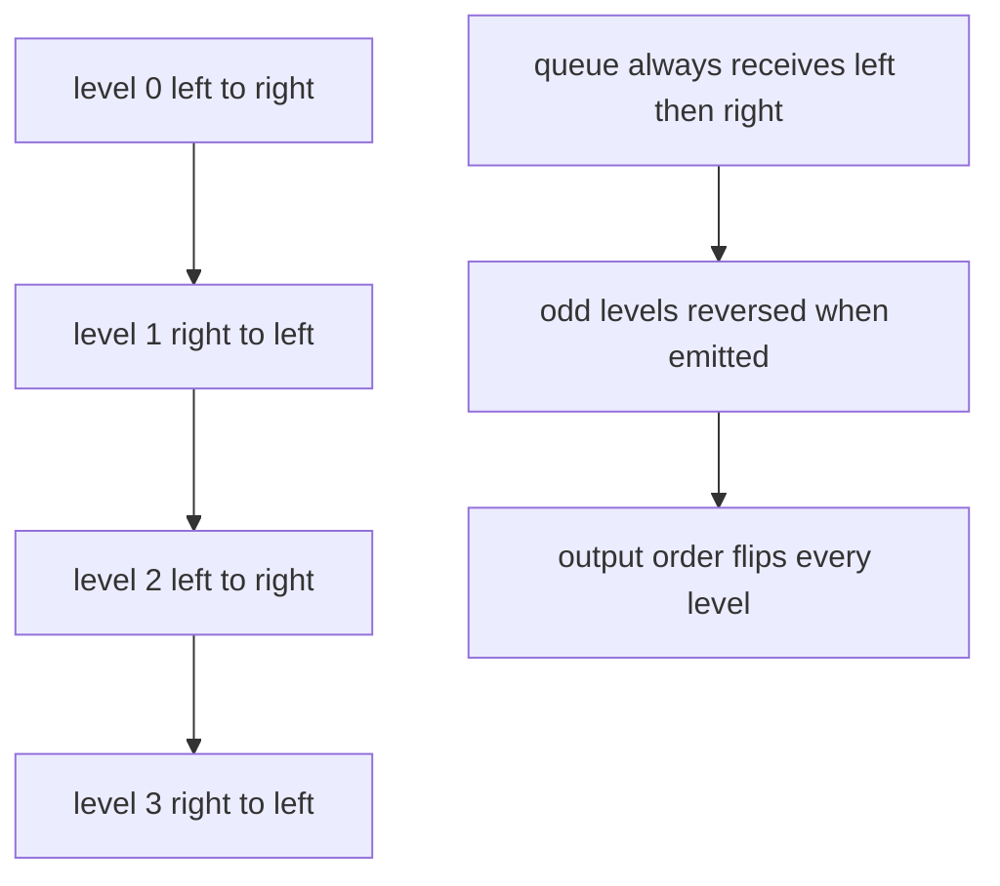
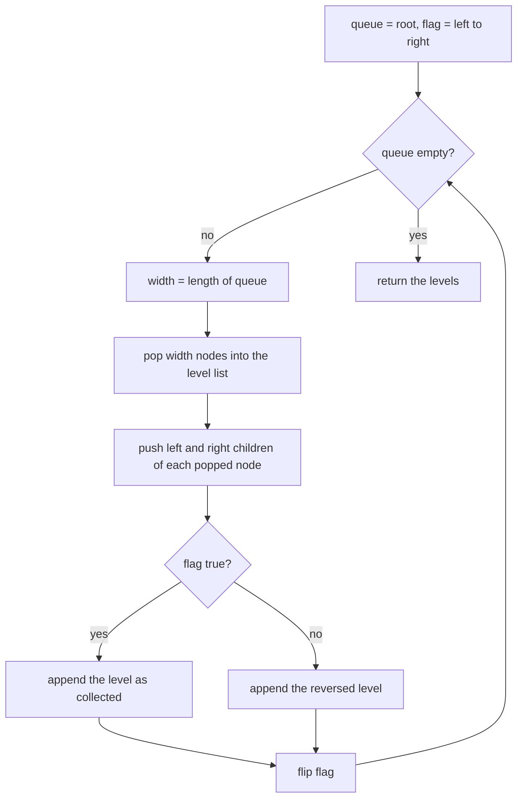
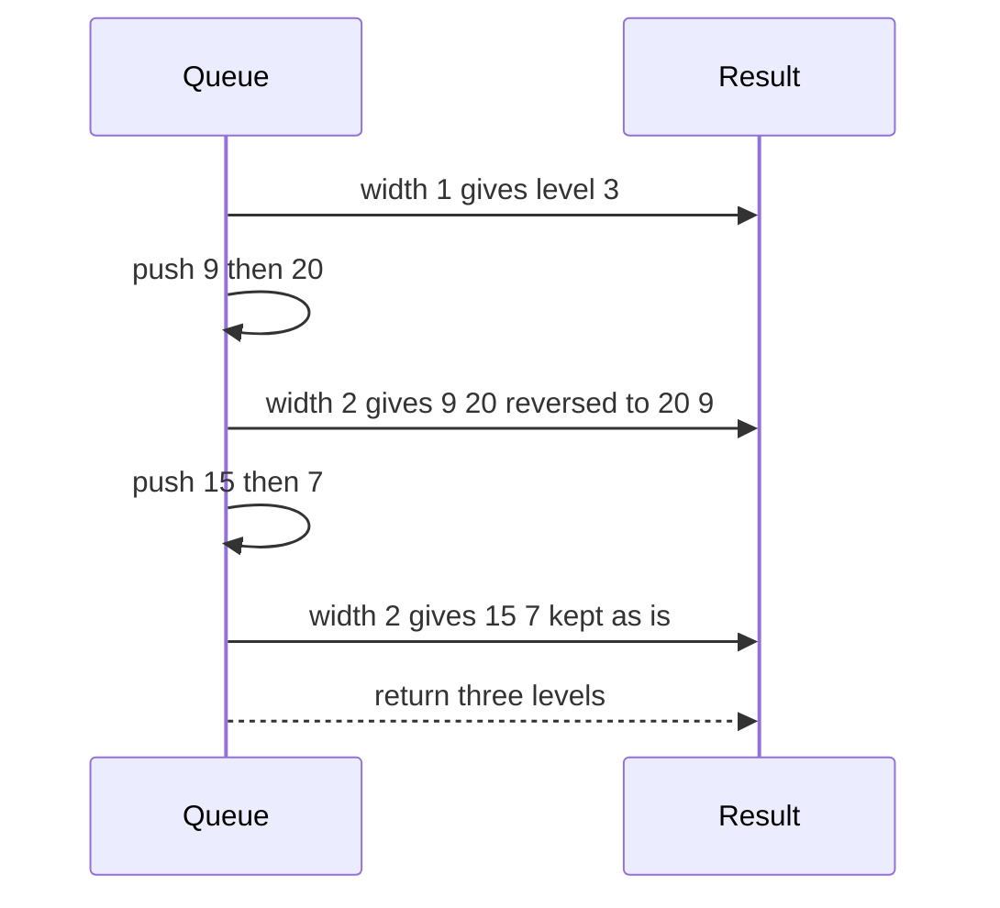

# 237 — Binary tree zigzag level order traversal.

> **Tier:** Intermediate · **CTCI chapter:** Ch 4 — Trees and Graphs
> **Task spec:** [237-binary-tree-zigzag-level-order-traversal.md](../../../tasks/intermediate/237-binary-tree-zigzag-level-order-traversal.md)
> **Solutions:** [Python](../../../solutions/python/intermediate/237-binary-tree-zigzag-level-order-traversal/solution.py) ·
> [Java](../../../solutions/java/intermediate/237-binary-tree-zigzag-level-order-traversal/Solution.java) ·
> [JavaScript](../../../solutions/javascript/intermediate/237-binary-tree-zigzag-level-order-traversal/solution.js) ·
> [C#](../../../solutions/csharp/intermediate/237-binary-tree-zigzag-level-order-traversal/Solution.cs)

## 1. Problem restatement

**Input:** the root of a binary tree. Each level of the output is a separate list.

**Output:** the node values level by level, where level 0 is written left to right, level 1 right
to left, level 2 left to right again, and so on — the direction alternates with the level index
(0-based). The empty tree yields `[]`.

| Call | Result |
| --- | --- |
| `zigzag_level_order([3, 9, 20, null, null, 15, 7])` | `[[3], [20, 9], [15, 7]]` |
| `zigzag_level_order([1, 2, 3, 4, 5, 6, 7])` | `[[1], [3, 2], [4, 5, 6, 7]]` |
| `zigzag_level_order([1, 2, 3, 4, null, null, 5])` | `[[1], [3, 2], [4, 5]]` |
| `zigzag_level_order([1])` | `[[1]]` |
| `zigzag_level_order([1, 2])` | `[[1], [2]]` |
| `zigzag_level_order(null)` | `[]` |

The tree notation `[3, 9, 20, null, null, 15, 7]` is the level-order build helper used by all four
files: `null` marks a missing child slot.

## 2. Intuition

Plain level-order traversal is a queue plus a loop. Zigzag only changes how each finished level is
*read out*, not which nodes belong to it — so the temptation is to flood-fill while flipping the
child-push order, pushing right before left on odd levels. That works, but it couples two unrelated
decisions: which children exist (a property of the tree) and in which order they are reported (a
property of the output).

The cheaper separation is: always push left then right, always collect the level in that natural
order, and then reverse the collected list on odd levels. Reversing a list of length `w` costs
`O(w)`, and the total over all levels is `O(n)` — the same as the traversal itself.



The one thing the naive "just a queue" version *cannot* do is tell where a level ends. That is why
every level starts by snapshotting `len(queue)` and popping exactly that many nodes.

## 3. Algorithm

1. If the root is missing, return an empty list.
2. Put the root in a queue and set a flag `left_to_right = true`.
3. While the queue is not empty:
   1. `width ← len(queue)` — the number of nodes on the current level.
   2. Pop `width` nodes, appending each value to a fresh level list and pushing present children
      (left first, then right).
   3. Append the level list to the result, reversed when `left_to_right` is false.
   4. Flip `left_to_right`.
4. Return the result.

```text
procedure zigzag_level_order(root)
    if root is missing then
        return empty list
    end
    levels ← empty list
    queue ← [root]
    left_to_right ← true
    while queue is not empty do
        width ← length of queue
        level ← empty list
        repeat width times
            node ← remove front of queue
            append value of node to level
            if left of node is present then append left of node to queue end
            if right of node is present then append right of node to queue end
        end
        if left_to_right then
            append level to levels
        else
            append reversed(level) to levels
        end
        left_to_right ← not left_to_right
    end
    return levels
end
```

The snapshot `width ← length of queue` is the load-bearing line: children pushed during the loop
must not be counted as part of the current level. Every one of the four files is built on it.



## 4. Worked example

Trace the classic input `[3, 9, 20, null, null, 15, 7]`, which builds this tree — `9` and `20` are
the children of `3`, the two `null` slots are `9`'s children, and `15` and `7` are `20`'s children:

    3
    ├── 9
    └── 20
        ├── 15
        └── 7

| Step | `width` | Level collected | Flag before | Level appended | Queue after |
| --- | --- | --- | --- | --- | --- |
| 1 | 1 | `[3]` | left to right | `[3]` | `9, 20` |
| 2 | 2 | `[9, 20]` | right to left | `[20, 9]` | `15, 7` |
| 3 | 2 | `[15, 7]` | left to right | `[15, 7]` | empty |

Step 3 is the assertion
`zigzag_level_order(build_tree([3, 9, 20, None, None, 15, 7])) == [[3], [20, 9], [15, 7]]`: the
queue drained in exactly three levels, and only the middle one was flipped.



## 5. Complexity

Let `n` be the node count and `w` the maximum level width.

| Measure | Bound | Why it holds |
| --- | --- | --- |
| Time, best | O(n) | every node is enqueued once and dequeued once; the docstring states "`O(n)` time" |
| Time, average | O(n) | the per-level reversal adds at most `w` steps per level, which sums to at most `n` |
| Time, worst | O(n) | reversing costs `O(w)` per level and `sum(w) = n` for a tree |
| Space, extra | O(w) | the queue holds at most one level plus the next; a perfect tree peaks at `n / 2 + 1` |
| Space, output | O(n) | the result contains every value exactly once |
| Depth-first alternative | O(n) with `O(h)` stack | a DFS can place each value directly at its index, but it needs the level index and the row position, which the BFS gives for free |

## 6. Pitfalls and edge cases

- **Empty tree.** `None` returns `[]`, not `[[]]`. Python and the other three files assert it.
- **Single node.** One level, never reversed: `[[1]]`.
- **Ragged levels.** Missing children are simply not enqueued, so a level can be shorter than the
  one above. `[1, 2, 3, 4, null, null, 5]` gives `[[1], [3, 2], [4, 5]]` — note the level-2 list
  holds four values because the two `null` slots in the middle are absent from the queue, not
  placeholders in the output.
- **Reversal happens on the values, not on the pushes.** The queue always receives left then right;
  only the finished level is flipped. Mixing the two strategies can double-reverse an odd level and
  silently produce the plain order.
- **The flag must flip every level**, including levels of width 1; otherwise the parity drifts and
  the assertion `[[1], [20, 9], [15, 7]]` fails on the second level.
- **Level width is captured before popping.** Reading `len(queue)` inside the loop would count
  freshly pushed children and merge levels.
- **A single-element level is unchanged by reversal.** That is why `[[1], [2]]` is a useful
  assertion: it checks the iteration count, not the flip.
- **Values, not nodes.** The output contains integers; nothing is mutated, so the same tree can be
  traversed again.

## 7. Variants and follow-ups

- **Plain level order.** [139-level-order-traversal-bfs-of-tree.md](../../../tasks/beginner/139-level-order-traversal-bfs-of-tree.md)
  is this traversal with the reversal removed.
- **Per-level aggregation.** [240-sum-of-nodes-at-each-level-level-order.md](../../../tasks/intermediate/240-sum-of-nodes-at-each-level-level-order.md)
  reuses the width snapshot to collapse each level into one number.
- **Column-major output.** [238-binary-tree-vertical-order-traversal.md](../../../tasks/intermediate/238-binary-tree-vertical-order-traversal.md)
  keeps the same BFS but buckets by a column index instead of by level.
- **Level by level with next pointers.** [239-connect-next-pointers-in-each-node-perfect-binary-tree.md](../../../tasks/intermediate/239-connect-next-pointers-in-each-node-perfect-binary-tree.md)
  builds the level links that make a queue unnecessary.
- The chapter walkthrough in [Trees and Graphs](../../ctci/04-trees-and-graphs.md) presents the four
  traversal families side by side.

## 8. Check yourself

1. What breaks if you read the queue length inside the popping loop instead of before it?

<details><summary>Show answer</summary>

The loop would keep popping nodes that belong to the next level, because pushing a child grows the
queue. Levels would merge and the reversal flag would apply to the wrong set of values. The
snapshot `width ← length of queue` must be taken before any child is pushed.

</details>

2. Why is reversing the finished level equivalent to pushing children in the opposite order?

<details><summary>Show answer</summary>

Because a level is exactly the multiset of children pushed while the previous level was popped, and
the previous level was itself visited in a uniform order. Flipping the collected list of a level
produces the same sequence as visiting that level in the opposite direction. The difference is
only in *when* the work happens — and the reversal is easier to reason about because the push order
stays constant.

</details>

3. For a perfect tree with 7 nodes, why is level 2 emitted as `[4, 5, 6, 7]` while level 1 is
`[3, 2]`?

<details><summary>Show answer</summary>

Because the flag starts `true` at level 0 and flips once per level: level 0 is kept as collected,
level 1 is reversed, level 2 is kept. The assertion
`zigzag_level_order([1, 2, 3, 4, 5, 6, 7]) == [[1], [3, 2], [4, 5, 6, 7]]` checks exactly that
alternation.

</details>

4. How much extra memory does the queue use on a complete tree of `n` nodes?

<details><summary>Show answer</summary>

`O(w)` where `w` is the widest level. On a complete tree the last level holds about half the nodes,
so the peak is `O(n)`; the deque never holds more than the current level plus the next one. The
output adds `O(n)` values, but no per-node auxiliary structure is allocated.

</details>

5. Does the algorithm need to know the height of the tree in advance?

<details><summary>Show answer</summary>

No. The loop terminates when the queue empties, and the flag flips once per emitted level, so the
parity is derived from the traversal rather than from a precomputed height. That is why a skewed
tree such as `[1, 2, null, 3, null, 4]` (levels of width 1) still alternates correctly — though
with width 1 the reversal has no visible effect.

</details>
