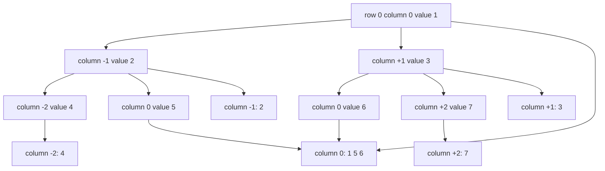
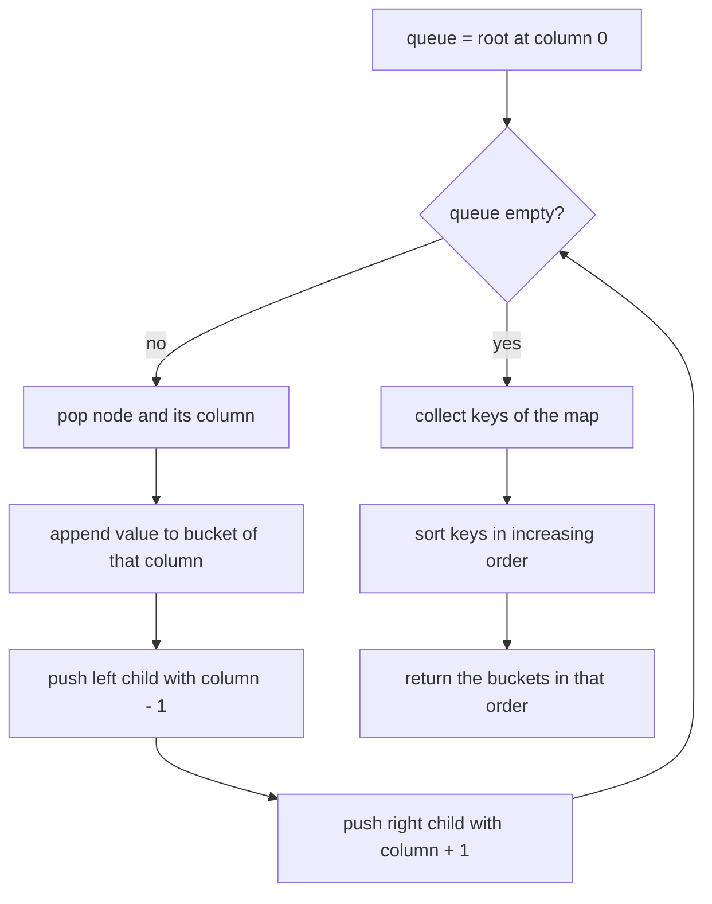
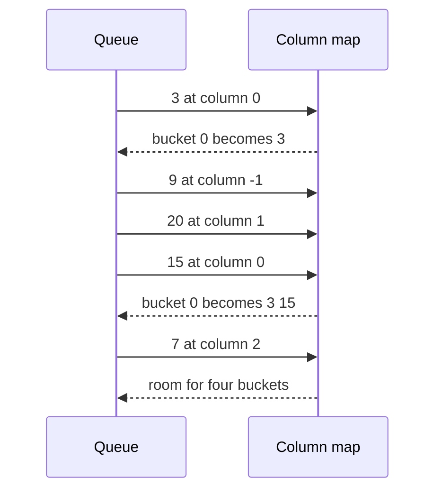

# 238 — Binary tree vertical order traversal.

> **Tier:** Intermediate · **CTCI chapter:** Ch 4 — Trees and Graphs
> **Task spec:** [238-binary-tree-vertical-order-traversal.md](../../../tasks/intermediate/238-binary-tree-vertical-order-traversal.md)
> **Solutions:** [Python](../../../solutions/python/intermediate/238-binary-tree-vertical-order-traversal/solution.py) ·
> [Java](../../../solutions/java/intermediate/238-binary-tree-vertical-order-traversal/Solution.java) ·
> [JavaScript](../../../solutions/javascript/intermediate/238-binary-tree-vertical-order-traversal/solution.js) ·
> [C#](../../../solutions/csharp/intermediate/238-binary-tree-vertical-order-traversal/Solution.cs)

## 1. Problem restatement

**Input:** the root of a binary tree.

**Output:** the node values grouped into vertical columns, where the root sits in column 0, a left
child moves one column left and a right child one column right. Columns are emitted in increasing
column order (so the leftmost column comes first); inside a column, values are ordered
**top to bottom**, and nodes on the same row are ordered **left to right**.

| Call | Result |
| --- | --- |
| `vertical_order([3, 9, 20, null, null, 15, 7])` | `[[9], [3, 15], [20], [7]]` |
| `vertical_order([1, 2, 3, 4, 5, 6, 7])` | `[[4], [2], [1, 5, 6], [3], [7]]` |
| `vertical_order([3, 9, 20, null, null, 15, 7, 8, 11])` | `[[9, 8], [3, 15], [20, 11], [7]]` |
| `vertical_order(chain 1-2-3-4)` | `[[4], [3], [2], [1]]` |
| `vertical_order([5])` | `[[5]]` |
| `vertical_order(null)` | `[]` |

The docstrings state the tie-breaking rule explicitly: "level order makes each column read
top-to-bottom, and BFS visits same-row nodes left-to-right, which settles the ties".

## 2. Intuition

Column assignment is a pure function of the path from the root: every step left decrements the
column, every step right increments it. So the whole problem is "annotate each node with a column
index, then bucket by index".

The interesting part is the order *inside* a bucket, and this is where the traversal choice pays
off. A depth-first descent visits a whole left subtree before touching the right one, so a node in
row 5 can be recorded before its column-mate in row 1. A breadth-first traversal has exactly the
properties the output needs: nodes are produced row by row (top to bottom of any column) and,
within a row, strictly left to right. Collecting in BFS order and appending to per-column lists
therefore produces the required order with no sorting inside the buckets.



Row 2 contains two nodes in column 0 (`5` and `6`), and BFS reaches `5` before `6` because `5` is
the left child of `2` while `6` is the left child of `3`. That left-to-right ordering is the tie
breaker, and it is why the centre column of the perfect tree is `[1, 5, 6]`.

## 3. Algorithm

1. If the root is missing, return an empty list.
2. Create an empty map from column index to list of values, and a queue holding `(root, 0)`.
3. While the queue is not empty:
   1. Pop `(node, column)`.
   2. Append the node's value to the list under `column`, creating it on first sight.
   3. Push `(node.left, column - 1)` and `(node.right, column + 1)` when those children exist.
4. Return the buckets, taking the map's keys in increasing column order.

```text
procedure vertical_order(root)
    if root is missing then
        return empty list
    end
    columns ← empty map from integer column to list of values
    queue ← [(root, 0)]
    while queue is not empty do
        (node, column) ← remove front of queue
        if column is not in columns then
            columns[column] ← new empty list
        end
        append value of node to columns[column]
        if left of node is present then append (left of node, column - 1) to queue end
        if right of node is present then append (right of node, column + 1) to queue end
    end
    return the lists of columns[key] for each key in increasing order
end
```

Step 4 is the only place a comparison happens, and it is a sort over the *distinct* columns, not
over the nodes — at most `n` keys, and often far fewer than `n` because columns are shared.



## 4. Worked example

Trace the classic tree `[3, 9, 20, null, null, 15, 7]` — root `3`, children `9` and `20`, and `20`
has children `15` and `7`:

    3
    ├── 9
    └── 20
        ├── 15
        └── 7

| Step | Node popped | Column | Bucket written | Buckets so far |
| --- | --- | --- | --- | --- |
| 1 | `3` | 0 | 0 → `[3]` | `{0: [3]}` |
| 2 | `9` | -1 | -1 → `[9]` | `{0: [3], -1: [9]}` |
| 3 | `20` | +1 | 1 → `[20]` | `{0: [3], -1: [9], 1: [20]}` |
| 4 | `15` | 0 | 0 → `[3, 15]` | `{0: [3, 15], -1: [9], 1: [20]}` |
| 5 | `7` | 2 | 2 → `[7]` | `{0: [3, 15], -1: [9], 1: [20], 2: [7]}` |

Sorting the keys `-1, 0, 1, 2` and reading the buckets gives `[[9], [3, 15], [20], [7]]`. Notice
that column 0 receives `15` while `3` is already there: the bucket spans two rows, and BFS order is
what puts the shallower node first.



## 5. Complexity

Let `n` be the node count and `c` the number of distinct columns (`c ≤ n`).

| Measure | Bound | Why it holds |
| --- | --- | --- |
| Time, best | O(n) | the BFS touches every node once; the docstring quotes `O(n log n)` overall |
| Time, average | O(n log n) | the column keys are sorted; every node is appended exactly once |
| Time, worst | O(n log n) | the `O(n)` traversal is dominated by the `O(c log c)` sort, and `c` can be `n` for a chain |
| Space, extra | O(n) | the map holds every value, the queue holds at most one level plus the next |
| Space, output | O(n) | the result is a permutation of the node values |
| Sorted-DFS cross-check | O(n log n) | the `vertical_order_sorted` helper sorts `(column, row, preorder index)` triples and must agree |

The Python file's `vertical_order_sorted` helper exists purely as an independent oracle: it
recursively records `(column, row, preorder index)` for every node, sorts the triples and groups
them by column. It is compared against the BFS answer on the fixed cases and on 200 random pruned
trees, which is the evidence that "BFS order equals sorted-DFS order" for this traversal.

## 6. Pitfalls and edge cases

- **Negative columns.** The leftmost column of a chain is column `-(n - 1)`. An implementation that
  stores buckets in an array indexed by column must first compute the minimum column as an offset;
  the four solutions all use a real map and sort the keys instead.
- **Same column, different rows.** Ordering inside a bucket is by row first, and BFS provides that
  automatically — a depth-first collection would need an explicit row field to sort by.
- **Same row *and* same column is possible.** In a perfect tree of 7 nodes, `5` is reached by
  left-then-right and `6` by right-then-left, so both sit in row 2, column 0. BFS reaches `5`
  first (it is the left child of `2`, while `6` is the left child of `3`), which is what makes the
  centre column `[1, 5, 6]` rather than `[1, 6, 5]`.
- **Empty tree.** `vertical_order(None)` is `[]`; the root check happens before the map is created.
- **Single node.** `[[5]]` — one bucket, and the sort is trivial.
- **Chains collapse to `n` buckets.** `[1, 2, null, 3, null, 4]` yields `[[4], [3], [2], [1]]`;
  each bucket has exactly one value, so ordering inside buckets never applies.
- **Ragged trees.** Missing children are simply not enqueued; no column is reserved for them, which
  is why `[9, 8]` appears as a two-row bucket in the deeper example.
- **BFS is a correctness requirement, not an optimisation.** Swapping the queue for a stack keeps
  the column assignment correct but reorders values inside the buckets, and several assertions
  would fail.
- **Column bound.** Columns always lie in `[-(h), h]` where `h` is the height, so the sorted key
  count is bounded by `2h + 1`.

## 7. Variants and follow-ups

- **Level-major output.** [237-binary-tree-zigzag-level-order-traversal.md](../../../tasks/intermediate/237-binary-tree-zigzag-level-order-traversal.md)
  is the sibling traversal that buckets by row instead of by column, with the same BFS skeleton.
- **Per-row aggregation.** [240-sum-of-nodes-at-each-level-level-order.md](../../../tasks/intermediate/240-sum-of-nodes-at-each-level-level-order.md)
  keeps the row index and collapses each row to a sum.
- **Plain BFS.** [139-level-order-traversal-bfs-of-tree.md](../../../tasks/beginner/139-level-order-traversal-bfs-of-tree.md)
  is the traversal without any bucketing.
- **Left-to-right links between same-row nodes.** [239-connect-next-pointers-in-each-node-perfect-binary-tree.md](../../../tasks/intermediate/239-connect-next-pointers-in-each-node-perfect-binary-tree.md)
  materialises the row order that this task only reads.
- The chapter walkthrough in [Trees and Graphs](../../ctci/04-trees-and-graphs.md) pairs horizontal
  and vertical traversals.

## 8. Check yourself

1. Why does the algorithm not need to sort nodes inside a column?

<details><summary>Show answer</summary>

Because BFS emits a shallower node before a deeper one (row order) and, within a row, emits nodes
left to right. Appending in that order is exactly the required order for the bucket, so the only
sort needed is over the column keys.

</details>

2. What is the result for the chain `[1, 2, null, 3, null, 4]`, and why is each bucket a single
value?

<details><summary>Show answer</summary>

`[[4], [3], [2], [1]]`. The chain descends to the left, so the columns are `-3, -2, -1, 0` and each
column is visited by exactly one node. The assertion in the files pins this down for both the BFS
and the sorted helper.

</details>

3. Where does the `log` in `O(n log n)` come from, and can it be removed?

<details><summary>Show answer</summary>

From sorting the distinct column keys. It can be avoided by tracking the minimum and maximum column
during the traversal and iterating the closed range in increasing order, which is `O(n)` time and
`O(1)` extra work beyond the range itself. The shipped solutions keep the sort because it needs no
extra state and the docstring quotes `O(n log n)`.

</details>

4. The centre column of the perfect 7-node tree is `[1, 5, 6]`. Explain each value's origin.

<details><summary>Show answer</summary>

`1` is the root at column 0. `5` is the left child of `2`, which itself is one column left of the
root — so the left step is undone by the right step. `6` is the left child of `3`, which is one
column right of the root, and its left step brings it back to column 0. BFS reaches `1`, then `5`,
then `6`, so the bucket reads top to bottom and left to right.

</details>

5. What does the `vertical_order_sorted` helper add beyond the BFS result?

<details><summary>Show answer</summary>

It is an independent implementation of the same specification: it computes `(column, row, preorder
index)` per node with a DFS and sorts those triples. Because it shares no code path with the BFS,
agreement on the fixed cases and 200 randomised trees is real evidence that the BFS ordering is
deterministic and correct rather than accidentally right.

</details>
