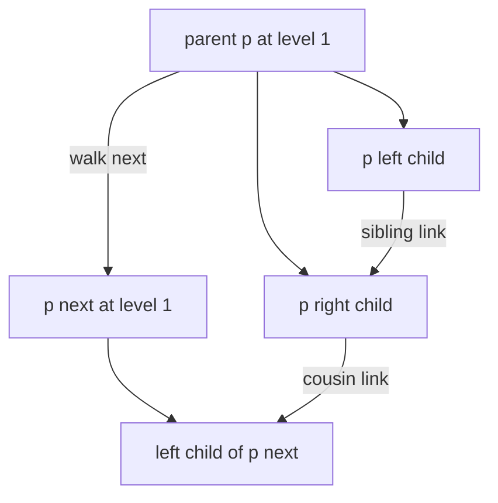
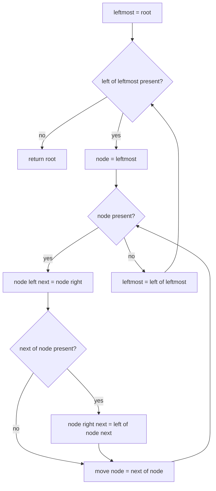
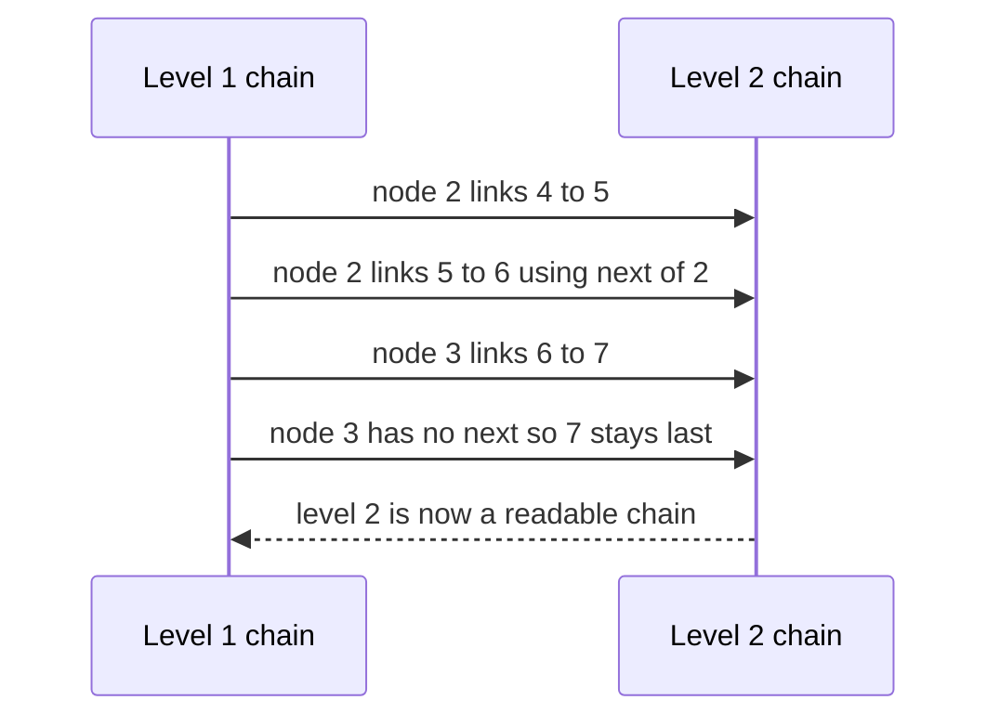

# 239 — Connect next pointers in each node (perfect binary tree).

> **Tier:** Intermediate · **CTCI chapter:** Ch 4 — Trees and Graphs
> **Task spec:** [239-connect-next-pointers-in-each-node-perfect-binary-tree.md](../../../tasks/intermediate/239-connect-next-pointers-in-each-node-perfect-binary-tree.md)
> **Solutions:** [Python](../../../solutions/python/intermediate/239-connect-next-pointers-in-each-node-perfect-binary-tree/solution.py) ·
> [Java](../../../solutions/java/intermediate/239-connect-next-pointers-in-each-node-perfect-binary-tree/Solution.java) ·
> [JavaScript](../../../solutions/javascript/intermediate/239-connect-next-pointers-in-each-node-perfect-binary-tree/solution.js) ·
> [C#](../../../solutions/csharp/intermediate/239-connect-next-pointers-in-each-node-perfect-binary-tree/Solution.cs)

## 1. Problem restatement

**Input:** the root of a **perfect** binary tree — every internal node has two children, and all
leaves are on the same level. Each node has a `next` field, initially missing.

**Output:** the same tree with every `next` pointing at the node's right neighbour on its level, or
missing for the last node of a level. The docstring calls this "the classic solution uses `O(1)`
extra space".

| Call | Result |
| --- | --- |
| `connect(build_tree([1, 2, 3, 4, 5, 6, 7]))` | levels read through `next`: `[[1], [2, 3], [4, 5, 6, 7]]` |
| `root.next` | missing |
| `root.left.next` | `root.right` |
| `root.left.left.next` | `root.left.right` |
| `root.left.right.next` | `root.right.left` |
| `root.right.left.next` | `root.right.right` |
| `connect(single node 1)` | `[[1]]`, `next` stays missing |
| `connect(null)` | `null` |
| `connect(15-node perfect tree)` | four levels of widths `1, 2, 4, 8` |
| `connect(root)` called twice | second call changes nothing |

The assertions use a `levels_via_next` helper that walks `next` chains from the leftmost node of
each level and **fails fast** if a chain is longer than expected, which is how a doubled or looping
link would be caught.

## 2. Intuition

The straightforward approach is a level-order BFS that remembers the previous node on the level and
sets `previous.next = current`. It is correct and simple, but the queue costs `O(w)` space, where
`w` is the widest level — on a perfect tree that is about `n / 2`.

The `O(1)` insight is that once a level's `next` chain exists, it *is* the queue. You can walk the
parent level as a linked list and set the children's links as you go, so the only state you need is
one pointer to the leftmost node of the current level and one pointer walking along it.

For a parent `p`, its two children are adjacent, so `p.left.next = p.right`. The only non-obvious
link is the "cousin" edge: `p.right` must point at `p.next.left`, i.e. the left child of the parent's
right neighbour. That single line is the reason the parent level has to be traversed through `next`
rather than through a queue.



Every link on a level comes from one of exactly two rules: a sibling link inside one parent, or a
cousin link between two neighbouring parents.

## 3. Algorithm

1. If the root is missing, return it.
2. Let `leftmost = root`.
3. While `leftmost.left` exists — i.e. the current level has children:
   1. Let `node = leftmost`.
   2. While `node` is present:
      1. Set `node.left.next = node.right` (sibling link).
      2. If `node.next` is present, set `node.right.next = node.next.left` (cousin link).
      3. Move to `node.next`.
   3. Set `leftmost = leftmost.left` and repeat for the next level.
4. Return the root.

```text
procedure connect(root)
    if root is missing then
        return missing
    end
    leftmost ← root
    while left of leftmost is present do
        node ← leftmost
        while node is present do
            left of node.next ← right of node
            if next of node is present then
                right of node.next ← left of next of node
            end
            node ← next of node
        end
        leftmost ← left of leftmost
    end
    return root
end
```

The recursion is a loop over levels plus a loop over parents, and the inner pointer `node` advances
through a chain that was completed on the previous iteration of the outer loop. Because the outer
loop descends only when the whole level has been linked, the `next` pointers of the parent level are
always ready before they are read.



## 4. Worked example

Trace the perfect tree `[1, 2, 3, 4, 5, 6, 7]`:

    1
    ├── 2
    │   ├── 4
    │   └── 5
    └── 3
        ├── 6
        └── 7

Level 0 is the root alone. The loop starts by linking level 2 using level 1's chain:

| Outer step | `leftmost` | Inner `node` | Link written | Rule |
| --- | --- | --- | --- | --- |
| 1 | `2` | `2` | `2.left.next = 2.right` → `4 → 5` | sibling |
| 1 | `2` | `2` | `2.next` is `3`, so `2.right.next = 3.left` → `5 → 6` | cousin |
| 1 | `2` | `3` | `3.left.next = 3.right` → `6 → 7` | sibling |
| 1 | `2` | `3` | `3.next` is missing, so no cousin link — `7.next` stays missing | level end |
| 2 | `4` | `4` | `4.left` is missing, so the outer loop stops | last level |

After the run, `levels_via_next(root)` returns `[[1], [2, 3], [4, 5, 6, 7]]`: exactly one node
starts each chain (`1`, `2`, `4`) and each chain is terminated by a missing `next`.



## 5. Complexity

Let `n` be the node count, `w` the widest level and `h` the height (`h = log2(n + 1)` for a perfect
tree).

| Measure | Bound | Why it holds |
| --- | --- | --- |
| Time, best | O(n) | every node's links are written exactly once |
| Time, average | O(n) | each level is walked once; the total number of visited parents is `n - 1` |
| Time, worst | O(n) | no node is revisited: the inner loop stops when `node` becomes missing |
| Space, extra | O(1) | two pointers (`leftmost`, `node`); the docstring calls this the point of the algorithm |
| Space, output | O(n) | the `next` fields themselves, one per node |
| BFS alternative | O(w) space | a queue holding the level plus the next; about `n / 2` on a perfect tree |

The `O(1)` claim holds only for perfect (or at least complete-enough) trees where "descend to
`leftmost.left`" lands on a node with both children. Shrinking inputs would need a small amount of
extra bookkeeping, which is why the task statement pins the input shape.

## 6. Pitfalls and edge cases

- **Perfect input is a precondition.** The outer loop condition `leftmost.left is present` assumes
  every internal node has two children; a node with only a right child would be skipped silently.
- **The level ends must stay missing.** `3.next` is missing, so no cousin link is written for `7`,
  and the assertion `root.right.right.next is None` checks it. Linking to the next level's first
  node is the classic bug here.
- **Empty tree.** `connect(None)` returns `None` — Python asserts `connect(None) is None`.
- **Single node.** The outer loop condition fails immediately, so `1.next` stays missing and the
  helper returns `[[1]]`.
- **Order of the two links matters.** The cousin link needs `node.next`, which was set while
  processing the *parent* level; the sibling link needs nothing but `node` itself. Writing them in
  the order above keeps `node.next` valid at the moment it is read.
- **Idempotency.** Calling `connect` twice must not change anything; the file asserts
  `levels_via_next(again) == [[1], [2, 3], [4, 5, 6, 7]]` after a second call on the same root,
  which catches an implementation that appends to a chain instead of assigning a single link.
- **Chain loops.** `levels_via_next` walks each chain with a length cap and raises if a chain is
  longer than expected, so a `next` pointer that loops back is an immediate failure rather than an
  infinite loop.
- **No queue, no visited set.** Because the level chain is the only structure being walked and each
  link is written once, there is no need for any deduplication.
- **`n` is `2^(h+1) - 1`.** The 15-node assertion checks the four-level case, including a level of
  width 8 whose last node must terminate the chain.

## 7. Variants and follow-ups

- **Same-row neighbours, read instead of written.** [238-binary-tree-vertical-order-traversal.md](../../../tasks/intermediate/238-binary-tree-vertical-order-traversal.md)
  reproduces the left-to-right order that these links encode, but pays `O(w)` for a queue.
- **Level-order traversal.** [139-level-order-traversal-bfs-of-tree.md](../../../tasks/beginner/139-level-order-traversal-bfs-of-tree.md)
  is the straightforward queue version of the same walk.
- **Per-level aggregation.** [240-sum-of-nodes-at-each-level-level-order.md](../../../tasks/intermediate/240-sum-of-nodes-at-each-level-level-order.md)
  consumes levels rather than linking them.
- **Flattening instead of linking levels.** [242-convert-binary-tree-to-doubly-linked-list-inorder.md](../../../tasks/intermediate/242-convert-binary-tree-to-doubly-linked-list-inorder.md)
  reuses `left`/`right` as `prev`/`next` on a single list, the in-order analogue of this task.
- The chapter walkthrough in [Trees and Graphs](../../ctci/04-trees-and-graphs.md) discusses when
  traversal pointers can replace auxiliary structures.

## 8. Check yourself

1. Which two rules generate every link, and which one needs the parent level's `next` chain?

<details><summary>Show answer</summary>

The sibling rule `node.left.next = node.right` (both children of one parent are adjacent) and the
cousin rule `node.right.next = node.next.left`, which needs the parent's right neighbour. The
cousin rule is the only reason the parent level must be walkable through `next`.

</details>

2. Why does the algorithm not need a queue even though it visits level by level?

<details><summary>Show answer</summary>

Because the `next` chain of a level *is* a queue: it lists the level's nodes in order, and it is
built one level ahead of when it is used. The outer loop holds only the leftmost node of the parent
level, and the inner loop walks it with a single pointer, so the extra space is `O(1)`.

</details>

3. What has to be true about the input for the `leftmost.left` condition to be safe?

<details><summary>Show answer</summary>

That every node with children has *both* children — i.e. the tree is perfect, as the task statement
says. If a node had only a right child, `leftmost.left` would be missing while children still exist
below, and the loop would stop early, leaving real nodes unlinked.

</details>

4. The file asserts `root.left.right.next is root.right.left`. Which node was `node` when that link
was written, and what was `node.next`?

<details><summary>Show answer</summary>

`node` was `2` (`root.left`) and `node.next` was `3` (`root.right`). The cousin rule set
`node.right.next = node.next.left`, i.e. `5.next = 6`. The assertion is the direct expression of
that one line.

</details>

5. How would the answer change if the tree were only *complete* rather than perfect?

<details><summary>Show answer</summary>

The sibling and cousin rules still hold for nodes that have both children, but the outer loop
cannot simply descend through `leftmost.left`, because the leftmost node of a level may be a leaf
while other nodes on that level are not. You would need to find the next level's first parent (for
example by walking the current chain for the first node with a child), and the missing-child
branches would have to be guarded — the `O(1)` space still works, at the cost of a few more checks.

</details>
