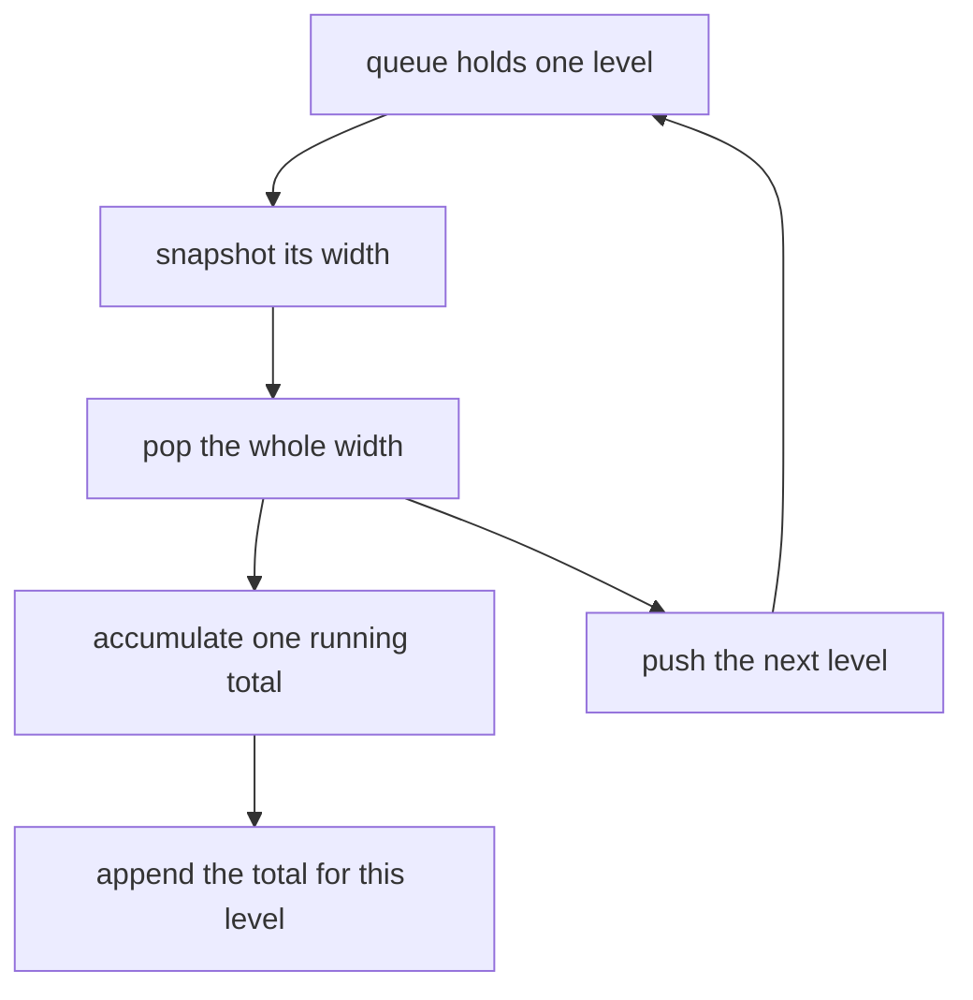
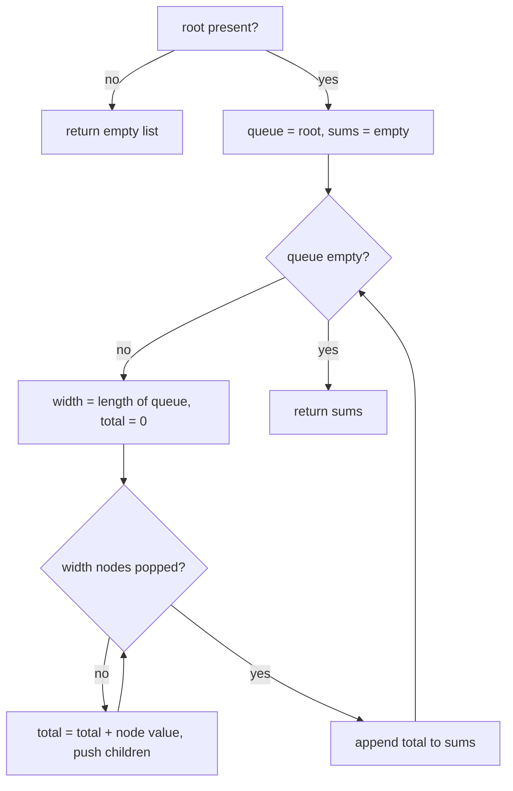
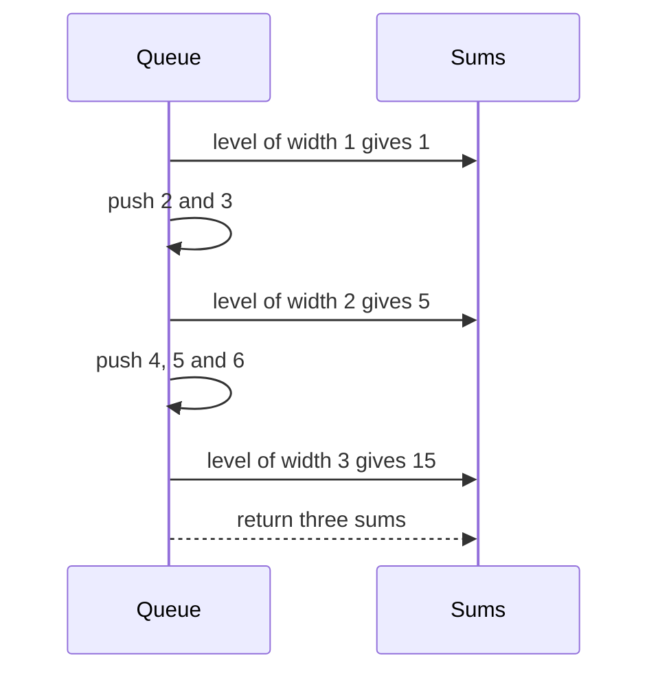

# 240 — Sum of nodes at each level (level order).

> **Tier:** Intermediate · **CTCI chapter:** Ch 4 — Trees and Graphs
> **Task spec:** [240-sum-of-nodes-at-each-level-level-order.md](../../../tasks/intermediate/240-sum-of-nodes-at-each-level-level-order.md)
> **Solutions:** [Python](../../../solutions/python/intermediate/240-sum-of-nodes-at-each-level-level-order/solution.py) ·
> [Java](../../../solutions/java/intermediate/240-sum-of-nodes-at-each-level-level-order/Solution.java) ·
> [JavaScript](../../../solutions/javascript/intermediate/240-sum-of-nodes-at-each-level-level-order/solution.js) ·
> [C#](../../../solutions/csharp/intermediate/240-sum-of-nodes-at-each-level-level-order/Solution.cs)

## 1. Problem restatement

**Input:** the root of a binary tree whose node values may be negative, zero, or all equal.

**Output:** one integer per level, in top-to-bottom order, where each integer is the sum of the
values of the nodes on that level. The empty tree yields `[]`.

| Call | Result | Levels |
| --- | --- | --- |
| `level_sums([1, 2, 3, 4, 5, null, 6])` | `[1, 5, 15]` | `{1}`, `{2, 3}`, `{4, 5, 6}` |
| `level_sums([1, 2, 3])` | `[1, 5]` | `{1}`, `{2, 3}` |
| `level_sums([1])` | `[1]` | `{1}` |
| `level_sums(null)` | `[]` | no levels |
| `level_sums([1, 2, null, 3, null, 4])` | `[1, 2, 3, 4]` | a left chain, one node per level |
| `level_sums([-1, -2, -3])` | `[-1, -5]` | negatives sum negatively |
| `level_sums([0, 0, 0, 0])` | `[0, 0, 0]` | zero sums are real levels |

The Python file also ships `level_sums_dfs`, a recursive depth-accumulating helper, and asserts
`level_sums(root) == level_sums_dfs(root)` on 200 random pruned trees.

## 2. Intuition

A level-order traversal already visits the nodes level by level. The only question is how to know
where one level ends: the answer, as in every level-aware BFS, is to snapshot the queue length
*before* popping, and pop exactly that many nodes while accumulating their values.

The alternative — a depth-first recursion that adds `node.val` into `sums[depth]` — is shorter but
needs the depth to be threaded through every call, and it must materialise the output list lazily
because it discovers a new level only when it first reaches it. Both are `O(n)`; the BFS needs
`O(w)` queue space, the DFS needs `O(h)` stack space.



## 3. Algorithm

1. If the root is missing, return an empty list.
2. Put the root in a queue and create an empty result list.
3. While the queue is not empty:
   1. `width ← len(queue)`; start `total ← 0`.
   2. Repeat `width` times: pop a node, add its value to `total`, and push its present children.
   3. Append `total` to the result.
4. Return the result.

```text
procedure level_sums(root)
    if root is missing then
        return empty list
    end
    sums ← empty list
    queue ← [root]
    while queue is not empty do
        width ← length of queue
        total ← 0
        repeat width times
            node ← remove front of queue
            total ← total + value of node
            if left of node is present then append left of node to queue end
            if right of node is present then append right of node to queue end
        end
        append total to sums
    end
    return sums
end
```

The DFS cross-check in the same files does the same job from the other direction:

```text
procedure level_sums_dfs(root)
    sums ← empty list
    procedure visit(node, depth)
        if node is missing then
            return
        end
        if depth equals length of sums then
            append 0 to sums
        end
        sums[depth] ← sums[depth] + value of node
        visit(left of node, depth + 1)
        visit(right of node, depth + 1)
    end
    visit(root, 0)
    return sums
end
```



## 4. Worked example

Trace `[1, 2, 3, 4, 5, null, 6]` — root `1`, children `2` and `3`, then `4` and `5` under `2`, and
`6` as the right child of `3`:

    1
    ├── 2
    │   ├── 4
    │   └── 5
    └── 3
        └── 6

| Step | `width` | Nodes popped | `total` | Result so far | Queue after |
| --- | --- | --- | --- | --- | --- |
| 1 | 1 | `1` | 1 | `[1]` | `2, 3` |
| 2 | 2 | `2, 3` | 5 | `[1, 5]` | `4, 5, 6` |
| 3 | 3 | `4, 5, 6` | 15 | `[1, 5, 15]` | empty |

The third level contains three nodes even though the tree is ragged — the `null` slot under `3` was
never enqueued, so it is not counted and not summed.



## 5. Complexity

Let `n` be the node count, `w` the maximum level width, `h` the height.

| Measure | Bound | Why it holds |
| --- | --- | --- |
| Time, best | O(n) | the docstring states "one pass over the tree, `O(n)` time"; every node is popped once |
| Time, average | O(n) | one addition per node plus one append per level |
| Time, worst | O(n) | no sorting, no nested scan: the total work is `c · n` |
| Space, extra (BFS) | O(w) | the queue holds one level plus the next |
| Space, extra (DFS) | O(h) | one stack frame per level, and `sums` also grows to `h` entries |
| Space, output | O(h) | the result has one entry per level |
| Naive per-level scan | O(n · h) | recomputing a level by filtering all nodes for each depth |

The two implementations trade queue width for stack depth. On a balanced tree `h ≈ log n` and
`w ≈ n / 2`, so the DFS variant is the memory-friendlier choice; on a chain the BFS wins, because
`w = 1` while `h = n` — and the chain case is exactly what the `[1, 2, null, 3, null, 4]` assertion
exercises.

## 6. Pitfalls and edge cases

- **Empty tree.** `[]`, not `[0]`: zero levels means zero sums. Both helpers assert it.
- **Negatives.** `[-1, -2, -3]` gives `[-1, -5]`; a running total must start at `0` and the sum
  implementation must not clamp to a maximum, unlike task 241 where clamping is required.
- **Zero sums are not empty levels.** `[0, 0, 0, 0]` gives `[0, 0, 0]` — the result length, not the
  sum value, tells you how many levels exist. A `while total != 0` style loop would break here.
- **`null` slots are not nodes.** The level-order builder skips them, so a missing child contributes
  nothing and does not create an empty level.
- **Ragged levels are the norm.** Levels of width `1, 2, 3` are perfectly normal; the algorithm
  never assumes a complete tree.
- **Chains.** A left chain gives one sum per node (`[1, 2, 3, 4]`), which is also the assertion that
  the snapshot logic does not accidentally merge consecutive widths.
- **Overflow.** The Python and JavaScript sums are arbitrary precision / doubles; Java and C#
  accumulate into `int`/`long` and rely on the test values staying small. A tree of `n` nodes with
  values around `10^9` would overflow a 32-bit accumulator.
- **Multiple roots are not a thing.** `level_sums` takes one root; a forest would be a loop over
  roots, appending each tree's level sums.
- **The DFS helper must create a slot lazily.** `if depth == len(sums)` is what lets it discover new
  levels without knowing the height in advance.

## 7. Variants and follow-ups

- **Per-level lists instead of sums.** [237-binary-tree-zigzag-level-order-traversal.md](../../../tasks/intermediate/237-binary-tree-zigzag-level-order-traversal.md)
  keeps the values and flips their order every level.
- **Bucketing by column instead of by row.** [238-binary-tree-vertical-order-traversal.md](../../../tasks/intermediate/238-binary-tree-vertical-order-traversal.md)
  plugs a column index into the same BFS.
- **Level sums with the level links already built.** [239-connect-next-pointers-in-each-node-perfect-binary-tree.md](../../../tasks/intermediate/239-connect-next-pointers-in-each-node-perfect-binary-tree.md)
  makes the queue unnecessary by turning each level into a linked list first.
- **The plain traversal.** [139-level-order-traversal-bfs-of-tree.md](../../../tasks/beginner/139-level-order-traversal-bfs-of-tree.md)
  is the unaggregated version.
- **A sum that must not be negated away.** [241-maximum-path-sum-in-binary-tree-any-path.md](../../../tasks/intermediate/241-maximum-path-sum-in-binary-tree-any-path.md)
  is the path-sum variant where clamping at zero is the crucial twist.

## 8. Check yourself

1. Why can the result not be inferred from the sums alone?

<details><summary>Show answer</summary>

Because a sum of `0` is ambiguous between "one node with value 0" and no nodes at all — see
`[0, 0, 0, 0]` giving `[0, 0, 0]`. The number of entries carries the level count, so the output must
be a list, and it must be appended once per level rather than once per non-zero total.

</details>

2. What is the queue snapshot for, exactly?

<details><summary>Show answer</summary>

To separate the current level from the next. Pushing children during the loop grows the queue, so
`length of queue` has to be read before the loop starts; popping exactly that many nodes consumes
one whole level and leaves the queue holding exactly the next one.

</details>

3. Which variant would you pick for a tree that is a chain `1-2-3-...-10000`, and why?

<details><summary>Show answer</summary>

The BFS. A chain has one node per level, so the queue never holds more than `1` node at a time while
the BFS makes 10000 passes of width 1. The DFS would need `O(h) = O(n)` stack frames and can blow
the language's recursion limit — Python's default limit is far below 10000.

</details>

4. What does `level_sums_dfs` do differently, and what is the guarantee it provides?

<details><summary>Show answer</summary>

It accumulates sums by depth during a preorder walk, creating a new slot when it first reaches a
depth (`depth == len(sums)`). It shares no code with the BFS, so agreement on the fixed cases and
200 randomised pruned trees is independent evidence that both the level partitioning and the
per-level addition are right.

</details>

5. A tree has 7 nodes and height 2 (edges). How long is the result, and does the width pattern
matter?

<details><summary>Show answer</summary>

Three entries, no matter how the 7 nodes are distributed among the filled slots — the number of
levels is `height + 1` in the 0-based sense used here (levels 0, 1, 2). Widths are irrelevant to
the output length, which is why the assertion `[1, 2, 3, 4, 5, null, 6] → [1, 5, 15]` has three
entries for a tree whose levels hold 1, 2 and 3 nodes.

</details>
