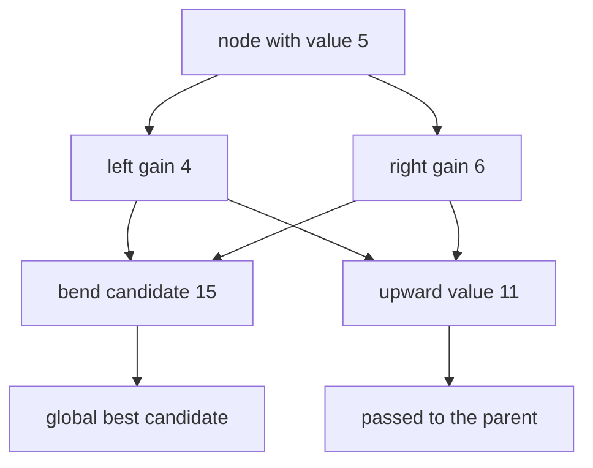
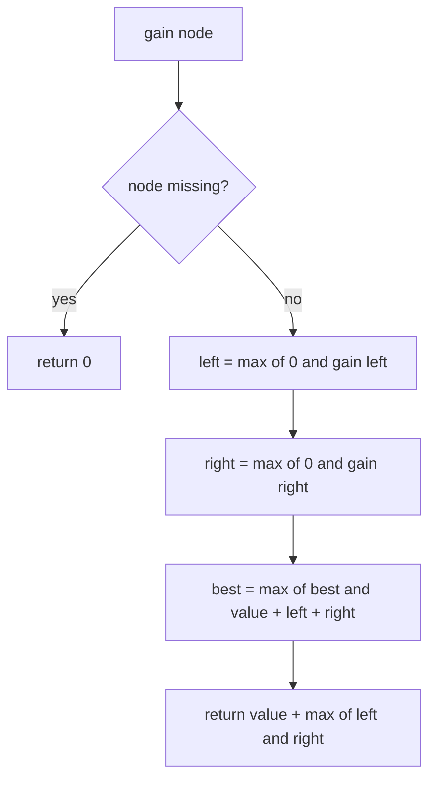
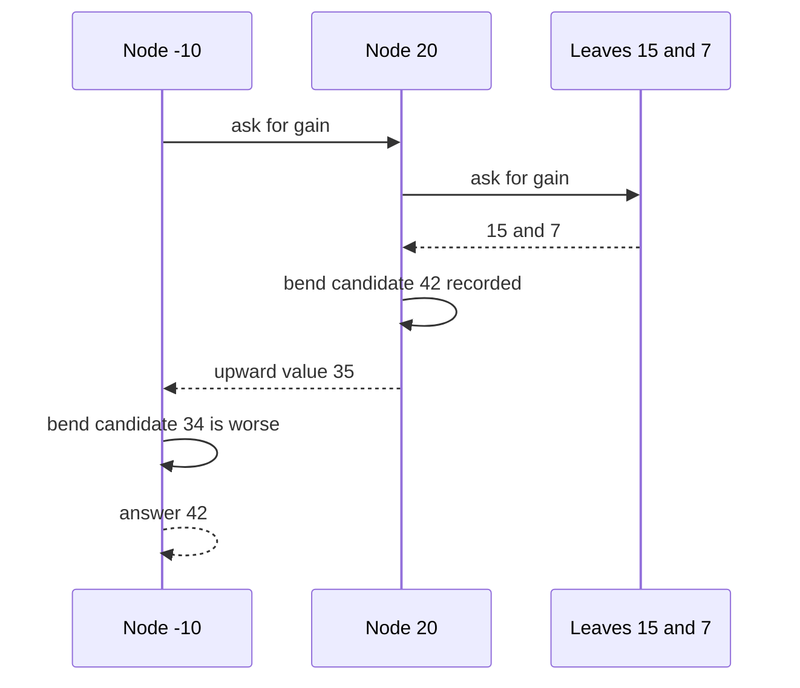

# 241 — Maximum path sum in binary tree (any path).

> **Tier:** Intermediate · **CTCI chapter:** Ch 4 — Trees and Graphs
> **Task spec:** [241-maximum-path-sum-in-binary-tree-any-path.md](../../../tasks/intermediate/241-maximum-path-sum-in-binary-tree-any-path.md)
> **Solutions:** [Python](../../../solutions/python/intermediate/241-maximum-path-sum-in-binary-tree-any-path/solution.py) ·
> [Java](../../../solutions/java/intermediate/241-maximum-path-sum-in-binary-tree-any-path/Solution.java) ·
> [JavaScript](../../../solutions/javascript/intermediate/241-maximum-path-sum-in-binary-tree-any-path/solution.js) ·
> [C#](../../../solutions/csharp/intermediate/241-maximum-path-sum-in-binary-tree-any-path/Solution.cs)

## 1. Problem restatement

**Input:** the root of a binary tree of integers, which may be negative. The tree must be
non-empty — the Python file raises `ValueError("empty tree has no path")` for a missing root.

**Output:** the largest sum of node values over every possible path that follows parent-child edges.
A path is any sequence of distinct nodes connected by edges; it may start and end anywhere, so it
does not have to pass through the root, and it may consist of a single node.

| Call | Result | Best path |
| --- | --- | --- |
| `max_path_sum([1, 2, 3])` | `6` | `2 → 1 → 3` |
| `max_path_sum([-10, 9, 20, null, null, 15, 7])` | `42` | `15 → 20 → 7` |
| `max_path_sum([-3])` | `-3` | the single node — negatives must still be taken |
| `max_path_sum([2, -1])` | `2` | the root alone; the child is skipped |
| `max_path_sum([1, -2, -3])` | `1` | the root alone; both children are skipped |

The docstring states the two rules in one sentence each: "at every node the best path through it is
`val + max(0, left_gain) + max(0, right_gain)`" and "the value returned upward is
`val + max(0, best single-side gain)`: a path cannot split".

## 2. Intuition

The naive approach is to try every pair of endpoints, but a tree with `n` nodes has `O(n²)` pairs and
each path's sum costs more to compute, which lands around `O(n³)` — and the recursion is unpleasant
because the path may bend at an ancestor.

The insight is that a path's *shape* is very constrained: it descends from its highest node into at
most one side, or into both sides at that single highest node. So each node needs to answer two
different questions:

1. **What is the best path that bends here?** A bend can use both children, so
   `value + max(0, left_gain) + max(0, right_gain)` — and this candidate is recorded globally.
2. **What is the best path that goes straight through and continues upward?** The path cannot fork,
   so it may keep at most one side: `value + max(0, max(left_gain, right_gain))`.

The `max(0, …)` clamp is what lets the algorithm *discard* an entire negative subtree. Without it, a
node with a large negative child would be forced to include it.



Two numbers per node, one visit: that is the whole algorithm.

## 3. Algorithm

1. Keep a mutable holder for the best value seen so far, initialised to negative infinity.
2. Define `gain(node)`:
   1. If the node is missing, return `0` — an absent side contributes nothing.
   2. `left ← max(0, gain(node.left))`, `right ← max(0, gain(node.right))`.
   3. Update the global best with `node.value + left + right` (the path that bends at this node).
   4. Return `node.value + max(left, right)` — the best straight path that continues upward.
3. If the root is missing, raise an error; otherwise call `gain(root)` and return the global best.

```text
procedure max_path_sum(root)
    if root is missing then
        raise error "empty tree has no path"
    end
    best ← negative infinity
    gain(root)
    return best

procedure gain(node)
    if node is missing then
        return 0
    end
    left ← max(0, gain(left of node))
    right ← max(0, gain(right of node))
    best ← max(best, value of node + left + right)
    return value of node + max(left, right)
end
```

`best` is a single-element holder in all four implementations — a list, an array, or a field on a
helper object — because the recursion cannot return two values without extra machinery. The clamp
appears twice per node (`max(0, …)` on each child's gain) and never on the node's own value.



## 4. Worked example

Trace the classic input `[-10, 9, 20, null, null, 15, 7]` — root `-10`, children `9` and `20`, and
`20` has children `15` and `7`:

    -10
    ├── 9
    └── 20
        ├── 15
        └── 7

| Step | Node | `left` | `right` | Bend candidate | `best` after | Upward value |
| --- | --- | --- | --- | --- | --- | --- |
| 1 | `9` | 0 | 0 | 9 | 9 | 9 |
| 2 | `15` | 0 | 0 | 15 | 15 | 15 |
| 3 | `7` | 0 | 0 | 7 | 15 | 7 |
| 4 | `20` | 15 | 7 | 42 | **42** | 35 |
| 5 | `-10` | 9 | 35 | 34 | 42 | 25 |

The bend at `20` gives `15 + 20 + 7 = 42`, which beats every other candidate, so the answer is `42`.
The upward value from `20` is `20 + max(15, 7) = 35`, and at the root the clamp discards the
negative contribution of `-10` itself only implicitly — the root's own value is always included
because a single-node path is legal.



## 5. Complexity

Let `n` be the number of nodes and `h` the height.

| Measure | Bound | Why it holds |
| --- | --- | --- |
| Time, best | O(n) | one post-order visit per node; each call does constant work |
| Time, average | O(n) | the two rules are applied exactly once per node |
| Time, worst | O(n) | no memoisation is needed because each node has exactly one parent |
| Space, extra | O(h) | the recursion stack; `O(log n)` balanced, `O(n)` for a chain |
| Space, global best | O(1) | one holder, updated in place |
| Space of the returned path | not materialised | the algorithm returns only the sum; recovering the nodes needs a second pass |
| Endpoint-pair brute force | O(n²) candidate paths | every pair of nodes, each costing `O(h)` to sum |

## 6. Pitfalls and edge cases

- **All-negative trees.** The clamp is applied to the *children's gains*, never to the node's own
  value, so `[-3]` returns `-3` and not `0`. If you clamp the node value too, an all-negative tree
  wrongly reports `0`.
- **Skipping a negative child.** `[2, -1]` returns `2`: the right child's gain is `-1`, the clamp
  turns it into `0`, and the bend candidate becomes `2 + 0 + 0`.
- **Both children negative.** `[1, -2, -3]` returns `1`; the connected path `-2 → 1 → -3` sums to
  `-4`, so the best path is the single root.
- **The path may not fork twice.** A path can bend at exactly one node; a second bend would need a
  node with degree 3. This is why the upward value uses `max(left, right)` while the bend uses
  `left + right`.
- **Empty tree.** The Python file raises `ValueError("empty tree has no path")`; Java throws an
  `IllegalArgumentException`, JavaScript an `Error`, and C# an `ArgumentException`, all with the same
  message. Returning `0` or negative infinity here would silently accept an invalid input.
- **A single node is a path.** `[-3]` and `[7]` are legal one-node paths, which is why `best` starts
  at negative infinity rather than at `0`.
- **`best` must be shared, not copied.** All four implementations use a mutable single-element
  holder for exactly this reason; recomputing a maximum after the recursion returns is not possible
  because the bend candidates are local to each node.
- **Overflow.** The Java and C# solutions accumulate into a `long` and return `long` rather than
  `int`, so a 32-bit overflow cannot happen; Python is unbounded, and JavaScript uses doubles, where
  sums beyond `2^53` lose precision. The test values stay far below those limits.
- **Recursion depth.** A chain of 100000 nodes will exhaust the stack in every one of the four
  languages; an iterative post-order would be needed for adversarial inputs.

## 7. Variants and follow-ups

- **Downward-only path sums.** [140-max-depth-of-binary-tree.md](../../../tasks/beginner/140-max-depth-of-binary-tree.md)
  counts edges instead of adding values, and needs no global best because there is no bend.
- **Minimum instead of maximum.** [267-minimum-path-sum-in-grid-dp.md](../../../tasks/intermediate/267-minimum-path-sum-in-grid-dp.md)
  shows the same "best path" thinking on a grid, where the path can turn freely and memoisation is
  mandatory.
- **Distance instead of sum.** [236-count-nodes-at-distance-k-from-target-in-binary-tree.md](../../../tasks/intermediate/236-count-nodes-at-distance-k-from-target-in-binary-tree.md)
  also reasons about paths that bend at a node, but the metric is hop count.
- **Level sums, not path sums.** [240-sum-of-nodes-at-each-level-level-order.md](../../../tasks/intermediate/240-sum-of-nodes-at-each-level-level-order.md)
  aggregates by row and never considers a bent path.
- The chapter walkthrough in [Trees and Graphs](../../ctci/04-trees-and-graphs.md) sets out the
  difference between subtree aggregates and path aggregates.

## 8. Check yourself

1. Why is the upward return value `value + max(left, right)` rather than `value + left + right`?

<details><summary>Show answer</summary>

Because the parent receives a *path*, and a path passing through the current node and continuing into
the parent can only descend on one side — using both would make the path fork, which is not allowed.
The two-sided sum is still computed, but only as a candidate for the global best.

</details>

2. What would happen if the `max(0, …)` clamps were removed?

<details><summary>Show answer</summary>

The algorithm would be forced to include every subtree, so `[2, -1]` would return `1` instead of `2`
and `[1, -2, -3]` would return `-4` instead of `1`. The clamp is precisely what allows a negative
subtree to be discarded, and only the node's own value is exempt so that all-negative trees still
produce a real (negative) answer.

</details>

3. For the tree `[-10, 9, 20, null, null, 15, 7]`, why is the best path `15 → 20 → 7` rather than
something through the root?

<details><summary>Show answer</summary>

Because the root contributes `-10`. The path through the root and its best side gives
`-10 + max(9, 35) = 25`, while the bend at `20` gives `35 + 7 = 42`. The algorithm compares those
candidates via the shared `best` holder and keeps `42`.

</details>

4. How many times is each node visited, and does the "any path" freedom cost extra work?

<details><summary>Show answer</summary>

Exactly once, in post-order. The freedom to start and end anywhere is handled by recording a bend
candidate at every node rather than by enumerating endpoint pairs, so the complexity stays `O(n)`
instead of `O(n²)` or worse.

</details>

5. Why does the Python solution use `best = [float("-inf")]` instead of a plain number?

<details><summary>Show answer</summary>

Because the recursion must both return the upward value *and* update a global maximum. A closure
cannot rebind an enclosing `int` without `nonlocal`, so the implementations wrap the value in a
mutable one-element container (a list, an array, or an object field) and mutate the element. The
other three languages use the same trick with their own idioms.

</details>
