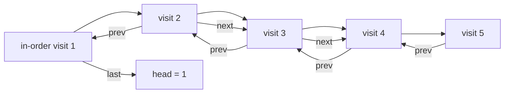
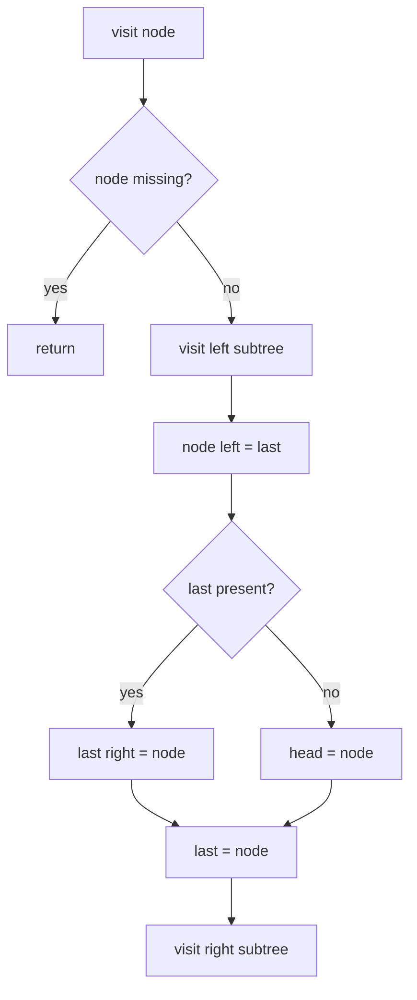
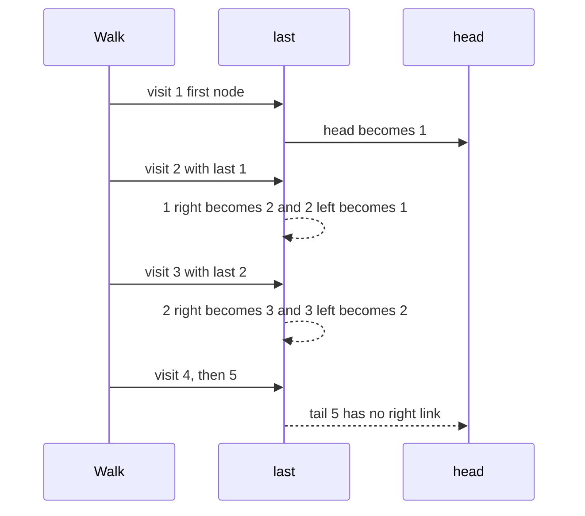

# 242 — Convert binary tree to doubly linked list (inorder).

> **Tier:** Intermediate · **CTCI chapter:** Ch 4 — Trees and Graphs
> **Task spec:** [242-convert-binary-tree-to-doubly-linked-list-inorder.md](../../../tasks/intermediate/242-convert-binary-tree-to-doubly-linked-list-inorder.md)
> **Solutions:** [Python](../../../solutions/python/intermediate/242-convert-binary-tree-to-doubly-linked-list-inorder/solution.py) ·
> [Java](../../../solutions/java/intermediate/242-convert-binary-tree-to-doubly-linked-list-inorder/Solution.java) ·
> [JavaScript](../../../solutions/javascript/intermediate/242-convert-binary-tree-to-doubly-linked-list-inorder/solution.js) ·
> [C#](../../../solutions/csharp/intermediate/242-convert-binary-tree-to-doubly-linked-list-inorder/Solution.cs)

## 1. Problem restatement

**Input:** the root of a binary tree. The conversion is **in place**: the tree's own nodes are
reused, and the `left` / `right` fields change meaning.

**Output:** the head of a doubly linked list whose values are the tree's in-order sequence, where
`left` is the `prev` link and `right` is the `next` link. The docstring is explicit: "in-place: left
becomes prev, right becomes next. Returns the list head."

| Call | Assertion |
| --- | --- |
| `to_values(to_doubly_linked_list([4, 2, 5, 1, 3]))` | `[1, 2, 3, 4, 5]` |
| `to_values_reverse(head)` | `[5, 4, 3, 2, 1]` — the `prev` links are intact |
| `to_doubly_linked_list(null)` | missing |
| `to_values(to_doubly_linked_list([7]))` | `[7]`, with both links missing |

The helper `to_values_reverse` walks to the tail through `right` and then back through `left`, so the
assertions check both directions of the list rather than just the forward order.

## 2. Intuition

Every in-order traversal visits the nodes in list order, so the list is just the in-order sequence
with an extra `prev` link. The trick is that no allocation is needed: while visiting, keep a pointer
`last` to the previously visited node. When the current node arrives:

- its `prev` is `last`,
- `last.next` is the current node,
- the first node visited becomes the head.

The subtle part is timing. The current node's `left` is overwritten before the right subtree is
recursed into, but its `right` is still the original child at that instant — the original link is
only destroyed when the *next* visited node writes `last.right`. So the recursion has already
captured the reference it needs, and no explicit save/restore is necessary *in this order*.



## 3. Algorithm

1. Keep two mutable holders: `last` (the previously visited node, initially missing) and `head`
   (initially missing).
2. `visit(node)`:
   1. If the node is missing, return.
   2. Recurse into the left subtree.
   3. Set `node.left = last` (the `prev` link).
   4. If `last` is present, set `last.right = node` (the `next` link); otherwise this is the first
      node, so record `head = node`.
   5. Set `last = node`.
   6. Recurse into the right subtree.
3. Call `visit(root)` and return `head`.

```text
procedure to_doubly_linked_list(root)
    last ← missing
    head ← missing
    visit(root)
    return head

procedure visit(node)
    if node is missing then
        return
    end
    visit(left of node)
    left of node ← last
    if last is present then
        right of last ← node
    else
        head ← node
    end
    last ← node
    visit(right of node)
end
```

The order inside `visit` is the whole algorithm: in-order position, then link backwards, then link
forwards, then advance `last`, then descend right.



## 4. Worked example

Trace the tree `[4, 2, 5, 1, 3]` — root `4`, children `2` and `5`, and `2` has children `1` and `3`:

    4
    ├── 2
    │   ├── 1
    │   └── 3
    └── 5

The in-order sequence is `1, 2, 3, 4, 5`. Watch the two holders:

| Visit order | Node | `last` before | Write `node.left` | Write `last.right` | `last` after | `head` |
| --- | --- | --- | --- | --- | --- | --- |
| 1 | `1` | missing | missing | *(none — first node)* | `1` | `1` |
| 2 | `2` | `1` | `1` | `1 → 2` | `2` | `1` |
| 3 | `3` | `2` | `2` | `2 → 3` | `3` | `1` |
| 4 | `4` | `3` | `3` | `3 → 4` | `4` | `1` |
| 5 | `5` | `4` | `4` | `4 → 5` | `5` | `1` |

After the walk, the head is `1`, whose `left` is missing; `5` is the tail, whose `right` is
missing. Reading `right` from the head gives `[1, 2, 3, 4, 5]`, and reading `left` back from the tail
gives `[5, 4, 3, 2, 1]` — the two assertions.



## 5. Complexity

Let `n` be the node count and `h` the height.

| Measure | Bound | Why it holds |
| --- | --- | --- |
| Time, best | O(n) | every node is visited exactly once and performs a constant number of pointer writes |
| Time, average | O(n) | the in-order walk is linear; no relinking passes over the list are needed |
| Time, worst | O(n) | no allocation, no search: total work is `c · n` |
| Space, extra | O(h) | the recursion stack only; both holders are single references |
| Space, output | O(1) extra | the nodes are reused — the tree *is* the list afterwards |
| Collect-then-relink alternative | O(n) extra | gathering the nodes into an array and then wiring them needs `O(n)` storage for the array |

## 6. Pitfalls and edge cases

- **Empty tree.** Returns missing; the Python file asserts `to_doubly_linked_list(None) is None`.
- **Single node.** Both links stay missing — the assertion checks `single.left is None` and
  `single.right is None`, so a stray self-link is a failure.
- **The head is recorded exactly once.** It is set in the `else` branch, which is only taken while
  `last` is still missing, i.e. for the very first in-order node.
- **Ordering of the writes.** `left of node ← last` happens before `right of last ← node`; doing them
  in the other order is also fine here, but recursing into the right subtree *before* reading it
  would not be: the original `right` child is destroyed by the next visit.
- **The tree is unusable afterwards.** In-place conversion means `root == head` only for a left
  spine. Every other caller must be done with the tree, because `to_*` traversals and the level-order
  builder no longer work on the linked structure.
- **`prev` links must be written too.** A singly linked conversion is easier but fails the
  `to_values_reverse` assertion, which is why the files check both directions.
- **Terminal links.** The tail's `right` and the head's `left` are the missing values, so a reverse
  walk terminates cleanly; a missing terminal link, or a link back to the root, would loop forever.
- **Recursion depth.** A chain of `n` nodes gives `n` stack frames, so deep inputs need an iterative
  in-order walk (a stack of nodes) instead of recursion.
- **Values are untouched.** Only the pointers change; the `val` fields are the same objects the tree
  held, which is what makes this a genuine in-place conversion.

## 7. Variants and follow-ups

- **Flattening to a right spine.** [149-convert-binary-tree-to-linked-list-flatten.md](../../../tasks/beginner/149-convert-binary-tree-to-linked-list-flatten.md)
  is the pre-order, singly linked cousin of this task.
- **Doubly linked list operations.** [063-implement-doubly-linked-list-insert-delete.md](../../../tasks/beginner/063-implement-doubly-linked-list-insert-delete.md)
  covers the structure this task produces.
- **In-order iteration without relinking.** [156-implement-iterator-for-a-binary-tree-inorder.md](../../../tasks/beginner/156-implement-iterator-for-a-binary-tree-inorder.md)
  gives the same sequence lazily and leaves the tree intact.
- **Rebuilding instead of flattening.** [243-reconstruct-binary-tree-from-inorder-and-preorder.md](../../../tasks/intermediate/243-reconstruct-binary-tree-from-inorder-and-preorder.md)
  goes the other way round, from the sequence back to the tree.
- The chapter walkthrough in [Trees and Graphs](../../ctci/04-trees-and-graphs.md) discusses
  in-order walks and pointer surgery.

## 8. Check yourself

1. Why must `head` be recorded inside the traversal rather than returned from the recursion?

<details><summary>Show answer</summary>

Because the recursion returns the subtree's wiring through the `last` chain, not the head: each
recursive call needs to know the previously visited node to link backwards. The head is therefore
recorded as a side effect in a shared holder the first time a node is visited with `last` still
missing.

</details>

2. Why is it safe to overwrite `node.left` before recursing into the right subtree?

<details><summary>Show answer</summary>

Because `node.right` still holds the original child at that moment — overwriting `left` touches a
different field. The original `right` is only destroyed when the next node in the walk writes
`last.right = next`, which happens after the recursive call has already captured the reference.

</details>

3. What would `to_values_reverse` return if the implementation only set `right` links?

<details><summary>Show answer</summary>

It would fail: after walking to the tail through `right`, the backward walk would see `left` values
that are still the original tree children, or missing, so the sequence would not be `[5, 4, 3, 2, 1]`.
The assertion exists to force the `prev` half of the doubly linked list.

</details>

4. How many nodes does a left spine `[1, 2, null, 3, null, 4]` produce, and where does the head sit?

<details><summary>Show answer</summary>

Four, in the order `4, 3, 2, 1` — a left spine's in-order sequence is the reverse of the insertion
order. The head is the deepest leftmost node, which was the *first* node visited, so `head` is not
the original root. That is the reason the function returns a head rather than reusing the argument.

</details>

5. Is the conversion stable across two calls on the same tree?

<details><summary>Show answer</summary>

No — and it is not meant to be. The first call destroys the tree structure, so a second call on the
same root would treat the list's `right` links as tree children and produce a different, meaningless
result. The tests build a fresh tree per assertion for exactly this reason.

</details>
