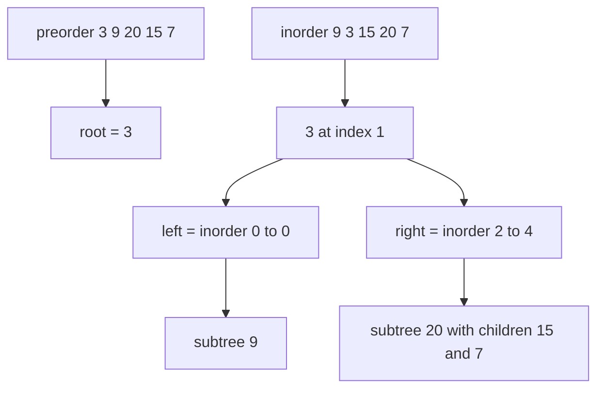
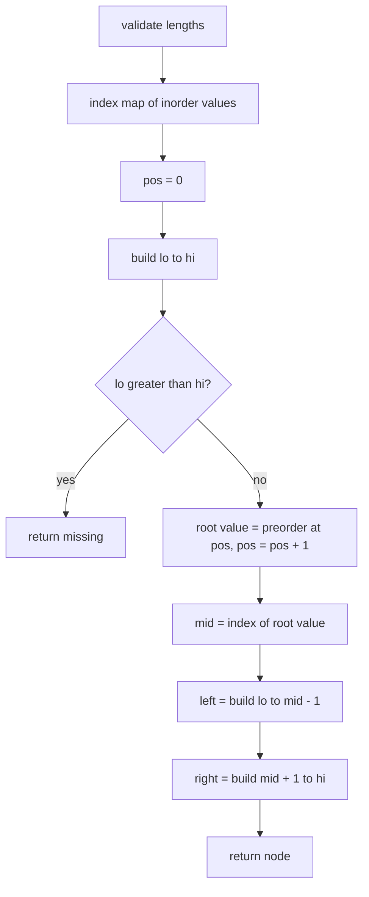
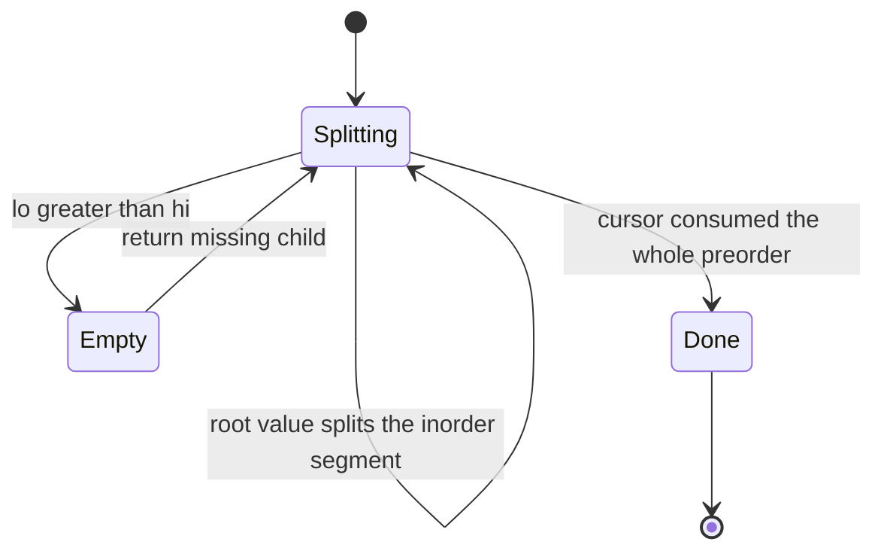

# 243 — Reconstruct binary tree from inorder and preorder.

> **Tier:** Intermediate · **CTCI chapter:** Ch 4 — Trees and Graphs
> **Task spec:** [243-reconstruct-binary-tree-from-inorder-and-preorder.md](../../../tasks/intermediate/243-reconstruct-binary-tree-from-inorder-and-preorder.md)
> **Solutions:** [Python](../../../solutions/python/intermediate/243-reconstruct-binary-tree-from-inorder-and-preorder/solution.py) ·
> [Java](../../../solutions/java/intermediate/243-reconstruct-binary-tree-from-inorder-and-preorder/Solution.java) ·
> [JavaScript](../../../solutions/javascript/intermediate/243-reconstruct-binary-tree-from-inorder-and-preorder/solution.js) ·
> [C#](../../../solutions/csharp/intermediate/243-reconstruct-binary-tree-from-inorder-and-preorder/Solution.cs)

## 1. Problem restatement

**Input:** two arrays of distinct values — `preorder` and `inorder` — describing the same binary
tree.

**Output:** the reconstructed tree's root. The assertion style used by all four files is a round
trip: serialise the rebuilt tree again and compare.

| Call | Assertion |
| --- | --- |
| `build_from_pre_in([3, 9, 20, 15, 7], [9, 3, 15, 20, 7])` | `preorder(root) == [3, 9, 20, 15, 7]` and `inorder(root) == [9, 3, 15, 20, 7]` |
| `build_from_pre_in([1], [1])` | `inorder(root) == [1]` |
| `build_from_pre_in([1, 2, 3], [3, 2, 1])` | a left spine: `preorder == [1, 2, 3]`, `inorder == [3, 2, 1]` |
| `build_from_pre_in([], [])` | raises `ValueError("preorder and inorder must be non-empty and equal-length")` |
| `build_from_pre_in([1], [1, 2])` | raises the same `ValueError` — the lengths differ |

The docstring states the rule in one line: "the first preorder value is the root; its index in the
inorder array splits both arrays. `O(n)` with a value `->` index map."

## 2. Intuition

Two facts drive everything:

- In **preorder**, the first value of any subtree is that subtree's root.
- In **inorder**, everything left of the root's position belongs to the left subtree and everything
  right of it belongs to the right subtree.

So the first preorder value tells you *which* value is the root, and its inorder position tells you
*how many* nodes each side has. The recursive structure follows immediately: the same two facts
apply to the slices.

The naive version searches for the root value in the inorder slice on each call, which costs
`O(n)` per node and `O(n²)` overall. A single hashmap from value to inorder index makes the lookup
`O(1)`, and the preorder scan can be driven by one shared cursor that advances by exactly one per
node — the map replaces the searching, the cursor replaces the slicing.



## 3. Algorithm

1. Build a map from each value in `inorder` to its index.
2. Check that both arrays are non-empty and of equal length; otherwise raise an error.
3. Keep a cursor `pos` into `preorder`, starting at `0`, shared by the recursion.
4. `build(lo, hi)`:
   1. If `lo > hi`, this subtree is empty — return a missing node.
   2. Take `root_value = preorder[pos]` and increment `pos`.
   3. Create the node, look up `mid = index[root_value]` in the map.
   4. Recurse left with `build(lo, mid - 1)`, then right with `build(mid + 1, hi)` — in that order,
      because the cursor reads preorder left to right.
5. Return `build(0, len(inorder) - 1)`.

```text
procedure build_from_pre_in(preorder, inorder)
    if preorder is empty or length of preorder is not equal to length of inorder then
        raise error "preorder and inorder must be non-empty and equal-length"
    end
    index ← map from value to its position in inorder
    pos ← 0
    return build(0, length of inorder - 1)

procedure build(lo, hi)
    if lo > hi then
        return missing
    end
    root_value ← preorder[pos]
    pos ← pos + 1
    node ← new node with root_value
    mid ← index[root_value]
    left of node ← build(lo, mid - 1)
    right of node ← build(mid + 1, hi)
    return node
end
```

The `(lo, hi)` bounds describe the segment of `inorder` owned by the current subtree, so the
recursion never needs to copy arrays — it only needs to know where the current segment starts and
ends. The cursor `pos` counts how many nodes of the preorder stream have already been consumed, and
because the recursion is left-first it matches the segments.



## 4. Worked example

Reconstruct from `preorder = [3, 9, 20, 15, 7]` and `inorder = [9, 3, 15, 20, 7]`. The index map is
`9 → 0`, `3 → 1`, `15 → 2`, `20 → 3`, `7 → 4`.

| Call | `(lo, hi)` | `pos` before | Root value | `mid` | Subtree built |
| --- | --- | --- | --- | --- | --- |
| 1 | `(0, 4)` | 0 | 3 | 1 | root `3` |
| 2 | `(0, 0)` | 1 | 9 | 0 | left child of `3` |
| 3 | `(0, -1)` | 2 | — | — | `9`'s left child: empty |
| 4 | `(1, 0)` | 2 | — | — | `9`'s right child: empty |
| 5 | `(2, 4)` | 2 | 20 | 3 | right child of `3` |
| 6 | `(2, 2)` | 3 | 15 | 2 | left child of `20` |
| 7 | `(4, 4)` | 4 | 7 | 4 | right child of `20` |

The `lo > hi` guard catches the six empty calls in the trace — the missing children of `9`, `15`
and `7` — and none of them consume a preorder position. After the run,
`preorder(root) == [3, 9, 20, 15, 7]` and `inorder(root) == [9, 3, 15, 20, 7]`, which is the
round-trip assertion.



## 5. Complexity

Let `n` be the number of nodes and `h` the height.

| Measure | Bound | Why it holds |
| --- | --- | --- |
| Time, best | O(n) | one map lookup and one node creation per node; the docstring quotes `O(n)` |
| Time, average | O(n) | the cursor advances exactly `n` times, and each `build` call does constant work |
| Time, worst | O(n) | no searching: the index map removes the linear scan inside each call |
| Space, extra | O(n) | the value-to-index map plus the recursion stack of `O(h)` |
| Space, output | O(n) | the reconstructed tree |
| Slice-and-search version | O(n²) | rebuilding slices copies `O(n)` elements per level, and searching costs `O(n)` per node |

The map is the only real optimisation, and it is what turns the textbook `O(n log n)`-with-sorting
or `O(n²)`-with-search reconstruction into a single linear pass.

## 6. Pitfalls and edge cases

- **The two recursions must be left-first.** The cursor reads `preorder` from the beginning, and
  preorder emits the entire left subtree before the right one. Building right first would feed the
  wrong root values into the subtrees.
- **Distinct values are required.** The index map stores one position per value; duplicates would
  overwrite each other and silently split the wrong way.
- **Length mismatch and empty input.** Both raise
  `ValueError("preorder and inorder must be non-empty and equal-length")`. Note that an empty pair
  is *invalid* here even though the empty tree is a legal concept — the files chose to reject it.
- **A single node.** `[1]` with `[1]` builds a leaf; both its recursive calls hit `lo > hi`.
- **Left spines.** `preorder = [1, 2, 3]` with `inorder = [3, 2, 1]` is a pure left chain: every
  root's right segment is empty. It is the assertion that catches an implementation which assumes
  the left segment is non-empty.
- **Right spines.** `preorder = [1, 2, 3]` with `inorder = [1, 2, 3]` is the mirror image; the same
  code handles it because the guard is symmetric in `lo` and `hi`.
- **The cursor is shared state.** In Python it lives in a one-element list, in Java in an array, in
  JavaScript in a closure variable, and in C# in a captured local — in every case the update must be
  visible to the other recursive calls.
- **Recursion depth equals the height.** A spine of `n` nodes gives `n` frames; a 100000-node spine
  would overflow the stack.
- **The input is not mutated.** Both arrays are read-only; only the new tree is built.

## 7. Variants and follow-ups

- **Postorder instead of preorder.** [244-reconstruct-binary-tree-from-inorder-and-postorder.md](../../../tasks/intermediate/244-reconstruct-binary-tree-from-inorder-and-postorder.md)
  walks the same arrays from the other end and must build the right subtree first.
- **Preorder with explicit null markers.** [245-reconstruct-binary-tree-from-preorder-with-null-markers.md](../../../tasks/intermediate/245-reconstruct-binary-tree-from-preorder-with-null-markers.md)
  needs only one array, because the shape is encoded in the token stream.
- **BST preorder alone.** [246-serialize-deserialize-binary-search-tree-compactly.md](../../../tasks/intermediate/246-serialize-deserialize-binary-search-tree-compactly.md)
  drops the inorder array entirely, using value bounds instead of positions.
- **Traversal orders in isolation.** [136-tree-preorder-traversal-recursive.md](../../../tasks/beginner/136-tree-preorder-traversal-recursive.md)
  and [137-tree-inorder-traversal-recursive.md](../../../tasks/beginner/137-tree-inorder-traversal-recursive.md)
  are the two walks this task inverts.
- The chapter walkthrough in [Trees and Graphs](../../ctci/04-trees-and-graphs.md) discusses the
  pairing of traversals and the trees they determine.

## 8. Check yourself

1. Why does the algorithm not need to know the sizes of the subtrees in advance?

<details><summary>Show answer</summary>

Because the inorder index `mid` of the root value gives them for free: the left segment is
`(lo, mid - 1)` and the right segment is `(mid + 1, hi)`. The `lo > hi` guard handles the empty
cases, so no size bookkeeping is needed.

</details>

2. What is the cursor `pos` for, and why is one cursor enough?

<details><summary>Show answer</summary>

It consumes the preorder array in the exact order the recursion visits nodes: one root value per
`build` call, left subtree before right. Since each node corresponds to exactly one `build` call,
`pos` advances exactly `n` times in total and never needs to be saved or restored.

</details>

3. What would go wrong with `preorder = [1, 1]` and `inorder = [1, 1]`?

<details><summary>Show answer</summary>

The index map would store only one entry for the value `1`, so both calls would resolve `mid` to the
same position and the reconstruction would be wrong (and the cursor would run off the end for
longer inputs). The algorithm's contract requires distinct values; duplicates make preorder+inorder
ambiguous in the first place.

</details>

4. How many nodes does `build(lo, hi)` create when it is called with `lo > hi`?

<details><summary>Show answer</summary>

None — it returns a missing child immediately and does not touch the cursor. That is why the empty
calls in the trace consume no preorder positions and the cursor stays at `4` after the last real
node (`7`).

</details>

5. What changes if the tree is passed as a BST and the values are sorted?

<details><summary>Show answer</summary>

Nothing in this algorithm — it never compares values, only positions in the two arrays. A sorted
inorder array is what a BST produces, which is exactly the extra structure task 246 exploits to drop
the inorder array entirely.

</details>
