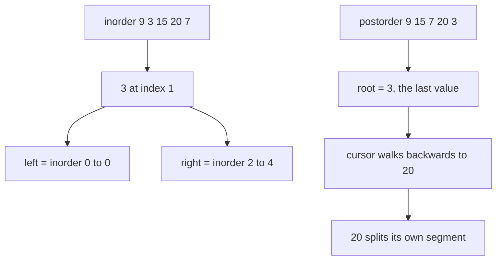
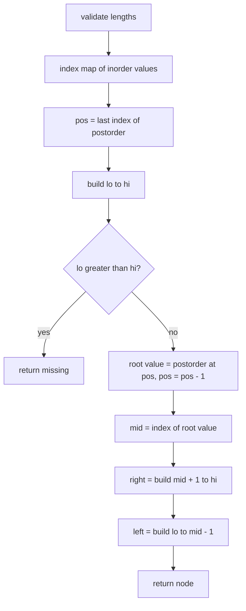
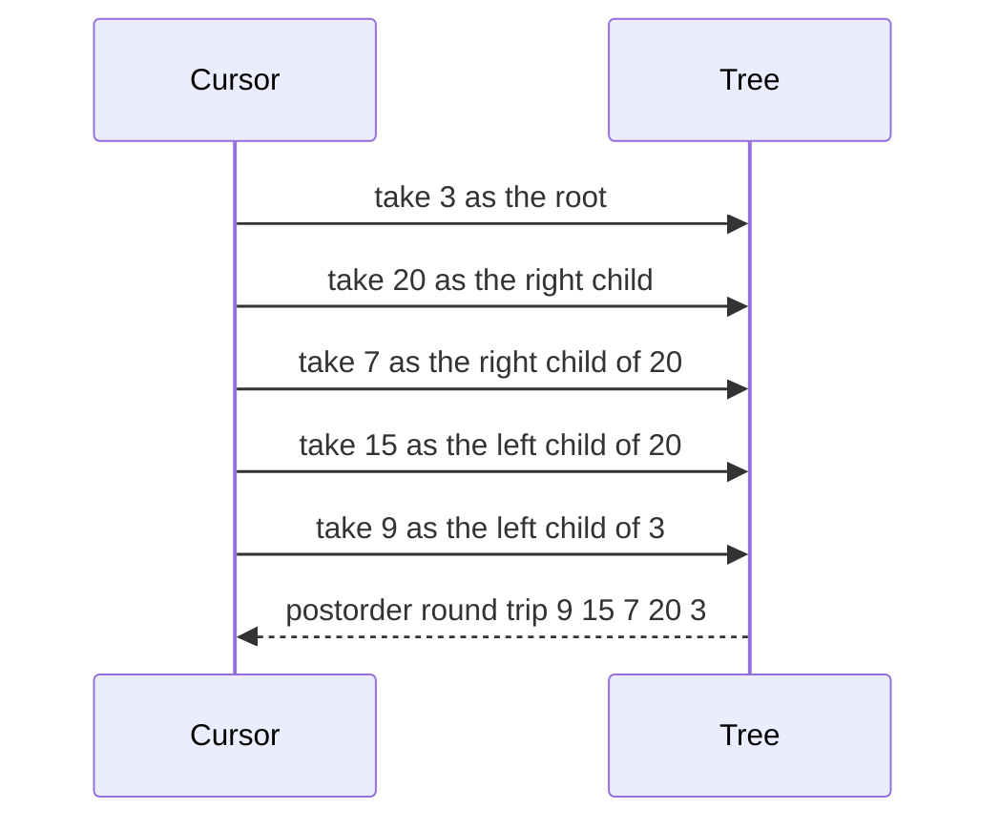

# 244 — Reconstruct binary tree from inorder and postorder.

> **Tier:** Intermediate · **CTCI chapter:** Ch 4 — Trees and Graphs
> **Task spec:** [244-reconstruct-binary-tree-from-inorder-and-postorder.md](../../../tasks/intermediate/244-reconstruct-binary-tree-from-inorder-and-postorder.md)
> **Solutions:** [Python](../../../solutions/python/intermediate/244-reconstruct-binary-tree-from-inorder-and-postorder/solution.py) ·
> [Java](../../../solutions/java/intermediate/244-reconstruct-binary-tree-from-inorder-and-postorder/Solution.java) ·
> [JavaScript](../../../solutions/javascript/intermediate/244-reconstruct-binary-tree-from-inorder-and-postorder/solution.js) ·
> [C#](../../../solutions/csharp/intermediate/244-reconstruct-binary-tree-from-inorder-and-postorder/Solution.cs)

## 1. Problem restatement

**Input:** two arrays of distinct values — `inorder` and `postorder` — describing the same binary
tree.

**Output:** the reconstructed tree's root, verified by the same round-trip style as the preorder
variant.

| Call | Assertion |
| --- | --- |
| `build_from_in_post([9, 3, 15, 20, 7], [9, 15, 7, 20, 3])` | `inorder(root) == [9, 3, 15, 20, 7]` and `postorder_traverse(root) == [9, 15, 7, 20, 3]` |
| `build_from_in_post([1], [1])` | `inorder(root) == [1]` |
| `build_from_in_post([3, 2, 1], [3, 2, 1])` | left spine: `postorder_traverse == [3, 2, 1]` and `inorder == [3, 2, 1]` |
| `build_from_in_post([], [])` | raises `ValueError("inorder and postorder must be non-empty and equal-length")` |
| `build_from_in_post([1], [1, 2])` | raises the same `ValueError` — lengths differ |

The docstring is one sentence: "the last postorder value is the root; walk postorder backwards
(right subtree first)."

## 2. Intuition

The mirror image of the preorder variant, and the mirror is a little sharper here:

- In **postorder**, the *last* value of a subtree is that subtree's root.
- In **inorder**, the root's position still splits the segment into left and right.

The trap is the direction of the scan. Reading postorder from the end backwards gives roots in the
order "root, right subtree, left subtree" — so the recursion must be **right-first**. If you keep the
left-first order that the preorder variant uses, the cursor hands right-subtree roots to left
subtrees and the tree comes out mirrored.



## 3. Algorithm

1. Build a map from each value in `inorder` to its index.
2. Check that both arrays are non-empty and of equal length; otherwise raise an error.
3. Keep a cursor `pos` starting at `len(postorder) - 1`, shared by the recursion, and decrement it as
   values are consumed.
4. `build(lo, hi)`:
   1. If `lo > hi`, return a missing node.
   2. Take `root_value = postorder[pos]` and decrement `pos`.
   3. Create the node and look up `mid = index[root_value]`.
   4. Recurse **right** with `build(mid + 1, hi)`, then **left** with `build(lo, mid - 1)`.
5. Return `build(0, len(inorder) - 1)`.

```text
procedure build_from_in_post(inorder, postorder)
    if postorder is empty or length of postorder is not equal to length of inorder then
        raise error "inorder and postorder must be non-empty and equal-length"
    end
    index ← map from value to its position in inorder
    pos ← length of postorder - 1
    return build(0, length of inorder - 1)

procedure build(lo, hi)
    if lo > hi then
        return missing
    end
    root_value ← postorder[pos]
    pos ← pos - 1
    node ← new node with root_value
    mid ← index[root_value]
    right of node ← build(mid + 1, hi)
    left of node ← build(lo, mid - 1)
    return node
end
```

Compare the two variants side by side: identical structure, three differences — the cursor starts at
the end and moves backwards, the root value is read at the cursor, and the right subtree is built
before the left.



## 4. Worked example

Reconstruct from `inorder = [9, 3, 15, 20, 7]` and `postorder = [9, 15, 7, 20, 3]`. The index map is
`9 → 0`, `3 → 1`, `15 → 2`, `20 → 3`, `7 → 4`, and the cursor starts at `4`.

| Call | `(lo, hi)` | `pos` before | Root value | `mid` | Subtree built |
| --- | --- | --- | --- | --- | --- |
| 1 | `(0, 4)` | 4 | 3 | 1 | root `3` |
| 2 | `(2, 4)` | 3 | 20 | 3 | right child of `3` |
| 3 | `(4, 4)` | 2 | 7 | 4 | right child of `20` |
| 4 | `(2, 2)` | 1 | 15 | 2 | left child of `20` |
| 5 | `(0, 0)` | 0 | 9 | 0 | left child of `3` |
| 6 | six empty calls | — | — | — | missing children of `7`, `15`, `9` |

Row 3 comes before row 4 — that is the right-first order the backwards scan demands. Building left
first would consume `7` as the left child of `20` and produce a mirrored tree, so the assertions
would fail even though a well-formed tree came out.



## 5. Complexity

Let `n` be the node count and `h` the height.

| Measure | Bound | Why it holds |
| --- | --- | --- |
| Time, best | O(n) | one map lookup per node; the docstring's approach is a single backwards scan |
| Time, average | O(n) | the cursor decrements exactly `n` times |
| Time, worst | O(n) | the index map removes the per-call linear search |
| Space, extra | O(n) | the value-to-index map, plus `O(h)` recursion frames |
| Space, output | O(n) | the reconstructed tree |
| Search-instead-of-map version | O(n²) | scanning the inorder segment for each root value |

The same map trick as task 243 applies, and the same `O(h)` stack caveat: a spine gives `n` frames.

## 6. Pitfalls and edge cases

- **Build right before left.** The single most common bug. Postorder emits `left, right, root`, so
  reading it backwards emits `root, right, left`.
- **The cursor starts at the end and decrements.** Starting at `0` and incrementing — copying the
  preorder variant — reconstructs a different (wrong) tree.
- **Distinct values only.** Duplicates collapse in the index map, exactly as in task 243.
- **Empty or mismatched lengths.** `ValueError("inorder and postorder must be non-empty and
  equal-length")`; both arrays are required.
- **A single node.** `[1]` with `[1]`: the root is consumed and both recursive calls hit the
  `lo > hi` guard, giving a leaf.
- **Left spines are tricky here.** `inorder = [3, 2, 1]`, `postorder = [3, 2, 1]` — the arrays are
  identical, which is the case people mis-read as a degenerate input. The cursor takes `1` as the
  root, then `2` (right segment empty, left segment `(0, 1)`) as its left child, then `3` as the leaf.
- **Right spines.** `inorder = [1, 2, 3]` with `postorder = [3, 2, 1]` is the mirror; the right-first
  recursion consumes `1`, then `2`, then `3` down the right side.
- **The reconstruction is not unique in general.** Inorder plus postorder determines a tree only when
  the values are distinct; with duplicates the split position is ambiguous.
- **Recursion depth equals the height**, so a 100000-node spine overflows the stack.
- **Values, not comparisons.** The algorithm never compares values, so a BST is not required — a
  sorted inorder array is only a symptom of one.

## 7. Variants and follow-ups

- **Preorder instead of postorder.** [243-reconstruct-binary-tree-from-inorder-and-preorder.md](../../../tasks/intermediate/243-reconstruct-binary-tree-from-inorder-and-preorder.md)
  is the mirror image with a forward cursor and a left-first recursion.
- **Preorder with null markers, no inorder array.** [245-reconstruct-binary-tree-from-preorder-with-null-markers.md](../../../tasks/intermediate/245-reconstruct-binary-tree-from-preorder-with-null-markers.md)
  encodes the shape in the token stream and needs only one array.
- **BST preorder alone.** [246-serialize-deserialize-binary-search-tree-compactly.md](../../../tasks/intermediate/246-serialize-deserialize-binary-search-tree-compactly.md)
  uses value bounds where this task uses inorder positions.
- **The traversal itself.** [138-tree-postorder-traversal-recursive.md](../../../tasks/beginner/138-tree-postorder-traversal-recursive.md)
  is the walk that this task inverts, and the assertion helper.
- The chapter walkthrough in [Trees and Graphs](../../ctci/04-trees-and-graphs.md) compares the three
  traversal orders as tree descriptions.

## 8. Check yourself

1. Why must the recursion visit the right subtree first?

<details><summary>Show answer</summary>

Because the cursor walks postorder from the end. Postorder lists `left, right, root`, so the reversed
stream is `root, right, left`: after taking a root, the next value belongs to the right subtree. Any
other order would consume right-subtree roots while building the left subtree and produce a
different tree.

</details>

2. What does swapping the two recursive calls actually produce?

<details><summary>Show answer</summary>

A well-formed but wrong tree — a mirror-flavoured reconstruction in which values that belong to the
right subtree end up on the left. The round-trip assertions catch it: `postorder_traverse(root)`
would return a different sequence from the input array.

</details>

3. The assertion inputs for the spine are `[3, 2, 1]` and `[3, 2, 1]`. Why is that not a bug in the
test?

<details><summary>Show answer</summary>

Because for a left spine the two orders coincide. Inorder and postorder both visit `3` last (it is
the leftmost leaf, which is both the first in-order and the last post-order value) so the arrays are
literally equal. The reconstruction still takes `1` as the root first, then `2`, then `3`.

</details>

4. How much does the index map save compared with searching inside each call?

<details><summary>Show answer</summary>

It removes an `O(n)` scan per node, dropping the total from `O(n²)` to `O(n)`. The map itself costs
`O(n)` space, which is the same order as the output tree, so the trade is free.

</details>

5. Both task 243 and this task reject an empty pair, although a tree can be empty. Why?

<details><summary>Show answer</summary>

The files deliberately raise
`ValueError("inorder and postorder must be non-empty and equal-length")` because an empty pair carries
no root value to return and the tasks are contracted on non-empty inputs. The guard also catches the
common programming error of passing one array from a different tree, where the lengths disagree.

</details>
