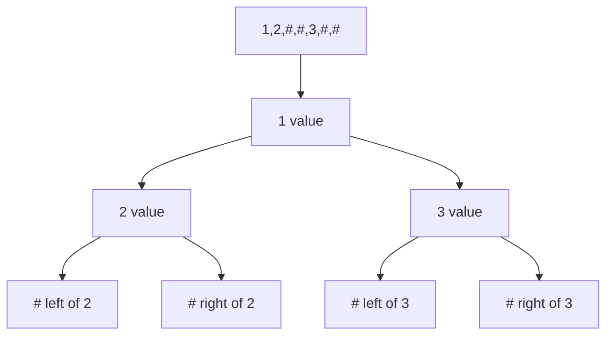
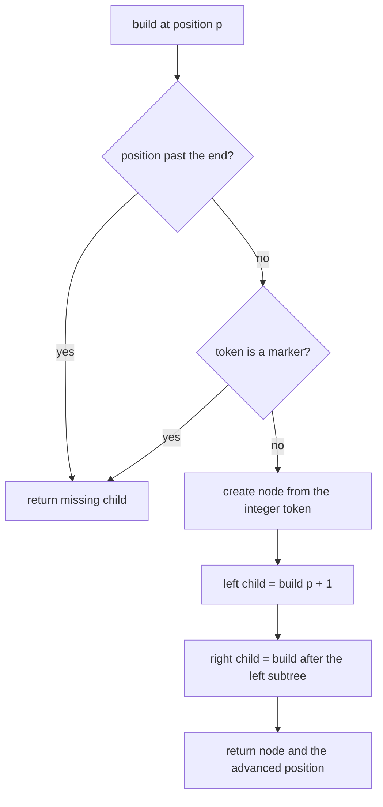
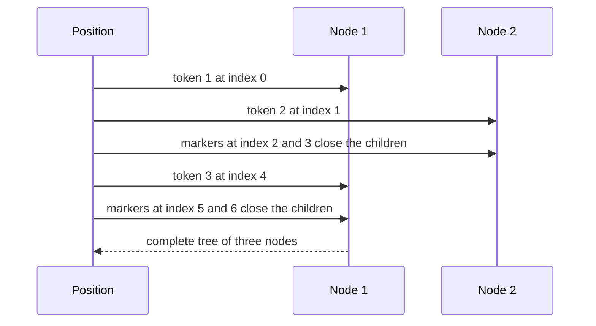

# 245 — Reconstruct binary tree from preorder with null markers.

> **Tier:** Intermediate · **CTCI chapter:** Ch 4 — Trees and Graphs
> **Task spec:** [245-reconstruct-binary-tree-from-preorder-with-null-markers.md](../../../tasks/intermediate/245-reconstruct-binary-tree-from-preorder-with-null-markers.md)
> **Solutions:** [Python](../../../solutions/python/intermediate/245-reconstruct-binary-tree-from-preorder-with-null-markers/solution.py) ·
> [Java](../../../solutions/java/intermediate/245-reconstruct-binary-tree-from-preorder-with-null-markers/Solution.java) ·
> [JavaScript](../../../solutions/javascript/intermediate/245-reconstruct-binary-tree-from-preorder-with-null-markers/solution.js) ·
> [C#](../../../solutions/csharp/intermediate/245-reconstruct-binary-tree-from-preorder-with-null-markers/Solution.cs)

## 1. Problem restatement

**Input:** a comma-separated preorder token stream where `#` marks a missing child — for example
`"1,2,#,#,3,#,#"`. The Python entry point accepts an iterable of tokens, the Java and C# entry points
accept the CSV string and split it, and the JavaScript one accepts either a string or an array of
tokens.

**Output:** the reconstructed tree's root, or missing when the stream is a lone `#`.

| Call | Assertion |
| --- | --- |
| `build_from_preorder_tokens("1,2,#,#,3,#,#")` | `preorder == [1, 2, 3]`, `inorder == [2, 1, 3]` |
| `build_from_preorder_tokens("1,2,4,#,#,5,#,#,3,#,6,#,#")` | `preorder == [1, 2, 4, 5, 3, 6]`, `inorder == [4, 2, 5, 1, 3, 6]` |
| `build_from_preorder_tokens(["#"])` | missing — "all-null tree" |
| `build_from_preorder_tokens(["9", "#", "#"])` | a single node with value `9` and no children |

The docstring names the format: "tokens like `1,2,#,#,3,#,#` where `#` marks a missing child; parse
with a pointer."

## 2. Intuition

Preorder tells you the root first but says nothing about where a subtree ends — unless the shapes are
written explicitly. A `#` token occupies the slot a child would have occupied, so the stream becomes
self-describing: a node is one value token followed by its left subtree's tokens and then its right
subtree's tokens, and a missing child is exactly one token.

That makes the parse a single pointer walk with no lookahead and no secondary array:

- read the token at the cursor;
- if it is a marker, return a missing child and advance by one;
- otherwise create a node, advance, parse the left subtree, then parse the right subtree.

Every node consumes exactly one value token and every absent child exactly one marker, so the token
count is a fixed `2n + 1` for `n` nodes.



## 3. Algorithm

1. Materialise the tokens into a sequence.
2. `build(position)`:
   1. If the position is past the end of the sequence, or the token at that position is a marker
      (`#` or a missing value), return `(missing child, position + 1)`.
   2. Convert the token to an integer and create the node.
   3. Parse the left child from `position + 1`, which returns both the child and the position after
      its tokens.
   4. Parse the right child from that new position.
   5. Return the node and the position after the right subtree.
3. Return the node produced by `build(0)` — which is missing when the stream is a single marker.

```text
procedure build_from_preorder_tokens(tokens)
    sequence ← tokens materialised into a list
    (root, end_position) ← build(0)
    return root

procedure build(position)
    if position is at or past the end of sequence then
        return (missing, position + 1)
    end
    token ← sequence[position]
    if token is a marker then
        return (missing, position + 1)
    end
    node ← new node with integer value of token
    (left_child, position) ← build(position + 1)
    (right_child, position) ← build(position)
    left of node ← left_child
    right of node ← right_child
    return (node, position)
end
```

Returning the position together with the node is what lets the two children be parsed one after the
other without a shared mutable cursor. The Python version does exactly that, returning a
`(node, position)` pair. The Java, C# and JavaScript versions instead keep a single shared position
(a field, a `ref int`, or a closure variable) and let the recursion mutate it — the same algorithm,
two different ways to thread the cursor.



## 4. Worked example

Parse `"1,2,#,#,3,#,#"`. The token list is `[1, 2, #, #, 3, #, #]` with seven tokens, and `n = 3`
nodes means `2n + 1 = 7`, so the stream is exactly the right length.

| Call | Position | Token | Action | Returns |
| --- | --- | --- | --- | --- |
| 1 | 0 | `1` | create node `1`, parse left from 1 | — |
| 2 | 1 | `2` | create node `2`, parse left from 2 | — |
| 3 | 2 | `#` | missing left of `2`, advance to 3 | `(missing, 3)` |
| 4 | 3 | `#` | missing right of `2`, advance to 4 | `(missing, 4)` |
| 5 | 4 | `3` | create node `3`, parse left from 5 | — |
| 6 | 5 | `#` | missing left of `3`, advance to 6 | `(missing, 6)` |
| 7 | 6 | `#` | missing right of `3`, advance to 7 | `(missing, 7)` |
| 8 | 7 | — | past the end | `(missing, 8)` |

The tree is `1` with left child `2` and right child `3`, all leaves: `preorder == [1, 2, 3]` and
`inorder == [2, 1, 3]`, matching the assertions. Step 8 is the guard that makes a trailing-marker
stream safe.



## 5. Complexity

Let `n` be the number of real nodes and `h` the height.

| Measure | Bound | Why it holds |
| --- | --- | --- |
| Time, best | O(n) | each of the `2n + 1` tokens is consumed exactly once |
| Time, average | O(n) | the cursor only moves forward; no token is re-read |
| Time, worst | O(n) | one integer conversion per value token, constant work per marker |
| Space, extra | O(n) | the token list, plus the output tree |
| Space, recursion | O(h) | one frame per level; a spine of `n` nodes is `n` frames |
| Split-then-parse cost | O(n) | `split` materialises `2n + 1` substrings, which is the `O(n)` term already counted |

## 6. Pitfalls and edge cases

- **Trailing or truncated streams.** The `position past the end` guard makes a short stream parse
  into a tree with missing children rather than crashing — but it also means a truncated stream is
  *silently* accepted. The files rely on the callers passing well-formed streams.
- **A lone marker.** `["#"]` returns a missing root, asserted as `buildFromPreorderTokens("#") == null`
  in Java and C#.
- **A single node is three tokens.** `"9,#,#"` is a leaf; `"9"` alone is also accepted by the guard
  (both children parse as missing past the end), but the tests use the explicit form.
- **Marker spelling.** The Python helper accepts `"#"` or a missing value as a marker; the other
  languages check for `"#"`. A literal `"null"` token would be parsed as an integer and fail.
- **Multi-digit values.** Tokens are split on commas before conversion, so `12` and `345` parse
  normally; a stream without commas (`"123#"`) would be a single token.
- **Whitespace is not trimmed.** `"1, 2, #, #"` produces tokens with leading spaces, and the integer
  conversion fails in Java (`Integer.parseInt(" 2")`) and C#. Use `"1,2,#,#"`.
- **Depth equals the tree height.** A spine of 10000 nodes overflows the stack; an explicit stack
  would be needed for adversarial inputs.
- **The guard order matters.** Checking `position >= length` *before* testing the marker is what keeps
  a `"#"`-terminated stream from running off the end.
- **No uniqueness question.** Unlike the two-array variants, this format fully determines the tree,
  including the shape of every missing child.

## 7. Variants and follow-ups

- **Two arrays instead of markers.** [243-reconstruct-binary-tree-from-inorder-and-preorder.md](../../../tasks/intermediate/243-reconstruct-binary-tree-from-inorder-and-preorder.md)
  and [244-reconstruct-binary-tree-from-inorder-and-postorder.md](../../../tasks/intermediate/244-reconstruct-binary-tree-from-inorder-and-postorder.md)
  use inorder to locate subtree boundaries.
- **No markers at all.** [246-serialize-deserialize-binary-search-tree-compactly.md](../../../tasks/intermediate/246-serialize-deserialize-binary-search-tree-compactly.md)
  shows a BST needing only its preorder, because value bounds replace the markers.
- **Counts instead of markers.** [235-serialize-and-deserialize-n-ary-tree.md](../../../tasks/intermediate/235-serialize-and-deserialize-n-ary-tree.md)
  writes each node's child count, which is the N-ary analogue of this format.
- **The naive binary serialiser.** [148-serialize-and-deserialize-binary-tree-preorder.md](../../../tasks/beginner/148-serialize-and-deserialize-binary-tree-preorder.md)
  is the same `#` convention applied in the other direction.
- The chapter walkthrough in [Trees and Graphs](../../ctci/04-trees-and-graphs.md) collects the
  reconstruction tasks together.

## 8. Check yourself

1. How many tokens does a tree with `n` nodes produce, and why?

<details><summary>Show answer</summary>

`2n + 1`. Every node emits one value token and two child slots, and each slot is either a node's
value token or a `#`. A binary tree with `n` nodes has `2n` child slots, of which `n - 1` are filled
by edges, leaving exactly `n + 1` missing children — so the count is `n` values plus `n + 1` markers.
The three-node example has 3 values and 4 markers, i.e. 7 tokens.

</details>

2. Why does the recursive call return the cursor position instead of just the node?

<details><summary>Show answer</summary>

Because the right subtree starts where the left subtree's tokens end, so the caller has to know that
position. Returning `(node, position)` is the functional way to thread it; the Java, C# and
JavaScript versions instead share a mutable cursor. Both are equivalent — but a shared cursor must be
updated *after* each read, or the two children would parse the same token.

</details>

3. What does `build_from_preorder_tokens(["#"])` return, and what would a missing guard do?

<details><summary>Show answer</summary>

A missing root, because the single token is a marker. Without the `position >= length` guard, a
stream whose tokens run out would still try to read `sequence[position]` and fail with an index
error instead of producing a missing child.

</details>

4. What tree does `"1,2,4,#,#,5,#,#,3,#,6,#,#"` describe?

<details><summary>Show answer</summary>

`1` with left child `2` and right child `3`; `2` has children `4` and `5`; `3` has a right child `6`.
Inorder is `4, 2, 5, 1, 3, 6` and preorder is `1, 2, 4, 5, 3, 6`, exactly the six-node assertions.

</details>

5. Does the format need the tokens in preorder specifically?

<details><summary>Show answer</summary>

The parser as written is preorder-specific: value, left subtree, right subtree. A level-order stream
of the same form would need a queue instead of recursion, and an inorder stream cannot be parsed this
way at all, because the root token would appear only after the entire left subtree. Both the task
name and the docstring call the format preorder, and the assertions check the preorder round trip.

</details>
