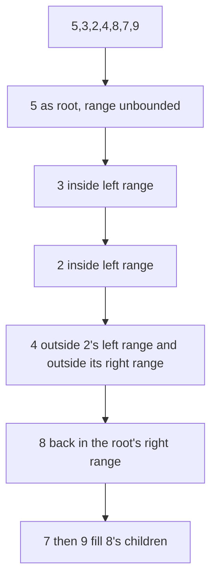
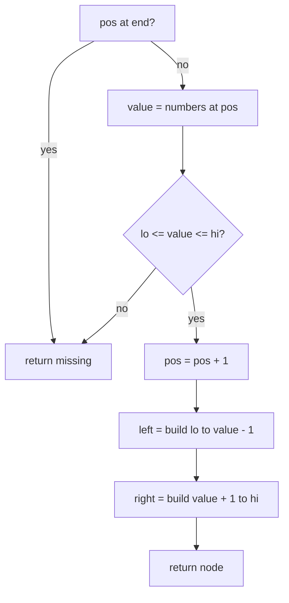
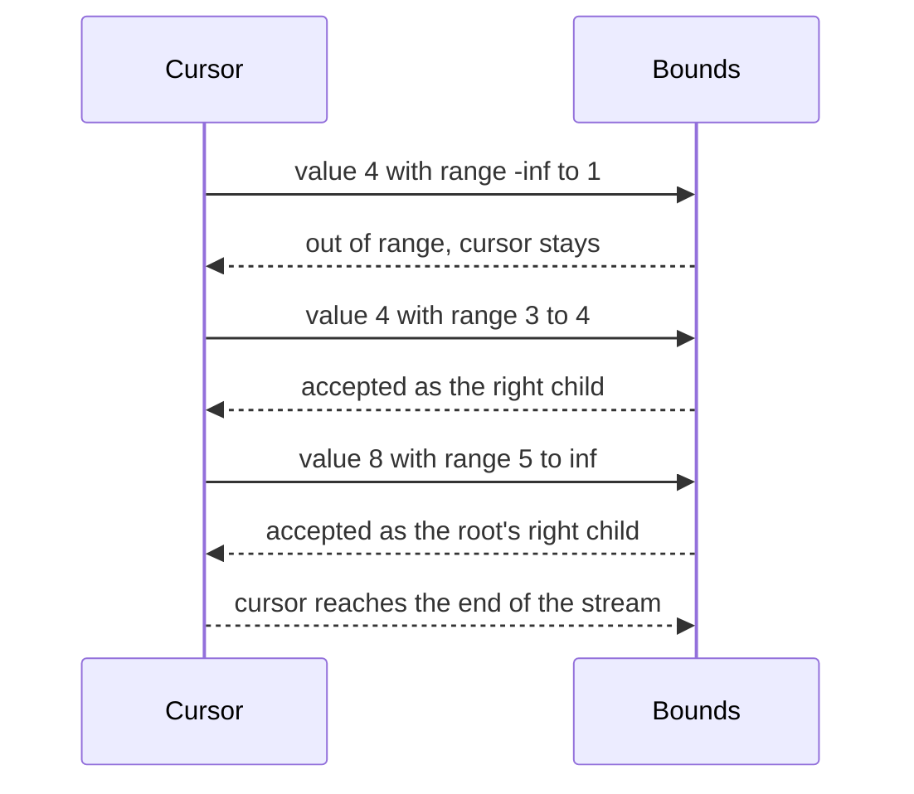

# 246 — Serialize/deserialize binary search tree compactly.

> **Tier:** Intermediate · **CTCI chapter:** Ch 4 — Trees and Graphs
> **Task spec:** [246-serialize-deserialize-binary-search-tree-compactly.md](../../../tasks/intermediate/246-serialize-deserialize-binary-search-tree-compactly.md)
> **Solutions:** [Python](../../../solutions/python/intermediate/246-serialize-deserialize-binary-search-tree-compactly/solution.py) ·
> [Java](../../../solutions/java/intermediate/246-serialize-deserialize-binary-search-tree-compactly/Solution.java) ·
> [JavaScript](../../../solutions/javascript/intermediate/246-serialize-deserialize-binary-search-tree-compactly/solution.js) ·
> [C#](../../../solutions/csharp/intermediate/246-serialize-deserialize-binary-search-tree-compactly/Solution.cs)

## 1. Problem restatement

**Input:** a binary **search** tree of distinct integers. The task pair writes it to a string and
reads it back.

**Output:** `serialize` returns the preorder values joined by commas — no null markers at all;
`deserialize` rebuilds the identical tree. The docstring makes the saving explicit: "a BST needs no
null markers: its preorder alone is enough, because the valid child range is bounded by the
ancestors' values. Rebuild by walking the preorder with `(lo, hi)` bounds → 7 values instead of 15
tokens for the 7-node tree below."

| Call | Result |
| --- | --- |
| `serialize(build_bst([5, 3, 8, 2, 4, 7, 9]))` | `"5,3,2,4,8,7,9"` |
| `serialize_with_nulls(root)` | `"5,3,2,#,#,4,#,#,8,7,#,#,9,#,#"` — the naive form, for comparison |
| `deserialize("5,3,2,4,8,7,9")` | a clone with the same preorder and `inorder == sorted(values)` |
| `serialize(deserialize("42"))` | `"42"` |
| `deserialize("")` | missing |

The compact form is asserted to be *shorter*: `len(data.split(",")) < len(serialize_with_nulls(...).split(","))`,
i.e. 7 tokens against 15.

## 2. Intuition

The marker format of task 245 spends two extra tokens per node to record missing children. A BST does
not need that information, because the search-tree property is a *constraint*: while walking the
preorder, a value can only belong to the current subtree if it lies inside a range carried down from
the ancestors.

Start at `(-infinity, +infinity)`: the first value is the root. Its left subtree may only contain
values `<` the root, so recurse with `(-infinity, root - 1)`; the right subtree gets
`(root + 1, +infinity)`. When the next value in the stream falls outside the current range, that
subtree is empty — stop, without consuming the token. The stream is fully consumed only when the
whole tree has been rebuilt.



## 3. Algorithm

Serialization:

1. Walk the tree in preorder, appending each value's decimal form to a list.
2. Join the list with commas and return the string — the naive variant does the same walk but emits
   `#` for every missing child.

Deserialization:

1. Split the string on commas and convert each part to an integer. An empty string yields no values.
2. Keep a cursor `pos` over the value array, starting at `0`.
3. `build(lo, hi)`:
   1. If the cursor is past the end, this subtree is empty — return a missing node.
   2. Read the value at the cursor, but do **not** consume it yet.
   3. If the value is outside `[lo, hi]`, this subtree is empty — return a missing node.
   4. Otherwise create the node, advance the cursor, and recurse with
      `build(lo, value - 1)` for the left child and `build(value + 1, hi)` for the right child.
4. Return `build(-infinity, +infinity)`.

```text
procedure serialize(root)
    values ← preorder values of root as text
    return values joined by ","

procedure deserialize(data)
    if data is empty then
        return missing
    end
    numbers ← each comma-separated part of data converted to an integer
    pos ← 0
    return build(-infinity, +infinity)

procedure build(lo, hi)
    if pos is at or past the end of numbers then
        return missing
    end
    value ← numbers[pos]
    if value is less than lo or value is greater than hi then
        return missing
    end
    pos ← pos + 1
    node ← new node with value
    left of node ← build(lo, value - 1)
    right of node ← build(value + 1, hi)
    return node
end
```

The bound check is the heart of the algorithm: a value that does not fit belongs to an ancestor's
other subtree, so the current recursion must return *without* consuming it. The `value - 1` and
`value + 1` edges encode that keys are distinct; the Java and C# implementations carry the bounds in
a `long` (starting from `long.MIN_VALUE` / `long.MAX_VALUE`) precisely so the decrement cannot
overflow, and Python starts from `float("-inf")` / `float("inf")`.



## 4. Worked example

Serialize the tree built by inserting `[5, 3, 8, 2, 4, 7, 9]` in order:

    5
    ├── 3
    │   ├── 2
    │   └── 4
    └── 8
        ├── 7
        └── 9

Preorder visits `5, 3, 2, 4, 8, 7, 9` — seven tokens. The marker form writes `5,3,2,#,#,4,#,#,8,7,#,#,9,#,#`
— fifteen tokens, because each of the eight missing children costs a token.

Now deserialize `"5,3,2,4,8,7,9"`:

| Call | `(lo, hi)` | `pos` | Value | In range? | Action |
| --- | --- | --- | --- | --- | --- |
| 1 | `(-inf, inf)` | 0 | 5 | yes | node `5`, cursor to 1 |
| 2 | `(-inf, 4)` | 1 | 3 | yes | node `3`, cursor to 2 |
| 3 | `(-inf, 2)` | 2 | 2 | yes | node `2`, cursor to 3 |
| 4 | `(-inf, 1)` | 3 | 4 | no | empty left child of `2`, cursor unchanged |
| 5 | `(3, 2)` | 3 | 4 | no | empty right child of `2`, cursor unchanged |
| 6 | `(3, 4)` | 3 | 4 | yes | node `4`, cursor to 4 |
| 7 | `(-inf, 4)` → `(5, inf)` | 4 | 8 | yes | node `8`, cursor to 5 |
| 8 | `(5, 7)` | 5 | 7 | yes | node `7`, cursor to 6 |
| 9 | `(5, 6)` → `(8, inf)` | 6 | 9 | yes | node `9`, cursor to 7 |

Rows 4 and 5 are the mechanism: the value `4` shows up twice as "out of range" and is left for the
right sibling, which then accepts it. That is why out-of-range must not advance the cursor.



## 5. Complexity

Let `n` be the node count and `h` the height.

| Measure | Bound | Why it holds |
| --- | --- | --- |
| Time, serialize | O(n) | one preorder visit, one append per node |
| Time, deserialize | O(n) | the cursor advances exactly `n` times; the bound check is constant work per call |
| Time, both | O(n) | but the constant is the point of the task: no marker tokens are produced or parsed |
| Space, string (compact) | `n` tokens | the docstring's "7 values instead of 15 tokens" |
| Space, string (markers) | `2n + 1` tokens | one value plus one marker per missing child |
| Space, extra (deserialize) | O(n) | the integer array plus `O(h)` recursion frames |
| Space, output | O(n) | the clone |

The compact form wins by roughly a factor of two on token count for any tree — a saving that grows
with the number of leaves, because the marker form's overhead is exactly the number of missing
children (`n + 1`).

## 6. Pitfalls and edge cases

- **Distinct keys are required.** The bounds are `value - 1` and `value + 1`, so a duplicate key can
  never be accepted: `deserialize` would silently drop it. The BST builder sends equal keys to the
  right, but the compact format cannot express that, so using it on a tree with duplicates loses
  data.
- **Out of range means "stop", not "skip".** The cursor must not advance. Advancing loses the value
  that belongs to the next subtree — the `4` in the trace above shows the failure mode.
- **Sentinel bounds must be wider than any key.** Java and C# use `long.MIN_VALUE` / `long.MAX_VALUE`
  with `long`-typed bounds; Python uses `float("-inf")` / `float("inf")`. Using the key type's own
  extremes and then computing `value - 1` can overflow.
- **Empty string.** `deserialize("")` returns missing; the Python and JavaScript versions avoid a
  spurious `[""]` array by special-casing the empty string, and Java checks `data.isEmpty()` first.
- **A single value.** `"42"` becomes a one-node tree, and `serialize` of that tree returns `"42"`.
- **No structure for non-BST input.** If the preorder comes from a non-BST, the bound check
  truncates silently — you get a smaller tree rather than an error. The format is only valid for
  search trees; there is no validation.
- **The compact form is not self-delimiting.** Unlike the marker format, a prefix of the string is
  not a valid tree, so streaming decoders cannot stop early.
- **Recursion depth equals the height.** The bound-driven recursion is shallow for balanced trees but
  `n` frames for a spine — and a spine is exactly what inserting sorted values into a plain BST
  produces, which is the motivation for task 247.
- **Ordering is not preserved by the string alone for non-distinct or non-BST data.** The preorder
  *is* the tree only under the search-tree property; for any other shape the string is ambiguous.

## 7. Variants and follow-ups

- **Markers when you cannot rely on the order.** [245-reconstruct-binary-tree-from-preorder-with-null-markers.md](../../../tasks/intermediate/245-reconstruct-binary-tree-from-preorder-with-null-markers.md)
  handles arbitrary binary trees with `#` tokens.
- **Two-array reconstruction.** [243-reconstruct-binary-tree-from-inorder-and-preorder.md](../../../tasks/intermediate/243-reconstruct-binary-tree-from-inorder-and-preorder.md)
  and [244-reconstruct-binary-tree-from-inorder-and-postorder.md](../../../tasks/intermediate/244-reconstruct-binary-tree-from-inorder-and-postorder.md)
  spend a second array instead of relying on the BST property.
- **Child counts for N-ary trees.** [235-serialize-and-deserialize-n-ary-tree.md](../../../tasks/intermediate/235-serialize-and-deserialize-n-ary-tree.md)
  encodes shape explicitly, which is the third option on the spectrum.
- **Keeping the tree balanced so the string stays short.** [247-implement-avl-tree-insert-rotations-balance.md](../../../tasks/intermediate/247-implement-avl-tree-insert-rotations-balance.md)
  and [248-implement-red-black-tree-insert-basic-conceptual.md](../../../tasks/intermediate/248-implement-red-black-tree-insert-basic-conceptual.md)
  fix the degenerate-spine problem at insertion time.
- The chapter walkthrough in [Trees and Graphs](../../ctci/04-trees-and-graphs.md) covers
  serialisation formats and their costs.

## 8. Check yourself

1. Where does the marker format spend its extra tokens?

<details><summary>Show answer</summary>

On missing children. Every node has two child slots, so a tree with `n` nodes has `n + 1` missing
children, each costing one `#` token. The token count is therefore `2n + 1` against the compact form's
`n` — for the seven-node example, 15 against 7.

</details>

2. Why must an out-of-range value leave the cursor untouched?

<details><summary>Show answer</summary>

Because the value belongs to an ancestor's other subtree, which will be built after the current call
returns. Consuming it would make the sibling subtree lose its root. In the trace, `4` is rejected
twice (for ranges `(-inf, 1)` and `(3, 2)`) before being accepted for `(3, 4)`.

</details>

3. What would go wrong with a tree that contains the value 7 twice?

<details><summary>Show answer</summary>

The bounds are exclusive — `value - 1` and `value + 1` — so a second `7` can never fit into any
subtree's range and would be silently dropped on deserialisation. The format is only correct for
distinct keys.

</details>

4. How many recursion frames does deserialising a 1000-node spine use, and what does that say about
the format?

<details><summary>Show answer</summary>

1000 frames, one per level, because each accepted node recurses into both children and the spine
depth equals the node count. It shows the compact string is short but the *decode* is still
depth-limited; serialising a balanced tree keeps both the string and the recursion shallow.

</details>

5. Can the same string be produced by two different BSTs?

<details><summary>Show answer</summary>

No — the preorder of a BST determines the tree uniquely, which is exactly what the bound-driven
rebuild exploits: at each step the range pins down whether the next value belongs here or further
up. Two different search trees would need different preorders, because the root is always the first
value.

</details>
