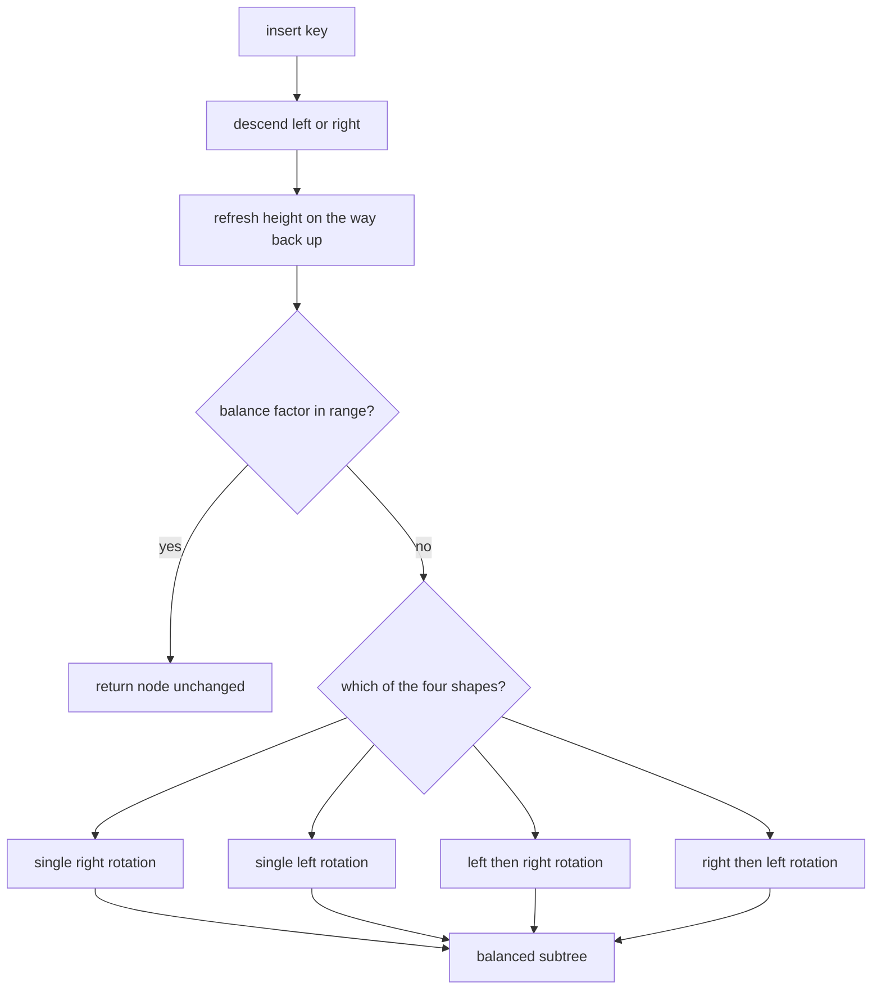
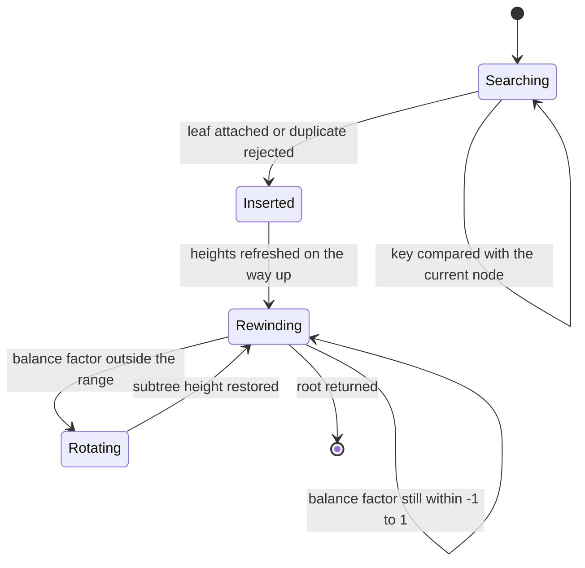
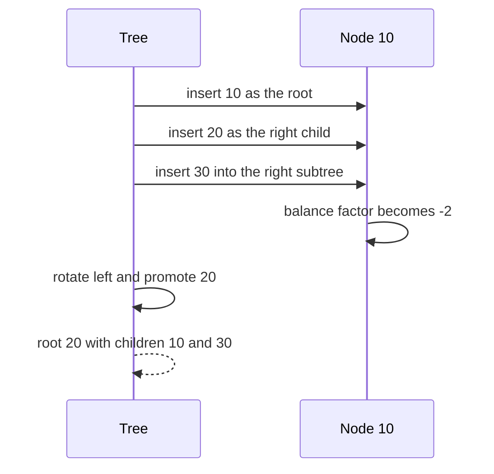

# 247 — Implement AVL tree insert & rotations (balance).

> **Tier:** Intermediate · **CTCI chapter:** CTCI §X — Advanced Topics
> **Task spec:** [247-implement-avl-tree-insert-rotations-balance.md](../../../tasks/intermediate/247-implement-avl-tree-insert-rotations-balance.md)
> **Solutions:** [Python](../../../solutions/python/intermediate/247-implement-avl-tree-insert-rotations-balance/solution.py) ·
> [Java](../../../solutions/java/intermediate/247-implement-avl-tree-insert-rotations-balance/Solution.java) ·
> [JavaScript](../../../solutions/javascript/intermediate/247-implement-avl-tree-insert-rotations-balance/solution.js) ·
> [C#](../../../solutions/csharp/intermediate/247-implement-avl-tree-insert-rotations-balance/Solution.cs)

## 1. Problem restatement

**Input:** a sequence of integer keys inserted one at a time into an AVL tree — a binary search tree
in which every node's height difference between its two subtrees stays within `[-1, 1]`.

**Output:** the root after each insertion, with the tree rebalanced by rotations whenever the
insertion breaks the invariant. Duplicates are ignored. The docstring: "every insert walks back up
updating heights; the first node whose balance factor leaves `[-1, 1]` is rebalanced with one LL/RR
rotation or one LR/RL double rotation."

| Call | Assertion |
| --- | --- |
| `build([10, 20, 30])` | root `20`, children `10` and `30` |
| `build([30, 20, 10])` | root `20`, children `10` and `30` |
| `build([30, 10, 20])` | root `20`, children `10` and `30` |
| `build([10, 30, 20])` | root `20`, children `10` and `30` |
| `build(range(1, 8))` | `inorder == [1..7]`, `is_balanced`, `height == 3` |
| `build(range(1, 11))` | `count == 10`, `is_balanced`, `height == 4` |
| `build([5, 5, 5])` | `count == 1` — duplicates ignored |
| `build([50, 20, 60, 10, 30, 55, 70])` | `inorder == [10, 20, 30, 50, 55, 60, 70]` |

Each node stores `key`, `left`, `right` and `height`, where a missing child has height `0` and a
leaf has height `1`.

## 2. Intuition

A plain BST insert walks down and attaches a leaf; the heights on the path are then stale, and the
tree can degenerate into a spine. AVL fixes both problems in the same walk back up:

- after recursing, refresh the node's height from its children;
- compute the balance factor `height(left) - height(right)`;
- if it is outside `[-1, 1]`, rotate.

Four rotation shapes cover every case, and the shape is decided by the direction of the imbalance and
by where the new key went relative to the child:

| Shape | Imbalance | New key relative to child | Fix |
| --- | --- | --- | --- |
| Left-left | `> 1` (left heavy) | less than the left child's key | one right rotation |
| Right-right | `< -1` (right heavy) | greater than the right child's key | one left rotation |
| Left-right | `> 1` | greater than the left child's key | rotate the left child left, then rotate right |
| Right-left | `< -1` | less than the right child's key | rotate the right child right, then rotate left |

A single rotation is just pointer surgery: it lifts one child into the parent's place and re-parents
the displaced subtree, and it restores the balance because the heavy side shrinks by one level while
the light side grows by one.



## 3. Algorithm

1. `insert(node, key)`:
   1. If the node is missing, return a new leaf with that key and height `1`.
   2. If the key is smaller, recurse left; if larger, recurse right; if equal, return the node
      unchanged (duplicates are ignored).
   3. Refresh the height: `1 + max(height(left), height(right))`.
   4. `bf ← height(left) - height(right)`.
   5. If `bf > 1` and the key is less than the left child's key → return `rotate_right(node)`.
   6. If `bf < -1` and the key is greater than the right child's key → return `rotate_left(node)`.
   7. If `bf > 1` and the key is greater than the left child's key → set
      `node.left = rotate_left(node.left)`, then return `rotate_right(node)`.
   8. If `bf < -1` and the key is less than the right child's key → set
      `node.right = rotate_right(node.right)`, then return `rotate_left(node)`.
   9. Otherwise return the node.
2. `build(keys)` folds `insert` over the list and returns the final root.

```text
procedure insert(node, key)
    if node is missing then
        return new leaf node with key and height 1
    end
    if key is less than key of node then
        left of node ← insert(left of node, key)
    else if key is greater than key of node then
        right of node ← insert(right of node, key)
    else
        return node
    end
    update(node)
    bf ← height of left of node - height of right of node
    if bf greater than 1 and key is less than key of left of node then
        return rotate_right(node)
    end
    if bf less than -1 and key is greater than key of right of node then
        return rotate_left(node)
    end
    if bf greater than 1 and key is greater than key of left of node then
        left of node ← rotate_left(left of node)
        return rotate_right(node)
    end
    if bf less than -1 and key is less than key of right of node then
        right of node ← rotate_right(right of node)
        return rotate_left(node)
    end
    return node

procedure rotate_right(y)
    x ← left of y
    left of y ← right of x
    right of x ← y
    update(y)
    update(x)
    return x
```

`rotate_left` is the mirror image. Note the order of the two `update` calls inside a rotation: the
demoted node (`y`) is refreshed first, because the promoted node's new height depends on it.



## 4. Worked example

Insert `10, 20, 30` — sorted input, the case that degenerates a plain BST.

| Step | Insert | Tree before (in-order) | Heights on the path | Balance factor seen | Action |
| --- | --- | --- | --- | --- | --- |
| 1 | `10` | empty | leaf | — | root `10`, height 1 |
| 2 | `20` | `10` | `20` is a leaf, `10` becomes height 2 | `0 - 1 = -1` at `10` | no rotation |
| 3 | `30` | `10 → 20` | `30` leaf, `20` height 2, `10` height 3 | `-2` at `10`, and `30 > 20` | single left rotation about `10` |

After the third insert, `rotate_left(10)` promotes `20`: the new root is `20` with left child `10`
and right child `30`, heights `1, 2, 1` — asserted as
`(root.key, root.left.key, root.right.key) == (20, 10, 30)`.

The three remaining shape assertions all produce the same root by different routes:

| Input | Shape | Rotations applied |
| --- | --- | --- |
| `30, 20, 10` | descending | single right rotation about `30` |
| `30, 10, 20` | left child, then its right child | left about `10`, then right about `30` |
| `10, 30, 20` | right child, then its left child | right about `30`, then left about `10` |



For the ascending input `1..7`, the rotations keep the tree perfect: the assertion records
`inorder == [1..7]`, `is_balanced(root)` and `height == 3`, which is the minimum possible height for
seven nodes. Inserting `1..10` keeps the balance and gives `height == 4`, because three levels hold
at most seven nodes.

## 5. Complexity

Let `n` be the number of keys inserted and `h` the height.

| Measure | Bound | Why it holds |
| --- | --- | --- |
| Time, best | O(log n) per insert | a balanced AVL tree has `h = O(log n)`, so the descent is logarithmic |
| Time, average | O(log n) per insert | heights and balance factors are computed in constant time per node on the path |
| Time, worst | O(log n) per insert | the AVL invariant keeps the height logarithmic in `n`; rotations are `O(1)` |
| Time, building `n` keys | O(n log n) | `n` independent inserts |
| Space | O(n) | one node per key, plus `O(log n)` recursion frames per insert |
| Plain BST on sorted input | O(n) per insert, `O(n²)` total | the spine case this task removes |

Only one rebalancing step is needed per insertion: the subtree's height returns to its pre-insert
value after the rotation, so ancestors above the fixing point stay balanced.

## 6. Pitfalls and edge cases

- **Refresh the heights after the rotation, not before.** `rotate_right` calls `update(y)` then
  `update(x)`; reversing the order leaves the promoted node with a stale height and the next balance
  factor is wrong.
- **Balance factors are computed from updated heights.** `update(node)` must run before
  `balance_factor(node)` on the way back up.
- **Duplicates are ignored, not counted.** `build([5, 5, 5])` yields `count == 1` and `insert`
  returns the node unchanged for an equal key — no multiplicity field exists.
- **The four cases are classified by the inserted key**, which is what the shipped code compares
  against `node.left.key` / `node.right.key`. The classic alternative classifies by the child's
  balance factor; both work here because the imbalance was just caused by this key.
- **Missing children have height `0`, leaves have height `1`.** A null-safe `height` helper is the
  only place that convention appears.
- **Empty input.** `build([])` returns a missing root; every `inorder`, `count` and `is_balanced`
  helper handles the missing case first.
- **The 10-key height is `4`, not `log2(10) ≈ 3.32`.** Heights are integers and levels hold
  `1, 2, 4, 3` nodes, so four levels are needed — the assertion records the exact value.
- **Integer keys only.** The comparisons are plain `<` / `>`; nothing here is generic over a
  comparator, which is why the four files all use `int` / `key`.
- **Deletion is out of scope.** Only insertion and rotation are implemented, so a full AVL
  implementation would still need the symmetric remove-and-rebalance path.

## 7. Variants and follow-ups

- **Red-black alternative.** [248-implement-red-black-tree-insert-basic-conceptual.md](../../../tasks/intermediate/248-implement-red-black-tree-insert-basic-conceptual.md)
  buys the same `O(log n)` guarantee with recolouring instead of strict height balance, which makes
  insertion cheaper and lookup slightly slower.
- **Rank queries on a balanced tree.** [order statistics tree](../../../tasks/advanced/433-implement-order-statistics-tree-using-balanced-bst-rank-select.md)
  adds subtree sizes to a balanced BST, exactly the structure this task builds.
- **The balance predicate on a plain tree.** [142-check-if-tree-is-balanced-height-difference-1.md](../../../tasks/beginner/142-check-if-tree-is-balanced-height-difference-1.md)
  is the `is_balanced` helper's standalone counterpart.
- **Sorted input, unrotated.** [246-serialize-deserialize-binary-search-tree-compactly.md](../../../tasks/intermediate/246-serialize-deserialize-binary-search-tree-compactly.md)
  shows why a degenerate spine is a problem: the preorder string grows to `n` tokens and the
  recursion depth grows to `n`.
- The chapter walkthrough in [Advanced Topics](../../ctci/x-advanced-topics.md) collects the
  self-balancing structures.

## 8. Check yourself

1. Why is at most one rotation needed per insertion?

<details><summary>Show answer</summary>

Because a single rotation (or one double rotation) restores the height of the whole rebalanced
subtree to what it was before the insertion. Ancestors above it therefore see unchanged heights and
cannot become unbalanced, so the walk back up stops after the first fix.

</details>

2. In `rotate_right(y)`, why is `update(y)` called before `update(x)`?

<details><summary>Show answer</summary>

After the rotation `y` has lost its tall child to `x`, so `y`'s height must be recomputed from its new
children first. `x` then becomes the parent of `y`, and its height depends on `y`'s new value —
updating `x` first would use a stale child height.

</details>

3. What do `build([30, 10, 20])` and `build([10, 30, 20])` have in common, and how do they differ?

<details><summary>Show answer</summary>

Both end with root `20` and children `10` and `30`. They differ in the shape of the imbalance: the
first is left-right (the key went right of the left child), so the fix is a left rotation about `10`
followed by a right rotation about `30`; the second is right-left and the rotations happen in the
opposite order.

</details>

4. Sorted input `1..10` produces height `4`. Why not `3`?

<details><summary>Show answer</summary>

Because three levels hold at most seven nodes and ten keys need a fourth; the assertion records
`height == 4` for `build(range(1, 11))`. The AVL invariant constrains the *difference* between the
two subtree heights at each node — it does not force every level to be completely full, so the
minimum height is achieved only when the keys happen to fill levels exactly.

</details>

5. What would happen if the duplicate branch returned a fresh leaf instead of the node?

<details><summary>Show answer</summary>

`build([5, 5, 5])` would produce three nodes instead of one, breaking `count(build([5, 5, 5])) == 1`,
and the tree would contain a search-tree violation (an equal key stored in a subtree it cannot
belong to). Returning the node unchanged is what makes insertion idempotent on repeated keys.

</details>
