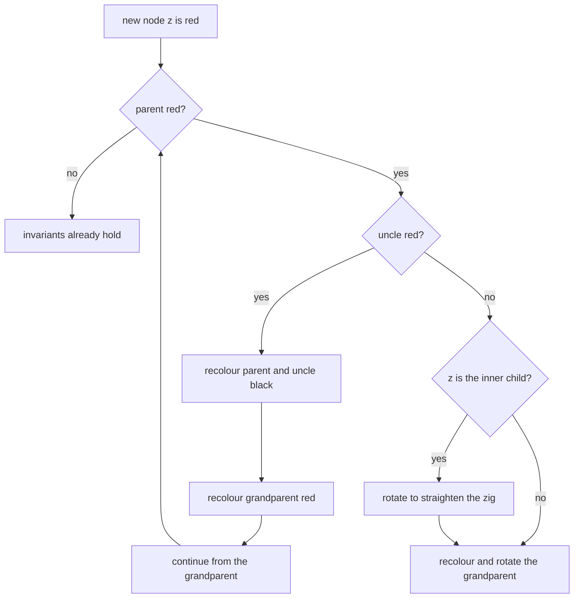
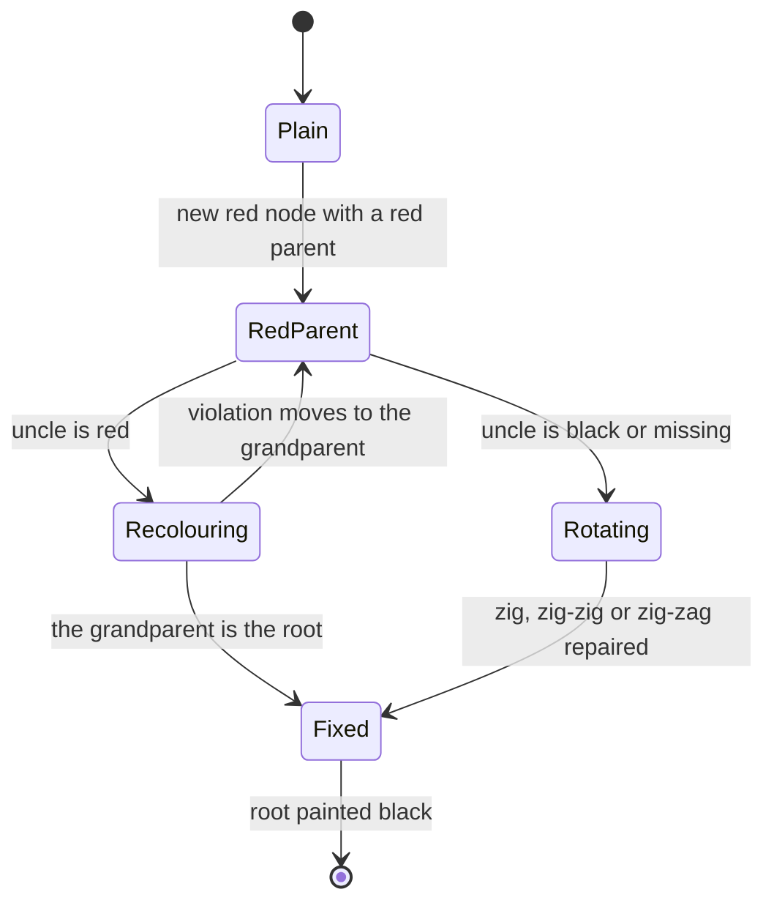
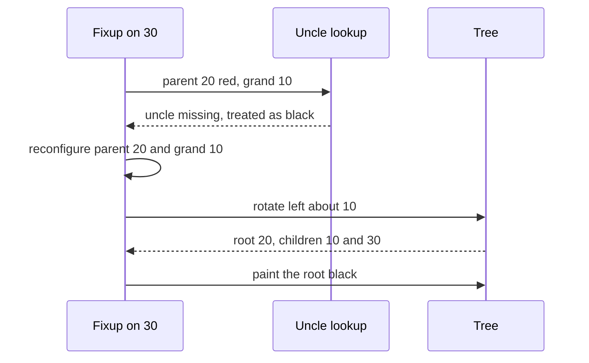

# 248 — Implement red-black tree insert basic (conceptual).

> **Tier:** Intermediate · **CTCI chapter:** CTCI §X — Advanced Topics
> **Task spec:** [248-implement-red-black-tree-insert-basic-conceptual.md](../../../tasks/intermediate/248-implement-red-black-tree-insert-basic-conceptual.md)
> **Solutions:** [Python](../../../solutions/python/intermediate/248-implement-red-black-tree-insert-basic-conceptual/solution.py) ·
> [Java](../../../solutions/java/intermediate/248-implement-red-black-tree-insert-basic-conceptual/Solution.java) ·
> [JavaScript](../../../solutions/javascript/intermediate/248-implement-red-black-tree-insert-basic-conceptual/solution.js) ·
> [C#](../../../solutions/csharp/intermediate/248-implement-red-black-tree-insert-basic-conceptual/Solution.cs)

## 1. Problem restatement

**Input:** a sequence of integer keys inserted one at a time into a red-black tree — a binary search
tree with one bit of colour per node and four invariants.

**Output:** after every insertion the four invariants hold, which the files check explicitly:

| Invariant | Checker |
| --- | --- |
| the tree is a valid BST | `inorder(root) == sorted(order)` |
| the root is black | `not root.red` |
| no red node has a red child | `no_red_red(root)` |
| every root-to-leaf path has the same number of black nodes | `len(black_heights(root, 0)) == 1` |

`insert` returns a boolean: `False` for a duplicate key, which is rejected outright.

| Call | Assertion |
| --- | --- |
| `insert` of `10, 20, 30` | root `20` and black; `10` and `30` red |
| insert `1..10` in order | all four invariants hold |
| insert `7, 3, 9, 1, 5, 8, 10, 2, 4, 6` | all four invariants hold |
| insert `50, 20, 60, 10, 30, 55, 70, 5, 15, 25, 35` | all four invariants hold |
| `insert(50)` on that last tree | `False` — duplicate rejected |

The docstring names the recipe: "CLRS insert + fixup: recolor while the uncle is red, otherwise
rotate (zig / zig-zig / zig-zag)."

## 2. Intuition

The plain BST descent is unchanged; the work is in restoring the invariants afterwards. A new node is
inserted **red**, because a red node adds no black to any path — so the black-height invariant and the
BST order survive automatically. The only thing a red node can break is "no red-red pair", and only
against its parent.

So the fixup loop looks at the parent and, when both are red, at the *uncle* — the grandparent's other
child:

- **Red uncle:** recolour parent and uncle black, grandparent red, and continue the loop from the
  grandparent. This pushes the violation upward without rotating.
- **Black uncle (or no uncle):** the local shape is a zig (parent and child on opposite sides),
  a zig-zig, or a zig-zag. Rotate to straighten the zig, then rotate the grandparent and recolour.

Every step moves the violation at most one generation up the tree, and each rotation is `O(1)`
pointer surgery — the same surgery as in task 247, with the grandparent's parent link to maintain.



## 3. Algorithm

1. **BST descend.** Walk from the root, remembering the parent, comparing keys. On an equal key,
   return `False` — duplicates are rejected.
2. **Attach.** Create a red node, link it to its parent (or make it the root when the tree was
   empty), then run the fixup on it.
3. **Fixup `z`:**
   1. While `z` has a parent and that parent is red:
      1. Let `parent ← z.parent` and `grand ← parent.parent` (which must exist, since the root is
         black and cannot be the red parent).
      2. Take `uncle` to be the grandparent's other child.
      3. If `uncle` is red: colour `parent` and `uncle` black, colour `grand` red, set
         `z ← grand` and repeat.
      4. Otherwise (uncle black or missing): if `z` is the parent's inner child, set `z ← parent`,
         rotate `z`, and re-read `parent` and `grand` from the new `z`. Then colour `parent` black,
         colour `grand` red, and rotate `grand`. The loop then exits.
   2. Colour the root black.
4. Return `True` — the key was inserted.

```text
procedure insert(tree, key)
    parent ← missing
    node ← root of tree
    while node is not missing do
        parent ← node
        if key is less than key of node then
            node ← left of node
        else if key is greater than key of node then
            node ← right of node
        else
            return false
        end
    end
    z ← new node with key, coloured red, parent ← parent
    if parent is missing then
        root of tree ← z
    else if key is less than key of parent then
        left of parent ← z
    else
        right of parent ← z
    end
    fixup(tree, z)
    return true

procedure fixup(tree, z)
    while parent of z is present and parent of z is red do
        parent ← parent of z
        grand ← parent of parent
        if parent is left of grand then
            uncle ← right of grand
            if uncle is present and uncle is red then
                parent.red ← black
                uncle.red ← black
                grand.red ← red
                z ← grand
            else
                if z is right of parent then
                    z ← parent
                    rotate_left(tree, z)
                    parent ← parent of z
                    grand ← parent of parent
                end
                parent.red ← black
                grand.red ← red
                rotate_right(tree, grand)
            end
        else
            mirror the same four blocks with left and right exchanged
        end
    end
    root of tree.red ← black
end
```

The final `root.red ← black` is not optional: the loop can exit with the root red (for example when
the recolouring case reaches the root), and the root invariant is the one that must hold
unconditionally.



## 4. Worked example

Insert `10, 20, 30` — the smallest input that forces a rotation.

| Step | Insert | Before | After attach | Fixup |
| --- | --- | --- | --- | --- |
| 1 | `10` | empty | `10` red becomes the root | root painted black |
| 2 | `20` | `10` black | `20` red as `10`'s right child | parent `10` is black, loop does not run |
| 3 | `30` | `10` black, `20` red | `30` red as `20`'s right child | parent `20` red, uncle missing, `z` is the right child (zig-zig) |

Step 3 in detail: `parent = 20`, `grand = 10`, the uncle is missing so it counts as black, and `z`
(`30`) is the *right* child of a right child — no preliminary rotation. `parent.red ← black` paints
`20` black, `grand.red ← red` paints `10` red, and `rotate_left(grand)` promotes `20`. The root
becomes `20` (black) with children `10` and `30` (both red), exactly the assertion. The final
`root.red ← black` is a no-op here because `20` was already painted black.



Now insert `1..10`. The interesting generations are the ones that exercise recolouring: after a red
uncle is spotted, parent and uncle turn black, the grandparent turns red and the violation moves up.
The checkers assert the outcome rather than the route: sorted inorder, black root, no red-red pair,
and a single black-height value across all root-to-leaf paths.

| Order | Route exercised |
| --- | --- |
| `1..10` ascending | repeated zig-zig rotations, with recolouring at the root |
| `7, 3, 9, 1, 5, 8, 10, 2, 4, 6` | interleaved, so both the zig-zag and zig-zig branches are hit |
| `50, 20, 60, 10, 30, 55, 70, 5, 15, 25, 35` | a wide tree where the black height stays uniform across eleven keys |

## 5. Complexity

Let `n` be the number of keys and `h` the height.

| Measure | Bound | Why it holds |
| --- | --- | --- |
| Time, best | O(log n) per insert | the descend is logarithmic; a black parent ends the fixup immediately |
| Time, average | O(log n) per insert | the fixup walks up at most `O(log n)` generations of recolouring |
| Time, worst | O(log n) per insert | the red-black invariants bound the height by `2 log2(n + 1)`, and at most two rotations occur |
| Time, building `n` keys | O(n log n) | `n` independent inserts |
| Space | O(n) | one node per key; no recursion in insert (the checkers recurse, but only over `O(log n)` height) |
| Rotations per insert | O(1) | at most one zig plus one promotion; recolouring is the only loop |
| Plain BST on sorted input | O(n) per insert | the spine that the colouring prevents |

Red-black insertion is the cheaper-rebalancing cousin of AVL: fewer rotations, more recolouring, and
a taller tree for the same key count — both keep every operation logarithmic.

## 6. Pitfalls and edge cases

- **The root must be black.** `root.red ← black` runs after the loop every time. When the
  recolouring case walks all the way up, the loop exits with a red root, and the invariant checker
  `not tree.root.red` would fail without that line.
- **A missing uncle is black.** The code tests `uncle is not None and uncle.red`; treating "no
  uncle" as anything else produces the wrong branch.
- **Zig case first, then the promotion.** When `z` is the parent's inner child, one rotation is
  performed *before* the recolour-and-rotate step, and `parent` / `grand` must be re-read from the
  new `z` — stale references after the rotation point at the wrong nodes.
- **Grandparent always exists inside the loop.** The parent is red, the root is black, so the parent
  cannot be the root and `parent.parent` is present.
- **Duplicates return `False`.** Inserting `50` twice leaves the tree unchanged and the second call
  reports `False`; `inorder` is still the sorted list.
- **The rotations maintain the parent links.** Unlike task 247's height-based rotations, these must
  also fix `node.parent` for the subtree moved across, or the fixup walks into the wrong generation.
- **Insert-only, deliberately.** The docstring calls this the "basic" implementation: deletion,
  `nil` sentinels and iteration are out of scope, so the tree cannot shrink.
- **The checkers are recursive.** `no_red_red` and `black_heights` both recurse over the tree; on a
  pathological input the recursion is `O(log n)` deep because the invariants bound the height.
- **Duplicate keys in the invariant checkers.** Because duplicates are rejected, the BST property
  can be checked with a plain sorted comparison (`inorder(root) == sorted(order)`), with no
  tie-breaking rule needed.
- **Eleven keys, uniform black height.** The widest assertion order contains `5, 15, 25, 35` as
  leaves; `black_heights` compares the black count over *all* root-to-leaf paths, which is what makes
  the uniformity check meaningful rather than a spot check.

## 7. Variants and follow-ups

- **Height-balanced instead of colour-balanced.** [247-implement-avl-tree-insert-rotations-balance.md](../../../tasks/intermediate/247-implement-avl-tree-insert-rotations-balance.md)
  uses the same rotation machinery with strict height tracking instead of colours.
- **The balance predicate on a plain tree.** [142-check-if-tree-is-balanced-height-difference-1.md](../../../tasks/beginner/142-check-if-tree-is-balanced-height-difference-1.md)
  is the "how unbalanced can a plain BST get" question that motivates this task.
- **Rank queries on a balanced tree.** [order statistics tree](../../../tasks/advanced/433-implement-order-statistics-tree-using-balanced-bst-rank-select.md)
  adds subtree sizes on top of a balanced structure like this one.
- **Tree editing primitives.** [063-implement-doubly-linked-list-insert-delete.md](../../../tasks/beginner/063-implement-doubly-linked-list-insert-delete.md)
  covers the pointer-surgery vocabulary that rotations rely on.
- The chapter walkthrough in [Advanced Topics](../../ctci/x-advanced-topics.md) compares
  self-balancing strategies.

## 8. Check yourself

1. Why is a new node inserted red rather than black?

<details><summary>Show answer</summary>

Because a black node increases the black count on the path that passes through it, breaking the
equal-black-height invariant immediately and for every path below. A red node adds no black, so only
the red-red rule can be violated — and that violation is local and repairable on the way up.

</details>

2. What does a red uncle tell you, and what does the fixup do about it?

<details><summary>Show answer</summary>

It tells you that the property can be restored without a rotation: recolour the parent and uncle
black (so no red-red pair remains at the parent's level) and the grandparent red (so the black counts
stay the same), then continue the loop with `z ← grand`. The violation has moved one generation up.

</details>

3. Trace the assertion tree: after inserting `10, 20, 30`, what are the node colours?

<details><summary>Show answer</summary>

`20` is black and both `10` and `30` are red. The rotation about `10` promoted `20`, and the
`parent.red ← black` / `grand.red ← red` pair painted `20` black and `10` red; `30` was already red,
and the final line repaints the root black (a no-op here, because the root was already black).

</details>

4. Why must `root.red ← black` run outside the loop?

<details><summary>Show answer</summary>

Because the recolouring branch can reach the root: when the grandparent becomes the root and is
painted red, the loop terminates (its parent is missing) with a red root. The invariant "root is
black" is unconditional, so it is enforced after the loop rather than inside a case.

</details>

5. What fails if the parent links are not maintained during a rotation?

<details><summary>Show answer</summary>

The fixup walks upward through `parent` pointers, so a stale link lands on the wrong node: the loop
may keep recolouring the same generation forever, or it may touch a node that is no longer the
parent of `z`. The `black_heights` and `no_red_red` assertions would fail on most of the listed
insertion orders.

</details>
