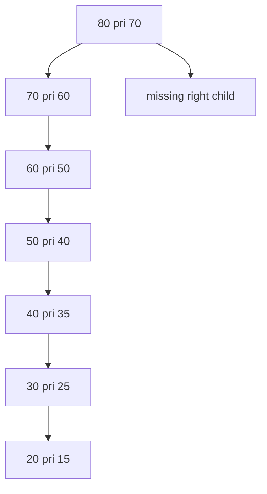
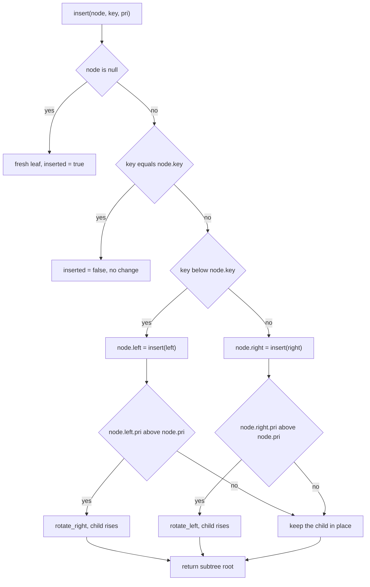
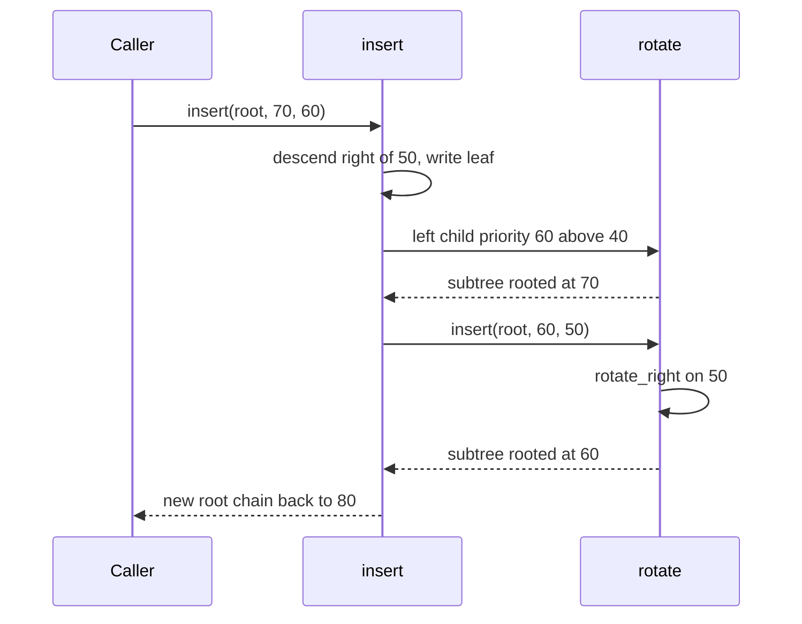
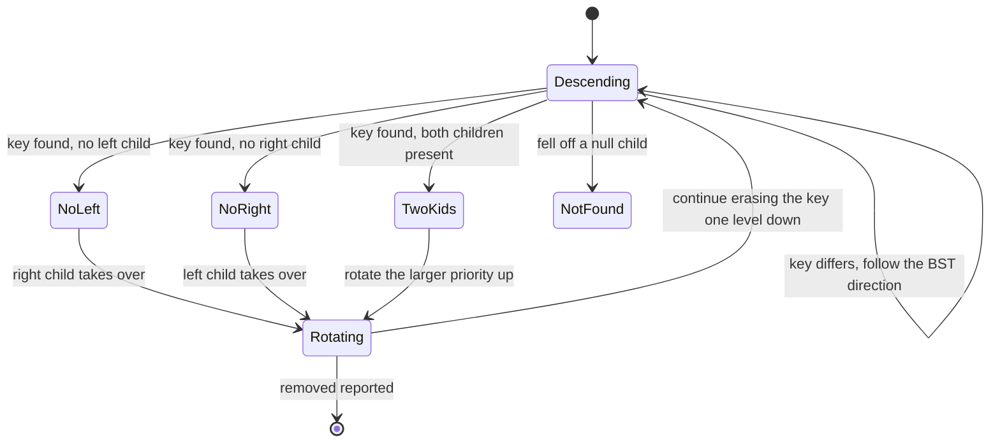

# 249 — Implement Treap (BST+heap) insert/delete.

> **Tier:** Intermediate · **CTCI chapter:** Ch 4 — Trees and Graphs
> **Task spec:** [249-implement-treap-bst-heap-insert-delete.md](../../../tasks/intermediate/249-implement-treap-bst-heap-insert-delete.md)
> **Solutions:** [Python](../../../solutions/python/intermediate/249-implement-treap-bst-heap-insert-delete/solution.py) ·
> [Java](../../../solutions/java/intermediate/249-implement-treap-bst-heap-insert-delete/Solution.java) ·
> [JavaScript](../../../solutions/javascript/intermediate/249-implement-treap-bst-heap-insert-delete/solution.js) ·
> [C#](../../../solutions/csharp/intermediate/249-implement-treap-bst-heap-insert-delete/Solution.cs)

## 1. Problem restatement

**Input:** a stream of `(key, priority)` pairs, both integers. Priorities are supplied by the
caller, not generated inside the structure, so a whole run is reproducible.

**Output:** a *treap* — a binary tree that is simultaneously a search tree on the keys and a
max-heap on the priorities — plus the usual observation helpers so a test can prove both
properties held.

The contract is fixed by the assertions the four solutions ship with (`main` in each file):

| Call | Result | Why |
| --- | --- | --- |
| `build([(50,40),(30,25),(70,60),(20,15),(40,35),(60,50),(80,70)])` | root has key `80`, priority `70` | the largest priority must end up at the root, whatever the insertion order |
| `preorder(root)` | `[80, 70, 60, 50, 40, 30, 20]` | the shape is fully determined by the seven priority values |
| `inorder(root)` | `[20, 30, 40, 50, 60, 70, 80]` | the BST property survives every rotation |
| `insert(treap_of(1), 1, 9)` | `inserted == False` | duplicate keys are rejected, and the priority is ignored |
| `erase(root, 30)` | `removed == True`, inorder `[20, 40, 50, 60, 70, 80]` | `30` had one child; that child takes its place |
| `erase(root, 80)` | `removed == True`, new root key `70` | erasing the root promotes its only child |
| `erase(root, 999)` | `removed == False`, tree unchanged | a miss walks to a `null` child and reports failure |
| `erase(None, 1)` | `(None, False)` | an empty treap is a legal input |
| `inorder(build([]))` | `[]` | building nothing yields nothing |

The API is one operation per concern: `insert` returns a *pair* (new root, inserted), `erase`
returns a pair (new root, removed), and `contains`, `inorder`, `preorder`, `is_heap` are pure
read-only walks. Nothing is deleted by rebuilding: `erase` restructures in place and returns the
same tree with one fewer node.

## 2. Intuition

The naive structure for an ordered set is a plain binary search tree: compare, go left when
smaller, go right when larger. It is `O(log n)` on average and `O(n)` on adversarial input —
feeding `1, 2, 3, ...` in order builds a right spine, i.e. a linked list with extra pointers.

The fix is to let randomness own the shape. Give every key a priority that is independent of the
key, and require two invariants at once:

- **BST on keys:** everything in the left subtree is smaller, everything in the right is larger.
- **Max-heap on priorities:** a parent's priority is never below either child's.

A *single* priority ordering satisfies the heap invariant in only one way, and that one way is a
uniquely determined tree shape. Rotations are the local move that repairs the heap without
touching the BST order, so "insert a key with a random priority" is just: insert as a plain BST
leaf, then bubble the leaf up with rotations until its parent has a larger priority.



The picture is the final state of the shipped test data. Every node's priority beats both of its
children, and the keys read in order down the left spine because each later insertion had a
larger priority and simply rotated to the root. Note the shape is a chain here — that is a
property of the seven hand-picked priorities, not of treaps in general; with independent random
priorities the expected height is `O(log n)`.

## 3. Algorithm

Insertion is a plain BST insert plus a "bubble up" repair; deletion is a plain BST find plus a
"rotate the survivor up" repair. Both are written as functions that return the (possibly new)
root of the subtree they were called on.

1. **Insert(node, key, pri).** If `node` is `None`, allocate a fresh leaf and report success.
2. If `key == node.key`, report failure and return the node untouched (no duplicate keys).
3. Recurse into the left subtree when `key < node.key`, otherwise into the right subtree; store
   the returned root back into the child slot.
4. If the child that was just written has a strictly larger priority than the node, rotate it up
   — `rotate_right` for a left child, `rotate_left` for a right child.
5. **Erase(node, key).** If `node` is `None`, report failure. Descend as in step 3 while the key
   differs.
6. On a hit: if there is no left child, the right child replaces the node; if there is no right
   child, the left child replaces it.
7. If both children exist, rotate the child with the *larger* priority up — `rotate_right` when
   the left child wins, `rotate_left` when the right child wins — and then continue erasing the
   key inside the subtree that now hangs below.
8. `build` folds `insert` over the input list; `contains`, `inorder`, `preorder` and `is_heap`
   only read.

```text
function rotate_right(y)
    x ← y.left
    y.left ← x.right
    x.right ← y
    return x

function rotate_left(x)
    y ← x.right
    x.right ← y.left
    y.left ← x
    return y

procedure insert(node, key, pri)
    if node = null then
        return new node with key and pri, inserted ← true
    if key = node.key then
        return node, inserted ← false
    if key < node.key then
        node.left ← insert(node.left, key, pri)
        if node.left.pri > node.pri then
            node ← rotate_right(node)
    else
        node.right ← insert(node.right, key, pri)
        if node.right.pri > node.pri then
            node ← rotate_left(node)
    return node, inserted

procedure erase(node, key)
    if node = null then
        return null, removed ← false
    if key < node.key then
        node.left ← erase(node.left, key)
    else if key > node.key then
        node.right ← erase(node.right, key)
    else
        removed ← true
        if node.left = null then return node.right, removed
        if node.right = null then return node.left, removed
        if node.left.pri > node.right.pri then
            node ← rotate_right(node)
            node.right ← erase(node.right, key)
        else
            node ← rotate_left(node)
            node.left ← erase(node.left, key)
    return node, removed
```

The pseudocode keeps the repository's signature: `insert` and `erase` both return a new root and
write the success flag as a side channel (a tuple in Python and JavaScript, a `boolean[]` in
Java, `ref bool` in C#).



The repair is a loop in disguise: each rotation moves the rising node exactly one level closer to
the root, so the recursion unwinds once the priority order is local again.

## 4. Worked example

Trace `build` over the shipped pairs `(50,40) (30,25) (70,60) (20,15) (40,35) (60,50) (80,70)`.
"Rotate" names what the invariant forced at that step:

| Step | Insert | Where it lands as a plain BST leaf | Repair |
| --- | --- | --- | --- |
| 1 | `50 pri 40` | empty tree | root becomes `50` |
| 2 | `30 pri 25` | left child of `50` | `25 < 40`, no rotation |
| 3 | `70 pri 60` | right child of `50` | `60 > 40`, `rotate_left` on `50` — `70` is the root |
| 4 | `20 pri 15` | left child of `30` | `15 < 25`, no rotation |
| 5 | `40 pri 35` | right child of `30` | `35 > 25`, `rotate_left` on `30` — `40` leads that subtree |
| 6 | `60 pri 50` | left child of `50` | `50 > 40`, `rotate_right` on `50` |
| 7 | `80 pri 70` | right child of `70` | `70 > 60`, `rotate_left` on `70` — `80` is the root |

After step 7 the tree is the one drawn in section 2: `80 → 70 → 60 → 50 → 40 → 30 → 20` down the
left spine. A preorder walk emits exactly that list and an inorder walk emits the sorted keys,
which is the whole point: the priority-driven shape did not disturb the key order.



Deletion on the resulting tree exercises two of the three cases:

- `erase(root, 30)`: `30` is found with a left child `20` and no right child, so step 6 returns
  `20` and the parent `40` adopts it. Inorder becomes `[20, 40, 50, 60, 70, 80]`; the heap check
  still passes.
- `erase(root, 80)`: the root has left child `70` and no right child, so the left child becomes
  the new root and `root.key == 70` afterwards.
- `erase(root, 999)`: the key is larger than every stored key, the walk falls off the right end
  and returns `removed = False` with the tree untouched, so inorder is still `[20, 40, 50, 60, 70]`.
- The third case — a node with *both* children, where the child with the larger priority is
  rotated up and the erase continues below — is not reachable from this particular data set; the
  shipped trees never give a deleted node two children.



## 5. Complexity

Let `n` be the number of stored keys and `h` the height of the treap.

| Measure | Bound | Why it holds |
| --- | --- | --- |
| `insert`, expected | O(log n) | a random priority places the node at the depth its rank suggests, so the expected height is `O(log n)` |
| `insert`, worst | O(n) | hand-picked priorities can force a spine; the shipped data set of seven keys does exactly that |
| `erase`, expected / worst | O(log n) / O(n) | the same descent, plus at most `h` rotations while the survivor climbs |
| `contains` | O(h) | one loop, no recursion, no restructuring |
| `inorder`, `preorder`, `is_heap` | O(n) | each visit does constant work |
| `build(m)` | O(m log n) expected | `m` independent insertions |
| Space | O(n) | one node per key, two child pointers and one priority each |
| Plain BST for comparison | O(log n) average, O(n) worst, O(n) space | correct but shape is attacker-controlled; the treap keeps the memory profile and removes the adversarial case |

Rotations are `O(1)` and only reassign three pointers each, so they add no asymptotic cost — they
just decide which of the many BST shapes with the same key order is the one kept.

## 6. Pitfalls and edge cases

- **Duplicate keys.** `insert` returns `(node, False)` and, crucially, does *not* rotate — the
  priority of the rejected pair is discarded. All four solutions assert this with
  `insert(build([(1, 5)]), 1, 9)` and require `inserted == False`.
- **Equal priorities.** The comparison is strict (`node.left.pri > node.pri` in insert,
  `node.left.pri > node.right.pri` in erase), so a tie falls through to the right/inner branch.
  Equal priorities are legal input, they simply do not force a rotation.
- **Deleting the root.** Handled by the same code path: when the root has at most one child the
  child is returned, and the caller stores it as the new root. The solutions assert
  `root.key == 70` after erasing `80`.
- **Deleting a missing key.** The recursion reaches `node == None`, returns `(None, False)`
  upwards and leaves every pointer as it was; `removed` records the miss.
- **Empty treap.** `erase(None, 1)` returns `(None, False)` and `inorder(build([]))` returns
  `[]`; both are asserted, so a `None` root must never be dereferenced.
- **One-child nodes.** The early returns make the `None`-child case cheap and avoid a pointless
  rotation; forgetting them is the usual way to turn this into a null-pointer bug.
- **Recursion depth.** `insert` and `erase` recurse along the search path; the depth is the tree
  height. With a deterministic test fixture that is bounded by the fixture, but with adversarial
  priorities a rewrite to an iterative form is the honest fix.
- **Caller-supplied priorities.** The repository deliberately takes priorities as parameters
  rather than generating them internally, which is what makes the preorder assertion
  `[80, 70, 60, 50, 40, 30, 20]` legitimate across all four languages instead of flaky.
- **Return-value protocol.** Every mutating operation returns the new subtree root; forgetting to
  write it back into the parent's child slot silently loses the rotation.

## 7. Variants and follow-ups

- **Random priorities inside the structure.** Generating the priority with a PRNG when the caller
  omits it gives the textbook treap without changing a single line of the repair logic — the
  invariants are identical.
- **Same invariants, different repair.** [250-implement-splay-tree-access-operation-basic.md](../../../tasks/intermediate/250-implement-splay-tree-access-operation-basic.md)
  also rotates a node towards the root, but on *every access* rather than on priority order, and
  the tree keeps parent pointers instead of priorities.
- **Ordered dictionary without priorities.**
  [251-implement-skip-list-insert-search-delete.md](../../../tasks/intermediate/251-implement-skip-list-insert-search-delete.md)
  buys the same expected `O(log n)` with a layered linked list and a coin flip, which shows the
  randomness can live in the links instead of the keys.
- **Tree-shaped key sets.**
  [252-design-a-phonebook-using-trie-with-counts-and-delete.md](../../../tasks/intermediate/252-design-a-phonebook-using-trie-with-counts-and-delete.md)
  stores keys by digit path rather than by comparison, so no rotations are needed at all.
- **Heap-ordered work.** Once a structure keeps a heap order, the same "bubble up, rotate the
  winner down" move reappears in the heap selection tasks
  ([256-top-k-frequent-elements-in-array-heap.md](../../../tasks/intermediate/256-top-k-frequent-elements-in-array-heap.md)).

## 8. Check yourself

1. Why does the treap need a priority at all, when a plain BST already maintains key order?

<details><summary>Show answer</summary>

Because key order alone leaves the *shape* undetermined, and the shape costs the running time.
Random priorities pick one of the many valid BST shapes uniformly enough that the expected height
is `O(log n)`, whichever order the keys arrive in. Without them, sorted input degenerates the tree
into a spine.

</details>

2. A rotation changes parent/child links. What guarantees the inorder walk is unaffected?

<details><summary>Show answer</summary>

A rotation only moves a node above or below its own parent, and it keeps the left/right relation
of every pair of keys that it touches. `rotate_right` on `y` promotes `x = y.left` and pushes `y`
into `x`'s right slot, so the key ranges of both subtrees are exactly what they were before. That
is why all four solutions assert a sorted inorder walk after every single operation.

</details>

3. What does `insert` return when the key already exists, and what happens to the new priority?

<details><summary>Show answer</summary>

It returns the unchanged node together with `inserted = False`, and the supplied priority is
dropped. The assertions make this explicit by inserting key `1` with priority `9` into a treap
whose only node is key `1` with priority `5` and requiring the call to fail, since priority `9`
would otherwise have hoisted the node to the root.

</details>

4. Which deletion case does the shipped test data never reach, and what would the code do?

<details><summary>Show answer</summary>

The two-children case. Every node erased by the tests has at most one child, so steps 6 return
early. If a node did have both children, `erase` would rotate up the child with the larger
priority (`rotate_right` when the left child wins, `rotate_left` otherwise) and recurse into the
subtree that now contains the key, which preserves the heap invariant while the key sinks to a
leaf position.

</details>

5. Why is `erase` not implemented as "find the node, rebuild the subtree from its children"?

<details><summary>Show answer</summary>

Because rebuilding from the children changes their relative shape and would break the heap order
unless you re-insert every key with its priority — turning `O(log n)` into `O(k log k)` for a
subtree of `k` nodes. Rotating the winner up is a local, `O(1)` repair that keeps both invariants
by construction.

</details>
