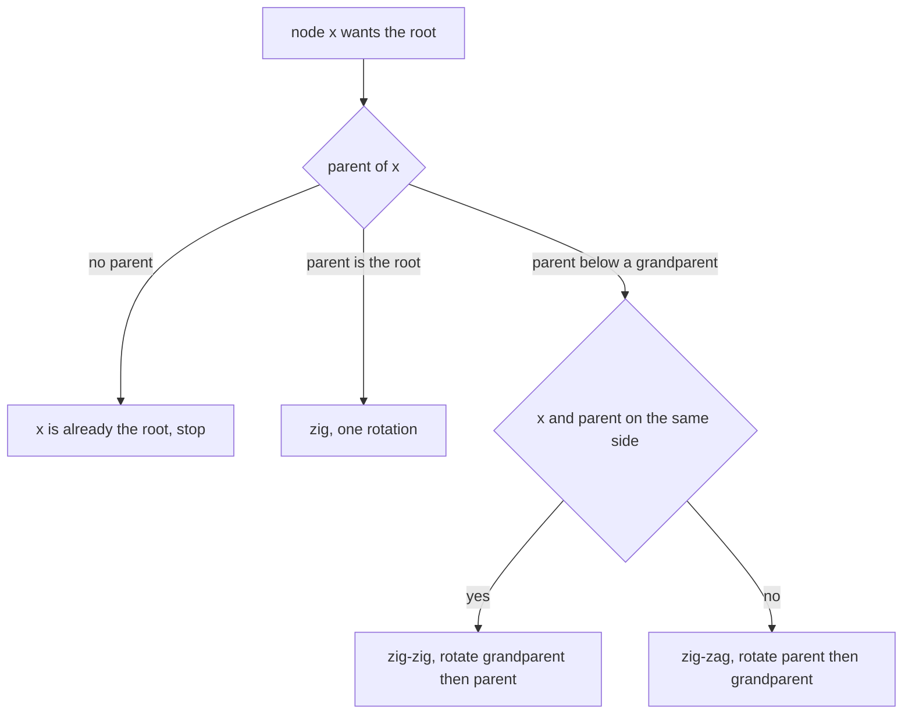
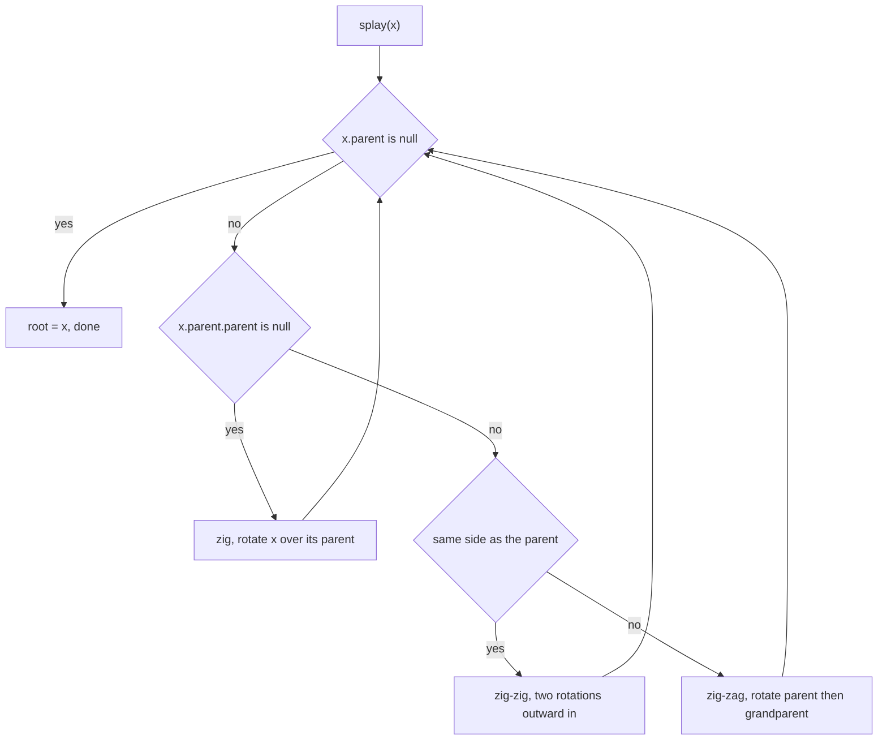
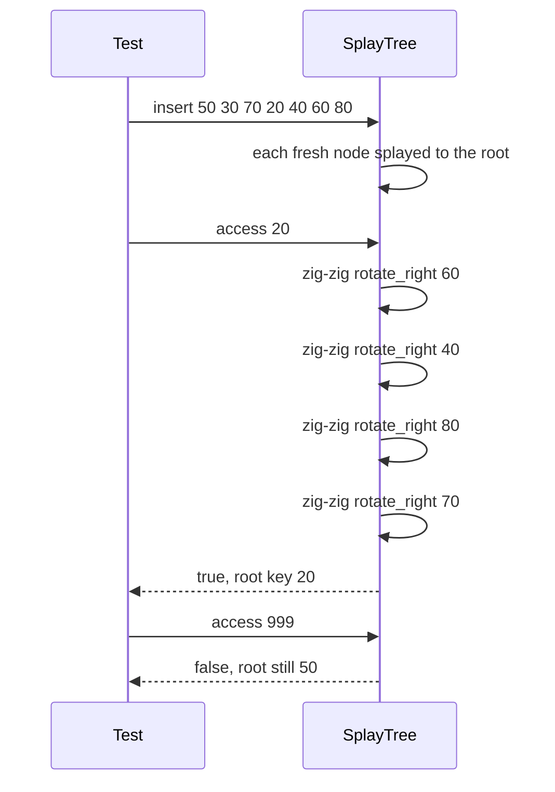

# 250 — Implement splay tree access operation (basic).

> **Tier:** Intermediate · **CTCI chapter:** Ch 4 — Trees and Graphs
> **Task spec:** [250-implement-splay-tree-access-operation-basic.md](../../../tasks/intermediate/250-implement-splay-tree-access-operation-basic.md)
> **Solutions:** [Python](../../../solutions/python/intermediate/250-implement-splay-tree-access-operation-basic/solution.py) ·
> [Java](../../../solutions/java/intermediate/250-implement-splay-tree-access-operation-basic/Solution.java) ·
> [JavaScript](../../../solutions/javascript/intermediate/250-implement-splay-tree-access-operation-basic/solution.js) ·
> [C#](../../../solutions/csharp/intermediate/250-implement-splay-tree-access-operation-basic/Solution.cs)

## 1. Problem restatement

**Input:** a sequence of `int` keys, inserted in the order the caller gives them, and a sequence
of access requests.

**Output:** a splay tree — a BST whose nodes carry parent pointers — where *every touch moves the
touched node to the root*. The class exposes `insert(key)`, `access(key)`, plus read-only
`inorder()` and `is_bst()` so a test can prove the tree stayed a valid BST.

The contract comes from the assertions in the four solution files:

| Call | Result | Why |
| --- | --- | --- |
| `insert(k)` for `50, 30, 70, 20, 40, 60, 80` | `True` every time | no duplicates, every insert succeeds |
| `root.key` after the loop | `80` | the node just inserted is splayed to the root |
| `inorder()` | `[20, 30, 40, 50, 60, 70, 80]` | the BST order survives every rotation |
| `is_bst()` | `True` | sorted inorder *and* every parent link consistent |
| `access(20)` | `True`, `root.key == 20` | the accessed node is splayed — zig-zig territory |
| `access(80)` | `True`, `root.key == 80` | mirror image of the previous case |
| `access(50)` | `True`, `root.key == 50` | zig-zag territory after the two previous splays |
| `access(999)` | `False`, `root.key` still `50` | a miss does **not** splay anything (documented) |
| `insert(50)` on a tree that already holds `50` | `False`, `root.key == 50` | the duplicate is splayed, not stored |
| `insert(7)` then `access(7)` on an empty tree | `True`, root is `7`, `root.parent is None` | one-node tree: no rotation needed |

The deleted-key operation is deliberately out of scope here: this is the *access* operation,
which is the part of a splay tree that all insertions and deletions are built from.

## 2. Intuition

A plain BST gives `O(log n)` only when the shape is balanced, and the shape is decided by the
insertion order. A splay tree takes the opposite stance: it does not maintain balance at all, it
maintains **recency**. Whatever node you touch becomes the root, so the tree reshapes itself
around your access pattern, and repeatedly touched keys are near the top.

The move that lifts a node is the rotation from task 249 — but a naive "rotate the node up over
its parent, one step at a time" is not enough. Rotating a deep zig-zig chain one step at a time
produces long, thin trees; rotating *pairs* first (grandparent, then parent) both lifts the node
two levels at once and halves the depth of the path it came from. Hence exactly three cases:

- **zig** — the parent is already the root: one rotation and the node is home.
- **zig-zig** — node and parent hang off the *same* side: the grandparent is rotated down first,
  then the parent, so the node jumps up two levels.
- **zig-zag** — node and parent hang off *opposite* sides: a double rotation that is the mirror
  of the two-step descent that created the shape.



The three cases are exhaustive because a node with a parent either has a grandparent or it does
not. The parent-pointer field is what makes the case distinction cheap: the code reads
`x.parent` and `x.parent.parent` instead of carrying a path stack.

## 3. Algorithm

`insert` is a plain BST descent plus `splay` on the node it created; `access` is a plain BST
descent plus `splay` on the node it found; `splay` is a loop that consumes the four sub-cases.

1. **Rotate primitives.** `rotate_left(x)` promotes `x.right` into `x`'s slot and makes `x` the
   new left child; `rotate_right(x)` is the mirror. Both go through one helper,
   `replace_child(parent, old, new)`, which rewires the *grandparent's* link (or the root pointer
   when the parent is `None`) and repairs `new.parent`.
2. **Splay(x).** While `x` has a parent, look at the parent and the grandparent.
3. No grandparent ⇒ **zig**: rotate `x` up over its parent (`rotate_right` when `x` is a left
   child, `rotate_left` otherwise).
4. Same-side pair ⇒ **zig-zig**: rotate the grandparent down, then the parent down; when both are
   left children use two `rotate_right` calls, when both are right children two `rotate_left`.
5. Opposite-side pair ⇒ **zig-zag**: rotate the parent down first, then the grandparent, in the
   direction each one needs.
6. Assign `root = x` when the loop ends, then let `insert`/`access` return.
7. **Insert(key).** Descend; on a hit, splay the existing node and return `False`. On a `None`
   child slot, attach the fresh leaf to the saved parent and splay it, then return `True`.
8. **Access(key).** Descend; on a hit, splay the node and return `True`. If the descent falls off
   the tree, return `False` **without** splaying — the repository documents this simplification.

```text
procedure replace_child(parent, old, fresh)
    if parent = null then root ← fresh
    else if parent.left = old then parent.left ← fresh
    else parent.right ← fresh
    if fresh ≠ null then fresh.parent ← parent

procedure rotate_left(x)
    y ← x.right
    x.right ← y.left
    if y.left ≠ null then y.left.parent ← x
    parent ← x.parent
    replace_child(parent, x, y)
    y.left ← x
    x.parent ← y

procedure splay(x)
    while x.parent ≠ null do
        parent ← x.parent
        grand ← parent.parent
        if grand = null then
            if x = parent.left then rotate_right(parent) else rotate_left(parent)
        else if x = parent.left and parent = grand.left then
            rotate_right(grand)
            rotate_right(parent)
        else if x = parent.right and parent = grand.right then
            rotate_left(grand)
            rotate_left(parent)
        else if x = parent.right and parent = grand.left then
            rotate_left(parent)
            rotate_right(grand)
        else
            rotate_right(parent)
            rotate_left(grand)
    root ← x

procedure access(key)
    node ← root
    while node ≠ null do
        if key = node.key then
            splay(node)
            return true
        node ← node.left if key < node.key else node.right
    return false
```

`insert` shares everything with `access` except the `None`-slot attachment:

```text
procedure insert(key)
    parent ← null
    node ← root
    while node ≠ null do
        parent ← node
        if key < node.key then node ← node.left
        else if key > node.key then node ← node.right
        else
            splay(node)
            return false
    fresh ← new node with key
    fresh.parent ← parent
    if parent = null then root ← fresh
    else if key < parent.key then parent.left ← fresh
    else parent.right ← fresh
    splay(fresh)
    return true
```



Each pass through the loop lifts `x` by at least one level and leaves every deeper node at least
as shallow as it was, so the loop terminates: the parent chain is strictly shortened from the top
every iteration.

## 4. Worked example

Building the tree by inserting `50, 30, 70, 20, 40, 60, 80` in that order. The right-hand column
is the splay that ran, in the order the code performs the rotations:

| Step | Insert | Path taken | Splay performed |
| --- | --- | --- | --- |
| 1 | `50` | empty tree | root becomes `50`, no rotation |
| 2 | `30` | left of `50` | zig: `rotate_right(50)` → root `30` |
| 3 | `70` | right of `50`, right of `30` | zig-zig: `rotate_left(30)`, `rotate_left(50)` → root `70` |
| 4 | `20` | left of `30` chain | zig-zig twice: `rotate_right(50)`, `rotate_right(30)`, then zig `rotate_right(70)` → root `20` |
| 5 | `40` | right of `30`, left of `50` | zig-zag: `rotate_right(50)`, `rotate_left(30)`, then zig `rotate_right(70)` → root `40` |
| 6 | `60` | right of `50`, left of `70` | zig-zag: `rotate_left(50)`, `rotate_right(70)`, then zig `rotate_left(40)` → root `60` |
| 7 | `80` | right of `70`, right of `60` | zig-zig: `rotate_left(60)`, `rotate_left(70)` → root `80` |

The final tree is `80` at the root with `70 → 60 → 40 → 20` down the left spine, `50` and `30`
parked under `40`. That is exactly what the assertions check: `root.key == 80`, and
`inorder()` is `[20, 30, 40, 50, 60, 70, 80]` — the rotations decided the shape, never the order.



`access(20)` is the interesting trace: `20` sits at depth 4 under `80`, and the walk to the root
consumes two zig-zig pairs plus one zig. The first pair rotates `60` then `40` down, which brings
`20` up two levels and shortens the spine below it; the second pair rotates `80` then `70` down,
which makes `20` the root. The tree that results is `20` with `70` as its right child and
`40 → 30`, `40 → 60 → 50`, `70 → 80` hanging below — the same seven keys, sorted inorder, and a
much shallower left side than before.

After `access(80)` (the mirror zig-zig, `rotate_left(20)` then `rotate_left(70)`) and
`access(50)`, the root is `50` and `access(999)` leaves it there, because the miss returns before
`splay` is ever called: the search walks off the right end of the tree and reports `False`, so the
shape of the tree is exactly what the previous successful access left behind.

## 5. Complexity

Let `h` be the current height and `n` the number of nodes.

| Measure | Bound | Why it holds |
| --- | --- | --- |
| One rotation | O(1) | three pointer reassignments plus one parent repair |
| `splay(x)`, worst single call | O(h) = O(n) | the loop runs once per level of `x` and the shipped tree of seven keys is a spine |
| `access`, worst single call | O(n) | descent `O(h)` plus splay `O(h)` |
| `access`, amortized | O(log n) in the classical analysis | the pair (zig-zig / zig-zag) rotations cut the path length roughly in half, which is what pays for the rotations |
| `insert` | same as `access` + O(1) | the descent is identical and the leaf attachment is constant work |
| Space | O(n) | one node per key plus one parent pointer per node; `splay` is iterative so no recursion stack |
| Plain BST for comparison | O(log n) average, O(n) worst, O(n) space | never restructures, so a recency pattern cannot help it |
| Treap (task 249) for comparison | O(log n) expected, O(n) worst | randomness owns the shape; access order is irrelevant there |

The amortized bound is the classical statement for full splaying. The repository's simplification
— a failed `access` does not splay the last node it looked at — removes those rotations entirely,
so a miss costs just the descent.

## 6. Pitfalls and edge cases

- **A miss must not splay.** `access(999)` returns `False` and the assertions demand
  `root.key == 50` afterwards. If you splay the last visited node on a miss, that assertion fails,
  and the documented behaviour of this task's `access` changes.
- **Duplicates.** `insert` on an existing key splays the *existing* node and returns `False`; the
  key is not stored twice, so `inorder()` still has seven entries. Because the duplicate in the
  test is the current root, `root.key == 50` remains true either way — the important half of the
  assertion is the `False`.
- **Parent pointers.** They are updated in `replace_child`, in both rotations, and when a fresh
  leaf is attached. `is_bst()` rechecks that every child's `parent` is its actual parent, which is
  the check that catches a rotation that forgot the grandparent.
- **The four mirror cases.** The `else` branch of `_splay` is the mirror zig-zag; dropping it
  makes right-left splays silently wrong while left-right ones still work — a classic partial-fix
  bug that the `access(50)` assertion catches.
- **Single-node tree.** `insert(7)` then `access(7)` must leave `root.parent` as `None`; a
  rotation on a childless root would dereference `x.parent` and crash.
- **Empty tree.** `access` on a `None` root simply returns `False`; `splay` is never entered with
  a `None` argument.
- **Ties and equal keys.** Keys are unique by construction — duplicates are rejected — so the
  strict comparisons `<` / `>` never need a tie rule.
- **Rotation direction naming.** `rotate_left(x)` here means "`x` becomes the left child", the
  same convention as task 249; mixing the two conventions is the most common port error between
  the four solution files.
- **Recursion depth.** Both `splay` and the two descents are iterative, so a deep spine cannot
  overflow the stack — only `inorder` recurses, and only as deep as the height.

## 7. Variants and follow-ups

- **Delete in a splay tree.** There is no `erase` in this repository's version, but the standard
  route is: splay the key, then splay the largest key of the left subtree in the left subtree and
  attach the right subtree to it — two `access` calls plus one pointer assignment.
- **Same rotation, different trigger.**
  [249-implement-treap-bst-heap-insert-delete.md](../../../tasks/intermediate/249-implement-treap-bst-heap-insert-delete.md)
  rotates on a priority comparison instead of on access, and needs no parent pointers because the
  recursion carries the path.
- **Recency without rotations.**
  [251-implement-skip-list-insert-search-delete.md](../../../tasks/intermediate/251-implement-skip-list-insert-search-delete.md)
  gets its `O(log n)` from layered links and a coin flip; the access pattern has no effect at all.
- **Key sets shaped by digits.**
  [252-design-a-phonebook-using-trie-with-counts-and-delete.md](../../../tasks/intermediate/252-design-a-phonebook-using-trie-with-counts-and-delete.md)
  and
  [253-implement-compressed-trie-radix-tree-basics.md](../../../tasks/intermediate/253-implement-compressed-trie-radix-tree-basics.md)
  replace comparisons with path traversal, which removes the need for balancing or splaying.
- **Where the amortized argument pays off.** The heap-based selectors
  ([259-kth-smallest-element-using-order-statistics-quickselect.md](../../../tasks/intermediate/259-kth-smallest-element-using-order-statistics-quickselect.md))
  use the same idea that an occasional expensive step can be charged to cheaper ones.

## 8. Check yourself

1. Why is one rotation per level not enough for a splay step?

<details><summary>Show answer</summary>

Because a long same-side chain rotated one step at a time leaves the rest of the path nearly as
deep as before, so the path length is not reduced enough to pay for the rotations. Doing the
grandparent and then the parent in a single case lifts the node two levels and roughly halves the
depth of the path it came from, which is what the amortized bound is built on.

</details>

2. What is the difference between `access` and `insert` in this implementation?

<details><summary>Show answer</summary>

`insert` descends while remembering the last node it visited. If the key is found it splays that
node and returns `False`; otherwise it hangs a fresh leaf off the remembered parent, splays the
leaf and returns `True`. `access` only searches: on a hit it splays and returns `True`, and on a
miss it returns `False` without touching the shape.

</details>

3. Which assertion would fail if `replace_child` forgot to set `fresh.parent = parent`?

<details><summary>Show answer</summary>

`is_bst()`, which the tests call after every splay. Its second half walks every node and requires
each child's `parent` pointer to be the node itself, so a rotation that rewires the child slot but
not the back-pointer is reported as not a BST even though the inorder walk is still sorted.

</details>

4. Why does `access(999)` leave `root.key == 50` in the shipped test?

<details><summary>Show answer</summary>

Because the search for `999` walks off the right end of the tree and `access` returns `False`
straight away; `splay` is only called on a node that was actually found. This is the documented
simplification of this repository's `access` — a textbook splay tree would splay the last node
visited on a miss.

</details>

5. How many rotations does a zig-zig splay perform, and how many does a zig-zag?

<details><summary>Show answer</summary>

Both perform two rotations per pass. Zig-zig rotates the grandparent and then the parent (two
`rotate_right` when both are left children, two `rotate_left` when both are right children);
zig-zag rotates the parent first and then the grandparent, in opposite directions. A `zig` — the
case where the parent is the root — is the only single-rotation case.

</details>
