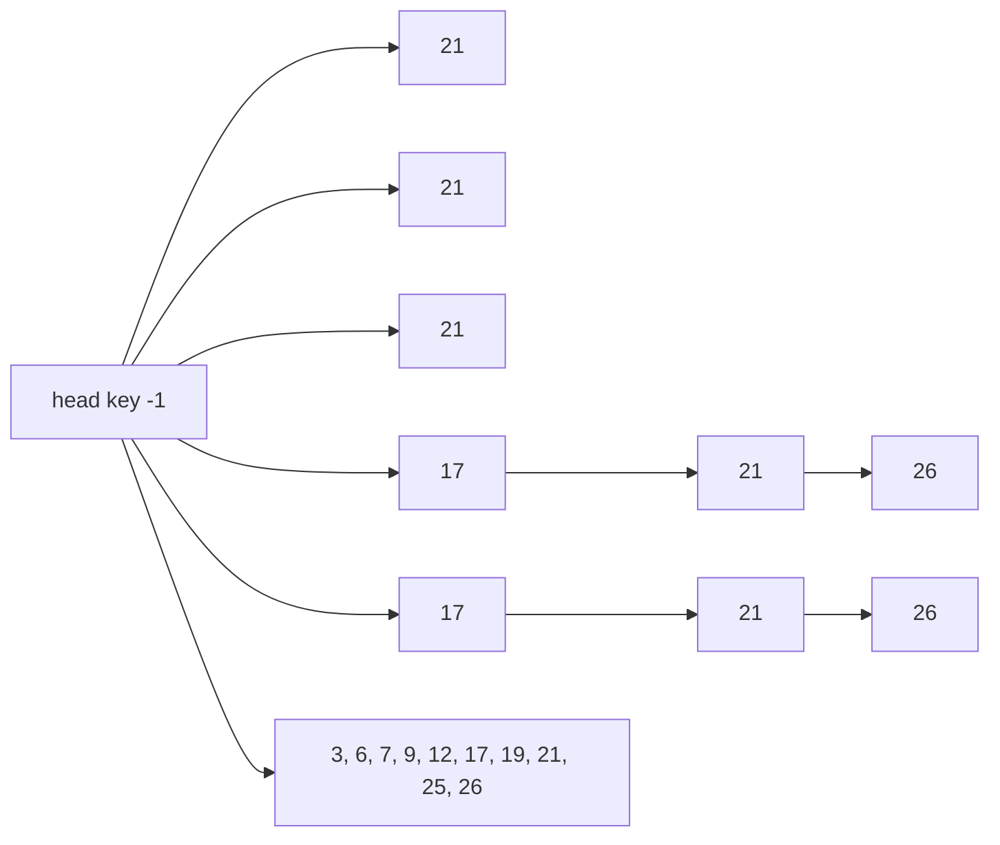
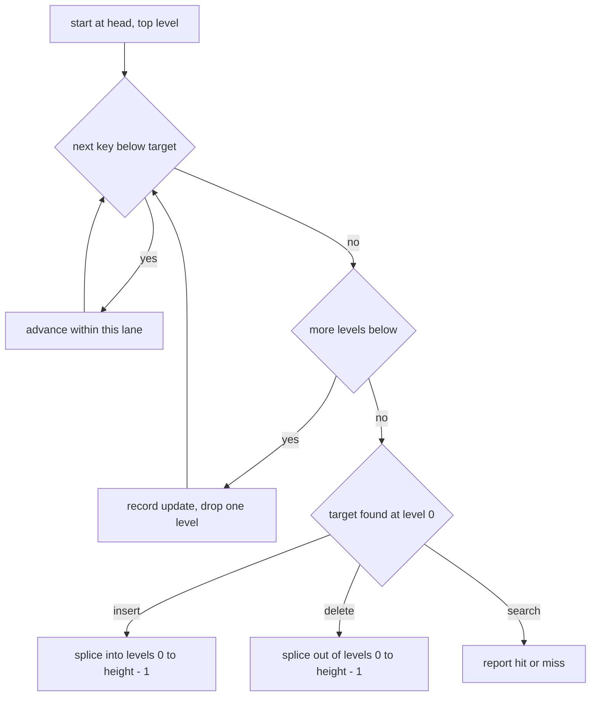
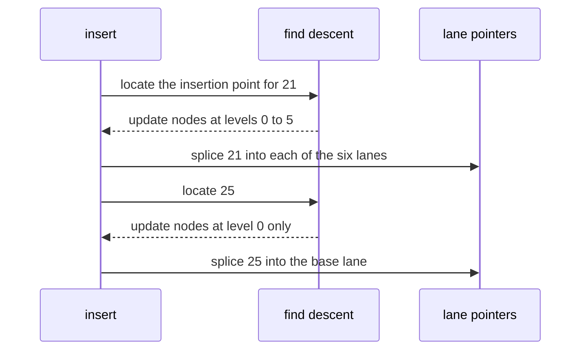
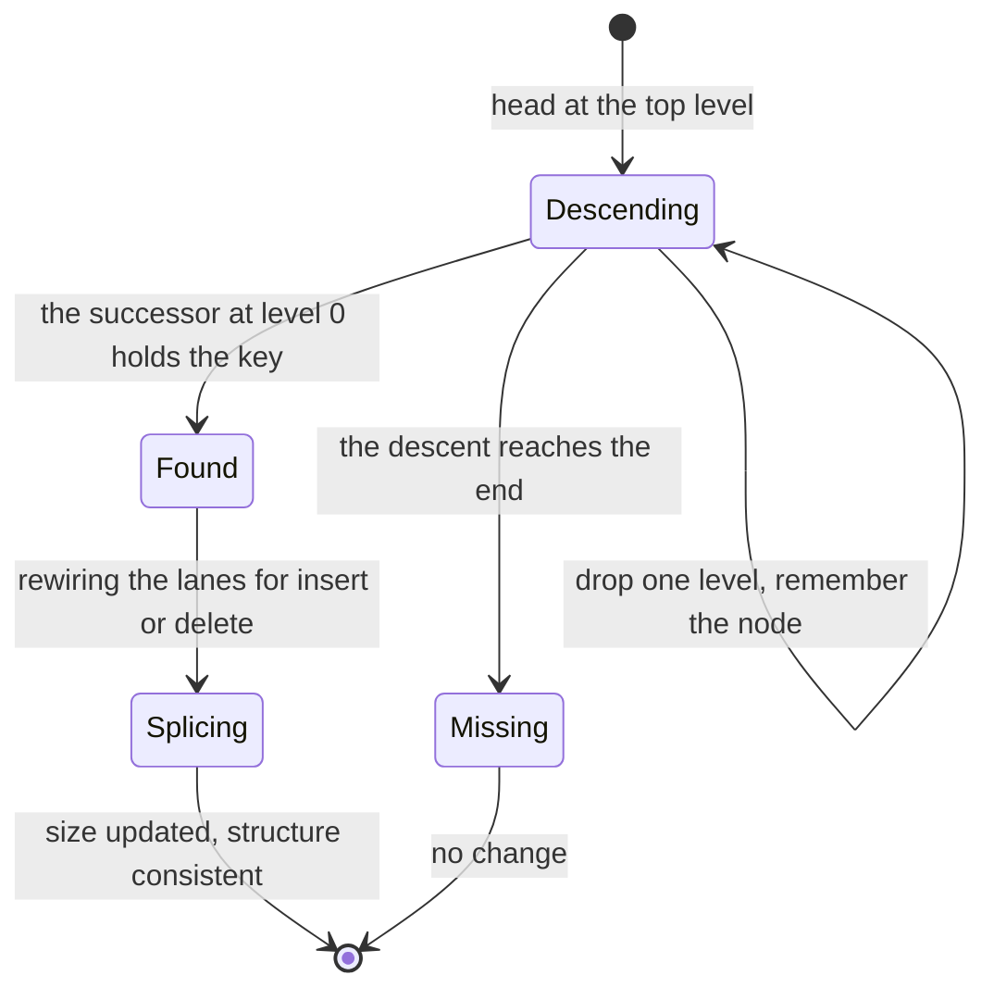

# 251 — Implement skip list insert/search/delete.

> **Tier:** Intermediate · **CTCI chapter:** Beyond — Advanced Data Structures & Algorithms
> **Task spec:** [251-implement-skip-list-insert-search-delete.md](../../../tasks/intermediate/251-implement-skip-list-insert-search-delete.md)
> **Solutions:** [Python](../../../solutions/python/intermediate/251-implement-skip-list-insert-search-delete/solution.py) ·
> [Java](../../../solutions/java/intermediate/251-implement-skip-list-insert-search-delete/Solution.java) ·
> [JavaScript](../../../solutions/javascript/intermediate/251-implement-skip-list-insert-search-delete/solution.js) ·
> [C#](../../../solutions/csharp/intermediate/251-implement-skip-list-insert-search-delete/Solution.cs)

## 1. Problem restatement

**Input:** a set of integer keys inserted one at a time, and then searches and deletions of keys,
including keys that are absent.

**Output:** a **skip list** — a layered sorted linked list whose upper levels are sparse "express
lanes" over level `0` — supporting `insert`, `search` and `delete`, plus enough observation helpers
(`walk(level)`, `heights()`, `size`) for a test to prove the layering invariants hold.

The contract is pinned by the assertions in the four solution files:

| Call | Result | Why |
| --- | --- | --- |
| `insert(k)` for `3, 6, 7, 9, 12, 19, 17, 26, 21, 25` | `True` every time, `size == 10` | all ten keys are new |
| `heights()` | `{3:1, 6:1, 7:1, 9:1, 12:1, 19:1, 17:4, 26:4, 21:6, 25:1}` | the deterministic coin gives the same structure in every language |
| `max(heights.values())` | `6` | the top lane is genuinely used, so `MAX_LEVEL` is reached |
| `walk(0)` | `3, 6, 7, 9, 12, 17, 19, 21, 25, 26` | level `0` holds every key, sorted |
| `walk(i)` for every level `i` | exactly the subsequence of `walk(0)` whose node height exceeds `i` | the layering invariant |
| `search(k)` for the ten keys | `True` | hits at every level combination |
| `search(k)` for `-1, 0, 5, 10, 20, 22, 30` | `False` | misses before, between and after the stored keys |
| `insert(3)` again | `False`, `size` still `10` | duplicates are rejected |
| `delete(19)` | `True`, `size == 9`, then `search(19)` is `False` | a level-`0`-only node |
| `delete(19)` again, `delete(4)`, `delete(100)` | `False` | missing keys |
| `delete(3)`, `delete(25)`, `delete(21)` | `True` | head-adjacent, near-tail, and the top-lane node |
| deleting the remaining six keys | `size == 0`, every lane empty, no key found | the structure returns to its empty state |
| `insert(42)` after draining | `True`, `search(42)`, `size == 1` | the structure is reusable |

The randomness is fake on purpose: the "coin" is a **deterministic 31-bit LCG**
(`state = (state * 1103515245 + 12345) mod 2^31`, bit `16` is the flip) seeded with `20251`, so all
four implementations build bit-for-bit the same structure and the height assertions hold everywhere.

## 2. Intuition

A sorted linked list searches in `O(n)` because you must walk it one node at a time. Balanced trees
fix that with `O(log n)` searches, at the cost of rotations and rebalancing.

A **skip list** fixes it with extra pointers instead. Level `0` is the ordinary sorted list of every
key. Level `1` links a sparse subset of the nodes — an express lane — and each higher level is a
sparser subset still. A search starts at the top-left, moves right along a lane while the next key is
too small, and drops down a level when it would overshoot. Each drop moves to a shorter lane, so the
work is logarithmic in expectation:



The picture is the state the shipped tests build: node `21` was promoted all the way to level `5`,
`17` and `26` stop at level `3`, and the other seven keys live on level `0` alone. That is exactly
what the invariant assertions check — the lane at level `i` is the subsequence of level `0` of the
nodes with more than `i` forward pointers.

The insertion height comes from repeated coin flips: every node starts at level `0` and is promoted
one level per "heads", capped by `MAX_LEVEL = 6`. The expected height is two, so level `1` holds
about half the keys, level `2` about a quarter, and the lanes stay sparse without any rebalancing.

## 3. Algorithm

1. Keep a `head` sentinel with `MAX_LEVEL` forward pointers (its key is `-1`, below every real key),
   a `size` counter, and the LCG state.
2. **find(key)** — the shared descent: start at `head`, and for each level from the top down, advance
   while the next node's key is strictly less than the target. Record the last node visited at each
   level in an `update` array; those are exactly the nodes whose forward pointers must change.
3. **coin()** — advance the LCG once and return bit `16`. **random_level()** — start at `1` and keep
   incrementing while the coin is `1`, stopping at `MAX_LEVEL`.
4. **insert(key)** — run `find`, then check `update[0]`'s successor: an equal key means a duplicate, so
   return `False`. Otherwise create a node with a freshly flipped height and splice it into every lane
   it participates in: `node.next[i] = update[i].next[i]`, then `update[i].next[i] = node`. Increment
   `size` and return `True`.
5. **search(key)** — the same descent, but instead of recording positions it checks after each level
   whether the next node holds the key; found anywhere means found.
6. **delete(key)** — run `find`, then check `update[0]`'s successor for an equal key. If absent, return
   `False`. Otherwise splice the node out of every lane it is in
   (`update[i].next[i] = target.next[i]` for `i < target.height`), decrement `size` and return `True`.

```text
procedure find(key)
    update ← array of MAX_LEVEL copies of head
    node ← head
    for i ← MAX_LEVEL - 1 down to 0 do
        while node.next[i] ≠ null and node.next[i].key < key do
            node ← node.next[i]
        update[i] ← node
    return update

procedure coin()
    state ← (state * 1103515245 + 12345) mod 2^31
    return bit 16 of state

procedure random_level()
    level ← 1
    while level < MAX_LEVEL and coin() = 1 do
        level ← level + 1
    return level

procedure insert(key)
    update ← find(key)
    after ← update[0].next[0]
    if after ≠ null and after.key = key then return false
    node ← new node with key and height random_level()
    for i ← 0 to node.height - 1 do
        node.next[i] ← update[i].next[i]
        update[i].next[i] ← node
    size ← size + 1
    return true

procedure delete(key)
    update ← find(key)
    target ← update[0].next[0]
    if target = null or target.key ≠ key then return false
    for i ← 0 to target.height - 1 do
        update[i].next[i] ← target.next[i]
    size ← size - 1
    return true
```

The `update` array is the whole trick: one descent records the insertion point at *every* level, so
insert and delete only have to rewire the lanes the node actually belongs to.



## 4. Worked example

Insert the ten shipped keys in order. The coin sequence is fixed by the seeded LCG, so the heights are
part of the expected state rather than an accident:

| Step | Key inserted | Flipped height | New lane members | `size` |
| --- | --- | --- | --- | --- |
| 1 | `3` | `1` | level `0` only | 1 |
| 2 | `6` | `1` | level `0` only | 2 |
| 3 | `7` | `1` | level `0` only | 3 |
| 4 | `9` | `1` | level `0` only | 4 |
| 5 | `12` | `1` | level `0` only | 5 |
| 6 | `19` | `1` | level `0` only | 6 |
| 7 | `17` | `4` | levels `0` through `3` | 7 |
| 8 | `26` | `4` | levels `0` through `3` | 8 |
| 9 | `21` | `6` | levels `0` through `5` | 9 |
| 10 | `25` | `1` | level `0` only | 10 |

Because `21` is six lanes tall, every level `0..5` contains it, which is what `max(heights) == 6`
asserts: the top lane is not merely allocated, it is used. Reading the lanes off the same table gives
the invariant the tests verify for each level `i`: lane `i` is the sorted subsequence of level `0` made
of the nodes taller than `i`. Level `1` is therefore `17, 21, 26`; level `3` is `21` alone, since `17`
and `26` stop below it; levels `4` and `5` are also just `21`.



Deletion reverses the same splice. Deleting key `19` — a level-`0`-only node between `17` and `21` —
touches one lane and leaves the rest of the structure untouched; the test then confirms
`search(19) == False` and `size == 9`. Deleting the top-lane node `21` is the more interesting case: it
is spliced out of all six lanes, and the invariant check afterwards confirms that the remaining nodes
still form consistent lanes, so no dangling pointer was left behind at a level where no other node
lives.



## 5. Complexity

Let `n` be the number of stored keys, `L = MAX_LEVEL = 6` the level cap, and `p = 1/2` the promotion
probability of the deterministic coin.

| Measure | Bound | Why it holds |
| --- | --- | --- |
| One `coin()` | O(1) | one multiplication, one addition and a mask |
| `random_level()` | O(L) worst, O(1) expected | the loop exits after a geometric number of flips, capped at `L` |
| `find` | O(L + expected lane length) | at most `L` drops and an expected `O(1)` steps per lane |
| `search`, `insert`, `delete`, expected | O(log n) | lane `i` holds a `2^-i` fraction of the keys, so the descent visits `O(log n)` nodes in expectation |
| `search`, `insert`, `delete`, worst | O(n) | an unlucky or adversarial coin sequence can put every node on level `0` or on the top lane |
| `walk(level)` | O(size of that lane) | one pass along the lane |
| `heights()` | O(n) | one pass along level `0` |
| Space | O(n · expected height) = O(n) | each node stores one forward pointer per level, with expected height `2` |
| Auxiliary memory per operation | O(L) | the `update` array has one entry per level |
| Balanced BST for comparison | O(log n) guaranteed, O(n) space | needs rotations; the skip list replaces rebalancing with coin flips |
| Sorted array for comparison | O(log n) search, O(n) insert/delete | the shift costs dominate, and there is no probabilistic escape |

The `L = 6` cap means the structure can hold `2^6 - 1` promoted promotions' worth of lanes; with ten
keys the invariant assertions are checked at every one of the six levels, including the two levels
occupied by a single node.

## 6. Pitfalls and edge cases

- **Duplicates.** `insert(3)` on a set that already holds `3` returns `False` and leaves `size == 10`;
  the check is the successor at level `0` after the descent, since `find` stops strictly *before* the
  target.
- **Missing keys.** `delete(19)` twice fails the second time; `delete(4)` and `delete(100)` fail at the
  `target == null` test and the key comparison respectively, and neither modifies the structure.
- **The head sentinel.** Its key is `-1` and it is `MAX_LEVEL` tall, so the descent never needs a
  null check on the "current" node. Choosing a key that could collide with a real key breaks the
  invariant silently.
- **Dropping levels in the right order.** `find` descends from `MAX_LEVEL - 1` to `0` at the *start* of
  each iteration; starting at level `0` throws away the express lanes and degrades the search to a
  linked-list walk.
- **Strictly-less comparison.** `find` advances while `next.key < key`, not `<=`. Using `<=` overshoots
  the insertion point and can drop the duplicate's predecessor, which turns duplicate rejection into
  silent duplication.
- **Splice only the node's own levels.** Insert and delete loop to `node.height - 1`, never to
  `MAX_LEVEL`: extending a short node's pointers past its height would corrupt the lanes above it.
- **Deleting a node that others' lanes point at.** The update array was captured at *every* level in
  the same descent, so removing the top-lane node `21` is a single pass over its six lanes. Recomputing
  the update array per level is the usual way this goes wrong.
- **Deterministic coin.** The LCG makes the structure reproducible, which is what allows assertions
  like `heights() == {3:1, 6:1, 7:1, 9:1, 12:1, 19:1, 17:4, 26:4, 21:6, 25:1}`; a real random source
  would make those tests flaky and force the tests to check invariants only.
- **The top lane can stay empty.** Nothing forces a promotion to `MAX_LEVEL`; the tests assert
  `max(heights) == MAX_LEVEL` precisely because that is not guaranteed by construction.
- **Draining to empty.** Deleting every key must leave `size == 0` and every lane empty, and the head
  sentinel allocated but unlinked — the same `walk(i) == []` check runs for all six lanes.
- **Reuse after draining.** Inserting `42` into the emptied structure must work: the head's pointers are
  already null, so no state beyond the head needs resetting.

## 7. Variants and follow-ups

- **Randomized, not seeded.** Using a real PRNG drops the cross-language identity assertions but keeps
  every invariant: the expected height and the `O(log n)` expected bounds do not depend on the coin
  being reproducible.
- **Same layer idea, no layers.**
  [252-design-a-phonebook-using-trie-with-counts-and-delete.md](../../../tasks/intermediate/252-design-a-phonebook-using-trie-with-counts-and-delete.md)
  and
  [253-implement-compressed-trie-radix-tree-basics.md](../../../tasks/intermediate/253-implement-compressed-trie-radix-tree-basics.md)
  share prefixes instead of levels, which gives ordered iteration without any balancing or coin flips.
- **Rotation-based alternatives.**
  [249-implement-treap-bst-heap-insert-delete.md](../../../tasks/intermediate/249-implement-treap-bst-heap-insert-delete.md)
  and
  [250-implement-splay-tree-access-operation-basic.md](../../../tasks/intermediate/250-implement-splay-tree-access-operation-basic.md)
  reach the same expected complexity with tree links and priorities or access-driven rotations, and
  pay `O(h)` recursion or parent-pointer bookkeeping instead of an `update` array.
- **Ordered iteration.** `walk(0)` is a sorted traversal in `O(n)`, which a hash table cannot provide;
  the trie tasks give the same property for strings rather than integers.
- **Bounded-memory membership.**
  [254-implement-bloom-filter-insert-check-probabilistic.md](../../../tasks/intermediate/254-implement-bloom-filter-insert-check-probabilistic.md)
  drops exactness — and with it ordered traversal, deletion and counts — to answer "is this key
  possibly present" in a fixed number of bits.

## 8. Check yourself

1. Why does the search start at the top level rather than at level `0`?

<details><summary>Show answer</summary>

Because the upper lanes skip large ranges of keys: at each level the search advances as far as it can
and then drops one level, which shrinks the remaining distance by roughly half each time. Starting at
level `0` would remove all the express lanes and make the search a plain linked-list walk of `O(n)`.

</details>

2. What is the `update` array, and why do insert and delete both need it?

<details><summary>Show answer</summary>

It records, for every level, the last node visited whose key is strictly less than the target — i.e.
the node whose forward pointer at that level must be rewired. Insert needs it to splice the new node
into each lane it belongs to, and delete needs it to splice the removed node out of each lane it
occupies. Both operations work on the *same* array, captured in one descent.

</details>

3. The test asserts `max(heights.values()) == 6`. Why is that worth asserting?

<details><summary>Show answer</summary>

Because promotions are probabilistic: a run could produce no node at `MAX_LEVEL` at all, leaving the top
lane unused and hiding bugs that only appear when a node is as tall as the sentinel. With the seeded
coin the height of node `21` is exactly `6`, so the assertion is deterministic in all four languages.

</details>

4. `delete(21)` removes the only node in levels `3` to `5`. What must the code get right?

<details><summary>Show answer</summary>

It must splice out the node at every level it occupies — the loop runs to `target.height - 1`, which is
`5` here — using the update pointers captured at those same levels. After the deletion the lanes must
still satisfy the subsequence invariant, which the tests re-check for all six levels.

</details>

5. What happens to the expected complexity if the promotion probability were `1` instead of `1/2`?

<details><summary>Show answer</summary>

Every node would be promoted to `MAX_LEVEL`, so every lane would contain every key and the structure
would degenerate into `MAX_LEVEL` copies of a full linked list — `O(n)` search, `O(n)` space per level,
no express-lane benefit. Half is what makes a lane hold a geometrically decreasing fraction of the
keys, which is where the logarithmic bound comes from.

</details>
