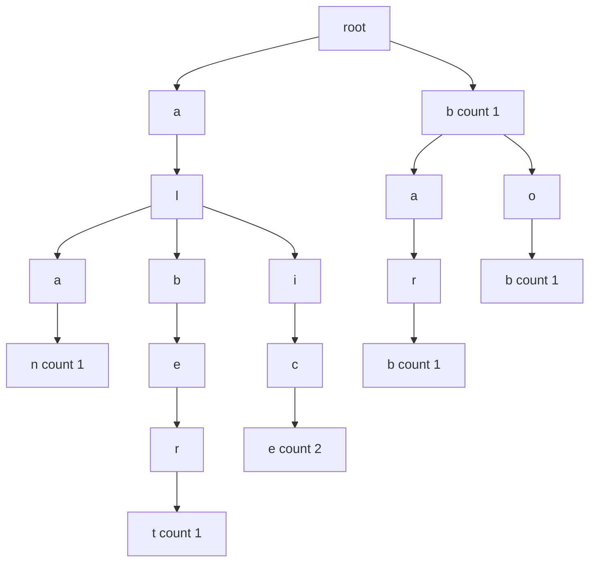
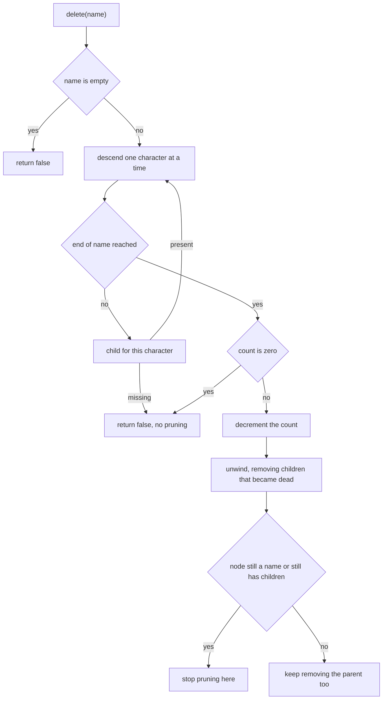
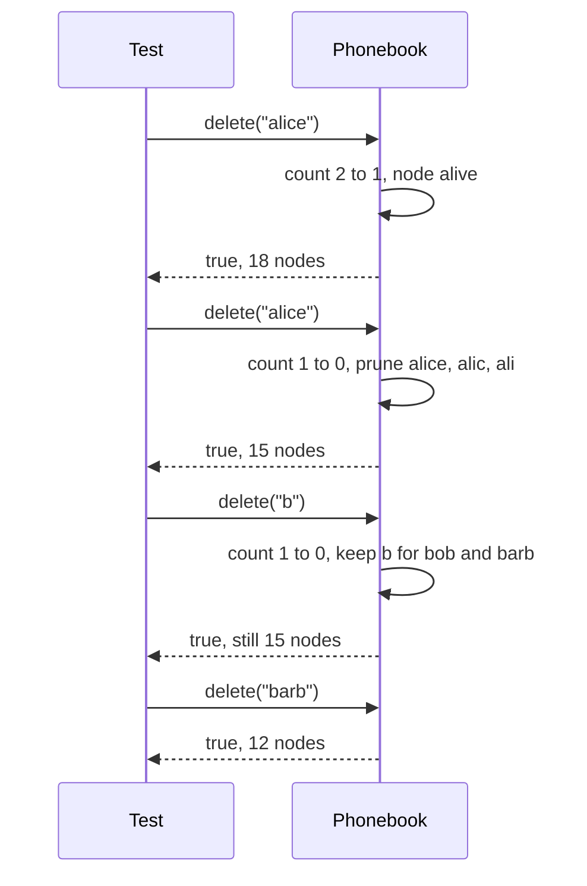
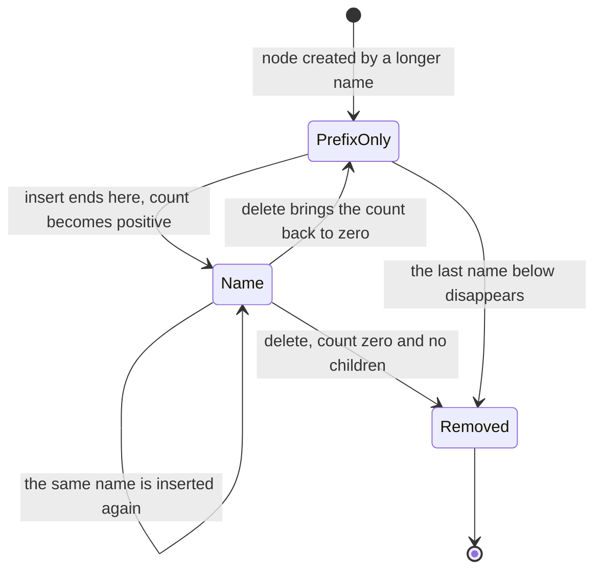

# 252 — Design a phonebook using trie with counts and delete.

> **Tier:** Intermediate · **CTCI chapter:** Ch 4 — Trees and Graphs
> **Task spec:** [252-design-a-phonebook-using-trie-with-counts-and-delete.md](../../../tasks/intermediate/252-design-a-phonebook-using-trie-with-counts-and-delete.md)
> **Solutions:** [Python](../../../solutions/python/intermediate/252-design-a-phonebook-using-trie-with-counts-and-delete/solution.py) ·
> [Java](../../../solutions/java/intermediate/252-design-a-phonebook-using-trie-with-counts-and-delete/Solution.java) ·
> [JavaScript](../../../solutions/javascript/intermediate/252-design-a-phonebook-using-trie-with-counts-and-delete/solution.js) ·
> [C#](../../../solutions/csharp/intermediate/252-design-a-phonebook-using-trie-with-counts-and-delete/Solution.cs)

## 1. Problem restatement

**Input:** lowercase names added to a phonebook, possibly the same name several times, plus
queries: an exact count for a name, a listing of every name with a given prefix, and a delete that
removes one reference to a name.

**Output:** a trie whose nodes carry a **count** — the number of times the name ending at that node
was added. A count of `0` means "this node is only a prefix, not a name". Delete decrements the
count and prunes branches that become dead, so deleting everything returns the structure to a bare
root.

The contract is fixed by the assertions in the four solution files:

| Call | Result | Why |
| --- | --- | --- |
| node count of a new phonebook | `1` | only the root exists |
| `insert("alice")` once, then again | `1`, then `2` | duplicate inserts increment rather than duplicate |
| node count after loading 7 names | `18` | 1 root + 17 nodes, because shared prefixes share nodes |
| `count("alice")` | `2` | the stored multiplicity |
| `count("al")`, `count("alic")`, `count("")` | `0` | prefixes and the empty string are not names |
| `count("alicia")` | `0` | unknown name |
| `list_prefix("al")` | `alan`, `albert`, `alice` | lexicographic order |
| `list_prefix("b")` | `b`, `barb`, `bob` | `b` was inserted as a name too |
| `list_prefix("z")` | empty | no such branch |
| `delete("alice")` | `True`, `count("alice") == 1`, node count `18` | one reference left, nothing pruned |
| `delete("alice")` again | `True`, `count("alice") == 0`, node count `15` | `alice`, `alic`, `ali` become dead and are pruned |
| `delete("alice")` a third time | `False` | nothing to remove |
| `delete("zzz")`, `delete("")` | `False` | unknown name; the empty name is rejected outright |
| `delete("b")` | `True`, node count still `15` | the `b` node must stay, `bob` and `barb` live under it |
| `delete("barb")` → `delete("alan")` → `delete("albert")` → `delete("bob")` | node counts `12`, `10`, `4`, `1` | pruning cascades upward as branches die |
| `words()` | all stored pairs, sorted; `[]` at the end | the whole dictionary view |

Entries are returned as `(name, count)` pairs — Python tuples, JavaScript `[name, count]` arrays,
and `name=count` strings in Java and C#. The children container differs too: Python dict and
JavaScript `Map` are sorted at listing time, while Java's `TreeMap` and C#'s `SortedDictionary`
are ordered by construction.

## 2. Intuition

The obvious phonebook is a list of strings. `count("alice")` then costs a scan of the whole list
and a full string comparison per entry, `list_prefix("al")` costs the same, and every operation is
proportional to the *total* number of characters stored.

A trie pays per character instead. `alice`, `alan` and `albert` share the nodes `a`, `al`, `ala`
and `alb`, so the structure stores each distinct prefix exactly once:



That is the exact 18-node structure the tests count, and it makes the three operations fall out of
one walk: `count` stops at the node and reads its counter, `list_prefix` stops after the prefix and
enumerates the subtree, `insert` walks (creating missing nodes) and increments the counter.

The subtlety is the difference between a **prefix** and a **name**. `al` is a node in the picture
but has no name attached, so `count("al")` must be `0` while `list_prefix("al")` returns three
names. The counter *is* that distinction: `0` means prefix, positive means name with multiplicity.
And delete cannot just zero the counter — a zero-count node may still be a necessary prefix for
other names (`b` after `delete("b")`), which is exactly when pruning must stop.

## 3. Algorithm

1. **insert(name).** Walk from the root, creating a child for each character that has none. When
   the walk ends, increment that node's counter and return it.
2. **count(name).** Walk without creating; return the node's counter, or `0` if the walk falls off
   the trie. The root's counter is `0`, so the empty name is naturally not a name.
3. **delete(name).** Reject the empty name. Recurse down the path; at the end, if the counter is
   `0` the name was not there and the call returns failure.
4. Otherwise decrement the counter and return success while reporting to the caller whether *this*
   node is now dead (counter `0` **and** no children).
5. On the way back up, a node whose child reported "dead" removes that child; then it reports its
   own deadness the same way. Pruning therefore stops automatically at the first node that still
   has a child or still holds a name.
6. **list_prefix(prefix).** Walk the prefix without creating. From that node, DFS in sorted
   character order, emitting `(prefix + path, counter)` for every node with a positive counter.

```text
procedure insert(name)
    node ← root
    for ch in name do
        if node.children[ch] = null then
            node.children[ch] ← new node
        node ← node.children[ch]
    node.count ← node.count + 1
    return node.count

procedure count(name)
    node ← root
    for ch in name do
        node ← node.children[ch]
        if node = null then return 0
    return node.count

procedure delete(name)
    if name is empty then return false
    return delete_at(root, name, 0)

procedure delete_at(node, name, i)
    if i = length(name) then
        if node.count = 0 then return false, dead ← false
        node.count ← node.count - 1
        return true, dead ← node.count = 0 and node has no children
    child ← node.children[name[i]]
    if child = null then return false, dead ← false
    found, prune ← delete_at(child, name, i + 1)
    if found is false then return false, dead ← false
    if prune then remove node.children[name[i]]
    return true, dead ← node.count = 0 and node has no children

procedure list_prefix(prefix)
    node ← root
    for ch in prefix do
        node ← node.children[ch]
        if node = null then return empty list
    out ← empty list
    dfs(node, prefix, out)
    return out

procedure dfs(node, path, out)
    if node.count > 0 then append (path, node.count) to out
    for ch in sorted keys of node.children do
        dfs(node.children[ch], path + ch, out)
```

`delete_at` returns a *pair* — "was the name removed" and "is this node now dead" — because the
recursion needs both answers: the first is the caller's result, the second decides the pruning.



## 4. Worked example

Starting from the 18-node trie, tracing the delete sequence of the shipped tests. "Nodes" is
`node_count()`, which includes the root:

| Step | Call | Effect | Nodes |
| --- | --- | --- | --- |
| 1 | `delete("alice")` | counter `2 → 1`; the node is not dead, no pruning | 18 |
| 2 | `list_prefix("al")` | `alice` is still listed, now with count `1` | 18 |
| 3 | `delete("alice")` | counter `1 → 0`; `alice` is dead, so `alic` and `ali` die too | 15 |
| 4 | `list_prefix("ali")` | empty: the branch is gone | 15 |
| 5 | `delete("alice")` | the path no longer exists ⇒ `False` | 15 |
| 6 | `delete("b")` | counter `1 → 0`, but `bob` and `barb` still need the `b` node | 15 |
| 7 | `list_prefix("b")` | `barb`, `bob` — `b` itself is no longer a name | 15 |
| 8 | `delete("barb")` | `barb`, `bar`, `ba` all become dead and are pruned | 12 |
| 9 | `delete("alan")` | `alan`, `ala` pruned | 10 |
| 10 | `delete("albert")` | `albert`, `alber`, `albe`, `alb`, and `a`, `al` pruned | 4 |
| 11 | `delete("bob")` | `bob`, `bo`, `b` pruned | 1 |

Step 6 is the one that shows *why* deletion needs the compound "removed and dead" answer: the
counter hits zero, but the node is still a bridge to two other names, so the prune flag is
`false` and nothing is unlinked. Step 10 is the opposite: after `albert` disappears, the entire
`a` subtree has no names left, so pruning walks all the way up to the root's child and stops
there, leaving `root + b + bo + bob` — the four nodes the test asserts.





## 5. Complexity

Let `L` be the length of the name being handled, `N` the number of nodes in the trie, and `R` the
number of names returned by a prefix listing.

| Measure | Bound | Why it holds |
| --- | --- | --- |
| `insert` | O(L) | one step per character, plus O(1) to create a node |
| `count` | O(L) | one step per character; a missing child short-circuits |
| `delete` | O(L) | the descent is `O(L)`, and the pruning pass touches at most the `L` nodes on the path |
| `list_prefix` | O(L + N_subtree) | the descent, then one visit per node below the prefix |
| `words()` | O(N) | `list_prefix("")` visits everything |
| `node_count` | O(N) | iterative DFS stack, no recursion |
| Space | O(N) nodes, one per distinct prefix | `N` is 18 for the seven test names instead of the 33 characters they contain |
| List-of-strings alternative | O(total characters) per lookup | every query compares whole strings against every stored name |

The pruning bound is the reason delete is written recursively: pruning costs one extra step per
level of the path, which is already the cost of the descent. An implementation that instead
scanned the whole trie looking for dead nodes would cost `O(N)` per delete.

## 6. Pitfalls and edge cases

- **A prefix is not a name.** `count("al") == 0` and `count("alic") == 0` are asserted even though
  both nodes exist. Reading "walk succeeded" as "name exists" is the classic bug here.
- **The empty name.** `count("")` is `0` (the root's counter), `delete("")` returns `False`
  immediately, and `list_prefix("")` lists every name. Inserting an empty name is outside the
  documented contract (`insert` takes a non-empty lowercase name).
- **Duplicate inserts increment.** `insert("alice")` returns `1` then `2`; a set-like trie would
  return `True`/`False` instead, and every count assertion would shift by one.
- **Pruning must stop at live nodes.** After `delete("b")` the counter is `0` but the node has
  children, so it stays; the test pins the node count at `15` to catch over-eager pruning.
- **Pruning is bottom-up.** Removing a dead node can make its parent dead in turn, which is why
  the recursion returns the "dead" flag rather than checking only the deleted node.
- **Deleting something that was never there.** `delete("zzz")` fails at the first missing child
  and returns `False` without touching the structure; a second `delete("alice")` fails after the
  branch was already pruned.
- **Ordering.** Listings are lexicographic because Python and JavaScript sort the keys when they
  emit, and Java's `TreeMap` / C#'s `SortedDictionary` iterate in key order. Relying on hash-map
  iteration order would make `list_prefix("b")` flaky.
- **Counts are per name, not per prefix.** `count` never sums a subtree; `alice` reports `2` and
  `al` reports `0` regardless of how many names start with `al`.
- **Recursion depth.** `delete_at` recurses once per character; the test names are short, but a
  long name needs either an iterative rewrite or tail-call-free bookkeeping.
- **`node_count` includes the root.** The empty phonebook is `1`, not `0`, which keeps the counts
  in the delete trace comparable with the "1 root + 17 nodes" comment in the solution files.

## 7. Variants and follow-ups

- **Compress the chains.**
  [253-implement-compressed-trie-radix-tree-basics.md](../../../tasks/intermediate/253-implement-compressed-trie-radix-tree-basics.md)
  folds single-child runs into one edge label and compares the resulting edge count (`6`) against
  this plain trie's node count (`9`) over the same words.
- **Approximate instead of exact.**
  [254-implement-bloom-filter-insert-check-probabilistic.md](../../../tasks/intermediate/254-implement-bloom-filter-insert-check-probabilistic.md)
  answers the same membership question in fixed space with a documented false-positive rate, and
  cannot count or list anything.
- **Counts without a trie.**
  [256-top-k-frequent-elements-in-array-heap.md](../../../tasks/intermediate/256-top-k-frequent-elements-in-array-heap.md)
  builds the same value-to-count map in a hash table and then selects from it with a heap, which
  is the right structure when you never need prefix queries.
- **Ordered keys by comparison.**
  [250-implement-splay-tree-access-operation-basic.md](../../../tasks/intermediate/250-implement-splay-tree-access-operation-basic.md)
  gives ordered iteration through rotations instead of character paths, at the cost of
  `O(log n)` comparisons per character.
- **Deletion without counts.** Dropping the counters turns this into a plain string set; delete
  then has to distinguish "decrement" from "remove", which is the case that makes the count field
  worthwhile in the first place.

## 8. Check yourself

1. Why does `node_count()` stay at 15 when `delete("b")` succeeds?

<details><summary>Show answer</summary>

Because `b`'s counter reaching zero only means `b` is no longer a name — the node is still the
prefix of `bob` and `barb`, so it has children and is not dead. Pruning removes only nodes whose
counter is zero *and* which have no children, which is why the test asserts the count is unchanged.

</details>

2. What does the second `delete("alice")` prune, and why does the third one fail?

<details><summary>Show answer</summary>

The second call takes `alice` from `1` to `0`; with no children the `alice` node dies, then `alic`
becomes a zero-count node with no children, then `ali` does — three nodes disappear, taking the
count from `18` to `15`. The third call finds no child `i` under `al`... in fact no child `a` under
the root on that path any more, so it returns `False` without changing anything.

</details>

3. How would you make `count(prefix)` return the total number of stored names under a prefix?

<details><summary>Show answer</summary>

Store a subtree total per node — incremented on every insert along the path and decremented on
every delete along the path — instead of only the count of names ending there. Then a prefix query
reads one number in `O(L)` rather than enumerating the subtree.

</details>

4. Why does `list_prefix` sort the keys instead of relying on the children container?

<details><summary>Show answer</summary>

Because two of the four implementations use unordered containers (Python `dict`, JavaScript `Map`)
whose iteration order is an implementation detail; sorting at emit time makes the output
lexicographic in all four languages, which is what the shared assertions require. Java's `TreeMap`
and C#'s `SortedDictionary` are already ordered, so their iteration order coincides.

</details>

5. What breaks if `insert` stores the name in the parent instead of incrementing the node's counter?

<details><summary>Show answer</summary>

`count` could no longer distinguish `al` from `alice`, because a prefix node would look like it
holds a name; `list_prefix` would emit names at the wrong depth; and the multiplicity (`2` for
`alice`) would be lost, so the first `delete("alice")` would have nothing to decrement. The
counter at the terminal node is the whole model.

</details>
