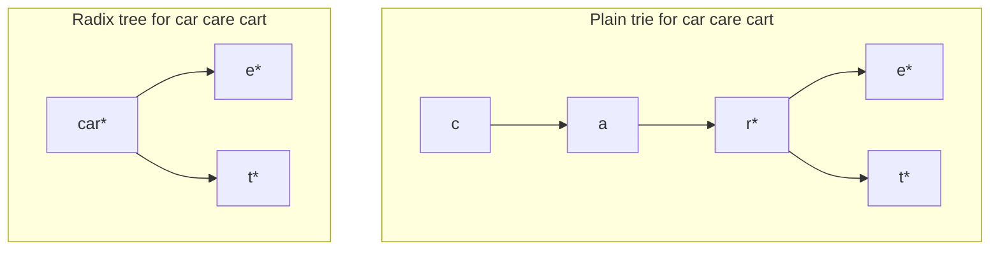
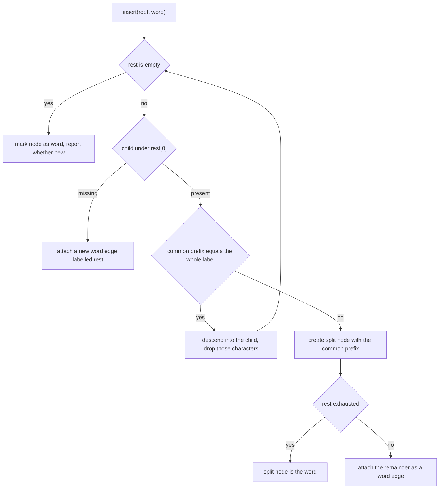
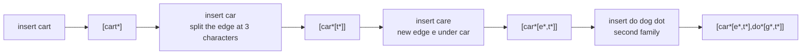
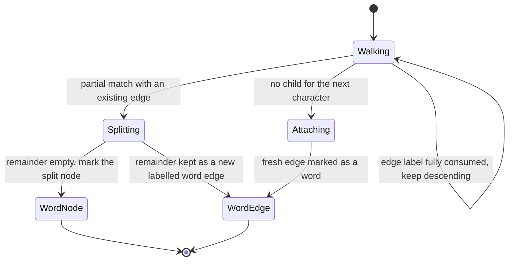

# 253 — Implement compressed trie (radix tree) basics.

> **Tier:** Intermediate · **CTCI chapter:** Ch 4 — Trees and Graphs
> **Task spec:** [253-implement-compressed-trie-radix-tree-basics.md](../../../tasks/intermediate/253-implement-compressed-trie-radix-tree-basics.md)
> **Solutions:** [Python](../../../solutions/python/intermediate/253-implement-compressed-trie-radix-tree-basics/solution.py) ·
> [Java](../../../solutions/java/intermediate/253-implement-compressed-trie-radix-tree-basics/Solution.java) ·
> [JavaScript](../../../solutions/javascript/intermediate/253-implement-compressed-trie-radix-tree-basics/solution.js) ·
> [C#](../../../solutions/csharp/intermediate/253-implement-compressed-trie-radix-tree-basics/Solution.cs)

## 1. Problem restatement

**Input:** a sequence of lowercase words inserted into a set, plus point lookups (`contains`) and
prefix lookups (`words_with_prefix`, `starts_with`).

**Output:** a **radix tree** — a trie in which every maximal run of single-child edges is stored
as one edge label — with a deterministic textual rendering (`shape`) and an edge count
(`node_count`) so a test can compare it against an uncompressed trie.

The contract is fixed by the assertions the four solution files ship with:

| Call | Result | Why |
| --- | --- | --- |
| `insert(root, "cart")` | `True`, `shape(root) == "[cart*]"` | one edge carries the whole word |
| `insert(root, "car")` | `True`, `shape(root) == "[car*[t*]]"` | the `cart` edge is split at three characters |
| `insert(root, "care")` | `True`, `shape(root) == "[car*[e*,t*]]"` | a new edge `e` joins under `car` |
| `insert(root, "car")` again | `False` | the word is already stored |
| `contains(root, "car" / "care" / "cart")` | `True` | all three are stored words |
| `contains(root, "ca" / "c" / "carts" / "caret" / "card" / "")` | `False` | `ca` and `c` are prefixes, `carts` is a path with no word flag |
| `node_count(root)` after the three words | `3` | one edge per stored-word chain above the shared part |
| `plain_trie_edges(["cart", "car", "care"])` | `5` | the uncompressed trie needs `c, ca, car, care, cart` |
| `node_count(root) < plain_trie_edges(...)` | `True` | that is the whole point of compressing |
| `insert(root, "do" / "dot" / "dog")` | `True`, shape gains `do*[g*,t*]` | a second family, also compressed |
| `words_with_prefix(root, "ca")` | `["car", "care", "cart"]` | the prefix ends *inside* the `car` edge |
| `words_with_prefix(root, "carts")` | `[]` | a path that runs past a word and finds nothing |
| `words_with_prefix(root, "")` | all six words, sorted | empty prefix lists everything |
| `startsWith(root, "car")` | `True`; `startsWith(root, "cat")` → `False` | derived from the prefix listing |
| final `node_count(root)` / `plain_trie_edges(...)` | `6` / `9` | six edges instead of nine |

`shape` is the debugging contract: labels are glued with commas, `*` marks a stored word, and
children are rendered in sorted key order, so the same structure prints identically in all four
languages.

## 2. Intuition

A plain trie stores one node per *character*, which is wasteful whenever words share long
prefixes. `car`, `care`, `cart` produce the chain `c → a → r` that has exactly one child per
character, and a long unique tail like `cart` produces a similar chain of dead-end nodes.

The compressed version's rule is: **never keep a node that has exactly one child unless a word
ends there.** All such nodes are collapsed into a single edge whose label is the concatenation of
their characters, so an edge is "the shortest string that distinguishes one branch from another".
The trie above becomes two nodes under the root: an edge labelled `car`, then two edges `e` and
`t` — three nodes in total instead of five.



Two things have to survive the collapse: the tree must still answer `contains(word)` exactly, and
it must still be able to answer *new* insertions exactly, which means a compressed edge can be
**split** in the middle. Inserting `car` into a tree that holds `cart` is precisely that case:
the edge `cart` splits into `car` (now a word) with a child edge `t`.

## 3. Algorithm

`insert` walks the tree edge by edge, consuming as much of the remaining word as each edge label
allows, and splits on partial matches.

1. Let `node` be the root and `rest` the word still to place.
2. If `rest` is empty, the current node represents the word: mark `is_word` (reporting whether it
   was new) and finish.
3. Look up the child under `rest[0]`. If there is none, attach a fresh edge labelled `rest`, mark
   it as a word, and finish.
4. Otherwise compare `rest` with the child's label character by character and count the common
   prefix length `common`.
5. If `common` equals the whole child label, the edge was fully consumed: descend into the child
   and continue with `rest[common:]`.
6. Otherwise the edge must be split: create a node labelled `child.label[:common]`, shorten the
   child's label to `child.label[common:]` and re-attach it under the split node, then continue
   with `rest[common:]`. If nothing remains of `rest` the split node *is* the word, so mark it;
   otherwise attach the remainder as a new word edge under the split node.
7. `contains` walks the same way but compares whole edge labels, and returns `node.is_word` at the
   end — a path ending on a non-word node is a miss.
8. `words_with_prefix` walks as far as the prefix reaches, allowing the prefix to end inside an
   edge, then collects every word below that point in sorted order.

```text
procedure insert(root, word)
    node ← root
    rest ← word
    while true do
        if rest is empty then
            was_new ← not node.is_word
            node.is_word ← true
            return was_new
        child ← node.children[rest[0]]
        if child = null then
            fresh ← new node labelled rest, marked as a word
            node.children[rest[0]] ← fresh
            return true
        common ← length of the longest common prefix of rest and child.label
        if common = length(child.label) then
            node ← child
            rest ← rest[common:]
            continue
        split ← new node labelled child.label[:common]
        child.label ← child.label[common:]
        split.children[child.label[0]] ← child
        node.children[rest[0]] ← split
        rest ← rest[common:]
        if rest is empty then
            split.is_word ← true
        else
            fresh ← new node labelled rest, marked as a word
            split.children[rest[0]] ← fresh
        return true
end

procedure contains(root, word)
    node ← root
    i ← 0
    while i < length(word) do
        child ← node.children[word[i]]
        if child = null or word[i : i + length(child.label)] ≠ child.label then
            return false
        i ← i + length(child.label)
        node ← child
    return node.is_word

procedure words_with_prefix(root, prefix)
    node ← root
    so_far ← empty string
    i ← 0
    while i < length(prefix) do
        child ← node.children[prefix[i]]
        if child = null then return empty list
        take ← min(length(prefix) - i, length(child.label))
        if child.label[:take] ≠ prefix[i : i + take] then return empty list
        node ← child
        so_far ← so_far + child.label
        if length(prefix) - i ≤ length(child.label) then break
        i ← i + length(child.label)
    collect every word below node, prefixing so_far, into out
    return out
```

Steps 5 and 6 are the only subtle parts: `common == length(child.label)` means "keep walking",
anything less means "split here". Because the collected prefix `so_far` accumulates whole edge
labels, a prefix that stops mid-edge still yields the right output string.



## 4. Worked example

Trace the three insertions the spec highlights. The rendering column is `shape(root)`, which
prints `label*` for a word node and `[children]` with children sorted by their first character:

| Step | Insert | What happens | `shape(root)` |
| --- | --- | --- | --- |
| 1 | `cart` | root has no child `c`; one edge carries the whole word | `[cart*]` |
| 2 | `car` | common prefix with edge `cart` is 3; split into `car*` plus child `t*` | `[car*[t*]]` |
| 3 | `care` | descend the `car` edge, no child `e`; attach edge `e` as a word | `[car*[e*,t*]]` |
| 4 | `car` | walk `car` exactly, node already `is_word` | `[car*[e*,t*]]` (unchanged, returns `False`) |
| 5 | `do` | no child `d` at the root; new edge | `[car*[e*,t*],do*]` |
| 6 | `dot` | `do` edge is consumed, child `t` attached | `[car*[e*,t*],do*[t*]]` |
| 7 | `dog` | child `g` attached next to `t` | `[car*[e*,t*],do*[g*,t*]]` |

Step 2 is the split and step 6 is the "keep walking" case; they are the two branches that make a
radix tree different from a plain trie. Note that after step 3 the tree has three nodes
(`car`, `e`, `t`) while a plain trie over the same three words has five (`c`, `ca`, `car`,
`care`, `cart`) — the exact counts the tests assert.



The lookup side is just as instructive. `contains(root, "ca")` walks into the `car` edge, but the
walk compares the *whole* label against `word[i:]`, `"ca" != "car"`, so it returns `False` before
even reaching a node — `ca` and `c` are prefixes, not words. `contains(root, "carts")` walks
`car`, then `t`, and lands on a node whose `is_word` is `False`, because `cart` was stored on the
parent edge; the final `return node.is_word` reports the miss. And `words_with_prefix(root, "ca")`
succeeds precisely because it takes `min(remaining prefix, label length)` characters: it stops in
the middle of the `car` edge and collects every word below it, giving
`["car", "care", "cart"]`.



## 5. Complexity

Let `L` be the length of the word or prefix, `E` the number of edges in the tree, and `R` the
number of words reported by a prefix query.

| Measure | Bound | Why it holds |
| --- | --- | --- |
| `insert`, best | O(L) | one edge per branch point; a word that follows existing edges just consumes them |
| `insert`, worst | O(L) | the common-prefix scan touches each character at most once, and a split allocates a constant number of nodes |
| `contains` | O(L) | each step consumes a whole edge label, so the loop runs at most `L` times and the total characters compared is `O(L)` |
| `words_with_prefix` | O(L + R) plus sorting | the descent is `O(L)`; the collection visits exactly the subtree below the stopping node |
| `shape`, `node_count` | O(E) | one visit per edge |
| Space | O(E) edges, each holding a label | compressed labels can be long, but no character is stored twice on a root-to-leaf path |
| Comparison: plain trie | `O(P)` nodes for `P` distinct prefixes — `5` vs `3` and `9` vs `6` on the tested inputs | every prefix gets its own node, so long shared runs cost memory twice |

The win is on the number of nodes, not on the asymptotic per-operation time: both structures are
linear in the length of the word being processed. A radix tree matters when the alphabet is small
and the words are long, because the amount of *memory* and the number of cache-unfriendly pointer
hops both shrink.

## 6. Pitfalls and edge cases

- **A word may be a prefix of an existing edge.** Inserting `car` into `[cart*]` must split the
  edge and mark the split node as a word; forgetting the `rest is empty` branch after the split
  loses the word flag and `contains(root, "car")` starts failing.
- **`is_word` is not the same as "has children".** `contains` must return `node.is_word`, not
  `true` on reaching a node; that single line is what makes `contains(root, "ca")` and
  `contains(root, "carts")` false.
- **Duplicates return `False`.** Re-inserting `car` walks the edge and finds `is_word` already
  set; the tree must not change and `shape(root)` must stay `[car*[e*,t*]]`.
- **Prefixes that end inside an edge.** `words_with_prefix(root, "ca")` stops after two characters
  of the `car` edge and must still list all three `car*` words; a naive implementation that
  requires a node boundary returns `[]` and fails that assertion.
- **Prefixes that run past the tree.** `words_with_prefix(root, "z")` and
  `words_with_prefix(root, "carts")` must both return an empty list, not throw: the descent has to
  check for a missing child and for a label mismatch separately.
- **The empty prefix.** `words_with_prefix(root, "")` never enters the descent loop and lists
  everything; the root's own label is empty and its `is_word` is `False`, so the empty string is
  never reported as a word.
- **Deterministic rendering.** `shape` sorts children by their first character, which is why the
  expected strings are `[car*[e*,t*]]` and `[car*[e*,t*],do*[g*,t*]]` rather than insertion order.
  Without the sort the value depends on the insertion order and the cross-language assertions
  break.
- **`node_count` excludes the root.** It counts edges, so the empty tree has `0` and the three
  shared words above have `3`; the tests compare it against `plain_trie_edges`, which counts
  distinct prefixes — the two numbers are only comparable because both count edges.

## 7. Variants and follow-ups

- **Deletion with edge merging.** Removing a leaf word must, when its parent becomes a
  non-word with one child, re-merge that parent's label with the child's. This is the mirror of
  the split in step 6 and the reason production radix trees are often built once and never edited.
- **Counts instead of flags.**
  [252-design-a-phonebook-using-trie-with-counts-and-delete.md](../../../tasks/intermediate/252-design-a-phonebook-using-trie-with-counts-and-delete.md)
  keeps an *uncompressed* trie whose nodes carry multiplicity counts, which shows what radix
  compression buys and what it costs in delete bookkeeping.
- **Approximate membership.**
  [254-implement-bloom-filter-insert-check-probabilistic.md](../../../tasks/intermediate/254-implement-bloom-filter-insert-check-probabilistic.md)
  answers the same "is this word present" question in constant space with a bounded false-positive
  rate, trading exactness for memory — the opposite trade-off to a radix tree.
- **Bounded memory over time.**
  [255-implement-rolling-bloom-filter-sliding-window.md](../../../tasks/intermediate/255-implement-rolling-bloom-filter-sliding-window.md)
  shows the sliding-window variant, where old items must also *expire*, which no trie does.
- **Ordered traversal by comparison.**
  [250-implement-splay-tree-access-operation-basic.md](../../../tasks/intermediate/250-implement-splay-tree-access-operation-basic.md)
  reaches the same lexicographic listing through key comparisons and rotations; the radix tree
  reaches it by path traversal, which is why it needs no balancing at all.

## 8. Check yourself

1. Why does the split in step 6 create exactly one intermediate node?

<details><summary>Show answer</summary>

Because a partial match means the new word and the existing edge agree on `common` characters and
diverge at `common`. Everything above that divergence point is shared by both strings, so it
becomes one node whose label is that shared prefix, and the two divergent continuations hang below
it. More nodes would mean one-child nodes, which the compression rule forbids.

</details>

2. `contains(root, "carts")` walks every stored edge successfully and still returns `False`. Why?

<details><summary>Show answer</summary>

Because the walk ends on the node reached after the label `t`, and that node's `is_word` is
`False` — `cart` was stored on the parent edge, and `t` only exists as a continuation of it.
`contains` returns `node.is_word`, not "the walk finished", which is exactly the distinction
between a prefix and a word.

</details>

3. The tests assert `node_count(root) == 3` against `plain_trie_edges(...) == 5`. What are the
five plain-trie nodes?

<details><summary>Show answer</summary>

They are the distinct prefixes of the three words: `c`, `ca`, `car`, `care`, `cart`. The radix
tree keeps only `car`, `e` and `t`, because `c` and `ca` are single-child chains that the
compression folds into the `car` edge.

</details>

4. What has to change in `words_with_prefix` if the prefix stops in the middle of an edge?

<details><summary>Show answer</summary>

Nothing extra: the descent already takes `min(remaining prefix length, label length)` characters
and accumulates the whole edge label into the collected prefix, then breaks out of the loop when
the prefix is shorter than the label. That is why `words_with_prefix(root, "ca")` correctly
returns all three `car*` words even though no node is labelled `ca`.

</details>

5. Why is the compressed structure not asymptotically faster for `contains` than a plain trie?

<details><summary>Show answer</summary>

Both compare at most `L` characters along a path of length at most `L`, so both are `O(L)`. The
radix tree wins on constants and on memory: fewer nodes, fewer pointer dereferences, and no node
dedicated to each internal character of a long shared prefix.

</details>
