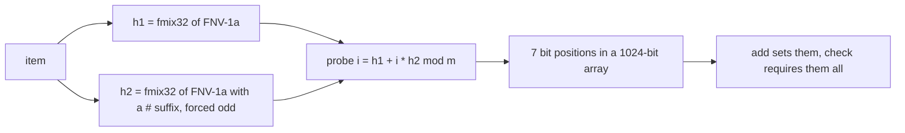
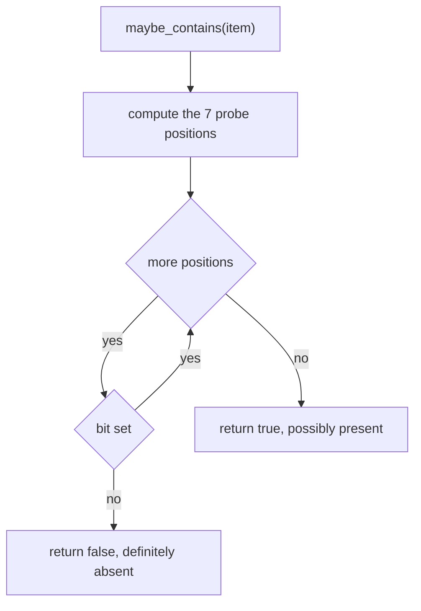
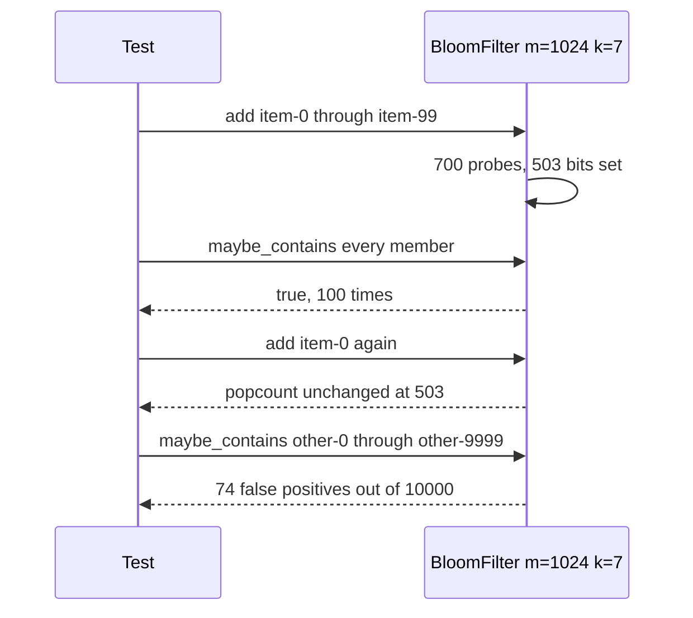
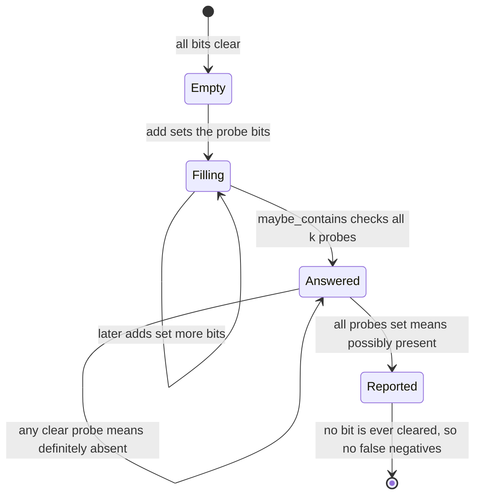

# 254 — Implement bloom filter insert/check (probabilistic).

> **Tier:** Intermediate · **CTCI chapter:** Beyond — Advanced Data Structures & Algorithms
> **Task spec:** [254-implement-bloom-filter-insert-check-probabilistic.md](../../../tasks/intermediate/254-implement-bloom-filter-insert-check-probabilistic.md)
> **Solutions:** [Python](../../../solutions/python/intermediate/254-implement-bloom-filter-insert-check-probabilistic/solution.py) ·
> [Java](../../../solutions/java/intermediate/254-implement-bloom-filter-insert-check-probabilistic/Solution.java) ·
> [JavaScript](../../../solutions/javascript/intermediate/254-implement-bloom-filter-insert-check-probabilistic/solution.js) ·
> [C#](../../../solutions/csharp/intermediate/254-implement-bloom-filter-insert-check-probabilistic/Solution.cs)

## 1. Problem restatement

**Input:** a stream of string items to add, and string items to test.

**Output:** a membership filter of `m = 1024` bits using `k = 7` hash probes per item, which answers
`maybe_contains` with **no false negatives** and a small, documented false-positive rate. The
structure stores no items at all — only bits.

The contract is pinned by the assertions in the four solution files:

| Call | Result | Why |
| --- | --- | --- |
| `popcount()` on a fresh filter | `0` | nothing added yet |
| `maybe_contains("item-0")`, `("x")`, `("hello")` on a fresh filter | all `False` | no bit is set, so every probe fails |
| `add(item)` for `item-0 .. item-99` | `maybe_contains` is `True` for all 100 | a set bit never clears, so no false negatives are possible |
| `popcount()` after those adds | exactly `503` | 700 probes over 1024 bits, with collisions |
| `add("item-0")` again | `popcount()` unchanged | adding an existing item is idempotent |
| 10000 non-members, `other-0 .. other-9999` | exactly `74` are reported present | the false-positive behaviour is deterministic for this data |
| the same count against the documented bound | `74 <= 200` | the header requires the measured rate to stay under 2%, against a theoretical `(1 - e^(-k·n/m))^k ≈ 0.7%` |
| `BloomFilter(bits=256, hashes=4)` with `a`, `b`, `c` | all three found | the parameters are constructor arguments, not fixed constants |

Everything here is deterministic: the hash is a fixed composition of FNV-1a and a MurmurHash3
avalanche step, so the four implementations produce identical bits and the exact numbers `503` and
`74` are cross-language assertions rather than samples.

## 2. Intuition

Exact membership needs to store the items. A **bloom filter** replaces "store the items" with "store
`k` hash positions per item in a shared bit array". Lookup recomputes the same `k` positions and
answers "possibly present" when all of them are set, "definitely absent" when any of them is clear.

That asymmetry is the whole design:

- **No false negatives** — adding an item only ever sets bits, and it sets exactly the bits the lookup
  checks, so a stored item can never fail the test.
- **False positives are possible** — bits set by *other* items can conspire to make an absent item's
  probes look set. The probability grows as the array fills, and that is the accepted trade.



The two hash values implement **double hashing**: instead of running `k` independent hash functions,
the code derives them from two base values with `(h1 + i·h2) mod m`. Because `h2` is forced odd and
`m = 1024` is a power of two, the `k` positions are guaranteed to be distinct for `i < k`, so a single
probe sequence never wastes probes on the same bit.

The mixing step matters for accuracy, and the solution headers document why: raw FNV-1a has poorly
distributed low bits, and using them directly **measured about ten times the theoretical
false-positive rate**. Running the hash through the MurmurHash3 finalizer (`xor-shift`, multiply by
`0x85ebca6b`, `xor-shift`, multiply by `0xc2b2ae35`, `xor-shift`) spreads the bits so the measured rate
comes back down to the theory: the shipped test observes 74 false positives in 10000 probes, i.e.
0.74% against a predicted `(1 - e^(-k·n/m))^k ≈ 0.7%` for `n = 100`, `m = 1024`, `k = 7`.

## 3. Algorithm

1. Allocate a bit array of `m` bits, all clear, and remember `k`.
2. **positions(item)** — compute `h1 = fmix32(fnv1a(item))` and `h2 = fmix32(fnv1a(item + "#")) | 1`,
   then return `(h1 + i·h2) mod m` for `i = 0 .. k-1`.
3. **add(item)** — set every position returned by step 2.
4. **maybe_contains(item)** — return `True` only if *every* position returned by step 2 is set.
5. **popcount()** — sum the bits, which is the observation the tests use to prove adds are idempotent.

```text
function fnv1a(text)
    h ← 2166136261
    for ch in text do
        h ← ((h xor code(ch)) * 16777619) mod 2^32
    return h

function fmix32(x)
    x ← x xor (x shifted right 16)
    x ← (x * 0x85EBCA6B) mod 2^32
    x ← x xor (x shifted right 13)
    x ← (x * 0xC2B2AE35) mod 2^32
    x ← x xor (x shifted right 16)
    return x

procedure positions(item)
    h1 ← fmix32(fnv1a(item))
    h2 ← fmix32(fnv1a(item + "#")) or 1
    out ← empty list
    for i ← 0 to k - 1 do
        append (h1 + i * h2) mod m to out
    return out

procedure add(item)
    for p in positions(item) do
        bits[p] ← 1

function maybe_contains(item)
    for p in positions(item) do
        if bits[p] = 0 then return false
    return true
```

The `or 1` on `h2` is not cosmetic: an even `h2` combined with a power-of-two `m` would make the probe
sequence cycle early, and the filter would lose whichever bits it never reached.



## 4. Worked example

The shipped test loads 100 members (`item-0 .. item-99`) and then probes 10000 non-members
(`other-0 .. other-9999`). Both phases are deterministic, so both can be tabulated exactly:

| Phase | Operation | Observation |
| --- | --- | --- |
| 0 | new filter | `popcount == 0`; every probe misses |
| 1 | add `item-0` through `item-99` | 700 probes (100 items × 7) hit 1024 bits |
| 2 | `popcount()` | `503` bits are set — 197 probe hits landed on already-set bits |
| 3 | `maybe_contains(k)` for the 100 members | all `True`; no false negative is possible |
| 4 | `add("item-0")` again | `popcount` still `503`: the same 7 bits are set again |
| 5 | `maybe_contains` over 10000 non-members | exactly `74` are reported present (0.74%) |
| 6 | assertion on the rate | `74 <= 200`, the documented 2% ceiling |
| 7 | small filter `m = 256`, `k = 4` with `a`, `b`, `c` | all three found; the parameters are configurable |

Phase 2 is where the false-positive rate is already visible: 700 probes produced only 503 set bits,
which means the array is about half full. That is the regime the theory describes — at `n/m ≈ 0.1`
with `k = 7` the expected occupancy is high enough that collisions between unrelated items become
likely, and phase 5 measures the consequence.



The failure mode is worth seeing explicitly: a non-member is reported present when all seven of its
probes happen to land on bits that other items set. The double hashing makes those seven positions
spread across the array rather than cluster, and the `fmix32` mixing makes the base positions uniform
— which is precisely the property the headers say raw FNV-1a lacked, at roughly ten times the
theoretical false-positive rate.



## 5. Complexity

Let `n` be the number of items added, `m` the number of bits, `k` the number of probes, and `L` the
length of the item string.

| Measure | Bound | Why it holds |
| --- | --- | --- |
| `add` | O(k + L) time | one string pass for each of the two base hashes, then `k` constant-time probes |
| `maybe_contains` | O(k + L) time | same hashing, then `k` bit tests with an early exit |
| `positions` | O(k + L) | one arithmetic step per probe |
| Time compared with a hash set | similar per operation, O(L) hashing either way | both are `O(1)`-ish per item; the difference is memory, not time |
| Space | O(m) bits, independent of `n` | the filter never stores an item, only its probes |
| False positives | `(1 - e^(-k·n/m))^k` under ideal hashing | at `n = 100`, `m = 1024`, `k = 7` this is about 0.7%, and the test measures 74/10000 = 0.74% |
| False negatives | zero | adding sets exactly the bits that the lookup checks, and nothing ever clears a bit |
| Deletion | not supported | clearing the bits of one item would create false negatives for every other item that shares them |
| Exact alternative (hash set) | O(n · L) space | grows with the data; the filter is fixed-size |

The constant `m` is what makes this attractive: the same 1024-bit filter would answer queries for a
million items with the same memory, at the cost of a much higher false-positive rate — the rate
depends on the load factor `n/m`, not on the item sizes.

## 6. Pitfalls and edge cases

- **No false negatives, ever.** The 100 members must all be found on the first probe sequence. Any
  change that can *clear* a bit (or re-derive positions differently between `add` and check) breaks
  the one guarantee the structure has.
- **Idempotent adds.** Re-adding `item-0` must not change the popcount; the test asserts the count is
  still `503` afterwards.
- **Exact, not approximate, expectations.** Because the hash is fully specified, the tests assert the
  exact `popcount` (503) and the exact false-positive count (74). Those constants double as a
  cross-language check that all four implementations hash identically.
- **The false-positive rate is a bound, not a value.** The tests assert `74 <= 200` (2%) while noting
  that theory predicts about 0.7%; a bound this loose is what lets the four languages share one
  assertion while still catching a badly broken hash.
- **Hash quality.** The `fmix32` avalanche is the documented fix for FNV-1a's poor low bits, which
  measured roughly ten times the theoretical false-positive rate when used raw. Skipping the mixing
  step is the single most impactful bug in this structure.
- **`h2` must be odd.** `(h1 + i·h2) mod m` with a power-of-two `m` visits `m / gcd(h2, m)` distinct
  positions; forcing `h2` odd makes that `m`, so the `k` probes never repeat a position within one
  item.
- **Empty filter.** Every probe fails on a fresh filter, which the tests assert for three items before
  the first add.
- **No deletion.** A bloom filter cannot forget an item without risking false negatives, which is
  exactly the gap the rolling variant
  ([255-implement-rolling-bloom-filter-sliding-window.md](../../../tasks/intermediate/255-implement-rolling-bloom-filter-sliding-window.md))
  addresses by discarding whole generations of bits at once.
- **Parameters are part of the contract.** `BloomFilter(bits=256, hashes=4)` is legal and must work;
  the class is not hard-wired to `1024`/`7`, so the probe arithmetic has to use the instance fields.
- **Counting is impossible.** The structure answers membership only — no multiplicities, no listing,
  no ordering, unlike the trie tasks in the same tier.
- **Bit versus byte arrays.** The Python solution uses a byte per bit for clarity; the asymptotics are
  the same and the `m`-bit accounting is what the false-positive formula assumes.

## 7. Variants and follow-ups

- **Forgetting over time.**
  [255-implement-rolling-bloom-filter-sliding-window.md](../../../tasks/intermediate/255-implement-rolling-bloom-filter-sliding-window.md)
  keeps several slices and clears them in rotation, so an item is guaranteed absent once every slice
  that ever held its bits has been cleared.
- **Exact membership with prefix structure.**
  [252-design-a-phonebook-using-trie-with-counts-and-delete.md](../../../tasks/intermediate/252-design-a-phonebook-using-trie-with-counts-and-delete.md)
  and
  [253-implement-compressed-trie-radix-tree-basics.md](../../../tasks/intermediate/253-implement-compressed-trie-radix-tree-basics.md)
  store the items and can count, list and delete them — the price is memory proportional to the data.
- **Counting instead of filtering.**
  [256-top-k-frequent-elements-in-array-heap.md](../../../tasks/intermediate/256-top-k-frequent-elements-in-array-heap.md)
  needs frequencies, so it uses a hash map rather than a filter.
- **Exact ranked deletion queries.**
  [251-implement-skip-list-insert-search-delete.md](../../../tasks/intermediate/251-implement-skip-list-insert-search-delete.md)
  supports insert, search and delete in expected `O(log n)` with `O(n)` memory; the filter trades that
  memory for a probabilistic answer.
- **Planning the parameters.** Choosing `k ≈ (m/n) · ln 2` minimizes the false-positive rate for a
  known `n`; the tests fix `m` and `k` and instead report the measured rate, which keeps the assertion
  language-independent.

## 8. Check yourself

1. Why can a bloom filter never produce a false negative?

<details><summary>Show answer</summary>

Because `add` sets exactly the bits that `maybe_contains` checks, using the same deterministic hash
composition, and no operation ever clears a bit. So for any item that was added, all `k` probes are
still set at query time and the answer is `True`.

</details>

2. What is the role of `| 1` when deriving `h2`?

<details><summary>Show answer</summary>

It forces `h2` to be odd. With `m` a power of two, an even `h2` would make the step cycle through only
`m / gcd(h2, m)` positions, so the `k` probes of a single item could repeat positions and the filter
would effectively use fewer distinct bits than intended. Odd `h2` makes the sequence visit `k`
distinct positions.

</details>

3. The test asserts `popcount() == 503` after 100 adds but allows any count of false positives up to
200. Why the difference in strictness?

<details><summary>Show answer</summary>

The popcount is a pure function of the specified hash, so all four languages must agree exactly and an
exact number is a useful cross-language check. The false-positive count is also deterministic here
(74), and it is asserted exactly as well, but the extra `<= 200` bound restates the documented 2%
ceiling so the intent survives even if the exact number is refactored.

</details>

4. Why is deletion not supported?

<details><summary>Show answer</summary>

Because bits are shared between items. Clearing the bits that belong to one item would also clear bits
that other items rely on, creating false negatives for them — destroying the single guarantee the
structure offers. Forgetting items requires discarding bits wholesale, which is what the rolling
variant does.

</details>

5. What happens to the false-positive rate if the same 1024-bit filter is used for a million items?

<details><summary>Show answer</summary>

It rises sharply, because the rate depends on the load factor `n/m`: the formula
`(1 - e^(-k·n/m))^k` grows as `n/m` grows, and once the array is saturated most probes succeed by
accident. Keeping the rate low for large `n` means more bits or more items per generation, not more
probes.

</details>
