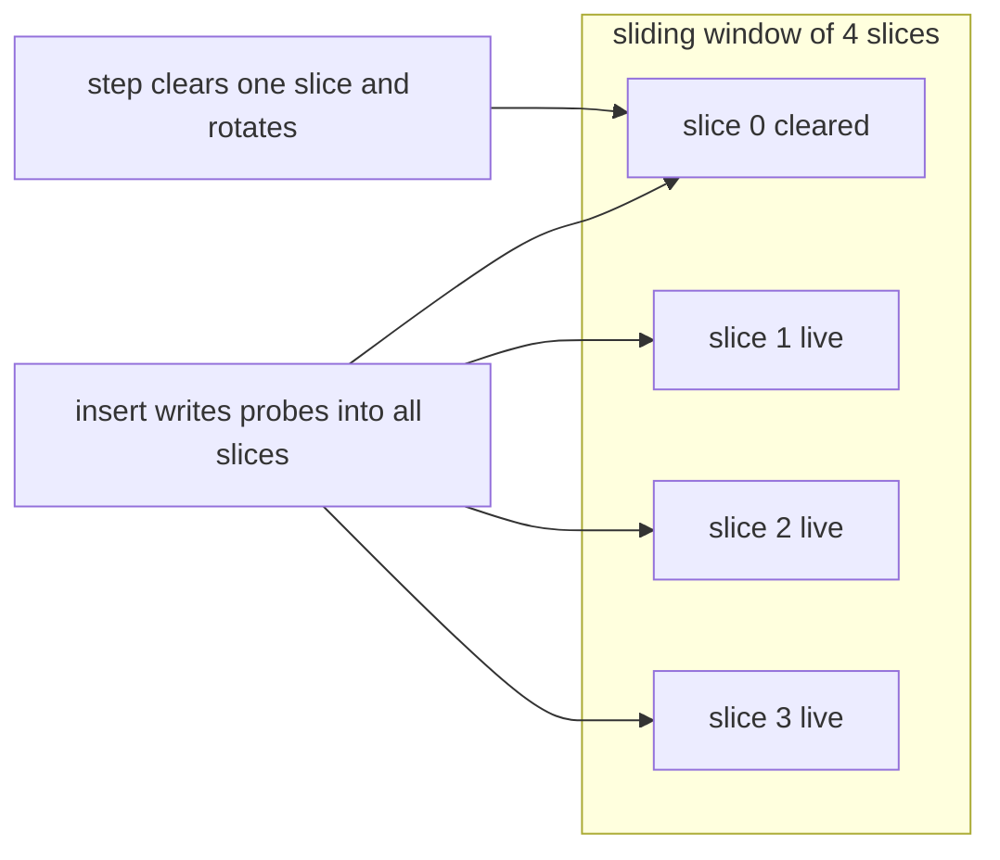
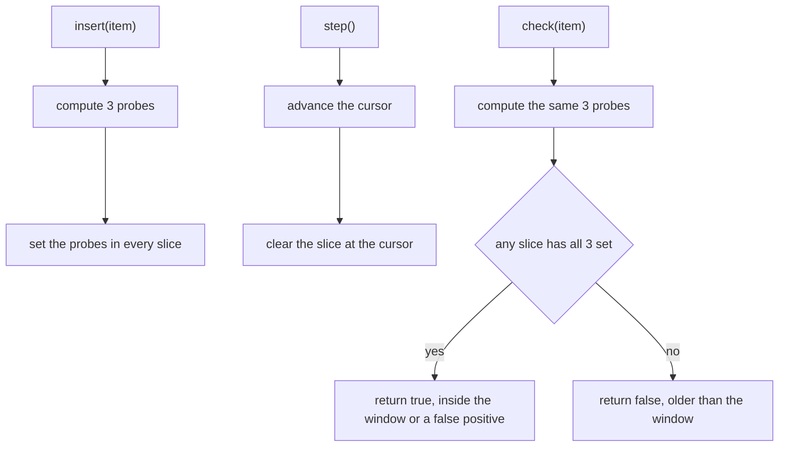
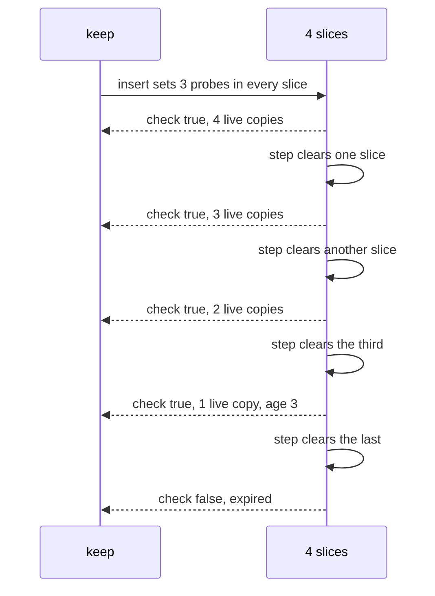
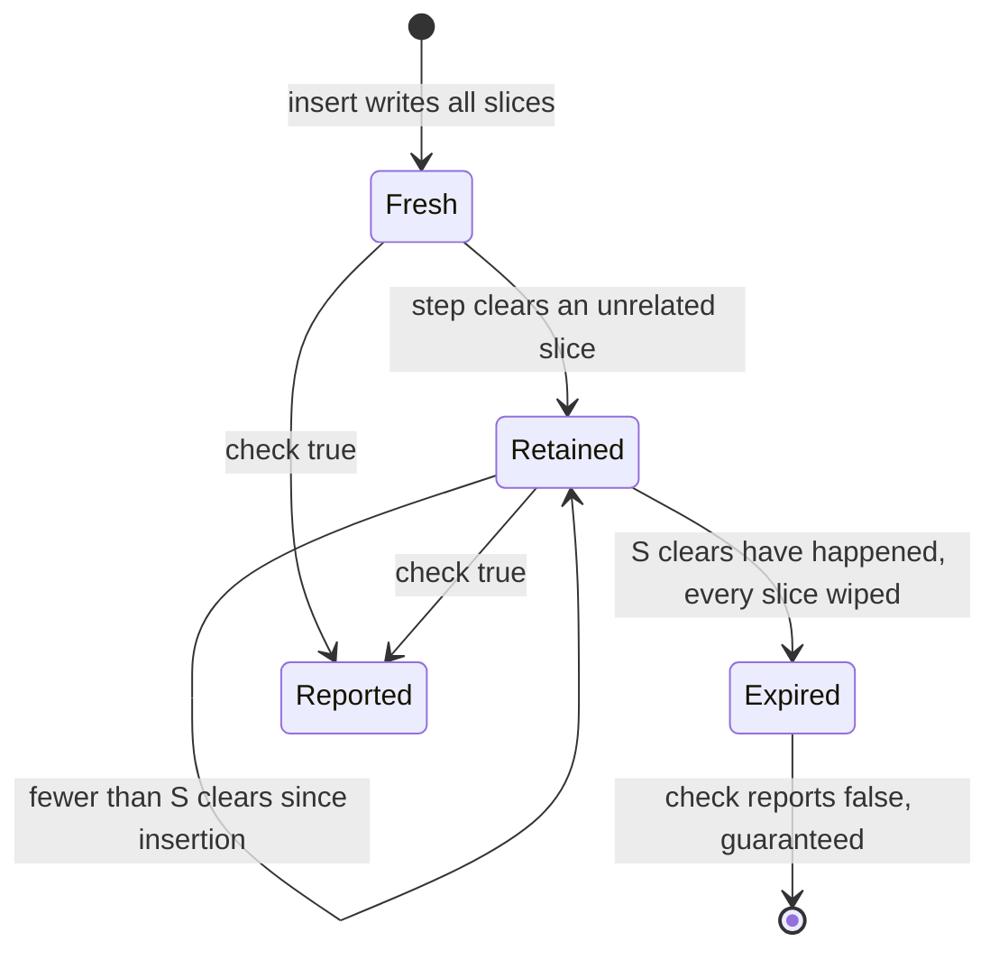

# 255 — Implement rolling bloom filter sliding window.

> **Tier:** Intermediate · **CTCI chapter:** Beyond — Advanced Data Structures & Algorithms
> **Task spec:** [255-implement-rolling-bloom-filter-sliding-window.md](../../../tasks/intermediate/255-implement-rolling-bloom-filter-sliding-window.md)
> **Solutions:** [Python](../../../solutions/python/intermediate/255-implement-rolling-bloom-filter-sliding-window/solution.py) ·
> [Java](../../../solutions/java/intermediate/255-implement-rolling-bloom-filter-sliding-window/Solution.java) ·
> [JavaScript](../../../solutions/javascript/intermediate/255-implement-rolling-bloom-filter-sliding-window/solution.js) ·
> [C#](../../../solutions/csharp/intermediate/255-implement-rolling-bloom-filter-sliding-window/Solution.cs)

## 1. Problem restatement

**Input:** a sequence of inserts interleaved with *steps* — explicit time advances — and membership
checks against a sliding window.

**Output:** a filter made of `S = 4` slices of `64` bits each with `3` probes per item, where

- every insert writes its probes into **all** slices;
- every `step()` clears exactly **one** slice, rotating through them;
- `check(item)` is true if **any** slice still has all of the item's bits set.

The guaranteed behaviour is: an item inserted at step `t` is **never missed while fewer than `S`
clears have happened** since, and is **certainly gone once `S` clears have happened**.

The contract is pinned by the assertions in the four solution files:

| Scenario | Result | Why |
| --- | --- | --- |
| `check("alpha")` on a fresh filter | `False` | the window is empty, so every probe fails |
| `insert("alpha")`, then `check("alpha")` | `True` | the insert wrote all four slices |
| every slice's popcount right after the insert | exactly `3` | the three probes are distinct within a slice |
| `step()`, then `check("alpha")` | `True` | age `1 < S = 4`, other slices still hold the bits |
| number of all-zero slices after that step | `1` | exactly one rotation happened |
| insert `solo`, then `step()` four times | `check` is `False`, all slices popcount `0` | age `4`: every slice that held it was cleared |
| insert `keep`, then `step()` three times | `check` is `True`; a fourth step makes it `False` | the boundary is exactly `S` |
| a 9-step timeline of inserts | no false negative for any item of age `<= S - 1`; `alpha` is gone at age `8` | the sliding-window guarantee, checked after every step |
| 8 members loaded at once | all 8 found | no false negatives when the window is full |
| 100 non-members, `q0 .. q99` | exactly `4` hits, and at least `1` | false positives do happen and are expected |

The hash is the same stable composition as
[254-implement-bloom-filter-insert-check-probabilistic.md](../../../tasks/intermediate/254-implement-bloom-filter-insert-check-probabilistic.md):
FNV-1a 32-bit followed by the MurmurHash3 `fmix32` avalanche, then double hashing with an odd step.

## 2. Intuition

An ordinary bloom filter can only grow: bits are set and never cleared, so it can never forget. That
is fine for a static set and useless for "which items did I see in the last `S` steps?" — a
time-windowed question.

Discarding bits is dangerous because bits are shared. The rolling filter's trick is to discard them
in **whole generations** instead of individually:

- keep `S` independent slices;
- each insert writes its probes into *every* slice, so every slice could answer the query on its own;
- each `step()` wipes one entire slice and moves on to the next;
- `check` asks whether *any* slice still answers yes.

The guarantee falls out of that arrangement. An item inserted at step `t` had its bits written into
all `S` slices; each subsequent step clears one slice, so after `d` steps the item still has bits in
`S - d` slices. While `d < S` at least one intact slice remains, so the lookup can still find it. After
`S` steps every slice that was alive at insertion time has been cleared, so the item is definitely
gone — no false negative inside the window, guaranteed expiry outside it.



Because every slice holds the same probe pattern after an insert, the four slices are interchangeable
storage — the rotation merely forgets the oldest generation first. And because clearing is wholesale,
no item can lose *part* of its probe set and stay half-visible; it is either fully intact in some slice
or fully expired.

## 3. Algorithm

1. Allocate `S` slices of `bits` bits each, all clear, plus a cursor `current = 0`.
2. **positions(item)** — the same double hashing as the plain filter: `h1` and an odd `h2`, with
   `(h1 + i·h2) mod bits` for `i = 0 .. HASHES - 1`.
3. **insert(item)** — compute the probes once and set each of them in *every* slice.
4. **step()** — advance the cursor modulo `S` and replace the slice under the cursor with a fresh,
   all-clear slice.
5. **check(item)** — compute the probes and answer true if *any* slice has all of them set.

```text
procedure positions(item, bits, hashes)
    h1 ← fmix32(fnv1a(item))
    h2 ← fmix32(fnv1a(item + "#")) or 1
    out ← empty list
    for i ← 0 to hashes - 1 do
        append (h1 + i * h2) mod bits to out
    return out

procedure insert(item)
    probes ← positions(item, bits, hashes)
    for word in slices do
        for p in probes do
            word[p] ← 1

procedure step()
    current ← (current + 1) mod number of slices
    slices[current] ← a fresh all-clear slice

function check(item)
    probes ← positions(item, bits, hashes)
    for word in slices do
        if all bits at probes are set in word then
            return true
    return false
```

The `any` in `check` and the write-to-*all* in `insert` are a matched pair: writing to only one slice
would shorten the window to that slice's lifetime, and checking all slices with an `all` instead of an
`any` would demand that every generation still remembers the item — which no rotation would allow.



## 4. Worked example

The lifetime of one item, `keep`, inserted at step `0` into a four-slice filter. Slice `0` is the one
cleared by the first `step()` because the cursor starts at `0` and advances before clearing:

| Step | Action | Slices after the action | `check("keep")` |
| --- | --- | --- | --- |
| 0 | `insert("keep")` | all four slices hold the 3 probes | `True` |
| 1 | `step()` | slice `1` cleared, slices `0`, `2`, `3` live | `True` |
| 2 | `step()` | slice `2` cleared | `True` |
| 3 | `step()` | slice `3` cleared — age `3`, still inside the window | `True` |
| 4 | `step()` | slice `0` cleared — every slice that held the item is gone | `False` |

The test asserts exactly this: three steps keep the item visible, and the fourth step loses it. The
boundary is `S - 1` steps of guaranteed visibility, and the item's age counted in clears is what
decides it, not the number of steps since insertion in any other sense — each `step()` is one clear.

The `ghost` scenario isolates the expiry: `insert("solo")` followed by four `step()` calls leaves every
slice at popcount `0`, so `check("solo")` is `False` and there is nothing left to find by accident.



The long timeline in the test drives the same rule continuously: `alpha` is inserted, then eight steps
run with a new `w<i>` inserted after each one, and after every step the assertion walks the history and
requires `check` to be `True` for every item of age `<= S - 1 = 3`. `alpha` itself is asserted to be
gone at age `8`. That check is the sliding-window guarantee stated as a test: inside the window no
false negative, outside it no obligation.



## 5. Complexity

Let `S` be the number of slices, `b` the bits per slice, `k` the probes per item, and `L` the item
length.

| Measure | Bound | Why it holds |
| --- | --- | --- |
| `insert` | O(L + k·S) time | two string hashes plus `k` bit writes into each of `S` slices |
| `step` | O(b) time to allocate the fresh slice, O(1) to advance the cursor | clearing a slice is one allocation, not a bit-by-bit wipe |
| `check` | O(L + k·S) worst, less on average | probes are computed once and tested per slice until one succeeds |
| Space | O(S · b) bits, fixed | independent of how many items are inserted and how long the stream runs |
| Guaranteed retention | exactly `S - 1` clears | an item's bits survive every slice until the last one that held it is cleared |
| False negatives inside the window | zero | at least one slice always retains the item's probes |
| False positives at any time | possible, bounded by the same load-factor formula as a plain filter | per-slice occupancy is what matters, and each slice is cleared periodically |
| Plain bloom filter (task 254) for comparison | O(m) bits, no expiry, no deletion | grows monotonically full and eventually saturates |
| Exact sliding-window set | O(items in window) space | the filter trades that for a fixed `S · b` footprint |

The multi-slice write multiplies the insert cost by `S`, which is the price of the window: the same
probes are stored `S` times so that forgetting can happen one generation at a time without ever
clearing a bit that another generation still needs.

## 6. Pitfalls and edge cases

- **Writing to every slice is mandatory.** The retention guarantee is "some slice still holds it", so
  an insert that writes to one slice only shortens the window to that slice and breaks the
  `age <= S - 1` assertions.
- **`check` must OR the slices, not AND them.** Requiring all slices to hold the item would make every
  item disappear after a single `step()`, which contradicts the `keep` trace.
- **Clearing is wholesale, never bit-wise.** Setting a slice to "all clear" is what makes expiry
  certain; clearing only the individual bits of a forgotten item would create false negatives for every
  other item that shares them — the reason a plain bloom filter cannot delete at all.
- **The cursor advances before the clear.** `current = (current + 1) mod S` then
  `slices[current] = fresh`, so the first `step()` clears slice `1` and the slice written most recently
  by the constructor's state is not the first to go. The test's "exactly one all-zero slice after one
  step" assertion pins the rotation count.
- **Boundary at exactly `S`.** An item survives `S - 1` clears and is gone after the `S`-th; both sides
  are asserted (`keep` at three steps, `ghost` at four).
- **Fresh filter.** `check` on an empty window is `False`, because every probe finds a clear bit in
  every slice; the test asserts it before the first insert.
- **False positives are the expected direction.** The loaded case asserts exactly `4` hits over
  `q0 .. q99` and also requires `hits >= 1`, so an implementation that somehow never reports a false
  positive would fail — the direction of error is deliberate and must not be "fixed".
- **Deterministic hashing again.** As in the plain filter, the seeded/stable hash makes the exact counts
  reproducible across all four languages, including the probe popcount of `3` per slice.
- **Distinct probes.** Forcing `h2` odd is what keeps the three probes apart within a `64`-bit slice;
  duplicated probes would report a popcount below `3` and weaken the filter.
- **`step()` is explicit, not time-based.** The caller decides when a generation ends; the structure has
  no clock, which is what makes the tests deterministic.
- **Slice count is the window length in steps.** `S = 4` means four steps, not four seconds; choosing
  `S` is choosing how many generations of history are retained, and the memory is `S · b` bits
  regardless.

## 7. Variants and follow-ups

- **No expiry needed.**
  [254-implement-bloom-filter-insert-check-probabilistic.md](../../../tasks/intermediate/254-implement-bloom-filter-insert-check-probabilistic.md)
  is the single-generation version, cheaper per insert and able to hold far more items, but it can never
  forget one.
- **Exact membership with deletion.**
  [251-implement-skip-list-insert-search-delete.md](../../../tasks/intermediate/251-implement-skip-list-insert-search-delete.md)
  supports true deletion in expected `O(log n)` — the property the rolling filter deliberately trades
  away for a fixed footprint.
- **Counting instead of remembering.** When the question is "which items are frequent" rather than "was
  this seen recently",
  [256-top-k-frequent-elements-in-array-heap.md](../../../tasks/intermediate/256-top-k-frequent-elements-in-array-heap.md)
  is the right shape: counts, not bits.
- **Windows over ordered data.**
  [261-median-of-two-sorted-arrays-log-min-n-m-algorithm.md](../../../tasks/intermediate/261-median-of-two-sorted-arrays-log-min-n-m-algorithm.md)
  solves a different windowing problem where the retained information is positional rather than
  temporal.
- **Tuning.** More slices lengthen the window but multiply insert cost by `S`; more bits reduce false
  positives; more probes reduce published rate up to the load-factor optimum
  `k ≈ (b/items) · ln 2`. The shipped defaults (`S = 4`, `b = 64`, `k = 3`) are the ones the tests
  measure.

## 8. Check yourself

1. Why does an item survive exactly `S - 1` clears rather than `S`?

<details><summary>Show answer</summary>

Because the insert wrote its bits into all `S` slices, and each `step()` destroys exactly one of them.
After `S - 1` clears one intact slice is still left, so the lookup can still succeed; the `S`-th clear
removes the last slice that held the item, so from then on it is definitely absent.

</details>

2. What would break if `check` used `all` over the slices instead of `any`?

<details><summary>Show answer</summary>

Every item would vanish after a single `step()`, because the cleared slice can no longer answer for it.
The `keep` assertions — still visible after one, two and three steps — would fail immediately, and the
sliding-window guarantee would collapse to a one-step window.

</details>

3. Why can this filter forget items at all, when a plain bloom filter cannot delete?

<details><summary>Show answer</summary>

Because it never clears bits selectively. Discarding an entire generation of bits is safe — the only
consequence is that items from that generation may become unreachable, which is exactly the intended
expiry — whereas clearing the bits belonging to one item would destroy information that other items
still rely on and create false negatives.

</details>

4. The test asserts `hits == 4` over 100 non-members and also `hits >= 1`. Why both?

<details><summary>Show answer</summary>

The exact count is deterministic given the fixed hash, so it is checked as a cross-language constant.
The `>= 1` bound documents the intent: false positives are an expected, acceptable direction of error,
so an implementation that reported zero would be suspicious even though the exact count would already
have caught it.

</details>

5. What does each slice's popcount of `3` right after a single insert prove?

<details><summary>Show answer</summary>

That the insert wrote the item's three probes into every slice and that the three probes are distinct
within a `64`-bit slice — a duplicated probe would show a popcount below `3`. It also confirms that the
slices are independent: nothing from other inserts is present to inflate the count.

</details>
