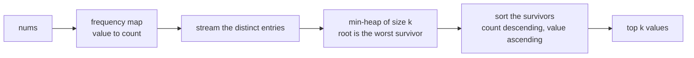
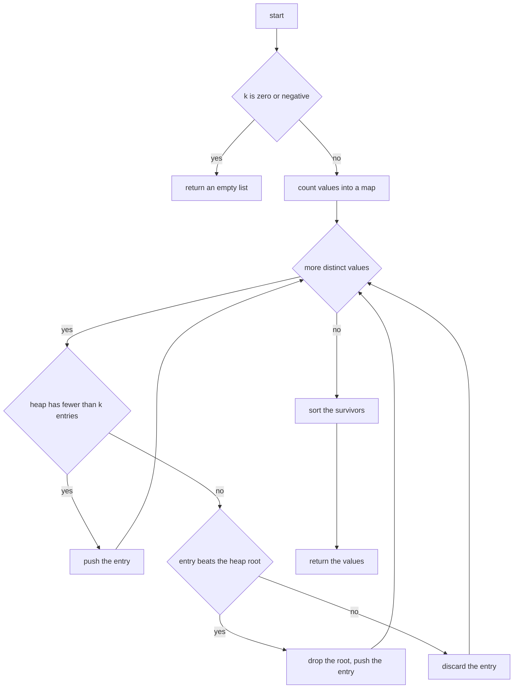
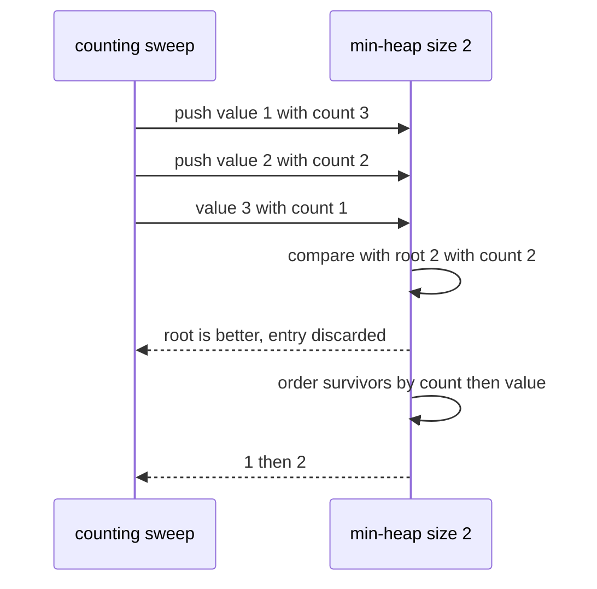
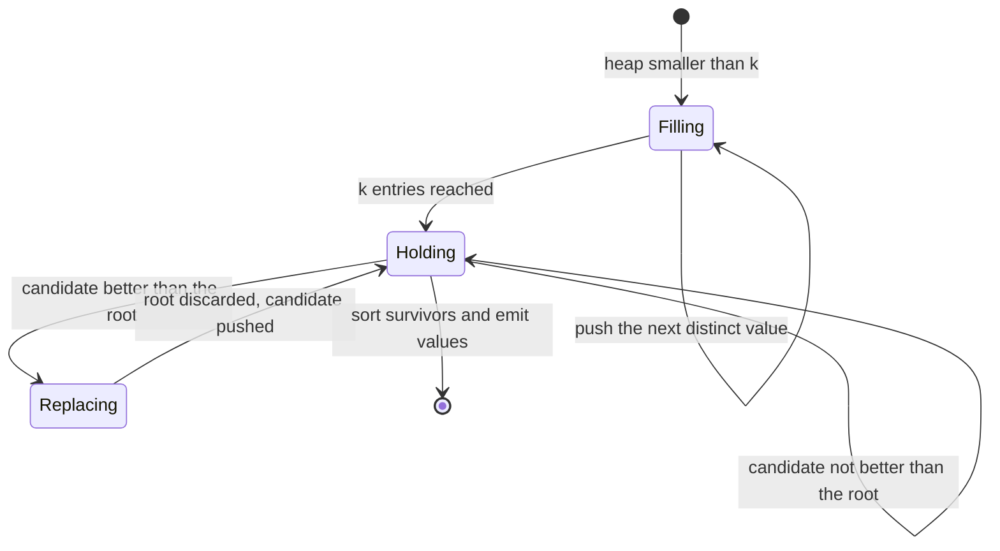

# 256 — Top K frequent elements in array (heap).

> **Tier:** Intermediate · **CTCI chapter:** Ch 10 — Sorting and Searching
> **Task spec:** [256-top-k-frequent-elements-in-array-heap.md](../../../tasks/intermediate/256-top-k-frequent-elements-in-array-heap.md)
> **Solutions:** [Python](../../../solutions/python/intermediate/256-top-k-frequent-elements-in-array-heap/solution.py) ·
> [Java](../../../solutions/java/intermediate/256-top-k-frequent-elements-in-array-heap/Solution.java) ·
> [JavaScript](../../../solutions/javascript/intermediate/256-top-k-frequent-elements-in-array-heap/solution.js) ·
> [C#](../../../solutions/csharp/intermediate/256-top-k-frequent-elements-in-array-heap/Solution.cs)

## 1. Problem restatement

**Input:** an integer array `nums` of length `n` (may be empty, may hold negatives and duplicates)
and an integer `k` (`k` may be `0` or larger than the number of distinct values).

**Output:** the values that occur most often, ordered by **frequency descending** and, when two
frequencies tie, by **value ascending**. The output holds at most `k` values, and each distinct
value appears at most once.

The contract is fixed by the assertions the four solution files ship with:

| Call | Result | Why |
| --- | --- | --- |
| `top_k_frequent([1,1,1,2,2,3], 2)` | `[1, 2]` | counts are `1 → 3`, `2 → 2`, `3 → 1` |
| `top_k_frequent([1,1,1,2,2,3], 1)` | `[1]` | only the leader |
| `top_k_frequent([1,1,1,2,2,3], 3)` | `[1, 2, 3]` | all three distinct values |
| `top_k_frequent([1,1,1,2,2,3], 6)` / `(..., 99)` | `[1, 2, 3]` | `k` above the distinct count returns everything |
| `top_k_frequent([1,1,1,2,2,3], 0)` | `[]` | `k <= 0` is an early empty result |
| `top_k_frequent([4,4,5,5,6], 2)` | `[4, 5]` | count tie broken by the smaller value |
| `top_k_frequent([3,1,2], 2)` | `[1, 2]` | every count is `1`, so the two smallest values win |
| `top_k_frequent([2,2,3,3,1], 1)` | `[2]` | a tie at the eviction boundary keeps the smaller value |
| `top_k_frequent([-1,-1,2,2], 2)` | `[-1, 2]` | negatives participate normally |
| `top_k_frequent([5], 1)` | `[5]` | single element |
| `top_k_frequent([7,7,7], 3)` | `[7]` | one distinct value, `k` larger than the answer |
| `top_k_frequent([], 3)` | `[]` | empty input |

The tie rule is the part worth writing down: an entry is **worse** than another when its count is
smaller, or — on equal counts — when its value is *larger*. Every solution documents that rule the
same way, and the assertions above were chosen to pin it down at both the start and the end of the
selection.

## 2. Intuition

Two separate jobs are hiding in this problem: **count**, and **select without sorting**. Counting
is a hash map sweep. Selection is where the interesting choice lives.

Sorting all `d` distinct values by `(count desc, value asc)` and slicing the first `k` is correct
and costs `O(d log d)`, but it computes an order you never use: you need `k` answers, not an
ordering of everything. A **bounded min-heap** keeps exactly `k` candidates, with the *worst*
candidate at the root, so a new entry only has to be compared against one element.

The inversion is the trick: a min-heap on "worst-ness" is a max-heap on quality. The root is the
weakest of the survivors — the smallest count, and among equal counts the largest value — which
is exactly the entry you would drop first.



With `d` distinct values, streaming through the heap costs `d log k` comparisons instead of
`d log d`, and the final ordering only sorts `k` entries. When `k` is close to `d` the two are
comparable; when `k` is small the heap is the clear winner.

## 3. Algorithm

1. If `k <= 0`, return an empty result immediately.
2. Sweep `nums` once, incrementing a counter per value in a hash map.
3. Create an empty heap that orders entries by "worst first": smaller count first, and on equal
   counts the larger value first.
4. For each distinct `(value, count)` pair: if the heap holds fewer than `k` entries, push it;
   otherwise compare it with the heap root and, when the candidate is *better* than the root,
   replace the root with it.
5. Collect the surviving entries and order them by count descending, value ascending.
6. Return just the values.

```text
procedure top_k_frequent(nums, k)
    if k <= 0 then return empty list
    freq ← empty map
    for x in nums do
        freq[x] ← freq[x] + 1
    heap ← empty min-heap ordered by (count ascending, value descending)
    for (value, count) in freq do
        entry ← (count, value)
        if size(heap) < k then
            push entry
        else if entry is better than root(heap) then
            replace root with entry
    survivors ← every entry of heap
    sort survivors by count descending, then value ascending
    return the values of survivors

function better(entry, other)
    if entry.count ≠ other.count then return entry.count > other.count
    return entry.value < other.value
```

Both halves of the comparison matter: comparing counts alone makes the tie cases depend on the
heap's internal order, which is why the tests include inputs where two counts are equal.



## 4. Worked example

Trace `top_k_frequent([1, 1, 1, 2, 2, 3], 2)`. Counting gives `{1: 3, 2: 2, 3: 1}`. The heap holds
`(count, -value)` pairs in the Python version, so the smallest tuple is the worst candidate and a
plain tuple comparison implements "smaller count, then larger value":

| Step | Entry reached | Heap before | Decision | Heap after |
| --- | --- | --- | --- | --- |
| 1 | `1` with count `3` | `[]` | fewer than `k = 2` entries, push | `[(3, -1)]` |
| 2 | `2` with count `2` | `[(3, -1)]` | fewer than `k`, push | `[(2, -2), (3, -1)]` |
| 3 | `3` with count `1` | `[(2, -2), (3, -1)]` | `(1, -3)` is not greater than the root `(2, -2)`, discard | unchanged |

The two survivors are values `2` and `1`; ordering them by count descending, value ascending gives
`[1, 2]`. The third value was rejected after a single comparison with the root — that is the
saving over sorting `d` entries.



The tie case behaves differently and is worth tracing separately. For `[3, 1, 2]` with `k = 2`
every count is `1`, so the entries in insertion order are `(1,-3)`, `(1,-1)`, `(1,-2)`:

| Step | Entry | Heap before | Decision | Heap after |
| --- | --- | --- | --- | --- |
| 1 | value `3` | `[]` | push | `[(1, -3)]` |
| 2 | value `1` | `[(1, -3)]` | push | `[(1, -3), (1, -1)]` |
| 3 | value `2` | `[(1, -3), (1, -1)]` | `(1, -2) > (1, -3)`, replace the root | `[(1, -2), (1, -1)]` |

The root was value `3` (the largest value, hence the worst on a count tie) and it is the one
evicted; the survivors `1` and `2` are emitted value-ascending. The same rule explains
`top_k_frequent([2,2,3,3,1], 1) == [2]`: with `k = 1` the heap holds value `2`, and the later
entry for value `3` has the same count but a larger value, so it is not better and does not
displace it.



## 5. Complexity

Let `n` be the length of `nums`, `d` the number of distinct values, and `k` the requested count.

| Measure | Bound | Why it holds |
| --- | --- | --- |
| Time, counting | O(n) | one hash-map increment per element |
| Time, selection | O(d log k) | each distinct value costs one heap push or one compare-and-replace, both `O(log k)` |
| Time, output ordering | O(k log k) | only the survivors are sorted |
| Time, total | O(n + d log k) | the documented bound in all four solution headers |
| Time, worst case | O(n + n log n) when `k = d` | the heap degenerates to sorting everything |
| Space | O(d + k) | the frequency map plus the bounded heap |
| Alternative: full sort | O(n + d log d) time, same space | simpler code, but it orders values you never return |
| Alternative: bucket by count | O(n) time after counting | one bucket per possible count, `n + 1` buckets, when the count range is dense |

The heap is the right choice when `k` is small relative to `d`; bucket sort beats it when the
maximum count is close to `n`, and both are preferable to sorting the distinct values.

## 6. Pitfalls and edge cases

- **`k <= 0`.** Returns an empty list *before* the heap is created, and the tests assert
  `top_k_frequent([1,1,1,2,2,3], 0) == []`.
- **`k` larger than `d`.** `k = 6` and `k = 99` on three distinct values both return all three;
  the heap never fills, so the "push while smaller than `k`" branch is the only one exercised.
- **Ties are broken by value, ascending.** `[4,4,5,5,6]` with `k = 2` returns `[4, 5]`; sorting by
  count alone would be unstable across languages.
- **Ties at the eviction boundary.** `[2,2,3,3,1]` with `k = 1` returns `[2]`, because the entry
  for `3` compares equal on count and loses on the second key. This is the assertion that catches
  an implementation that compares only counts.
- **Negative values.** `[-1,-1,2,2]` with `k = 2` returns `[-1, 2]`; the heap key must not assume
  non-negative values, and ascending order means `-1` before `2`.
- **Empty input.** `[]` with `k = 3` returns `[]`; the counting sweep does nothing and the heap
  stays empty.
- **Single distinct value.** `[7,7,7]` with `k = 3` returns `[7]`, not three copies: the heap holds
  one entry per *distinct* value.
- **The heap holds records, not values.** Each heap element carries both the count and the value,
  because the value is needed for the tie-break and for the final ordering. Java and C# compare
  `int[]` pairs with an explicit comparator; Python packs `(count, -value)` into a tuple and
  JavaScript attaches a comparator to the array.
- **Ordering direction is used twice.** The heap is a *min*-heap on worst-ness while the output is
  *descending* by count, so mixing the two directions silently reverses the result without
  breaking any type check.
- **The final sort is on `k` elements.** Sorting the whole frequency map instead would be correct
  but reinstates the `O(d log d)` cost the heap was meant to avoid.

## 7. Variants and follow-ups

- **Strings with a lexicographic tie-break.**
  [257-top-k-frequent-words-heap-lexicographic-tie.md](../../../tasks/intermediate/257-top-k-frequent-words-heap-lexicographic-tie.md)
  keeps the same heap skeleton but replaces "smaller value wins" with "alphabetically smaller word
  wins", which is the same comparison shape on a different key.
- **Streaming instead of arrays.**
  [258-kth-largest-element-in-stream-min-heap.md](../../../tasks/intermediate/258-kth-largest-element-in-stream-min-heap.md)
  keeps a `k`-bounded min-heap across a sequence of `add` calls, so the same root-is-the-worst
  invariant answers a different question without re-reading the input.
- **Selection without a heap.**
  [259-kth-smallest-element-using-order-statistics-quickselect.md](../../../tasks/intermediate/259-kth-smallest-element-using-order-statistics-quickselect.md)
  and
  [260-quickselect-randomized-implementation.md](../../../tasks/intermediate/260-quickselect-randomized-implementation.md)
  pick a single order statistic in expected linear time, which is the better trade when only one
  element is wanted and the array can be reordered.
- **Many sorted inputs at once.**
  [262-merge-k-sorted-lists-heap.md](../../../tasks/intermediate/262-merge-k-sorted-lists-heap.md)
  uses the same bounded-size heap idea one level up: the heap holds one head per list.
- **Counting as a first phase.** The frequency map built here is the same structure the trie-based
  phonebook uses for multiplicity in
  [252-design-a-phonebook-using-trie-with-counts-and-delete.md](../../../tasks/intermediate/252-design-a-phonebook-using-trie-with-counts-and-delete.md).

## 8. Check yourself

1. Why is a min-heap the right shape for keeping the `k` *most* frequent values?

<details><summary>Show answer</summary>

Because the entry you want to evict is the worst survivor, and the root of a min-heap on
worst-ness is exactly that entry. Each new candidate is compared with one element — the root — and
only a winning candidate costs a `log k` replacement, so the whole selection is `d log k` instead
of `d log d`.

</details>

2. What does the tie-break rule for equal counts do, and where is it implemented?

<details><summary>Show answer</summary>

On equal counts the *larger* value is the worse entry, so it is evicted first and the smaller value
survives. Python encodes it by storing `(count, -value)` and comparing tuples, Java and C# by an
explicit comparator that checks count first and value second, and JavaScript by a comparator
function. The tests `[3,1,2]`, `[4,4,5,5,6]` and `[2,2,3,3,1]` pin it down.

</details>

3. `top_k_frequent([1,1,1,2,2,3], 6)` returns three values, not six. Why is that not a bug?

<details><summary>Show answer</summary>

Because the heap holds one entry per distinct value, and the array only has three distinct values
(`1`, `2`, `3`). A `k` larger than `d` simply means the heap never fills, so every distinct value
is a survivor.

</details>

4. When would sorting all distinct values be the better implementation?

<details><summary>Show answer</summary>

When `k` is close to `d`, because then the heap solves nearly the same problem with more
machinery: both cost `O(d log d)`. Sorting also wins when the caller wants the full frequency
ordering anyway, and when the comparison is expensive enough that halving the number of
comparisons is not worth extra allocations.

</details>

5. What is the cost of the heap approach when the input has `n` elements and only one distinct
value?

<details><summary>Show answer</summary>

`O(n)` for the counting sweep plus `O(d log k) = O(1 · log k)` for the single distinct entry, so
`O(n)` overall — the count sweep dominates and the answer is that one value. The tests cover it
with `[7,7,7]` and `k = 3`.

</details>
