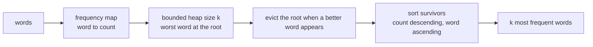
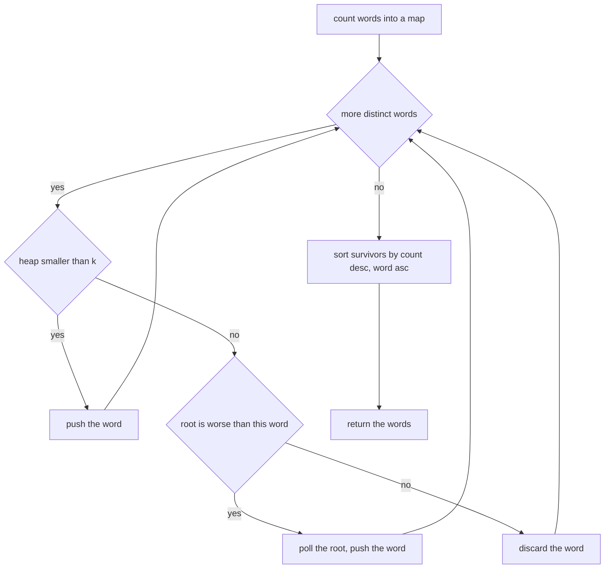
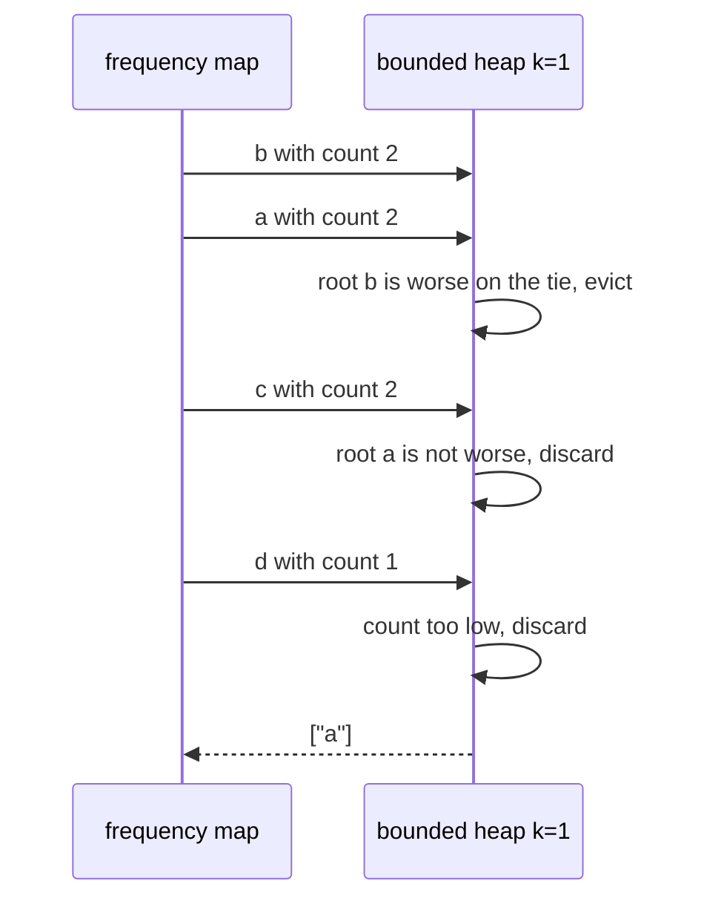
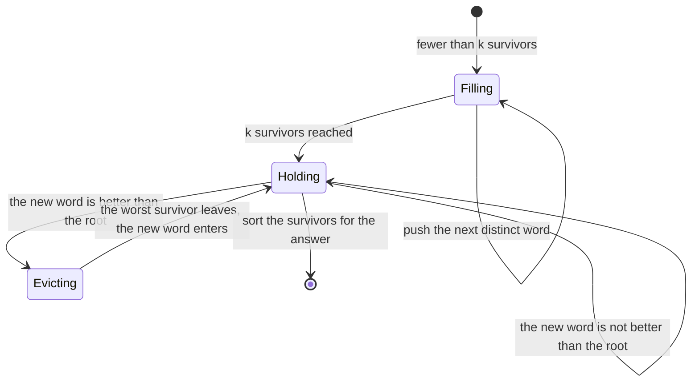

# 257 — Top K frequent words (heap + lexicographic tie).

> **Tier:** Intermediate · **CTCI chapter:** Ch 10 — Sorting and Searching
> **Task spec:** [257-top-k-frequent-words-heap-lexicographic-tie.md](../../../tasks/intermediate/257-top-k-frequent-words-heap-lexicographic-tie.md)
> **Solutions:** [Python](../../../solutions/python/intermediate/257-top-k-frequent-words-heap-lexicographic-tie/solution.py) ·
> [Java](../../../solutions/java/intermediate/257-top-k-frequent-words-heap-lexicographic-tie/Solution.java) ·
> [JavaScript](../../../solutions/javascript/intermediate/257-top-k-frequent-words-heap-lexicographic-tie/solution.js) ·
> [C#](../../../solutions/csharp/intermediate/257-top-k-frequent-words-heap-lexicographic-tie/Solution.cs)

## 1. Problem restatement

**Input:** a list of words (strings, possibly repeated, possibly empty) and an integer `k`.

**Output:** the `k` most frequent words in the ordering rule stated by the solution headers:
**more frequent words first; on equal counts, the lexicographically smaller word first**. When `k`
exceeds the number of distinct words, every distinct word is returned.

The exact contract is pinned by the assertions the four solution files ship with:

| Call | Result | Why |
| --- | --- | --- |
| `top_k_frequent_words(["i","love","leetcode","i","love","coding"], 1)` | `["i"]` | `i` and `love` both count `2`; `i` is smaller |
| `(..., 2)` | `["i", "love"]` | the two-count tier, lexicographic |
| `(..., 3)` | `["i", "love", "coding"]` | `coding` beats `leetcode` in the count-`1` tier |
| `(..., 4)` | `["i", "love", "coding", "leetcode"]` | full listing |
| `(..., 9)` | `["i", "love", "coding", "leetcode"]` | more `k` than distinct words |
| `(..., 0)` | `[]` | `k <= 0` short-circuits |
| `(["the","day","is","sunny","the","the","sunny","is","is"], 2)` | `["is", "the"]` | `is:3`, `the:3`, `sunny:2`, `day:1` |
| `(["a","aa","aaa"], 2)` | `["a", "aa"]` | all count `1`, so pure lexicographic order |
| `(["b","b","a","a","c","c","d"], 1)` | `["a"]` | `a:2`, `b:2`, `c:2`, `d:1`; eviction tie resolved lexicographically |
| `(..., 2)` / `(..., 3)` | `["a", "b"]` / `["a", "b", "c"]` | smaller letters survive the ties |
| `(["only"], 1)` | `["only"]` | single word |
| `([], 3)` | `[]` | empty input |

The distinguishing feature against the numeric version of this problem (task 256) is the
comparison key: instead of "smaller value wins" the rule is "lexicographically smaller word
wins", and string comparison has an ordering that is *not* the insertion order — `"a"` is smaller
than `"aa"`, which is smaller than `"aaa"`, and `"cod"` is smaller than `"coding"`.

## 2. Intuition

Counting is again a hash-map sweep; the new work is the comparison. A **bounded heap** keeps the
`k` best words with the *worst* candidate at the root, so eviction is a single comparison against
one element. "Worst" is the inverse of the output rule:

- lower count is worse;
- on a count tie, the **lexicographically larger** word is worse.

So the heap's ordering is exactly the reverse of the answer's ordering, and the final answer is
obtained by sorting the at-most-`k` survivors with the natural rule. This double reversal is the
usual place where implementations go wrong: a heap ordered by the answer's rule would put the
*best* word at the root and evict it on the first overflow.



Python expresses the rule by wrapping each `(count, word)` pair in a small class whose `__lt__`
compares counts first and, on a tie, reverses the word comparison; Java, JavaScript and C# attach
the equivalent comparator to their heap type. The reversal exists because "smallest heap element"
has to mean "worst candidate" for the root to be the eviction target: lower count is worse, and on a
count tie the lexicographically larger word is worse, so the survivors sorted the other way round
are the answer.

## 3. Algorithm

1. If `k <= 0`, return an empty list.
2. Count each word with a hash map.
3. Build a heap whose ordering is "worst first": lower count first; on equal counts, larger word
   first.
4. For each distinct word: push it while the heap holds fewer than `k` entries; afterwards replace
   the root whenever the root is worse than the new entry.
5. Sort the survivors by count descending and word ascending, then return the words.
6. Reaching the end of the input, every distinct word is a survivor when `d <= k`.

```text
procedure top_k_frequent_words(words, k)
    if k <= 0 then return empty list
    freq ← empty map
    for word in words do
        freq[word] ← freq[word] + 1
    heap ← empty min-heap ordered by (count ascending, word descending)
    for (word, count) in freq do
        entry ← (count, word)
        if size(heap) < k then
            push entry
        else if root(heap) is worse than entry then
            replace root with entry
    survivors ← every entry of heap
    sort survivors by count descending, then word ascending
    return the words of survivors

function is_worse(first, second)
    if first.count < second.count then return true
    if first.count > second.count then return false
    return first.word > second.word

function is_better(entry, other)
    return is_worse(other, entry)
```

The step-4 comparison is written as "is the root worse than the entry": when the root is worse, it
is the one evicted. If the entry and the current root are equal on both keys they cannot both exist
in the map, so the tie-break never leaves the outcome ambiguous.



## 4. Worked example

Take `["b", "b", "a", "a", "c", "c", "d"]`, so the counts are `a:2`, `b:2`, `c:2`, `d:1`. The map
iterates in first-appearance order `b, a, c, d`. Trace `k = 1` first: the heap holds one word, so
every later word must beat the current root.

| Step | Entry | Root before | Root worse than entry? | Heap after |
| --- | --- | --- | --- | --- |
| 1 | `b` with count `2` | — | heap was empty, push | `[b:2]` |
| 2 | `a` with count `2` | `b:2` | yes — equal counts, `b` is the larger word | `[a:2]` |
| 3 | `c` with count `2` | `a:2` | no — equal counts, `a` is the smaller word | `[a:2]` |
| 4 | `d` with count `1` | `a:2` | no — `2` is not below `1` | `[a:2]` |

The answer is `["a"]`, the same list the tests require. Step 2 is the eviction tie: `b` and `a`
have equal counts, so the lexicographically larger word loses.

Now `k = 3` with the same counts shows the filling branch: `b`, `a` and `c` fill the heap, then
`d` is compared with the root and discarded, because its count `1` is below `2` and a `k`-bounded
heap cannot hold four entries. The survivors are sorted by count descending and word ascending,
giving `["a", "b", "c"]` — three words of the same count in alphabetical order.



The other shipped family behaves the same way on a larger map. For
`["i","love","leetcode","i","love","coding"]` the counts are `i:2`, `love:2`, `leetcode:1`,
`coding:1`; with `k = 3` the heap ends up holding `i:2`, `love:2` and whichever of the two
count-`1` words is smaller — `coding` — because `leetcode` is lexicographically larger and is
therefore the worse of the two. Ordering the survivors gives `["i", "love", "coding"]`, exactly the
asserted third row.



## 5. Complexity

Let `n` be the number of words in the input, `d` the number of distinct words, `k` the requested
count, and `L` the length of a word (string comparison is `O(L)`).

| Measure | Bound | Why it holds |
| --- | --- | --- |
| Time, counting | O(n · L) | one hash of every word character |
| Time, selection | O(d log k) comparisons | one push or one compare-and-replace per distinct word |
| Time, output ordering | O(k log k) comparisons | only the survivors are sorted |
| Time, documented total | O(n + d log k) | the header of all four solution files states this bound for the string-keyed version |
| Space | O(d + k) | the frequency map plus the bounded heap |
| Alternative: full sort | O(d log d) comparisons | same space, simpler code, orders entries the caller never sees |
| Alternative: bucket by count | O(n) after counting | one bucket per distinct count, then take words alphabetically until `k` is reached |

String comparisons are more expensive than integer comparisons, which makes the `log k` factor
worth keeping small: bucket sort by frequency and a lexicographic pass over each bucket avoid the
heap entirely when the count range is small.

## 6. Pitfalls and edge cases

- **The comparison is inverted in the heap.** "Worst first" means lower count and, on a tie,
  *larger* word. Getting this backwards produces the `k` least frequent words and still returns a
  correctly typed list; the `k = 1` tie assertions exist to catch it.
- **`k <= 0`.** Return an empty list before counting, matching
  `top_k_frequent_words(classic, 0) == []`.
- **`k` above the distinct count.** `k = 9` with four distinct words returns those four; the heap
  never fills, so the eviction branch is dead code for that call.
- **Lexicographic, not length.** `["a","aa","aaa"]` with `k = 2` returns `["a", "aa"]`. These
  strings have no duplicates, so their counts are all `1` and the answer is pure lexicographic
  order; a length-based tie-break would return `["a","aa"]` for the wrong reason.
- **Empty input.** `([], 3)` returns `[]`; the map stays empty and so does the heap.
- **Single word.** `(["only"], 1)` returns `["only"]` — the filling branch, no eviction.
- **Words, not lengths.** The heap holds the word itself, because the word is both the identity of
  the entry and the tie-break key; a heap of counts alone cannot reconstruct the answer.
- **Ties that survive together.** `a:2`, `b:2`, `c:2` all fit in the `k = 3` heap and are emitted in
  alphabetical order, so the tie rule has to be applied once more when the survivors are sorted —
  it is the same comparison, not a different one.
- **Repeated words are counted individually.** `b` twice contributes `2`, not one; there is no set
  semantics anywhere in this task.
- **Final ordering direction.** The heap orders worst-first, the answer orders best-first; the
  final sort flips the direction deliberately and must not reuse the heap's comparator as-is.

## 7. Variants and follow-ups

- **Numeric values instead of words.**
  [256-top-k-frequent-elements-in-array-heap.md](../../../tasks/intermediate/256-top-k-frequent-elements-in-array-heap.md)
  is the same bounded heap with `(count, -value)` keys, where a tuple or a pair comparison replaces
  the string comparator.
- **Growing input, single order statistic.**
  [258-kth-largest-element-in-stream-min-heap.md](../../../tasks/intermediate/258-kth-largest-element-in-stream-min-heap.md)
  keeps the same "bounded heap, root is the boundary" invariant but answers with the root value
  instead of sorting survivors.
- **One selection instead of `k`.**
  [260-quickselect-randomized-implementation.md](../../../tasks/intermediate/260-quickselect-randomized-implementation.md)
  finds a single order statistic in expected linear time when the answer does not need the whole
  top-`k` ordering.
- **Word order without counts.** A radix tree gives lexicographic listing with no hashing at all —
  see [253-implement-compressed-trie-radix-tree-basics.md](../../../tasks/intermediate/253-implement-compressed-trie-radix-tree-basics.md)
  and
  [252-design-a-phonebook-using-trie-with-counts-and-delete.md](../../../tasks/intermediate/252-design-a-phonebook-using-trie-with-counts-and-delete.md).
- **Merging ordered sources.** When the words arrive already grouped or sorted,
  [262-merge-k-sorted-lists-heap.md](../../../tasks/intermediate/262-merge-k-sorted-lists-heap.md)
  shows the heap used as a merge front instead of as a bounded selection buffer.

## 8. Check yourself

1. Why must the heap put the *larger* word at the root on a count tie?

<details><summary>Show answer</summary>

Because the root is the entry that gets evicted when a better word arrives. The best words are the
smaller words within a count tier, so the worst survivor — the one to drop — is the largest word of
the tier. Reversing this puts a valuable word at the root and evicts it on the next insert.

</details>

2. `["a","aa","aaa"]` with `k = 2` returns `["a","aa"]`. What are the counts, and which rule decides
the answer?

<details><summary>Show answer</summary>

Every count is `1` because no word repeats, so the count rule cannot distinguish them; the
lexicographic tie-break decides, and `a` sorts before `aa`, which sorts before `aaa`. The tests
assert both `k = 2` and `k = 3` for exactly this input.

</details>

3. How many heap operations does one distinct word cost, and what is the total?

<details><summary>Show answer</summary>

One push if the heap is not yet full, otherwise one comparison against the root plus, at most, one
poll-and-push pair. Both push and replacement are `O(log k)`, so the selection phase is
`O(d log k)` for `d` distinct words, on top of the `O(n)` counting sweep.

</details>

4. Why is the answer not already in the heap's order?

<details><summary>Show answer</summary>

Because the heap is ordered worst-first — the opposite of the required output — so that eviction is
cheap. The final step sorts the at-most-`k` survivors by count descending and word ascending, which
is the answer order and costs only `O(k log k)`.

</details>

5. What would break if the frequency map were replaced by a set plus a counter of "seen" words?

<details><summary>Show answer</summary>

Everything, because the map value is the comparison key: without per-word counts there is no way to
tell `i:2` from `coding:1`, so the primary ordering disappears. Counting is the first of the two
phases precisely because the heap can only order entries that already carry their multiplicity.

</details>
