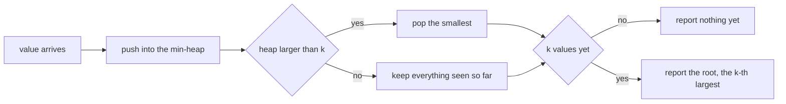
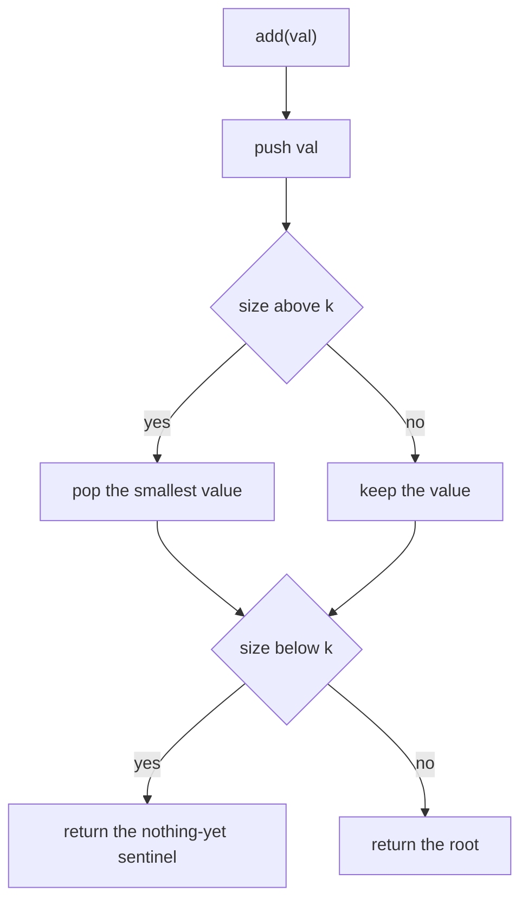
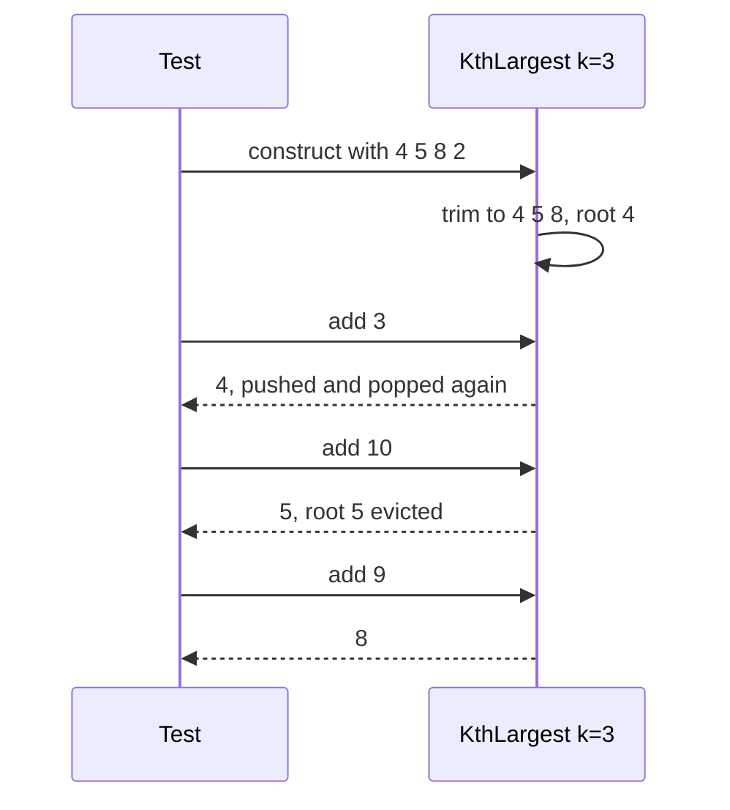
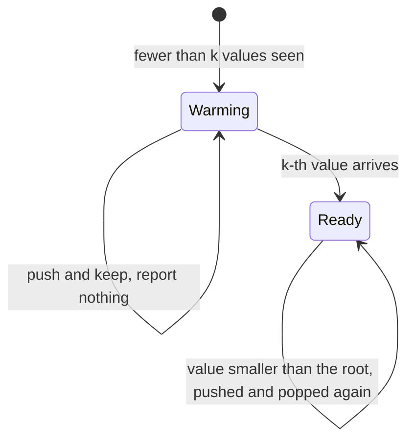

# 258 — Kth largest element in stream (min-heap).

> **Tier:** Intermediate · **CTCI chapter:** Ch 10 — Sorting and Searching
> **Task spec:** [258-kth-largest-element-in-stream-min-heap.md](../../../tasks/intermediate/258-kth-largest-element-in-stream-min-heap.md)
> **Solutions:** [Python](../../../solutions/python/intermediate/258-kth-largest-element-in-stream-min-heap/solution.py) ·
> [Java](../../../solutions/java/intermediate/258-kth-largest-element-in-stream-min-heap/Solution.java) ·
> [JavaScript](../../../solutions/javascript/intermediate/258-kth-largest-element-in-stream-min-heap/solution.js) ·
> [C#](../../../solutions/csharp/intermediate/258-kth-largest-element-in-stream-min-heap/Solution.cs)

## 1. Problem restatement

**Input:** a construction-time count `k >= 1`, an initial list of numbers, and then a stream of
`add(value)` calls that arrive one at a time.

**Output:** after each `add`, the `k`-th largest value among every number seen so far (initial list
plus all added values). If fewer than `k` values have been seen, `add` returns "nothing yet" —
`None` in Python, `null` in Java and C#, `null` in JavaScript.

The contract is pinned by the assertions in the four solution files:

| Call sequence | Result | Why |
| --- | --- | --- |
| `KthLargest(3, [4,5,8,2])`, then `add(3), add(5), add(10), add(9), add(4)` | `4, 5, 5, 8, 8` | the heap always holds the three largest values seen |
| `KthLargest(5, [3,1])`, then `add(2), add(7), add(9), add(4)` | `None, None, 1, 2` | `None` until five values have been seen |
| `KthLargest(1, [4,5,8,2])`, then `add(3), add(10), add(4)` | `8, 10, 10` | `k = 1` is the running maximum |
| `KthLargest(2, [5,5,5])`, then `add(5), add(4), add(6), add(7)` | `5, 5, 5, 6` | duplicates count separately |
| `KthLargest(2, [])`, then `add(5), add(3), add(10), add(8)` | `None, 3, 5, 8` | an empty initial list is legal |
| `KthLargest(2, [1,2,3])` | heap holds `[2, 3]` (in either order) | the initial list is trimmed to the top `k` |
| `KthLargest(0, ...)` | throws / reports an error | `k` must be at least `1` |

Two behaviours here are *documented* rather than mathematically forced, and both are asserted:
`add` returns the "nothing yet" sentinel while fewer than `k` values have arrived, and the
constructor trims an oversized initial list down to its `k` largest values instead of keeping
everything.

## 2. Intuition

The naive answer recomputes the order statistic from scratch: collect everything seen so far, sort
it, index from the end. That is `O(n log n)` per query and `O(n)` memory for a question whose
answer only moves when a new value lands near the top of the order.

The streaming answer keeps a **min-heap of exactly `k` values**: precisely the `k` largest values
seen so far. A min-heap is the mirror image here — the smallest element of the heap is the *weakest
member of the top-`k` set*, which is exactly the `k`-th largest value overall, sitting at the root
where it can be read in `O(1)`.

Maintaining that invariant takes one comparison per insert: push the new value, and if the heap now
has `k + 1` entries, pop the root. The popped element is the smallest of `k + 1`, hence it cannot be
among the `k` largest — it is the one that would have been evicted.



The invariant also explains the trimming in the constructor: an initial list with more than `k`
values has to lose its smallest entries before the first `add`, because the heap may never hold
more than `k` of them.

## 3. Algorithm

1. **Constructor.** Reject `k < 1`. Heapify the initial list in place and pop the root until at
   most `k` values remain, leaving the `k` largest of the initial list.
2. **add(val).** Push `val` into the heap.
3. If the heap now holds more than `k` entries, pop the root — the smallest value cannot belong to
   the top `k`.
4. If the heap holds fewer than `k` entries, report the "nothing yet" sentinel.
5. Otherwise return the root, which is the smallest of the `k` retained values and therefore the
   `k`-th largest overall.

```text
procedure construct(k, nums)
    if k < 1 then raise an error
    heap ← min-heap built from nums
    while size(heap) > k do
        pop the root of heap
    store heap and k

procedure add(val)
    push val into heap
    if size(heap) > k then
        pop the root of heap
    if size(heap) < k then
        return nothing
    return root(heap)

procedure kth_largest(heap, k)
    if size(heap) < k then return nothing
    return root(heap)
```

Steps 2 and 3 are the entire maintenance cost, and step 5 is a free read of the root. Step 4 is the
documented "stream too short" case: the heap is deliberately allowed to sit below size `k` while
the stream fills up, and the check protects the root read.



The heap of size `k` is a *window* over the observed values: everything smaller than the root has
already been discarded and can never come back, which is what makes the memory bound `O(k)`
regardless of how long the stream runs.

## 4. Worked example

Trace `KthLargest(3, [4, 5, 8, 2])`. The constructor heapifies `[4, 5, 8, 2]` and pops once,
leaving the three largest of the initial list: `{4, 5, 8}` with root `4`.

| Call | Value | Heap after push | Heap after trim | Size | Returned |
| --- | --- | --- | --- | --- | --- |
| — | initial | `{2, 4, 5, 8}` | `{4, 5, 8}`, root `4` | 3 | — |
| 1 | `add(3)` | `{3, 4, 5, 8}` | `{4, 5, 8}`, root `4` | 3 | `4` |
| 2 | `add(5)` | `{4, 5, 5, 8}` | `{5, 5, 8}`, root `5` | 3 | `5` |
| 3 | `add(10)` | `{5, 5, 8, 10}` | `{5, 8, 10}`, root `5` | 3 | `5` |
| 4 | `add(9)` | `{5, 8, 9, 10}` | `{8, 9, 10}`, root `8` | 3 | `8` |
| 5 | `add(4)` | `{4, 8, 9, 10}` | `{8, 9, 10}`, root `8` | 3 | `8` |

Row 1 is the interesting one: `3` is pushed and immediately popped again, because with `{3, 4, 5, 8}`
in the heap the smallest element cannot be in the top three. The answer `4` is the root of the
heap, and it does not move. Row 3 shows the same mechanism at a larger scale: `10` enters, `5` is
evicted, and the `k`-th largest becomes the *new* root `5`.



The growing case behaves differently, and the sentinel is the witness. In
`KthLargest(5, [3, 1])` the constructor keeps both values, so the heap starts at size `2`:

| Call | Heap after push and trim | Size | Returned |
| --- | --- | --- | --- |
| `add(2)` | `{1, 2, 3}` | 3 | `None` |
| `add(7)` | `{1, 2, 3, 7}` | 4 | `None` |
| `add(9)` | `{1, 2, 3, 7, 9}` | 5 | `1` |
| `add(4)` | `{2, 3, 4, 7, 9}` | 5 | `2` |

The first two calls return nothing because the stream has not yet produced five values; the third
returns `1`, the smallest of `{1,2,3,7,9}` and therefore the fifth largest; the fourth pushes `4`,
evicts `1`, and the answer moves up to `2`. The `k = 1` configuration is the degenerate case of the
same code: the heap holds one value, the root is the running maximum, and every smaller value is
pushed and popped again.



## 5. Complexity

Let `k` be the requested rank, `s` the size of the initial list, and `t` the number of `add` calls.

| Measure | Bound | Why it holds |
| --- | --- | --- |
| Constructor, heapify | O(s) | bottom-up heap construction |
| Constructor, trimming | O((s - k) log s) | at most `s - k` pops, each `O(log s)` |
| One `add` | O(log k) | one push and at most one pop inside a heap of at most `k + 1` entries |
| One query | O(1) | the answer is the root of the heap |
| All `t` adds | O(t log k) | each call is independent and bounded by the heap size |
| Space | O(k) | the heap never holds more than `k` values, no matter how long the stream runs |
| Alternative: re-sort on every query | O((s + t) log(s + t)) per query | correct, and it also keeps every value, so the memory grows with the stream |
| Alternative: two heaps | O(log k) per add, O(1) query | better when the median or several order statistics are wanted, worse for a single rank |

The heap's size, not the stream's length, sets the cost of every call: adding the millionth value
remains `O(log k)`.

## 6. Pitfalls and edge cases

- **`k < 1`.** The constructor rejects it rather than returning nonsense; the "k-th" of nothing is
  not defined, and the Python version raises `ValueError("k must be >= 1")`.
- **Fewer than `k` values seen.** `add` returns the sentinel `None` until the heap reaches size `k`
  — the behaviour documented in the header and asserted by the `KthLargest(5, [3,1])` family.
- **Initial list longer than `k`.** The heap must be trimmed in the constructor; the test asserts
  `KthLargest(2, [1,2,3])` leaves exactly `[2, 3]` in some order. Skipping the trim makes the very
  first query report `1`, which is the third largest, not the second.
- **Empty initial list.** `KthLargest(2, [])` is legal: the heap starts empty and the first two
  `add` calls return `None`, the third returns `3`.
- **Duplicates count separately.** `KthLargest(2, [5,5,5])` answers `5` repeatedly; the second
  largest of three equal values is that value. A set-based implementation would break the trim
  and answer differently after `add(4)`.
- **`k = 1`.** The heap is the running maximum; every smaller value is pushed and popped in the same
  call, which is correct but worth noting when reading the trace.
- **Push before the size check.** Trimming after the push is what makes the invariant simple: the
  heap temporarily holds `k + 1` values and the smallest is discarded, so the heap always contains
  the `k` largest *seen so far*.
- **The answer is not the popped value.** `add` returns the root *after* the trim; returning the
  popped element would answer with the value that just left the top `k`.
- **Sentinel semantics.** The three languages use `null`/`None`; a caller that treats the return
  value as a number must check for it, which is why the tests assert `is None` explicitly.
- **Memory does not grow with the stream.** Old values below the root are discarded permanently;
  the structure cannot answer "what was the k-th largest an hour ago", only "now".

## 7. Variants and follow-ups

- **Keep the whole top-`k` ordering.**
  [256-top-k-frequent-elements-in-array-heap.md](../../../tasks/intermediate/256-top-k-frequent-elements-in-array-heap.md)
  and
  [257-top-k-frequent-words-heap-lexicographic-tie.md](../../../tasks/intermediate/257-top-k-frequent-words-heap-lexicographic-tie.md)
  use the same bounded heap but sort the survivors, because the caller wants the ordering rather
  than one element.
- **Batch selection instead of streaming.**
  [259-kth-smallest-element-using-order-statistics-quickselect.md](../../../tasks/intermediate/259-kth-smallest-element-using-order-statistics-quickselect.md)
  and
  [260-quickselect-randomized-implementation.md](../../../tasks/intermediate/260-quickselect-randomized-implementation.md)
  answer a single order statistic in expected linear time when the whole array is available and may
  be reordered.
- **Two sorted inputs.**
  [261-median-of-two-sorted-arrays-log-min-n-m-algorithm.md](../../../tasks/intermediate/261-median-of-two-sorted-arrays-log-min-n-m-algorithm.md)
  solves the order-statistic problem for two sorted arrays in `O(log min(n, m))`, a strict
  improvement that relies on the inputs being sorted.
- **Merging many ordered streams.**
  [262-merge-k-sorted-lists-heap.md](../../../tasks/intermediate/262-merge-k-sorted-lists-heap.md)
  and
  [263-merge-k-sorted-arrays-divide-conquer.md](../../../tasks/intermediate/263-merge-k-sorted-arrays-divide-conquer.md)
  are the "many inputs, heap front" relatives of this single-stream window.

## 8. Check yourself

1. Why does a *min*-heap hold the `k` *largest* values?

<details><summary>Show answer</summary>

Because the eviction target is the weakest member of the retained set. Sorting the `k` largest
values ascending, the first one — the smallest — is the `k`-th largest overall, and a min-heap
exposes exactly that element at the root in `O(1)`. A max-heap would put the best value at the root,
which is the one you least want to evict.

</details>

2. What does `add` return before `k` values have been seen, and why is that a documented choice?

<details><summary>Show answer</summary>

The sentinel `None`/`null`. A `k`-th largest value simply does not exist yet for a stream shorter
than `k`, and the header documents this behaviour so the choice is part of the contract instead of
an accident. The `KthLargest(5, [3,1])` family asserts the first two calls are `None` and the third
returns `1`.

</details>

3. Why must the constructor trim the initial list?

<details><summary>Show answer</summary>

Because the invariant is "the heap holds the `k` largest values seen so far". A list of three values
with `k = 2` would otherwise leave three entries, making the root the third largest. Popping until
at most `k` remain leaves `{2, 3}`, and the first `add(0)` then correctly answers `2`.

</details>

4. `KthLargest(3, [4,5,8,2])` answers `4` for `add(3)`. Which step evicts the new value?

<details><summary>Show answer</summary>

The trim. `3` is pushed into `{4, 5, 8}` giving `{3, 4, 5, 8}`; since the heap now holds `k + 1 = 4`
entries, the root `3` is popped, because the smallest of four values cannot be among the three
largest. The root stays `4`, which is the return value.

</details>

5. What is the memory cost after a million `add` calls with `k = 10`?

<details><summary>Show answer</summary>

`O(k) = O(10)` values plus the heap's bookkeeping. Every value that falls below the root is
discarded permanently — the structure deliberately forgets anything that cannot be in the top
`k` — so the footprint is independent of the stream length.

</details>
