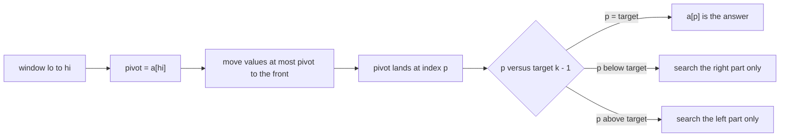
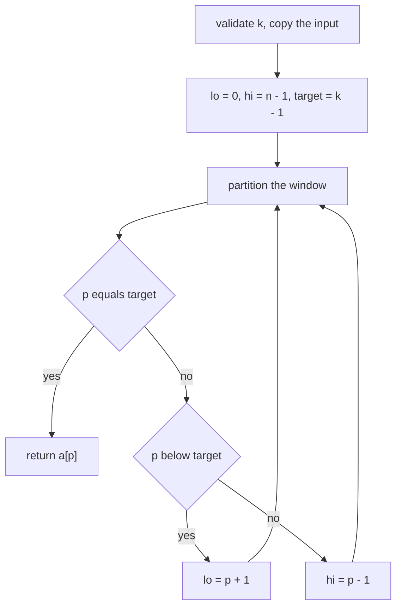
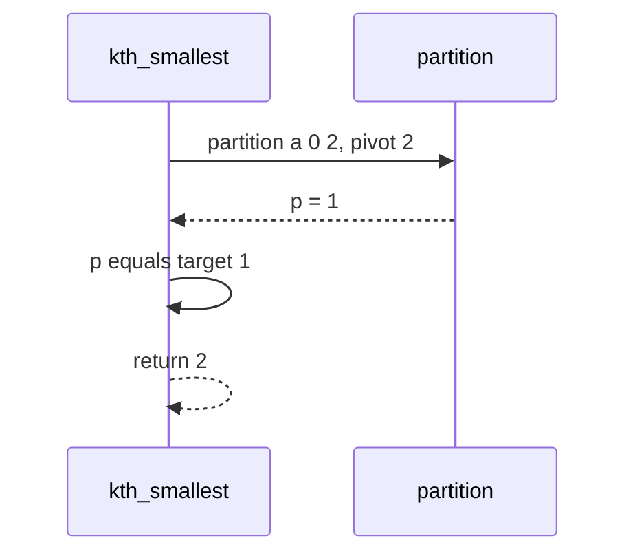
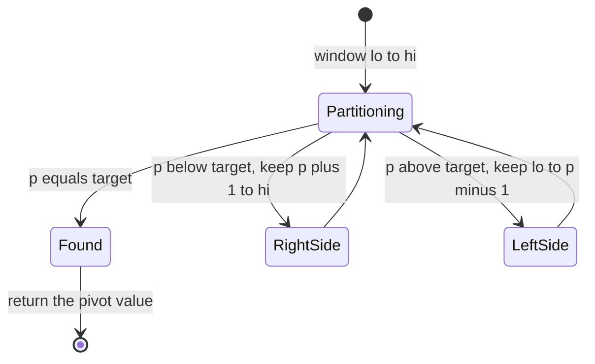

# 259 — Kth smallest element using order statistics / quickselect.

> **Tier:** Intermediate · **CTCI chapter:** Beyond — Numerical & Scientific Computing
> **Task spec:** [259-kth-smallest-element-using-order-statistics-quickselect.md](../../../tasks/intermediate/259-kth-smallest-element-using-order-statistics-quickselect.md)
> **Solutions:** [Python](../../../solutions/python/intermediate/259-kth-smallest-element-using-order-statistics-quickselect/solution.py) ·
> [Java](../../../solutions/java/intermediate/259-kth-smallest-element-using-order-statistics-quickselect/Solution.java) ·
> [JavaScript](../../../solutions/javascript/intermediate/259-kth-smallest-element-using-order-statistics-quickselect/solution.js) ·
> [C#](../../../solutions/csharp/intermediate/259-kth-smallest-element-using-order-statistics-quickselect/Solution.cs)

## 1. Problem restatement

**Input:** a list of integers `values` (possibly with duplicates, possibly unsorted) and a 1-based
rank `k`.

**Output:** the value that would sit at index `k - 1` if the list were sorted — without sorting it.
The caller's list is copied first, so the input is never reordered.

The contract is pinned by the assertions in the four solution files:

| Call | Result | Why |
| --- | --- | --- |
| `kth_smallest([7], 1)` | `7` | the only element is the first smallest |
| `kth_smallest([3,1,2], 1 / 2 / 3)` | `1 / 2 / 3` | all three ranks of a small permutation |
| `kth_smallest([5,5,5,5], 3)` | `5` | duplicates are distinct positions with the same value |
| `kth_smallest([2,1,1,3], 2)` | `1` | sorted is `[1, 1, 2, 3]`, index `1` holds `1` |
| `kth_smallest([9,4,7,1,8,2,6,3,5], 4)` | `4` | the fourth smallest of nine |
| `original` after the call | unchanged | the algorithm works on a copy |
| `kth_smallest([1,2,3], 0 / -1 / 10)` | raises | `k` must satisfy `1 <= k <= n` |
| 13 fixed cases, every `k`, cross-checked against sorting | equal | the LCG-generated arrays, sorted and reversed ranges, and all-equal arrays all agree with `sorted(values)[k-1]` |

The spec's "order statistics" framing is what the algorithm is: quickselect finds the element of
rank `k` directly, instead of computing a full ordering and throwing away the rest.

## 2. Intuition

Sorting answers the question and does a lot of pointless work. The value at rank `k` only needs the
array *partitioned* around it: everything smaller on the left, everything larger on the right, and
`k` itself somewhere at the boundary.

**Partition** is the classic Lomuto scheme with `a[hi]` as the pivot: sweep the window, swap every
element `<= pivot` to the front, then put the pivot in the slot after them. After one partition the
pivot sits at its final sorted position `p`, and that is a permanent fact about the array — `p`
elements are below it, the rest above it.



The insight that turns partition into a selection algorithm: after the pivot is placed, the *other*
side cannot matter. If `p < k - 1` then the answer is larger than the pivot, so every element at or
left of `p` is irrelevant; if `p > k - 1`, everything right of `p` is irrelevant. Each round
therefore halves the problem in expectation, and the loop keeps only one side.

The repository's version uses the **last element as a deterministic pivot** — documented in the
headers — and makes the loop iterative, so a pathological pivot sequence can never grow the call
stack. The price of determinism is the classic one: on already-sorted input the pivot is always an
extreme, each partition removes exactly one element, and the running time degrades to `O(n²)`.

## 3. Algorithm

1. Validate `k`: it must satisfy `1 <= k <= n`, otherwise raise an error (`ValueError` in Python,
   `IllegalArgumentException` in Java and C#).
2. Copy the input list so the caller's data is untouched.
3. Set the window to the whole array: `lo = 0`, `hi = n - 1`, and the target index to `k - 1`.
4. Partition the window around `a[hi]`; the returned index `p` is the pivot's sorted position.
5. If `p == target`, return `a[p]`.
6. If `p < target`, move `lo` to `p + 1` — the answer lies to the right of the pivot.
7. Otherwise move `hi` to `p - 1` and repeat from step 4.
8. The partition helper itself: take `pivot = a[hi]`, keep a write cursor `store = lo`, scan
   `i` from `lo` to `hi - 1`, swap each `a[i] <= pivot` into `store` and advance it, then place the
   pivot at `store` and return `store`.

```text
procedure partition(a, lo, hi)
    pivot ← a[hi]
    store ← lo
    for i ← lo to hi - 1 do
        if a[i] <= pivot then
            swap a[store] and a[i]
            store ← store + 1
    swap a[store] and a[hi]
    return store

procedure kth_smallest(values, k)
    if k < 1 or k > length(values) then raise an error
    a ← copy of values
    lo ← 0
    hi ← length(a) - 1
    target ← k - 1
    while true do
        p ← partition(a, lo, hi)
        if p = target then return a[p]
        if p < target then lo ← p + 1
        else hi ← p - 1
```

The `<=` in the partition scan matters for duplicates: equal elements are pushed to the left of the
pivot, so the pivot still lands at the boundary between "at most pivot" and "greater than pivot" and
the rank arithmetic stays exact.



Each iteration is one pass over the current window, so the total work is the sum of the window
sizes. With a balanced pivot that sum is geometric — `n + n/2 + n/4 + ... = O(n)`; with an extreme
pivot the window shrinks by one element per round and the sum becomes `O(n²)`.

## 4. Worked example

Trace `kth_smallest([3, 1, 2], 2)`. The copy is `a = [3, 1, 2]`, the window is `[0, 2]`, and
`target = 1`.

| Step | Window `lo..hi` | pivot | Scan result | Pivot placed at `p` | Array | Next |
| --- | --- | --- | --- | --- | --- | --- |
| 1 | `0..2` | `a[2] = 2` | `3` stays, `1` moves to slot `0` | `1` | `[1, 2, 3]` | `p == target` ⇒ answer `a[1] = 2` |

The scan in detail: `store = 0`, `i = 0` reads `3`, which is greater than the pivot so nothing moves;
`i = 1` reads `1 <= 2`, so `a[0]` and `a[1]` swap and `store` becomes `1`; the final swap puts the
pivot `2` at index `1`, which is exactly `target`, so the answer is returned after a single
partition. Sorting would have compared all three elements repeatedly; this touched the array twice.

Two more values of `k` on the same input show the other branches. For `k = 3` the first partition
returns `p = 1 < target = 2`, so the window becomes `[2, 2]`; partitioning a single element returns
`p = 2 = target` and the answer is `a[2] = 3`. For `k = 1` the first partition returns `p = 2 > 0`,
so the window becomes `[0, 1]`; the partition of `[0, 1]` uses `a[1] = 2` as the pivot, and `1`
moves to slot `0`, leaving the pivot at `p = 1 > 0`, so the window becomes `[0, 0]` and `a[0] = 1`
is returned.



The degenerate shape is worth seeing because the tests include it. On `list(range(64))` the pivot is
always the largest value in the window: the scan never swaps, the pivot is written back to `hi`, and
the window shrinks to `[lo, hi - 1]`. Sixty-three partitions of decreasing size — `O(n²)` work — but
still the correct answer for every `k`, which is what the cross-check against `sorted(values)`
verifies for all 64 ranks.



## 5. Complexity

Let `n` be the length of the input and `W` the size of the current window.

| Measure | Bound | Why it holds |
| --- | --- | --- |
| One partition | O(W) | a single scan of the window with `O(1)` work per element |
| Time, best | O(n) | the first pivot lands on `target`, so a single partition answers |
| Time, expected | O(n) | with a random-quality pivot each round discards a constant fraction of the window, so the geometric sum is linear |
| Time, worst | O(n²) | the documented case with the deterministic last-element pivot: sorted or reverse-sorted input leaves an extreme pivot, removing one element per round |
| Space, extra | O(1) | the partition is in place inside the copy, and the loop is iterative |
| Space, total | O(n) | the copy the algorithm works on, which the tests require |
| Alternative: full sort | O(n log n) time, `O(log n)` to `O(n)` extra | simpler, and it also answers every other rank, which this does not |
| Alternative: median-of-medians pivot | O(n) worst case | a deterministic pivot-selection step that provably splits the window well, at the cost of a much larger constant |

Note the asymmetry against [258-kth-largest-element-in-stream-min-heap.md](../../../tasks/intermediate/258-kth-largest-element-in-stream-min-heap.md):
a bounded heap answers a streamed query in `O(n log k)` but keeps only `k` values, while quickselect
answers one query in expected `O(n)` and needs the whole array present and reorderable.

## 6. Pitfalls and edge cases

- **1-based `k`.** `target = k - 1`, and `k` is validated against `1 <= k <= n`; the tests assert
  that `0`, `-1` and `n + 1` all raise instead of returning a wrong element or crashing later.
- **Duplicates.** The partition test is `a[i] <= pivot`, so equal values go left of the pivot and the
  pivot still lands at the boundary. `[5,5,5,5]` with `k = 3` returns `5`, and
  `[2,1,1,3]` with `k = 2` returns `1` because the sorted array is `[1, 1, 2, 3]`.
- **The caller's list must survive.** Every solution copies before partitioning; the test compares
  the whole nine-element list after the call. An in-place variant would have to say so in its
  contract.
- **Already-sorted input is the worst case.** With the last element as the pivot, ascending input
  gives `O(n²)`; descending input behaves the same way because the last element is the minimum. The
  cross-check cases include `range(64)` and `range(63, -1, -1)` precisely because those shapes are
  where implementations break.
- **Single element.** `k = 1` on `[7]` partitions a window of size one, returns `p = 0 = target`
  immediately.
- **Iterative, not recursive.** Each round recurses nowhere; a bad pivot sequence therefore shows up
  as time, not as a stack overflow — the documented reason for the loop.
- **Partition must place the pivot.** The final swap `a[store]` with `a[hi]` is what guarantees the
  returned index is the pivot's sorted position. Skipping it makes `p` meaningless and the search
  may loop forever.
- **Termination.** Each iteration either returns or shrinks the window strictly (`lo = p + 1` or
  `hi = p - 1`), so the loop cannot spin.
- **`<=` versus `<`.** With `<` the pivot ends up in the "greater" region and duplicates to the left
  are mis-ordered, which shifts the rank for arrays like `[5,5,4,4,3,3,2,2,1,1]`.
- **Identical results across languages.** The test data comes from a Park-Miller LCG
  (`state = state * 48271 mod 2^31 - 1`) so all four implementations are checked against exactly the
  same arrays and ranks, not just against their own oracle.

## 7. Variants and follow-ups

- **Randomized pivot.**
  [260-quickselect-randomized-implementation.md](../../../tasks/intermediate/260-quickselect-randomized-implementation.md)
  keeps this partition but chooses the pivot at random, which is what turns the expected bound into a
  statement about the algorithm rather than about the input.
- **Streaming version with a bounded heap.**
  [258-kth-largest-element-in-stream-min-heap.md](../../../tasks/intermediate/258-kth-largest-element-in-stream-min-heap.md)
  maintains the same rank incrementally, `O(log k)` per inserted value, without needing the whole
  array.
- **Two sorted inputs.**
  [261-median-of-two-sorted-arrays-log-min-n-m-algorithm.md](../../../tasks/intermediate/261-median-of-two-sorted-arrays-log-min-n-m-algorithm.md)
  exploits pre-existing order to reach `O(log min(n, m))` for a rank-based query, which quickselect
  cannot use.
- **Top-`k` sets.**
  [256-top-k-frequent-elements-in-array-heap.md](../../../tasks/intermediate/256-top-k-frequent-elements-in-array-heap.md)
  answers a related question — the `k` most frequent values — where the selection key is a count
  rather than the value itself.
- **Guaranteed linear selection.** Median-of-medians replaces the pivot choice with a deterministic
  selection of a provably good pivot, giving `O(n)` worst case; the repository's version documents
  that it does not do this and relies on the expected bound instead.

## 8. Check yourself

1. Why can the search discard one side after a partition?

<details><summary>Show answer</summary>

Because a partition places the pivot at its final sorted index `p` and guarantees that everything
left of `p` is at most the pivot and everything right is greater. So if `p < k - 1` the answer is
strictly to the right of `p`; if `p > k - 1` it is strictly to the left. The discarded side can
never contain rank `k`.

</details>

2. What exactly makes already-sorted input quadratic here?

<details><summary>Show answer</summary>

The deterministic last-element pivot. In ascending order `a[hi]` is the largest value in the window,
so the scan moves nothing, the pivot stays at `hi`, and the next window is `[lo, hi - 1]` — one
element removed per partition. That gives `n - 1` partitions of sizes `n - 1, n - 2, ...`, i.e.
`O(n²)` comparisons, which is the worst case the header documents.

</details>

3. `kth_smallest([2,1,1,3], 2)` returns `1`. Why is that not an off-by-one error?

<details><summary>Show answer</summary>

Because ranks are positions in the sorted multiset, not distinct values: sorted the array is
`[1, 1, 2, 3]`, and the second smallest position holds `1`. The partition's `<=` comparison keeps
equal elements on the left of the pivot, so rank arithmetic stays valid with duplicates.

</details>

4. Why does the implementation copy the input?

<details><summary>Show answer</summary>

Because partitions reorder the array in place. Copying preserves the caller's data — the test takes a
snapshot of the nine-element list and asserts it is unchanged after the query — while keeping the
`O(1)` extra space of the in-place partition inside the copy.

</details>

5. When is a heap the better choice than quickselect for a rank query?

<details><summary>Show answer</summary>

When the elements arrive over time rather than as one array, or when the data must not be reordered
or copied. A `k`-bounded heap is `O(n log k)` for a whole pass and `O(log k)` per insert, and it
never needs the full array; quickselect is expected `O(n)` per query and needs the whole array
present so it can partition it.

</details>
