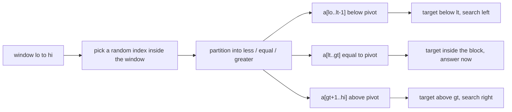
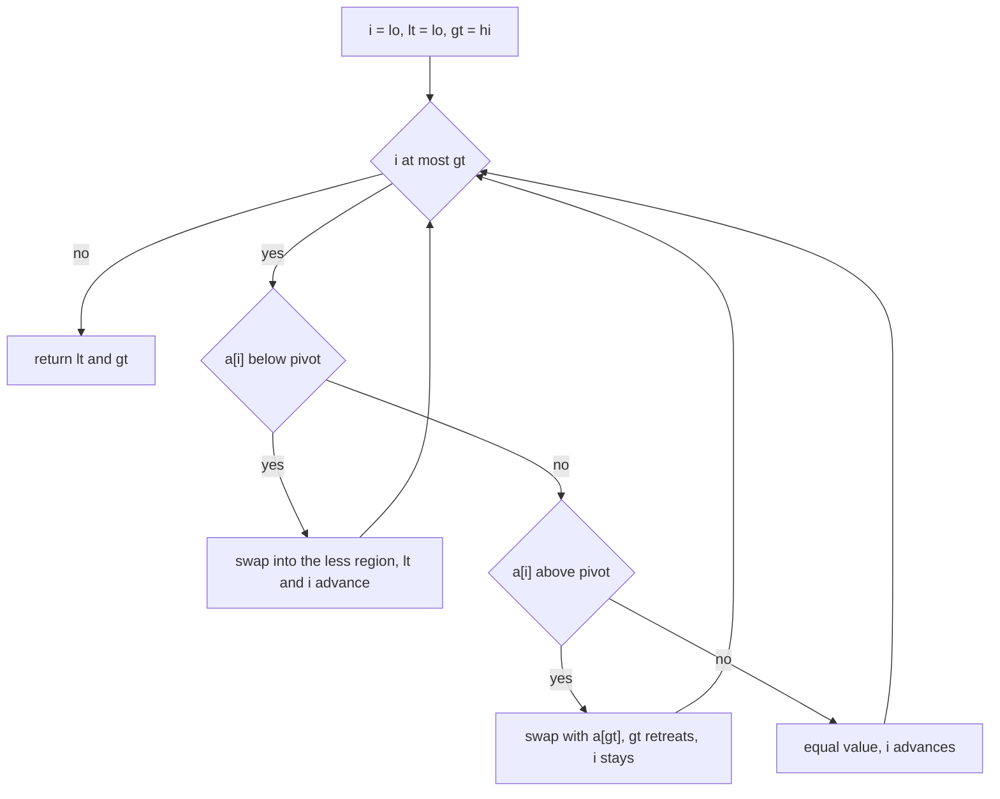
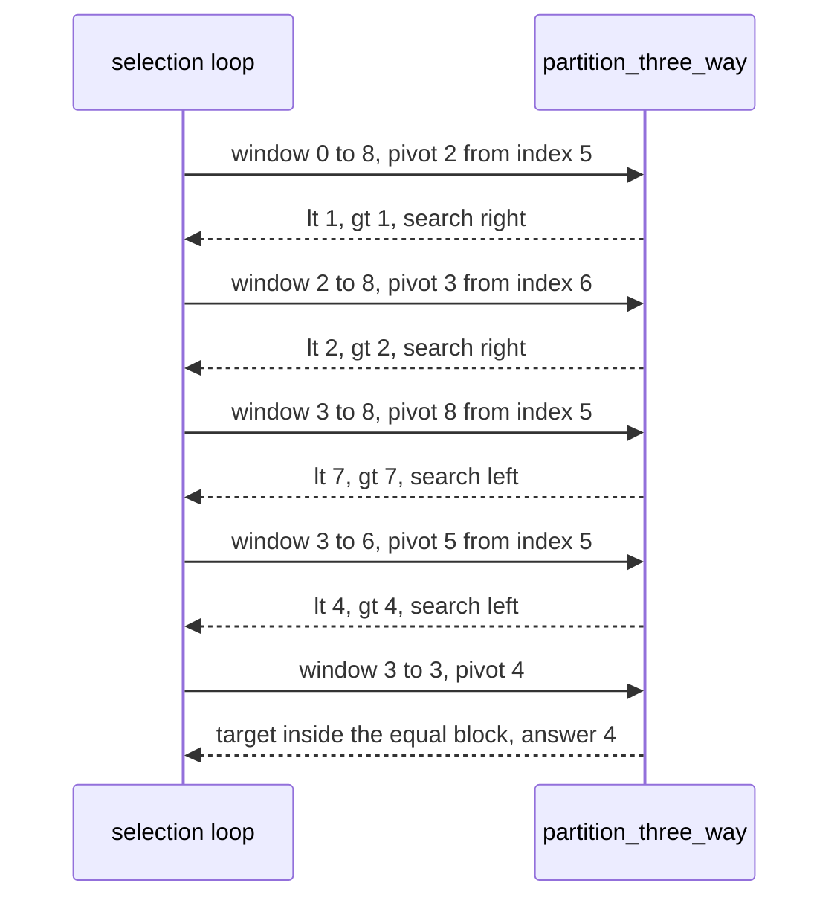
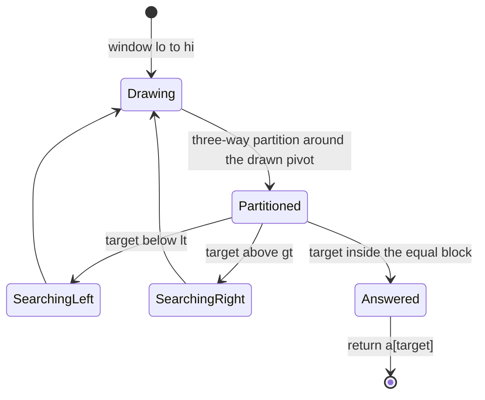

# 260 — Quickselect randomized implementation.

> **Tier:** Intermediate · **CTCI chapter:** Ch 10 — Sorting and Searching
> **Task spec:** [260-quickselect-randomized-implementation.md](../../../tasks/intermediate/260-quickselect-randomized-implementation.md)
> **Solutions:** [Python](../../../solutions/python/intermediate/260-quickselect-randomized-implementation/solution.py) ·
> [Java](../../../solutions/java/intermediate/260-quickselect-randomized-implementation/Solution.java) ·
> [JavaScript](../../../solutions/javascript/intermediate/260-quickselect-randomized-implementation/solution.js) ·
> [C#](../../../solutions/csharp/intermediate/260-quickselect-randomized-implementation/Solution.cs)

## 1. Problem restatement

**Input:** a list of integers `values` (duplicates allowed) and a 1-based rank `k`.

**Output:** the `k`-th smallest value. The caller's list is copied first, so the input keeps its
original order.

Two choices distinguish this from the deterministic version of the same problem (task 259):

- the pivot index is **drawn at random** from the current window, using a fixed-seed Park-Miller
  LCG so every run and every language makes the same choices;
- the partition is **three-way**, so values equal to the pivot land in one block and the search can
  skip the whole block at once.

The contract is pinned by the assertions in the four solution files:

| Call | Result | Why |
| --- | --- | --- |
| `kth_smallest([7], 1)` | `7` | single element |
| `kth_smallest([3,1,2], 2)` | `2` | the median of three |
| `kth_smallest([5,5,5,5], 3)` | `5` | one partition puts all four equal values in one block |
| `kth_smallest([2,1,1,3], 2)` | `1` | sorted is `[1, 1, 2, 3]` |
| `kth_smallest([9,4,7,1,8,2,6,3,5], 4)` | `4` | five partitions with the default seed |
| that list after the call | unchanged | the algorithm copies the input |
| `k` of `0`, `-1`, `10` on a 3-element list | raises | `1 <= k <= n` is validated |
| 13 fixed cases, all `k`, with `seed=260260` **and** `seed=999` | equal to `sorted(values)[k-1]` | the answer must not depend on the seed |
| 5000 equal elements | `7` for `k` of `1, 2, 2500, 4999, 5000` | the equal block finishes in one partition |
| ascending and descending `range(4000)` | `k - 1` | the iterative loop survives the degenerate shapes |
| a sawtooth `[i % 17]` of 1000 elements | matches the sorted oracle | many duplicates, mixed values |

The seed is a *reproducibility* device, not part of the contract: the tests assert the same answers
for a different seed, because the returned value is a property of the input alone.

## 2. Intuition

Task 259's deterministic last-element pivot has a well-known failure mode: on sorted input the pivot
is always an extreme, the window shrinks by one element per round, and the running time collapses to
`O(n²)`. Randomizing the pivot removes the attacker's leverage — no input can be arranged to make
every draw bad, because the draws do not depend on the input.

The second change fixes the other common degenerate case: many equal elements. A two-way partition
places the pivot but leaves its equal copies scattered on both sides, so an all-equal array keeps
producing windows of size `n - 1`. A **three-way (Dutch national flag) partition** sweeps the window
into three regions

```text
a[lo .. lt - 1] < pivot     a[lt .. gt] == pivot     a[gt + 1 .. hi] > pivot
```

and returns the two boundary indices `lt` and `gt`. If `k - 1` falls inside the equal block the
answer is immediate; otherwise the next window is `[lo, lt - 1]` or `[gt + 1, hi]`, which *excludes
the entire equal run* rather than one pivot position.



Both changes preserve the same overall shape as ordinary quickselect: partition, compare the target
rank with the pivot's block, and continue into exactly one side. The loop stays iterative, so no
pivot sequence can overflow the stack.

## 3. Algorithm

1. Validate `k` (`1 <= k <= n`, otherwise raise) and copy the input.
2. Initialise the LCG state from the seed: `state = seed mod (2^31 - 1)`, replaced by `1` if that is
   zero, so the generator can never get stuck at zero.
3. Draw: advance the state once (`state = state * 48271 mod (2^31 - 1)`) and take the pivot *value*
   from index `lo + state mod (window length)`.
4. Partition the window three ways around that value: `lt` marches up over the "less" region, `i`
   scans, and `gt` marches down over the "greater" region; `i == gt` ends the scan.
5. If `target < lt`, restrict the window to `[lo, lt - 1]`. If `target > gt`, restrict it to
   `[gt + 1, hi]`.
6. Otherwise `target` lies inside the equal block, so `a[target]` is the answer.
7. Repeat from step 3 until the answer is returned.

```text
procedure partition_three_way(a, lo, hi, pivot)
    lt ← lo
    i ← lo
    gt ← hi
    while i <= gt do
        if a[i] < pivot then
            swap a[lt] and a[i]
            lt ← lt + 1
            i ← i + 1
        else if a[i] > pivot then
            swap a[i] and a[gt]
            gt ← gt - 1
        else
            i ← i + 1
    return lt, gt

procedure kth_smallest(values, k, seed)
    if k < 1 or k > length(values) then raise an error
    a ← copy of values
    state ← seed mod 2147483647
    if state = 0 then state ← 1
    lo ← 0
    hi ← length(a) - 1
    target ← k - 1
    while true do
        state ← (state * 48271) mod 2147483647
        pivot ← a[lo + state mod (hi - lo + 1)]
        lt, gt ← partition_three_way(a, lo, hi, pivot)
        if target < lt then
            hi ← lt - 1
        else if target > gt then
            lo ← gt + 1
        else
            return a[target]
```

The scan's `i` only advances on "less" and "equal"; on "greater" it swaps the offending element to
the tail and shrinks `gt`, leaving `i` in place so the freshly swapped element is inspected next.
That is the standard Dutch-national-flag loop and the reason it terminates: each iteration consumes
one slot from the right (greater) or strictly advances `i`.



## 4. Worked example

Trace `kth_smallest([9, 4, 7, 1, 8, 2, 6, 3, 5], 4)` with the default seed. The target index is `3`.
Each row is one pass of the loop; the state column is the LCG value produced by that draw and the
index column is `lo + state mod (hi - lo + 1)`:

| Round | Window | LCG state | Pivot index | Pivot value | `lt` | `gt` | Array after the partition | Next |
| --- | --- | --- | --- | --- | --- | --- | --- | --- |
| 1 | `0..8` | `1825592225` | `5` | `2` | `1` | `1` | `[1, 2, 7, 8, 4, 6, 3, 5, 9]` | `target 3 > gt 1` ⇒ `lo = 2` |
| 2 | `2..8` | `1170838330` | `6` | `3` | `2` | `2` | `[1, 2, 3, 4, 6, 8, 5, 9, 7]` | `target 3 > gt 2` ⇒ `lo = 3` |
| 3 | `3..8` | `62405684` | `5` | `8` | `7` | `7` | `[1, 2, 3, 4, 6, 5, 7, 8, 9]` | `target 3 < lt 7` ⇒ `hi = 6` |
| 4 | `3..6` | `1612699270` | `5` | `5` | `4` | `4` | `[1, 2, 3, 4, 5, 7, 6, 8, 9]` | `target 3 < lt 4` ⇒ `hi = 3` |
| 5 | `3..3` | `324258420` | `3` | `4` | `3` | `3` | unchanged | `target` inside the block ⇒ `4` |

Round 1 is worth reading closely: the pivot value `2` ends up alone at index `1`, so the equal
block is a single slot and the search moves right. Round 5 shows the endgame — the window has
shrunk to one element, the draw can only pick index `3`, and the target falls inside the equal
block, so the answer `4` is returned without any further comparison. Round 3 is the case where the
pivot value `8` landed far to the right (`lt = gt = 7`), and the search moved left.



The duplicate-heavy case is where the three-way partition pays off. For `[5, 5, 5, 5]` with `k = 3`
the single draw picks index `1`, the pivot value is `5`, and the partition returns `lt = 0`,
`gt = 3` — the entire array is one equal block, so the target `2` is inside it and the answer is
returned after exactly one partition. A two-way partition over the same input would have removed one
position per round instead of four.



## 5. Complexity

Let `n` be the length of the input and `W` the size of the current window.

| Measure | Bound | Why it holds |
| --- | --- | --- |
| One three-way partition | O(W) | a single scan; every element is inspected once and swapped at most once |
| Time, expected | O(n) | a random pivot splits the window reasonably in expectation, so the expected sum of window sizes is linear |
| Time, worst | O(n²) | an unlucky pivot sequence can still isolate one element per round; the headers document this |
| Time, all-equal input | O(n) | one partition produces `lt = lo`, `gt = hi`, and the target is inside the block |
| Time, sorted input | not special any more | the pivot is drawn from an index, not from a position correlated with the value order, so sorted arrays get no worse treatment than unsorted ones |
| Space, extra | O(1) | in-place partition inside the copy; the loop is iterative |
| Space, total | O(n) | the copy the algorithm works on |
| Two-way quickselect (task 259) | expected O(n), worst O(n²), O(1) extra | same shape, one boundary index, and duplicates are not grouped |
| Comparison sort | O(n log n), needs more space | answers every rank, which this does not |

The duplicate handling is an asymptotic improvement, not a constant-factor one: with `d` distinct
values a three-way partition can never do better than the number of distinct values, but it never
does worse than a two-way partition on the same input either.

## 6. Pitfalls and edge cases

- **1-based `k`, validated.** `0`, `-1` and `n + 1` all raise; the tests check all three on a
  three-element list.
- **The input must survive.** The algorithm partitions a copy, and the tests compare the nine-element
  list after the call.
- **All-equal input.** `[5,5,5,5]` with `k = 3` finishes in one partition because the equal block
  covers the whole array; the 5000-element equal case checks the same property at scale.
- **Duplicates in general.** `[2,1,1,3]` with `k = 2` returns `1`; `[1,2]` repeated 200 times
  returns the value at rank `k` of the sorted multiset, because ranks count positions, not distinct
  values.
- **Seed independence.** The answer must not depend on the seed, and the tests assert
  `seed=999` produces the same values as the default `260260`. The seed exists so that the *number
  of rounds* is reproducible across languages, not so the result is.
- **A zero seed.** `state = seed mod (2^31 - 1)` is replaced by `1` when it is zero; a generator
  stuck at zero would always draw index `lo`, which is exactly the deterministic-pivot failure the
  randomization was meant to avoid.
- **Draw range.** The index is `lo + state mod (hi - lo + 1)` — inside the *current* window. Using
  `mod n` with the full array index would sometimes pick a position outside the window and break the
  partition invariant.
- **Which value becomes the pivot.** The pivot is a **value** read from the array, not an index, so
  partition must handle equal values explicitly — that is exactly what the three regions are for.
- **`i` must not advance on "greater".** After swapping `a[i]` with `a[gt]`, the element now at `i`
  has not been inspected yet; advancing `i` silently skips it and can leave the window unsorted in a
  way that makes the rank test wrong.
- **Iteration, not recursion.** The loop keeps a bad draw sequence from overflowing the stack, which
  the 4000- and 5000-element cases exercise.
- **Returning inside the block.** `return a[target]` is correct *because* every position in
  `[lt, gt]` holds the pivot value; returning `a[lt]` would look equivalent but breaks the moment the
  code is generalized to keyed records.

## 7. Variants and follow-ups

- **Deterministic pivot.**
  [259-kth-smallest-element-using-order-statistics-quickselect.md](../../../tasks/intermediate/259-kth-smallest-element-using-order-statistics-quickselect.md)
  uses the last element of the window and Lomuto's two-way partition; cleaner to explain, quadratic
  on sorted input.
- **Incremental rank queries.**
  [258-kth-largest-element-in-stream-min-heap.md](../../../tasks/intermediate/258-kth-largest-element-in-stream-min-heap.md)
  answers the same rank question for values that arrive one at a time, keeping a bounded heap of the
  top `k`.
- **Ranks over sorted inputs.**
  [261-median-of-two-sorted-arrays-log-min-n-m-algorithm.md](../../../tasks/intermediate/261-median-of-two-sorted-arrays-log-min-n-m-algorithm.md)
  gets logarithmic time by exploiting order the input already has, which no quickselect variant can.
- **Selecting a set, not one rank.**
  [256-top-k-frequent-elements-in-array-heap.md](../../../tasks/intermediate/256-top-k-frequent-elements-in-array-heap.md)
  and
  [257-top-k-frequent-words-heap-lexicographic-tie.md](../../../tasks/intermediate/257-top-k-frequent-words-heap-lexicographic-tie.md)
  return `k` entries with a full ordering, which a single-rank selection cannot provide.
- **Median-of-medians.** Replacing the random draw with a deterministic choice of a provably good
  pivot gives `O(n)` worst case; the repository documents that it deliberately stays with the
  randomized expected bound.

## 8. Check yourself

1. Why does the three-way partition make an all-equal array fast?

<details><summary>Show answer</summary>

Because the partition returns `lt = lo` and `gt = hi` for an array of equal values — the whole window
is the "equal" block — so the target index is inside it and the answer is returned after exactly one
partition. The test asserts this for `[5,5,5,5]` with `k = 3` and for 5000 equal elements with ranks
`1`, `2`, `2500`, `4999` and `5000`.

</details>

2. How does the seed relate to the returned answer?

<details><summary>Show answer</summary>

It does not affect it. The seed only fixes which pivot index is drawn each round, which makes the
sequence of partitions reproducible across runs and languages; the rank-`k` value is a property of
the input. The tests re-run every fixed case with `seed=999` and require the same answers.

</details>

3. In round 2 of the worked trace the pivot value was `3` and `lt = gt = 2`, yet `target` was `3`.
What happened next?

<details><summary>Show answer</summary>

`target = 3 > gt = 2`, so the equal block (the single slot at index `2`) is entirely to the left of
the target and the search moved right: `lo = gt + 1 = 3`. The window became `[3, 8]` for round 3,
where the draw picked value `8` at index `5`.

</details>

4. Why is one three-way partition still `O(W)` even though it performs up to two swaps per element?

<details><summary>Show answer</summary>

Because each pass of the loop either advances `i` or shrinks `gt`, so the loop runs at most `W` times
and each iteration does a constant amount of work and at most one swap. The swaps are bounded by the
number of elements, not by their positions.

</details>

5. What is the worst case of this randomized implementation, and why do the tests not hit it?

<details><summary>Show answer</summary>

`O(n²)`, when the drawn pivots repeatedly land on extreme values of their window — a probability
that shrinks quickly as `n` grows but is never zero. The tests include the classic adversaries
(ascending 4000, descending 4000, 5000 equal values, a 1000-element sawtooth) and verify that with
the fixed seed none of them produces a bad pivot sequence.

</details>
