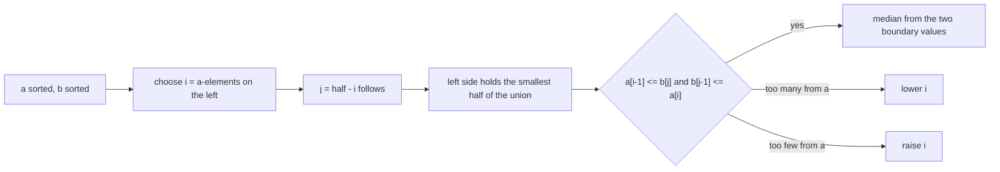
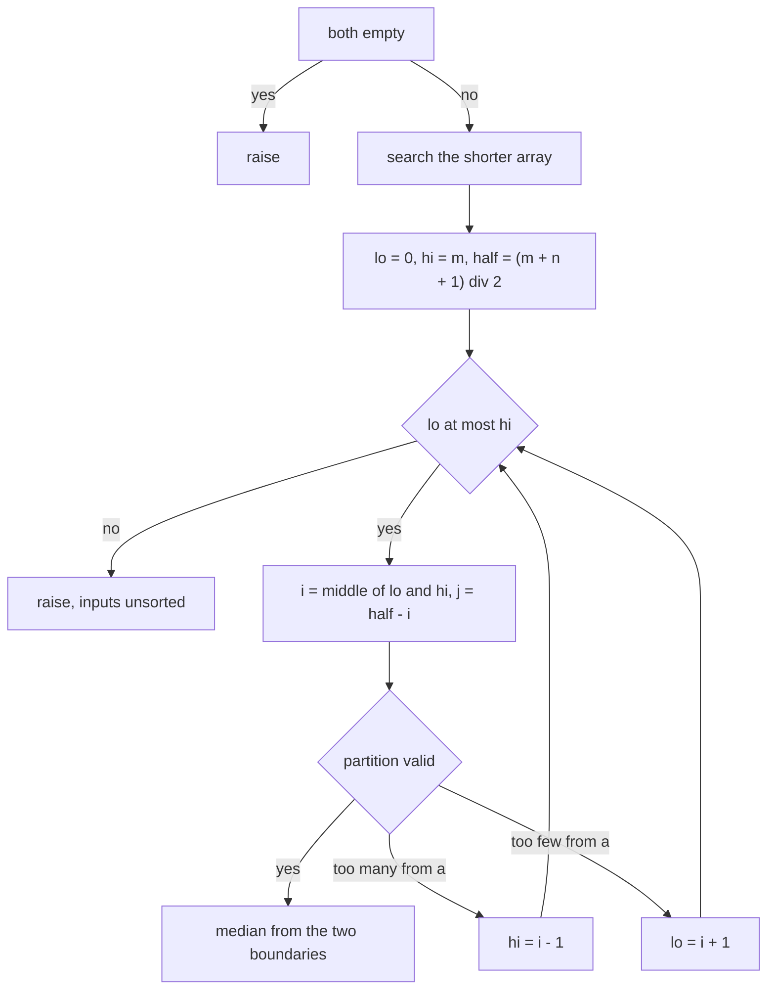
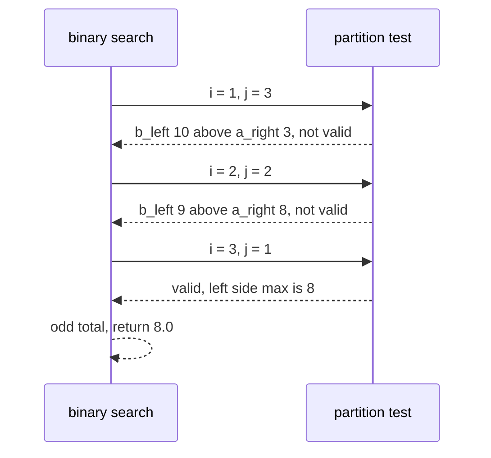
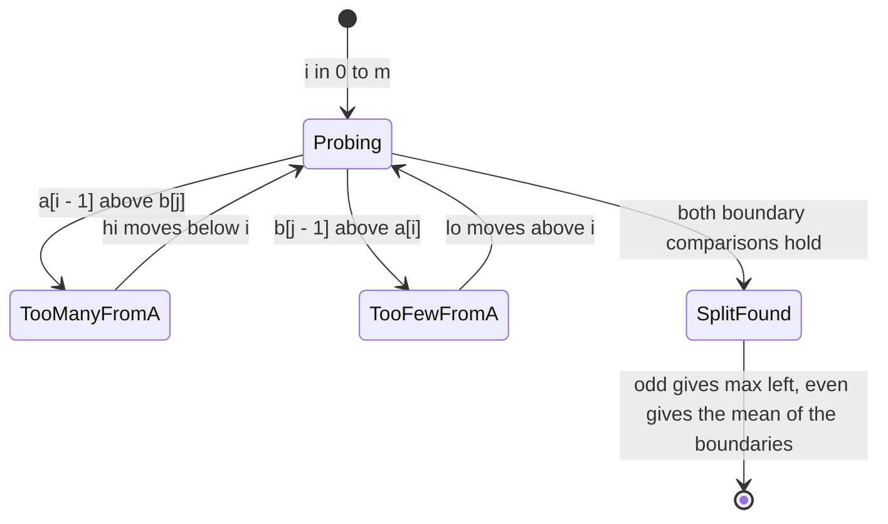

# 261 — Median of two sorted arrays (log min(n,m) algorithm).

> **Tier:** Intermediate · **CTCI chapter:** Ch 10 — Sorting and Searching
> **Task spec:** [261-median-of-two-sorted-arrays-log-min-n-m-algorithm.md](../../../tasks/intermediate/261-median-of-two-sorted-arrays-log-min-n-m-algorithm.md)
> **Solutions:** [Python](../../../solutions/python/intermediate/261-median-of-two-sorted-arrays-log-min-n-m-algorithm/solution.py) ·
> [Java](../../../solutions/java/intermediate/261-median-of-two-sorted-arrays-log-min-n-m-algorithm/Solution.java) ·
> [JavaScript](../../../solutions/javascript/intermediate/261-median-of-two-sorted-arrays-log-min-n-m-algorithm/solution.js) ·
> [C#](../../../solutions/csharp/intermediate/261-median-of-two-sorted-arrays-log-min-n-m-algorithm/Solution.cs)

## 1. Problem restatement

**Input:** two arrays `a` and `b`, each sorted ascending, either of which may be empty. Both empty
at once is rejected.

**Output:** the median of the merged multiset — the middle value when the combined length is odd,
and the mean of the two middle values when it is even — computed in `O(log min(m, n))` time with
`O(1)` extra space.

The contract is pinned by the assertions in the four solution files:

| Call | Result | Why |
| --- | --- | --- |
| `median_of_two_sorted([1,3], [2])` | `2.0` | combined length `3`, middle value `2` |
| `median_of_two_sorted([1,2], [3,4])` | `2.5` | combined length `4`, mean of `2` and `3` |
| `median_of_two_sorted([], [1])` | `1.0` | an empty first array is legal |
| `median_of_two_sorted([1,2,3,4,5], [])` | `3.0` | an empty second array is legal |
| `median_of_two_sorted([0,0], [0,0])` | `0.0` | duplicates and zeroes |
| `median_of_two_sorted([2], [1,3])` | `2.0` | the shorter array is second, so the algorithm swaps |
| `median_of_two_sorted([1,3,8], [7,9,10,11])` | `8.0` | classic interleaved case, odd total |
| `median_of_two_sorted([1,2], [3,4,5,6])` | `3.5` | every element of `a` is left of every element of `b` |
| `median_of_two_sorted([5,6,7,8], [1,2,3,4])` | `4.5` | the mirror image of the previous row |
| `median_of_two_sorted([1,1], [1,1])` | `1.0` | all-equal arrays |
| `median_of_two_sorted([-5,-3,-1], [-2])` | `-2.5` | negatives, even total |
| `median_of_two_sorted([1,2,3], [4,5,6])` | `3.5` | three and three |
| `median_of_two_sorted([], [])` | raises `ValueError` | the documented boundary case |
| 300 random sorted pairs | equal to a merge-based oracle | independent cross-check |

The answers are floating point even when the median is an integer (`2.0`, not `2`), because the even
case returns a mean and the odd case is widened to match; the `median_oracle` helper exists purely as
an independent `O(m + n)` reference used by those 300 cross-checks.

## 2. Intuition

The obvious solution merges the arrays and indexes the middle, which is `O(m + n)` and throws away
the only property the input offers: both arrays are *already sorted*. Sorted input means you can
binary search a *decision* rather than a value.

The decision to search over is the **split**. Give the left half of the final merged array
`half = (m + n + 1) / 2` elements (rounded down). Let `i` be how many of them come from `a` and
`j = half - i` how many come from `b`. A split is valid when nothing on the left side is larger than
anything on the right side, which reduces to two comparisons because each array is sorted:

```text
a[i - 1] <= b[j]        and        b[j - 1] <= a[i]
```

Once a valid split is found, the left side contains the smallest `half` values of the union, so the
median is the largest of them, or the mean of the largest left value and the smallest right value.



Two details make the comparisons total instead of conditional: out-of-range indices are replaced by
sentinels, `-inf` when the split leaves nothing on that side and `+inf` when it consumes the whole
array. And the search runs over the **shorter** array, so `i` lives in `[0, m]` where `m` is the
smaller length — that keeps the binary search at `O(log min(m, n))` and guarantees the partner index
`j` stays inside `b`.

The validity test also tells you which way to move: `a[i-1] > b[j]` means `a` contributed too many
left elements, so lower `i`; otherwise `a` contributed too few, so raise it.

## 3. Algorithm

1. Reject the both-empty input.
2. Swap `a` and `b` if `a` is longer, so the binary search always runs on the shorter array; let
   `m = len(a)`, `n = len(b)`, `half = (m + n + 1) // 2`.
3. Binary search `i` over `[0, m]` with `lo = 0`, `hi = m`.
4. For a candidate `i`, compute `j = half - i` and read the four boundary values with sentinel
   substitution: `a_left`, `a_right`, `b_left`, `b_right`.
5. If `a_left <= b_right` and `b_left <= a_right`, the partition is valid — go to step 6. If
   `a_left > b_right`, there are too many `a` elements on the left, so `hi = i - 1`. Otherwise there
   are too few, so `lo = i + 1`. Continue at step 4.
6. For an odd combined length return the larger of the two left boundary values; for an even length
   return the mean of the larger left value and the smaller right value.
7. If the loop exits without a valid partition, the inputs were not sorted; the solutions raise
   rather than return a wrong answer.

```text
procedure median_of_two_sorted(a, b)
    if length(a) = 0 and length(b) = 0 then raise an error
    if length(a) > length(b) then swap a and b
    m ← length(a)
    n ← length(b)
    half ← (m + n + 1) div 2
    lo ← 0
    hi ← m
    while lo <= hi do
        i ← (lo + hi) div 2
        j ← half - i
        a_left ← a[i - 1] if i > 0 else negative infinity
        a_right ← a[i] if i < m else positive infinity
        b_left ← b[j - 1] if j > 0 else negative infinity
        b_right ← b[j] if j < n else positive infinity
        if a_left <= b_right and b_left <= a_right then
            if (m + n) is odd then
                return max(a_left, b_left)
            return (max(a_left, b_left) + min(a_right, b_right)) / 2
        if a_left > b_right then
            hi ← i - 1
        else
            lo ← i + 1
    raise an error, the inputs are not sorted
```

Step 5's two comparisons are exact complements on sorted input: exactly one of "too many", "too
few" and "valid" holds, so the binary search makes progress every iteration.



## 4. Worked example

Trace `median_of_two_sorted([1, 3, 8], [7, 9, 10, 11])`. Here `m = 3`, `n = 4`, so `a` is already the
shorter array; `half = (3 + 4 + 1) // 2 = 4`, and the search window is `lo = 0`, `hi = 3`.

| Round | `i` | `j = half - i` | `a_left` | `a_right` | `b_left` | `b_right` | Valid? | Next |
| --- | --- | --- | --- | --- | --- | --- | --- | --- |
| 1 | `1` | `3` | `1` | `3` | `10` | `11` | no — `b_left 10 > a_right 3` | `a_left > b_right` false ⇒ `lo = 2` |
| 2 | `2` | `2` | `3` | `8` | `9` | `10` | no — `b_left 9 > a_right 8` | `lo = 3` |
| 3 | `3` | `1` | `8` | `+inf` | `7` | `9` | yes — `8 <= 9` and `7 <= +inf` | even/odd? odd, `m + n = 7` |

The combined length is odd, so the answer is the larger of the two left boundaries: `max(8, 7) = 8.0`.
Reading the split as a picture, the left side takes all of `a` and one element of `b`
(`7`), giving the smallest four values `1, 3, 7, 8` — whose largest is exactly the median of the
seven merged values `1, 3, 7, 8, 9, 10, 11`. Note the sentinel: `a_right` is `+inf` because the split
consumed `a` entirely, which is what makes the `b_left <= a_right` comparison trivially true instead
of an index-out-of-range bug.



The even-length case differs only in the final step. For `[1, 2]` and `[3, 4, 5, 6]` — the "all of
`a` is left of all of `b`" shape — the search converges on `i = 2`, `j = 0`:
`a_left = 2`, `a_right = +inf`, `b_left = -inf`, `b_right = 3`. Both comparisons hold with the
sentinels doing the work (`2 <= 3`, `-inf <= +inf`), the combined length `6` is even, and the answer
is `(max(2, -inf) + min(+inf, 3)) / 2 = (2 + 3) / 2 = 2.5` — the mean of the two middle values of
`1, 2, 3, 4, 5, 6`.



## 5. Complexity

Let `m` and `n` be the two array lengths, with `min` the shorter of the two.

| Measure | Bound | Why it holds |
| --- | --- | --- |
| Time | O(log min(m, n)) | the binary search halves the interval `[0, m]` for the shorter array, so at most about `log2(min + 1)` probes |
| Time, per probe | O(1) | four boundary reads and two comparisons, with sentinel substitution |
| Space, extra | O(1) | the search stores indices and boundary values only |
| Space, total | O(1) beyond the inputs | neither array is copied or merged |
| Comparison: merge then index | O(m + n) time, O(m + n) space | the `median_oracle` helper in the solution files, kept only as a cross-check |
| Comparison: quickselect on the concatenation | expected O(m + n) time | ignores the pre-existing order entirely |
| Comparison: single rank query on sorted input | O(log m + log n) by binary searching each array | needs the value range to binary search on, unlike this partition argument |

The logarithmic factor is a search over *splits*, not over values: it works for strings, floats or
any other ordered type, and it never needs to know the range of the data.

## 6. Pitfalls and edge cases

- **Both arrays empty.** Rejected with an error before any indexing; the tests assert the failure
  explicitly. Exactly one empty array is legal and is handled by the sentinels.
- **Empty array as the shorter one.** `median_of_two_sorted([], [1])` puts `m = 0`, so `hi = 0` and
  the only candidate is `i = 0`, `j = half = 1`: `a_left = -inf`, `a_right = +inf`, `b_left = 1`,
  `b_right = +inf`, which is valid and returns `1.0`.
- **Sentinel substitution.** Out-of-range boundaries must become `-inf` / `+inf`, not `0` and not an
  exception. Without them, the "one array fully left" cases (`[1,2]` vs `[3,4,5,6]`) index past the
  end of the array.
- **Search the shorter array.** The swap in step 2 is what bounds `i` by the smaller length and keeps
  `j = half - i` within `[0, n]`. Searching the longer array still works on many inputs but breaks
  the `O(log min(m, n))` bound and can push `j` out of range for the boundary reads.
- **`half` rounding.** `(m + n + 1) // 2` makes the left side one element larger when the total is
  odd, which is what makes the odd case a simple "maximum of the left boundaries" instead of a
  three-way case analysis.
- **Odd versus even total.** Odd returns `max(a_left, b_left)`; even returns the mean of the two
  boundaries. Using the even formula for an odd total divides a single value by two, and using the
  odd formula for an even total silently drops the upper middle value.
- **Float output.** The Python solution widens the odd case with `float(...)` so both branches
  return the same type; tests compare against `2.0`, `3.0`, `0.0` rather than integers.
- **Duplicates.** `[0,0]` and `[0,0]` give `0.0`, `[1,1]` and `[1,1]` give `1.0`; the comparisons are
  `<=` on both sides, so equal values can sit on either side of a valid split.
- **Unsorted input.** The loop can exhaust `[lo, hi]` without finding a valid partition; the
  solutions raise an "inputs are not sorted" error instead of returning a plausible-looking number.
- **Index arithmetic with `j = 0` or `j = n`.** `b[j-1]` is only read when `j > 0` and `b[j]` only
  when `j < n`; confusing the two guards is the most common port bug in this algorithm.

## 7. Variants and follow-ups

- **No pre-existing order.** When the inputs are unsorted, the partition argument has nothing to
  search on;
  [259-kth-smallest-element-using-order-statistics-quickselect.md](../../../tasks/intermediate/259-kth-smallest-element-using-order-statistics-quickselect.md)
  and
  [260-quickselect-randomized-implementation.md](../../../tasks/intermediate/260-quickselect-randomized-implementation.md)
  find the same rank in expected linear time.
- **Streaming order statistics.**
  [258-kth-largest-element-in-stream-min-heap.md](../../../tasks/intermediate/258-kth-largest-element-in-stream-min-heap.md)
  keeps a bounded heap so a rank can be queried after every insertion, at `O(log k)` per element.
- **Merging rather than indexing.** If the merged array is wanted anyway,
  [262-merge-k-sorted-lists-heap.md](../../../tasks/intermediate/262-merge-k-sorted-lists-heap.md)
  and
  [263-merge-k-sorted-arrays-divide-conquer.md](../../../tasks/intermediate/263-merge-k-sorted-arrays-divide-conquer.md)
  do the full merge — for two arrays that is the `O(m + n)` oracle used here as a cross-check.
- **Weighted or repeated medians.** A different rank rule (weighted elements, percentile) breaks the
  "one element larger on the left" shortcut and requires generalizing `half` to a weighted sum.
- **More than two arrays.** The split argument generalizes to `k` arrays only by adding indices to
  the search space, which costs a factor `k` in the exponent — merging is usually the better route.

## 8. Check yourself

1. Why does the algorithm binary search the shorter array?

<details><summary>Show answer</summary>

Because the searched variable `i` is the number of `a`-elements on the left side, and `i` ranges over
`[0, m]`. Searching the shorter array keeps the interval small (giving `O(log min(m, n))`) and keeps
the partner `j = half - i` inside `[0, n]`, so the boundary reads never need more than the sentinel
guards.

</details>

2. What exactly does `half = (m + n + 1) // 2` describe?

<details><summary>Show answer</summary>

The number of elements in the left half of the merged array. The extra `+ 1` before the integer
division makes the left side one element larger when the total is odd, so the median is always the
largest element on the left side — the odd case becomes a single `max` instead of a case split.

</details>

3. In the trace, round 3 produced `a_right = +inf`. What made that legal?

<details><summary>Show answer</summary>

The split took all three `a` elements, so `i = m = 3` and there is no `a[3]`. Substituting `+inf`
expresses "nothing on the right side of `a`", which makes the comparison `b_left <= a_right`
trivially true rather than an out-of-range read. The same idea produces `-inf` when a side is empty.

</details>

4. When is the answer a mean, and of which two values?

<details><summary>Show answer</summary>

When the combined length is even: the mean of the largest element on the left side
(`max(a_left, b_left)`) and the smallest element on the right side (`min(a_right, b_right)`). For odd
totals the left side already holds the single middle element, so nothing is averaged.

</details>

5. `median_of_two_sorted([1,3,8], [7,9,10,11])` returns `8.0` after three probes. What would the
merge-based oracle do differently?

<details><summary>Show answer</summary>

It would build the merged array `[1, 3, 7, 8, 9, 10, 11]` — seven comparisons and a seven-element
allocation — and then index the middle position. The partition search never materializes the merge:
it only needs the four boundary values around the correct split, which is why it costs
`O(log min(m, n))` time and `O(1)` extra space.

</details>
