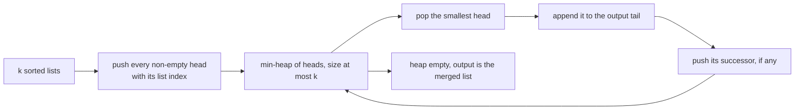
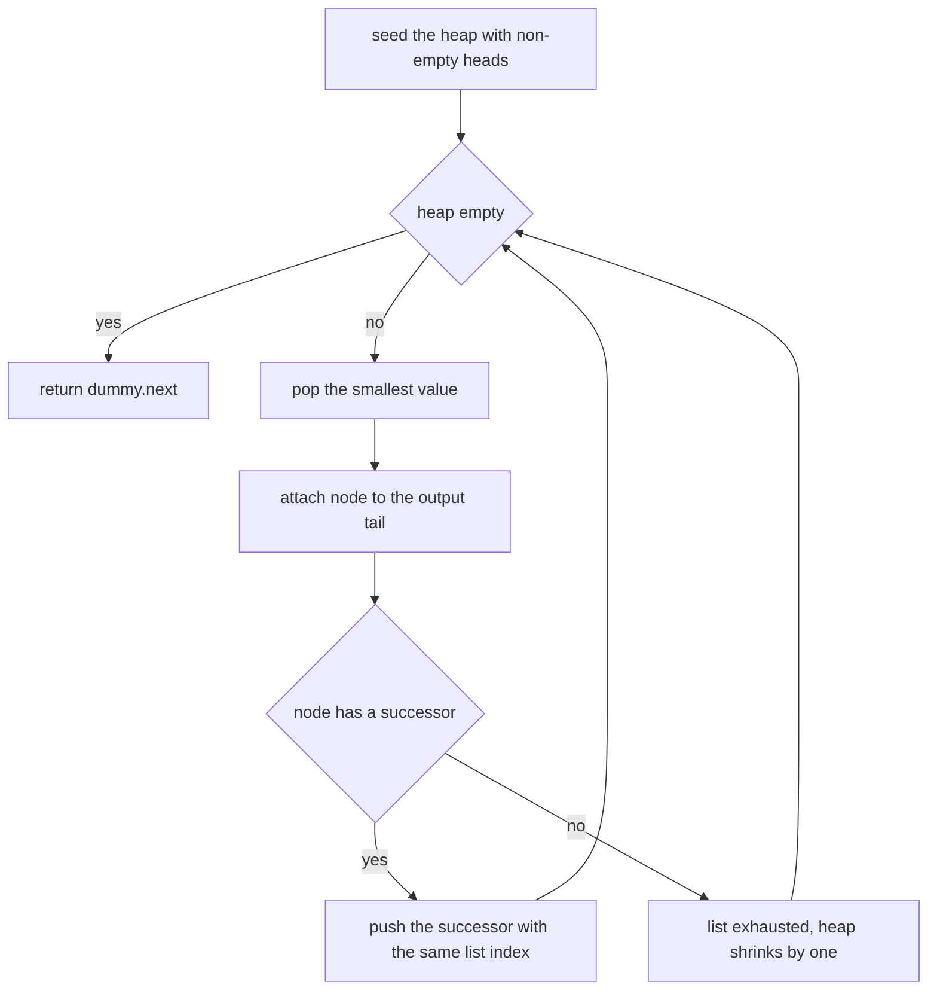
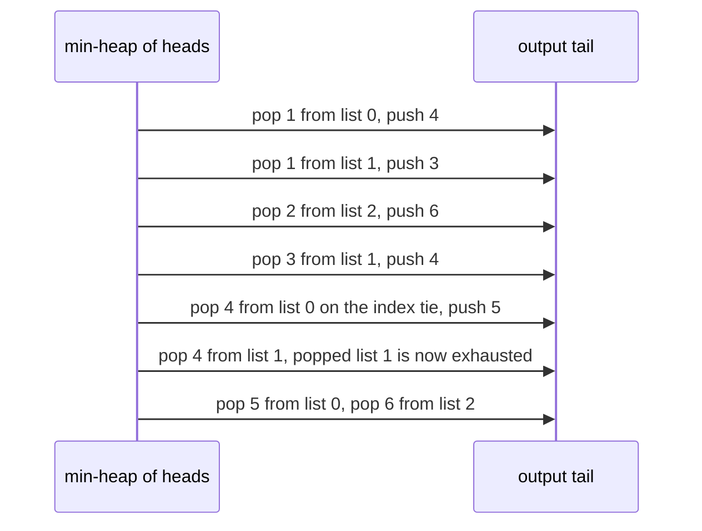
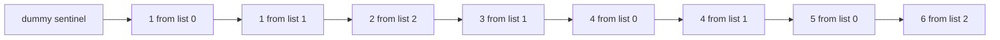

# 262 — Merge K sorted lists (heap).

> **Tier:** Intermediate · **CTCI chapter:** Ch 10 — Sorting and Searching
> **Task spec:** [262-merge-k-sorted-lists-heap.md](../../../tasks/intermediate/262-merge-k-sorted-lists-heap.md)
> **Solutions:** [Python](../../../solutions/python/intermediate/262-merge-k-sorted-lists-heap/solution.py) ·
> [Java](../../../solutions/java/intermediate/262-merge-k-sorted-lists-heap/Solution.java) ·
> [JavaScript](../../../solutions/javascript/intermediate/262-merge-k-sorted-lists-heap/solution.js) ·
> [C#](../../../solutions/csharp/intermediate/262-merge-k-sorted-lists-heap/Solution.cs)

## 1. Problem restatement

**Input:** `k` singly linked lists, each sorted ascending; `k` may be `0`, and any list may be empty
(the head pointer is "nothing").

**Output:** one sorted linked list containing every node of every input list, built by **rewiring the
existing nodes** — no value is copied into a new node.

The contract is pinned by the assertions in the four solution files:

| Call | Result | Why |
| --- | --- | --- |
| `merge_k_lists([[1,4,5], [1,3,4], [2,6]])` | `[1, 1, 2, 3, 4, 4, 5, 6]` | the classic three-list merge |
| `merge_k_lists([])` | `None` | `k = 0` |
| `merge_k_lists([None, None])` | `None` | every list empty |
| `merge_k_lists([single])` where `single` is `[1,2,3]` | the **same head object** | `k = 1` short-circuits and returns the input untouched |
| `merge_k_lists([[1], [2,3,4,5], [6]])` | `[1, 2, 3, 4, 5, 6]` | one long middle list |
| `merge_k_lists([[1,1], [1,1]])` | `[1, 1, 1, 1]` | duplicates from different lists |
| `merge_k_lists([None, [1], None, []])` | `[1]` | empty lists may be interleaved |
| `merge_k_lists([[-3,-1], [-2,0]])` | `[-3, -2, -1, 0]` | negatives |
| `merge_k_lists([[5,5], [5], []])` | `[5, 5, 5]` | duplicates plus an empty list |
| 300 random cases | equal to a flatten-and-sort oracle | independent cross-check |

Two documented behaviours shape the implementation. `k <= 1` after filtering empty lists returns the
single head *by identity*, and equal values are consumed in **list order** because the heap entry
carries the list index as a tie-breaker, which makes the merge deterministic rather than dependent on
the heap's internal arrangement.

## 2. Intuition

Merging two sorted lists is a linear scan: compare the two heads, append the smaller, advance it.
Merging `k` lists with that idea naively costs `O(k)` comparisons per appended node, because every
list head has to be looked at again and again — `O(n k)` in total for `n` nodes.

The fix is to stop searching linearly for the smallest of the `k` heads and **keep the heads in a
min-heap**. The smallest head is then the root, so "which list goes next" is a single `O(1)` read,
and advancing a list costs one `pop` plus one `push`, i.e. `O(log k)`.

Crucially, the heap never holds more than `k` entries: one per non-empty list. Each node enters the
heap exactly once — when it becomes the head of its list — and leaves it exactly once — when it is
appended to the output, at which point its successor takes its place.



The output is assembled with the **dummy-head trick**: a sentinel node owns the list, and a `tail`
cursor appends each popped node by setting `tail.next`. The final answer is `dummy.next`, which is why
the function can return "nothing" for an empty merge without special-casing the first append.

## 3. Algorithm

1. Push the head of every non-empty list into a min-heap as `(value, list index, node)`. The list
   index is only a tie-breaker, and it also keeps the heap from ever having to compare two nodes.
2. Create the sentinel `dummy` and let `tail = dummy`.
3. While the heap is non-empty: pop the smallest entry, attach that node to `tail.next`, and move
   `tail` onto it.
4. If the popped node has a successor, push `(successor.value, same list index, successor)`.
5. When the heap is empty, the merged chain hangs off `dummy.next`; return it. For `k = 0` (or only
   empty lists) the heap was never filled, so the answer is "nothing".

```text
procedure merge_k_lists(lists)
    heap ← empty min-heap ordered by (value, list index)
    for idx ← 0 to length(lists) - 1 do
        node ← lists[idx]
        if node ≠ null then
            push (node.value, idx, node) into heap
    dummy ← new node with value 0
    tail ← dummy
    while heap is not empty do
        value, idx, node ← pop the smallest entry of heap
        tail.next ← node
        tail ← node
        if node.next ≠ null then
            push (node.next.value, idx, node.next) into heap
    tail.next ← null
    return dummy.next
```

The heap size bound is the whole performance story: at most one entry per list exists at any moment,
so the heap never exceeds `k` entries, and only `n` pushes and `n` pops happen in total.



## 4. Worked example

Trace the shipped three-list case: `[1,4,5]`, `[1,3,4]`, `[2,6]`. The heap starts with the three
heads: `(1, 0)`, `(1, 1)`, `(2, 2)`. Each row is one pop and, where relevant, the push that follows:

| Step | Heap before | Popped | Output so far | Pushed next |
| --- | --- | --- | --- | --- |
| 1 | `(1,0) (1,1) (2,2)` | `(1, list 0)` | `[1]` | `(4, 0)` |
| 2 | `(1,1) (2,2) (4,0)` | `(1, list 1)` | `[1, 1]` | `(3, 1)` |
| 3 | `(2,2) (3,1) (4,0)` | `(2, list 2)` | `[1, 1, 2]` | `(6, 2)` |
| 4 | `(3,1) (4,0) (6,2)` | `(3, list 1)` | `[1, 1, 2, 3]` | `(4, 1)` |
| 5 | `(4,0) (4,1) (6,2)` | `(4, list 0)` | `[1, 1, 2, 3, 4]` | `(5, 0)` |
| 6 | `(4,1) (5,0) (6,2)` | `(4, list 1)` | `[1, 1, 2, 3, 4, 4]` | list 1 is exhausted |
| 7 | `(5,0) (6,2)` | `(5, list 0)` | `[1, 1, 2, 3, 4, 4, 5]` | list 0 is exhausted |
| 8 | `(6,2)` | `(6, list 2)` | `[1, 1, 2, 3, 4, 4, 5, 6]` | list 2 is exhausted |

Step 5 is the tie-break in action: the heap holds `(4, list 0)` and `(4, list 1)`, and the entry with
the smaller list index is popped first. That is what makes the result `[..., 4, 4, ...]` reproducible
instead of dependent on which of the two equal entries the heap happened to place at the root. Steps
6 to 8 show the heap shrinking as lists run out, never exceeding `k = 3`.



The rewiring is worth drawing, because no node is allocated after the sentinel. Each popped node
keeps its own `next` pointer as the link to its successor and is *also* linked from the output tail,
then the tail moves onto it:



Because the merge rewires the `next` pointers of the input lists, the shipped tests run the
flatten-and-sort oracle **before** the merge — after it, the original lists are no longer independent
chains but slices of the merged one.

## 5. Complexity

Let `k` be the number of lists shown to the heap (non-empty ones, so `k <= number of inputs`) and `n`
the total number of nodes.

| Measure | Bound | Why it holds |
| --- | --- | --- |
| Time | O(n log k) | each of the `n` nodes is popped once and at most once pushed, each operation `O(log k)` |
| Time, seeding | O(k) | one push per non-empty list |
| Space, heap | O(k) | at most one entry per list, because a pop that pushes replaces exactly one entry |
| Space, output | O(1) extra | the output reuses the input nodes; only the sentinel is new |
| Best case | O(n log k) still | the heap work does not depend on the values, only on the counts |
| Alternative: flatten and sort (`median_oracle` style) | O(n log n) time, O(n) space | the `merge_oracle` helper in the solution files, used only for cross-checks |
| Alternative: merge lists pairwise left to right | O(n k) time | each node is re-copied into the growing accumulator once per list, so a node from the last list is touched `O(k)` times |
| Alternative: divide and conquer | O(n log k) time, same asymptotics as the heap | see [263-merge-k-sorted-arrays-divide-conquer.md](../../../tasks/intermediate/263-merge-k-sorted-arrays-divide-conquer.md), which pays recursion instead of heap operations |
| `k = 1` | O(1) | the single non-empty list is returned by identity |

The heap wins over sorting because the input order is already exploited: nothing is compared that has
not already been shown to be a current minimum candidate. It wins over sequential pairwise merging
because the accumulator never grows a repeated factor.

## 6. Pitfalls and edge cases

- **`k = 0`.** `merge_k_lists([])` returns "nothing"; the heap is never seeded and the sentinel's
  `next` is null.
- **All lists empty.** `[None, None]` also returns "nothing"; empty heads are skipped during seeding,
  so no heap entry is ever created.
- **`k = 1` returns the same object.** The tests assert identity (`same is single`), not just equal
  contents; copying nodes would still produce the right values and fail the assertion — and it would
  break the "nodes are reused, no copies are made" contract documented in the header.
- **Empty lists interleaved with non-empty ones.** `[None, [1], None, []]` yields `[1]`; every head is
  inspected and null heads are simply not pushed.
- **Duplicates and the tie-break.** Equal values are ordered by list index, so equal nodes are
  consumed in list order. Without an explicit tie-breaker, languages that compare the node objects
  (Python tuples falling through to `ListNode`) raise, and languages that do not raise get an
  order that depends on heap internals.
- **`n` is the total node count, not per list.** The `O(n log k)` bound counts every node exactly
  once; an implementation that re-pushes a node (for example on the pop path *and* the push path)
  silently doubles the work.
- **The input lists are consumed.** The merge rewires `next` pointers of the nodes it receives, so
  the inputs are no longer valid independent lists afterwards. The tests capture the oracle's answer
  first for exactly this reason.
- **Tail terminating null.** The last popped node's `next` is already null because its list ended
  there, but the code sets `tail.next = null` explicitly so a partially consumed list cannot leak a
  stale tail into the result.
- **`k` counts shown lists, not parameters.** The heap's `log k` factor uses the number of non-empty
  lists; passing a thousand empty lists costs a thousand null checks and nothing else.
- **Sentinel value.** The dummy node carries an arbitrary value (`0` here) and is never part of the
  answer; only `dummy.next` is returned.

## 7. Variants and follow-ups

- **Arrays instead of linked lists.**
  [263-merge-k-sorted-arrays-divide-conquer.md](../../../tasks/intermediate/263-merge-k-sorted-arrays-divide-conquer.md)
  reaches the same `O(n log k)` by merging pairs recursively, and needs a temporary buffer because
  array elements cannot be relinked.
- **Merging two sorted arrays.**
  [261-median-of-two-sorted-arrays-log-min-n-m-algorithm.md](../../../tasks/intermediate/261-median-of-two-sorted-arrays-log-min-n-m-algorithm.md)
  shows that when only the *middle* of the merged result is wanted, `O(log min(m, n))` beats a full
  merge.
- **One list's worth of slots at a time.**
  [258-kth-largest-element-in-stream-min-heap.md](../../../tasks/intermediate/258-kth-largest-element-in-stream-min-heap.md)
  uses the same "heap over the current frontier" idea with a single stream and a bounded window.
- **Selecting rather than merging.**
  [256-top-k-frequent-elements-in-array-heap.md](../../../tasks/intermediate/256-top-k-frequent-elements-in-array-heap.md)
  also keeps `k` candidates in a heap, but discards the rest instead of ordering everything.
- **Heap-of-heads with a different criterion.** The same skeleton merges `k` sorted iterators by any
  key — timestamps, distances in Dijkstra, event ordering in a simulation — because the heap only
  ever needs the "current smallest" of each source.

## 8. Check yourself

1. Why is the heap never larger than `k` entries?

<details><summary>Show answer</summary>

Because it holds exactly one entry per non-empty list: the seeding adds one per list, and every later
pop pushes at most one replacement — the popped node's successor. So the pop-and-push pair replaces
one entry with one entry, and the size only shrinks as lists are exhausted.

</details>

2. What does the list index in the heap entry accomplish?

<details><summary>Show answer</summary>

Two things: it breaks ties between equal values so the merge is deterministic (equal values are taken
in list order, which is why the traced case outputs `4` from list 0 before `4` from list 1), and it
keeps the heap comparison from ever needing to order two node objects, which most languages cannot do.

</details>

3. `merge_k_lists([single])` returns the identical head object. What does that constrain?

<details><summary>Show answer</summary>

That the merge rewires nodes instead of copying them, and that the `k <= 1` case short-circuits. The
test asserts object identity, so an implementation that rebuilds the chain with fresh nodes fails even
though the values would be identical — and it would also break the documented `O(1)` extra space.

</details>

4. Why do the tests evaluate the flatten-and-sort oracle before calling the merge?

<details><summary>Show answer</summary>

Because merging modifies the input lists: it rewires the `next` pointers of the very nodes it hands to
the output. After a merge the original heads are slices of the merged chain, so flattening them again
would not produce the original multiset. The oracle is therefore run first and its result stored.

</details>

5. How does the heap approach compare with merging the lists pairwise left to right?

<details><summary>Show answer</summary>

Sequential pairwise merging costs `O(n k)` in the worst case, because each node is copied into the
accumulator once per list processed after it. The heap merges all `k` lists simultaneously in
`O(n log k)`, and the divide-and-conquer variant of task 263 reaches the same bound with a different
constant profile.

</details>
