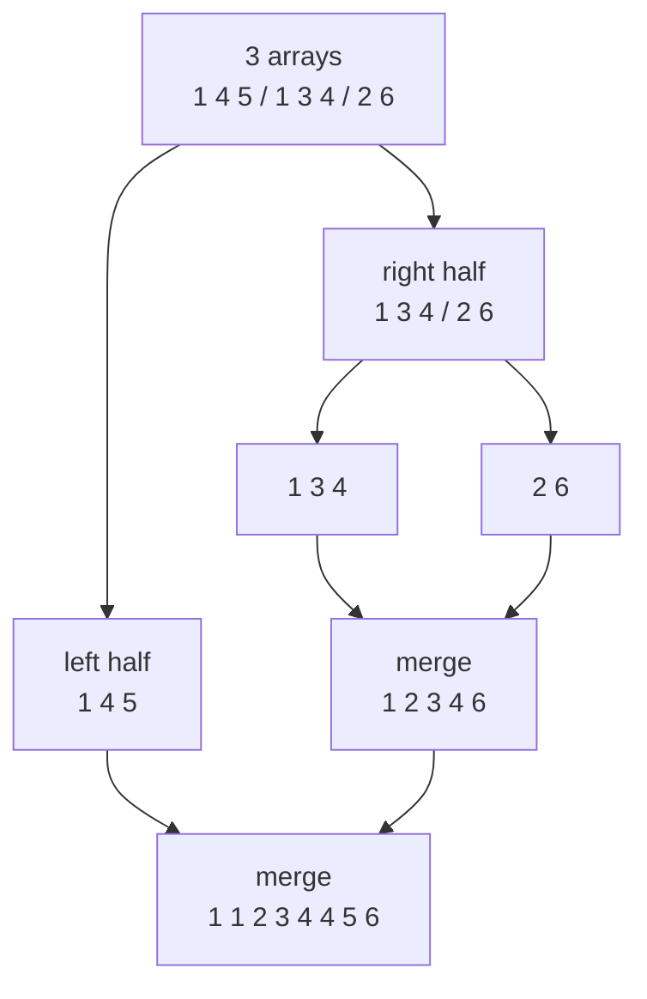
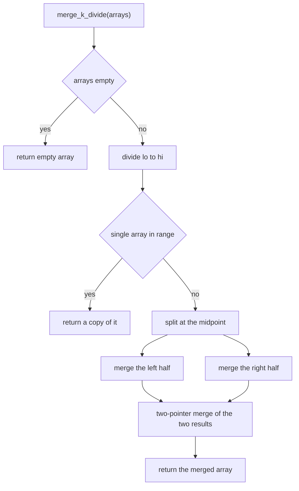
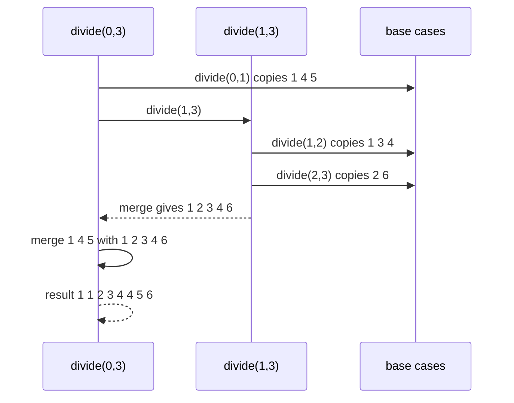
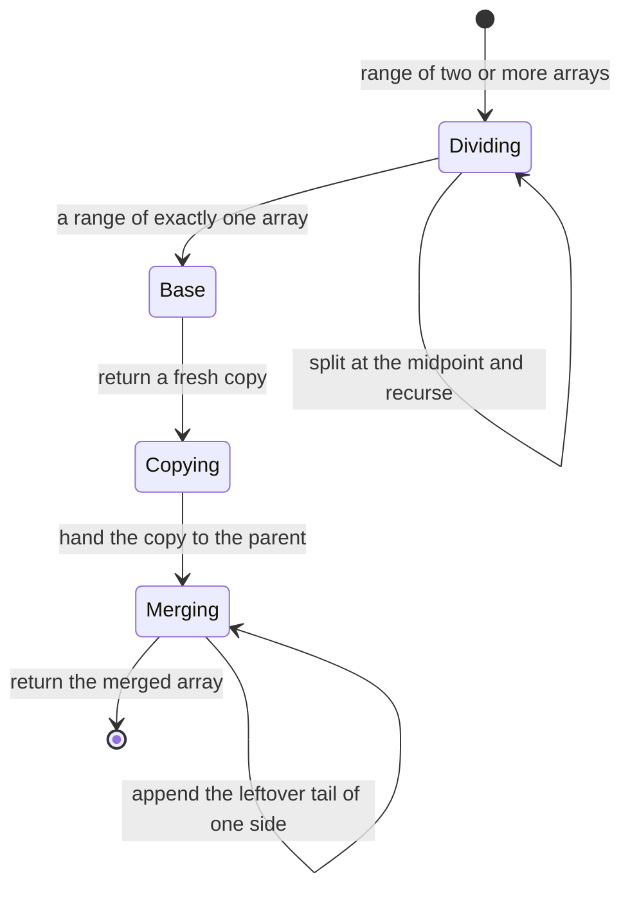

# 263 — Merge K sorted arrays (divide & conquer).

> **Tier:** Intermediate · **CTCI chapter:** Ch 10 — Sorting and Searching
> **Task spec:** [263-merge-k-sorted-arrays-divide-conquer.md](../../../tasks/intermediate/263-merge-k-sorted-arrays-divide-conquer.md)
> **Solutions:** [Python](../../../solutions/python/intermediate/263-merge-k-sorted-arrays-divide-conquer/solution.py) ·
> [Java](../../../solutions/java/intermediate/263-merge-k-sorted-arrays-divide-conquer/Solution.java) ·
> [JavaScript](../../../solutions/javascript/intermediate/263-merge-k-sorted-arrays-divide-conquer/solution.js) ·
> [C#](../../../solutions/csharp/intermediate/263-merge-k-sorted-arrays-divide-conquer/Solution.cs)

## 1. Problem restatement

**Input:** a list of `k` arrays, each sorted ascending; `k` may be `0`, and individual arrays may be
empty. The input arrays must not be modified.

**Output:** one sorted array holding every element of every input array.

The contract is pinned by the assertions in the four solution files:

| Call | Result | Why |
| --- | --- | --- |
| `merge_k_divide([[1,4,5], [1,3,4], [2,6]])` | `[1, 1, 2, 3, 4, 4, 5, 6]` | the classic three-array merge |
| `merge_k_divide([])` | `[]` | `k = 0` |
| `merge_k_divide([[3,4]])` | `[3, 4]`, and **not** the same object | `k = 1` returns a fresh copy |
| `merge_k_divide([[]])` | `[]` | a single empty array |
| `merge_k_divide([[1], [2,3,4,5], [6]])` | `[1, 2, 3, 4, 5, 6]` | very unequal lengths |
| `merge_k_divide([[2,2], [2,2], [2]])` | `[2, 2, 2, 2, 2]` | duplicates across arrays |
| `merge_k_divide([[], [1], [], [2,3]])` | `[1, 2, 3]` | empty arrays interleaved |
| `merge_k_divide([[-3,-1], [-2,0]])` | `[-3, -2, -1, 0]` | negatives |
| all fixed cases and 300 random cases | divide & conquer == heap version == flatten-and-sort | the three implementations must agree |

The `k = 1` identity assertion (`copy is not original`) is the array counterpart of task 262's
"return the same node": here the merged result must be a **new** array, so a caller who mutates the
result cannot corrupt the input. The repository ships three implementations of the same merge — the
recursive one that is the subject of the task, a heap-based one, and a flatten-and-sort oracle — and
the tests require all three to agree on every input.

## 2. Intuition

Merging two sorted arrays with two pointers is linear and needs no auxiliary structure: walk both
arrays, always append the smaller head, and when one runs out, append the rest. For `k` arrays, the
question is how to combine `k` linear merges without paying a linear factor for the "always pick the
smallest head" decision.

**Divide and conquer** answers it with the merge sort recursion instead of a heap. Split the `k`
arrays into two roughly equal halves, recursively produce the merged result of each half, then merge
those two results with a single two-pointer scan. The recursion tree has `log k` levels, and each
level touches every element exactly once, because the level's merges cover disjoint parts of the
input.



Contrast with the heap version of the same problem: the heap decides "which head is next" in
`O(log k)` per element, while divide and conquer decides it per *pair of halves* and pays only the
linear scans. Both end up at `O(n log k)`; the trade is a heap of `k` entries and no recursion versus
`log k` levels of recursion and no heap.

The base case matters: a single array is returned as a **copy**, never by reference, because the
caller's data has to stay intact and the levels above allocate new buffers anyway.

## 3. Algorithm

1. If there are no arrays, return an empty array.
2. Recursively divide the index range `[lo, hi)` of arrays into two halves and merge their results.
3. The recursion stops when a range holds exactly one array — return a copy of it.
4. Merge two sorted arrays with two pointers: while both have elements, append the smaller head and
   advance that pointer.
5. Append the non-empty remainder of whichever array is left.
6. Return the merged array to the caller, which uses it as the second operand of its own two-pointer
   merge.

```text
procedure merge_two(a, b)
    out ← empty array
    i ← 0
    j ← 0
    while i < length(a) and j < length(b) do
        if a[i] <= b[j] then
            append a[i] to out
            i ← i + 1
        else
            append b[j] to out
            j ← j + 1
    append a[i:] to out
    append b[j:] to out
    return out

procedure merge_k_divide(arrays)
    if arrays is empty then return empty array
    return divide(arrays, 0, length(arrays))

procedure divide(arrays, lo, hi)
    if hi - lo = 1 then
        return a copy of arrays[lo]
    mid ← (lo + hi) div 2
    left ← divide(arrays, lo, mid)
    right ← divide(arrays, mid, hi)
    return merge_two(left, right)
```

The recursion splits on *indices*, not on values, so it is oblivious to the data: the shape of the
recursion tree depends only on `k`, which is what makes the `log k` level count predictable.



## 4. Worked example

Trace `merge_k_divide([[1,4,5], [1,3,4], [2,6]])`. The range `[0, 3)` splits at `mid = 1`, so the left
half is the single array `[1,4,5]` and the right half is `[1,3,4]` and `[2,6]`.

| Level | Call | Produces | How |
| --- | --- | --- | --- |
| 0 | `divide(0, 3)` | `[1,1,2,3,4,4,5,6]` | merges the two level-1 results |
| 1 | `divide(0, 1)` | `[1, 4, 5]` | base case: a fresh copy of the first array |
| 1 | `divide(1, 3)` | `[1, 2, 3, 4, 6]` | merges `[1,3,4]` with `[2,6]` |
| 2 | `divide(1, 2)` | `[1, 3, 4]` | base case copy |
| 2 | `divide(2, 3)` | `[2, 6]` | base case copy |

The final merge is the one worth stepping through pointer by pointer, since it decides the ties. Its
inputs are `a = [1, 4, 5]` and `b = [1, 2, 3, 4, 6]`:

| Step | `i`, `j` | Compare | Taken | Output so far |
| --- | --- | --- | --- | --- |
| 1 | `0, 0` | `1 <= 1` | `a[0]` | `[1]` |
| 2 | `1, 0` | `4 > 1` | `b[0]` | `[1, 1]` |
| 3 | `1, 1` | `4 > 2` | `b[1]` | `[1, 1, 2]` |
| 4 | `1, 2` | `4 > 3` | `b[2]` | `[1, 1, 2, 3]` |
| 5 | `1, 3` | `4 <= 4` | `a[1]` | `[1, 1, 2, 3, 4]` |
| 6 | `2, 3` | `5 > 4` | `b[3]` | `[1, 1, 2, 3, 4, 4]` |
| 7 | `2, 4` | `5 <= 6` | `a[2]` | `[1, 1, 2, 3, 4, 4, 5]` |
| 8 | `3, 4` | `a` exhausted | append `b[4:]` | `[1, 1, 2, 3, 4, 4, 5, 6]` |

Step 1 shows the tie rule: `a[i] <= b[j]` prefers the left operand, so equal values are taken from
the left half first. That is deterministic, and it is the only choice the merge makes; the tests do
not depend on which of two equal values is chosen, since the values are indistinguishable.



The three-way agreement test is what gives this implementation its confidence: for every fixed case
and each of 300 random inputs, the divide-and-conquer result equals the heap-based result and the
flatten-and-sort result. A bug in either the pointer logic or the recursion split would show up as a
disagreement rather than as a silently wrong list.



## 5. Complexity

Let `n` be the total number of elements across all `k` arrays.

| Measure | Bound | Why it holds |
| --- | --- | --- |
| Time | O(n log k) | `log k` recursion levels, each level performing two-pointer merges that together touch every element once |
| Time, `k = 1` | O(n) | the base case copies the single array |
| Time, `k = 0` | O(1) | the empty check returns immediately |
| Space, output | O(n) | the merged result, the documented "O(n) output space" |
| Space, temporaries | O(n) at any instant | the live results along the recursion path have sizes `n/2 + n/4 + ...`, a geometric sum |
| Space, recursion | O(log k) frames | the depth of the divide step |
| Alternative: heap-based merge (`merge_k_heap`) | O(n log k) time, O(k) heap space | same asymptotics, no recursion, different constants; shipped as the cross-check |
| Alternative: flatten and sort (`merge_oracle`) | O(n log n) time | ignores the pre-existing order, so it is strictly worse when `k << n` |
| Alternative: sequential pairwise merging | O(n k) time | each round re-copies everything accumulated so far |

For `k = 2` the divide-and-conquer version *is* a single two-pointer merge, which is the `O(n)`
optimum; the `log k` factor only appears when there are more arrays than two.

## 6. Pitfalls and edge cases

- **`k = 0`.** Returns an empty array without recursing; `merge_k_divide([])` is asserted directly.
- **`k = 1` returns a copy.** The tests assert `copy == original` **and** `copy is not original`: the
  result must never alias the caller's array, because the levels above allocate fresh buffers and a
  shared reference would make the merge mutate inputs on later operations.
- **Empty arrays inside the list.** `[[], [1], [], [2,3]]` merges to `[1, 2, 3]`; an empty array is a
  perfectly valid operand for the two-pointer merge and never needs a special case.
- **Ties.** `a[i] <= b[j]` takes from the left operand, so equal values are consumed left-first.
  Using `<` instead changes which equal element is emitted but not the resulting sequence of values,
  which is why no assertion distinguishes them.
- **Unequal halves.** The split is `mid = (lo + hi) / 2`, so with an odd number of arrays the left
  half is one larger. The recursion is correct for any split; it is the level count that the power-of
  two argument describes, and skew changes it by at most one level.
- **Inputs must not be modified.** Every solution copies at the base case and never writes into the
  operands. Task 262's linked-list merge deliberately does the opposite — it rewires the input nodes —
  so the two tasks document different ownership contracts for the same algorithm.
- **Leftover tails are appended, not compared.** After one pointer reaches the end there is nothing
  left to compare; appending the whole remainder in one slice keeps the merge linear.
- **Recursion depth.** `O(log k)` frames, independent of `n`, so the recursion cannot be the cause of
  a stack overflow even for arrays with millions of elements.
- **Three implementations, one answer.** The tests require the divide-and-conquer result, the
  heap-based result and the flat sort to agree. Any change to the merge must keep all three in sync,
  and the cross-checks are what make the sentinel-free pointer code trustworthy.
- **Total size, not per-array size.** The `O(n log k)` bound uses the total element count; a single
  huge array among many tiny ones costs `O(n)` at the level where it is merged, not `O(n log k)` per
  array.

## 7. Variants and follow-ups

- **Linked lists instead of arrays.**
  [262-merge-k-sorted-lists-heap.md](../../../tasks/intermediate/262-merge-k-sorted-lists-heap.md)
  uses a heap over the `k` current heads and rewires nodes in place, which avoids the buffer the array
  version needs.
- **Only the middle of the result.**
  [261-median-of-two-sorted-arrays-log-min-n-m-algorithm.md](../../../tasks/intermediate/261-median-of-two-sorted-arrays-log-min-n-m-algorithm.md)
  shows that when a single rank is wanted, `O(log min(m, n))` beats merging the arrays at all.
- **Merging a stream with a fixed buffer.**
  [258-kth-largest-element-in-stream-min-heap.md](../../../tasks/intermediate/258-kth-largest-element-in-stream-min-heap.md)
  keeps `k` values rather than merging `k` sources, which is the right shape when only a rank is
  needed.
- **Merge sort by recursion.** The same divide-and-conquer skeleton with a single array split in half
  is merge sort; replacing "split in half" with "split into sorted runs" gives the natural-sort
  variant of the same code.
- **External merging.** When the inputs do not fit in memory, the recursion becomes a multi-pass
  merge over files; the level count is then chosen from the available buffer size rather than from
  `k`.

## 8. Check yourself

1. Why does the recursion have `log k` levels?

<details><summary>Show answer</summary>

Because each `divide` call splits its range of arrays into two halves, so the number of arrays in a
call halves at every level until a range holds one array. Starting from `k` arrays, that takes
`log2(k)` levels, and each level merges disjoint parts of the data — hence `O(n)` work per level.

</details>

2. What is the difference between the base case and `k = 1` at the top level?

<details><summary>Show answer</summary>

Nothing: both call `divide` on a single-array range and return a copy of that array. The test asserts
the copy explicitly for the top-level case (`copy is not original`) to pin down that the result never
aliases the input.

</details>

3. Why is flatten-and-sort worse here, and when would it be preferable?

<details><summary>Show answer</summary>

It costs `O(n log n)` while ignoring the fact that the inputs are already sorted, whereas the merge
costs `O(n log k)` and exploits that order. It is preferable when `k` is close to `n` (then the two
bounds nearly coincide) or when the code is only a test oracle, which is exactly the role
`merge_oracle` plays in these solutions.

</details>

4. In the pointer trace, step 1 took from `a` rather than `b` although both held `1`. Does the choice
matter?

<details><summary>Show answer</summary>

Not for the resulting sequence of values, because the two elements are indistinguishable — only the
provenance of each copy differs. It matters for determinism: `<=` fixes a rule, so the same input
always produces the same output, which is what the cross-checks against the heap version and the flat
sort rely on.

</details>

5. The heap-based version of the same merge uses `O(k)` extra memory; why does this one need `O(n)`?

<details><summary>Show answer</summary>

Because array elements cannot be relinked: every merge must write its output into a new buffer, and
the buffers of the merges along the recursion path coexist, summing to `O(n)` at any instant. The
heap version keeps only one entry per list and copies nothing, which is why it is the better choice
whenever the data can be relinked.

</details>
