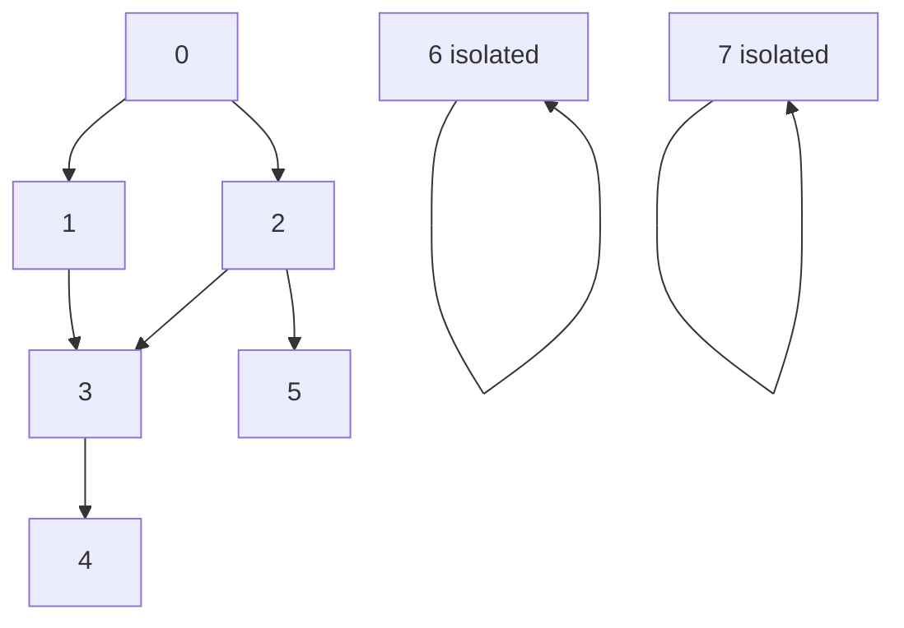
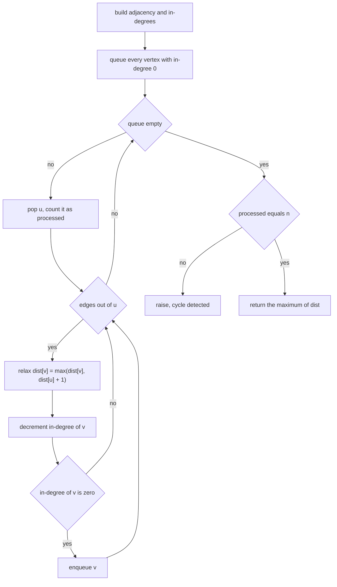
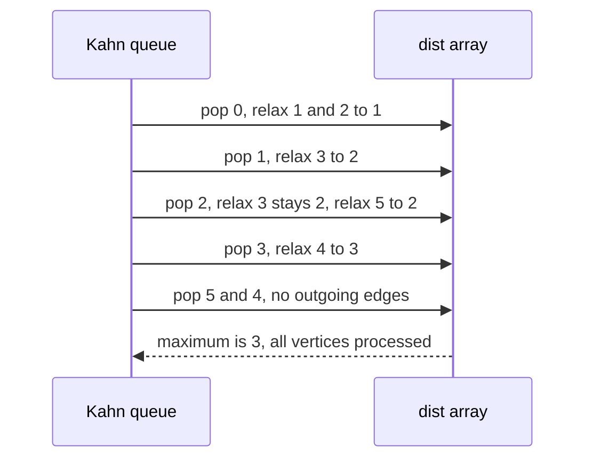
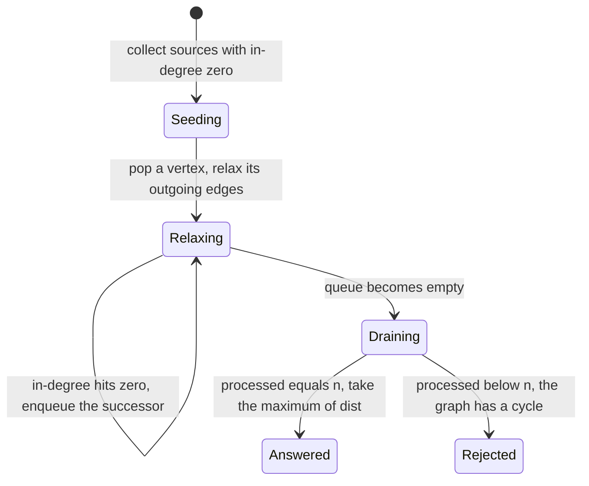

# 264 — Find longest path in DAG (DP on topo order).

> **Tier:** Intermediate · **CTCI chapter:** Ch 8 — Recursion and Dynamic Programming
> **Task spec:** [264-find-longest-path-in-dag-dp-on-topo-order.md](../../../tasks/intermediate/264-find-longest-path-in-dag-dp-on-topo-order.md)
> **Solutions:** [Python](../../../solutions/python/intermediate/264-find-longest-path-in-dag-dp-on-topo-order/solution.py) ·
> [Java](../../../solutions/java/intermediate/264-find-longest-path-in-dag-dp-on-topo-order/Solution.java) ·
> [JavaScript](../../../solutions/javascript/intermediate/264-find-longest-path-in-dag-dp-on-topo-order/solution.js) ·
> [C#](../../../solutions/csharp/intermediate/264-find-longest-path-in-dag-dp-on-topo-order/Solution.cs)

## 1. Problem restatement

**Input:** a vertex count `n` (vertices are numbered `0 .. n-1`) and a list of directed edges
`(u, v)`. The graph is **unweighted**, and the answer is measured in **edges** — the solutions
document that there is no weighted variant here.

**Output:** the number of edges on the longest path in the graph. A graph with no edges, a single
vertex, or only disconnected vertices has a longest path of `0`. A graph that contains a cycle is
rejected with an error.

The contract is pinned by the assertions in the four solution files:

| Call | Result | Why |
| --- | --- | --- |
| `longest_path(6, [(0,1),(0,2),(1,3),(2,3),(3,4),(2,5)])` | `3` | `0 → 2 → 3 → 4` (and equally `0 → 1 → 3 → 4`) |
| `longest_path(8, ...same edges...)` | `3` | vertices `6` and `7` are disconnected and stay at `0` |
| `longest_path(5, [(0,1),(1,2),(2,3),(3,4)])` | `4` | a linear chain visits all five vertices |
| `longest_path(5, [(0,1),(1,2),(3,4)])` | `2` | two disjoint chains, the longer wins |
| `longest_path(4, [(0,1),(0,2),(1,3),(2,3)])` | `2` | a diamond: the two routes into `3` tie |
| `longest_path(3, [(0,2),(2,1)])` | `2` | the topological order is not the index order |
| `longest_path(4, [(3,2),(2,1),(1,0)])` | `3` | the same chain written backwards |
| `longest_path(1, [])` | `0` | one vertex, no edges |
| `longest_path(0, [])` | `0` | no vertices at all |
| `longest_path(3, [(0,1),(1,2),(2,0)])` | raises `ValueError` | a cycle makes "longest path" ill-defined |
| 300 random DAGs | equal to a memoized-DFS oracle | independent cross-check |

Two documented behaviours decide the implementation details: isolated or disconnected vertices are
legitimate and contribute `0`, and a cyclic graph is **rejected** rather than answered, because Kahn's
queue drains before every vertex is processed.

## 2. Intuition

"Longest path" sounds like a harder version of shortest path, and in a general graph it is: the
longest *simple* path problem is NP-hard, and in a graph with a cycle it is not even well defined,
since you can loop forever. The `DAG` in the title is the whole point — acyclicity is what makes a
linear-time solution exist.

The insight is about *dependencies*. In a DAG, every edge points forward in topological order, so
when a vertex is processed, every path that can possibly reach it has already been fully evaluated.
That means a single array `dist` is enough:

- `dist[v]` = length in edges of the longest path **ending** at `v`;
- every vertex starts at `0` (a path of no edges, which is exactly right for isolated vertices);
- when `u` is finalized, each edge `u → v` relaxes `dist[v] = max(dist[v], dist[u] + 1)`.

Kahn's algorithm produces the order and the dependency guarantee at the same time: a vertex enters
the queue only when its in-degree drops to zero, i.e. when all of its predecessors have been
finalized.



That is the tested 8-vertex graph. The longest chain is `0 → 2 → 3 → 4`, three edges, and the
isolated vertices `6` and `7` sit at `dist = 0` without affecting the answer, because the result is
the maximum over all vertices.

## 3. Algorithm

1. Build the adjacency list and the in-degree array from the edge list; every edge `(u, v)`
   increments `indeg[v]`.
2. Seed a queue with every vertex whose in-degree is `0` — the graph's sources, including isolated
   vertices.
3. Set `dist = [0] * n` and `processed = 0`.
4. While the queue is non-empty: pop `u`, increment `processed`, then for each edge `u → v` relax
   `dist[v] = max(dist[v], dist[u] + 1)`, decrement `indeg[v]`, and enqueue `v` when its in-degree
   reaches `0`.
5. After the queue drains, compare `processed` with `n`. If they differ, some vertex was never
   released, which can only happen through a cycle — raise an error instead of answering.
6. Return the maximum of `dist`, or `0` for an empty graph.

```text
procedure longest_path(n, edges)
    adj ← n empty lists
    indeg ← n zeros
    for (u, v) in edges do
        append v to adj[u]
        indeg[v] ← indeg[v] + 1
    queue ← every vertex v with indeg[v] = 0
    dist ← n zeros
    processed ← 0
    while queue is not empty do
        u ← pop the front of queue
        processed ← processed + 1
        for v in adj[u] do
            if dist[u] + 1 > dist[v] then
                dist[v] ← dist[u] + 1
            indeg[v] ← indeg[v] - 1
            if indeg[v] = 0 then
                append v to queue
    if processed ≠ n then
        raise an error, the graph contains a cycle
    if n = 0 then return 0
    return the maximum of dist
```

The relaxation is a `max`, not an assignment: a vertex with several predecessors keeps the longest
route into it, which is precisely why the diamond case answers `2` (both routes reach `3` after two
edges) instead of `1`.



## 4. Worked example

Trace the tested 6-vertex graph `(0,1) (0,2) (1,3) (2,3) (3,4) (2,5)`. In-degrees start as
`0:[0] 1:[1] 2:[1] 3:[2] 4:[1] 5:[1]`, so the queue starts with just vertex `0`.

| Step | Popped `u` | Edges relaxed | `dist` after | In-degree changes | Queue after |
| --- | --- | --- | --- | --- | --- |
| 1 | `0` | `0→1`, `0→2` | `0,1,1,0,0,0` | `1` and `2` reach zero | `[1, 2]` |
| 2 | `1` | `1→3` | `0,1,1,2,0,0` | `3` drops to `1` | `[2]` |
| 3 | `2` | `2→3`, `2→5` | `0,1,1,2,0,2` | `3` reaches zero, `5` reaches zero | `[3, 5]` |
| 4 | `3` | `3→4` | `0,1,1,2,3,2` | `4` reaches zero | `[5, 4]` |
| 5 | `5` | none | `0,1,1,2,3,2` | — | `[4]` |
| 6 | `4` | none | `0,1,1,2,3,2` | — | `[]` |

All six vertices were processed, so no cycle exists, and the maximum of `dist` is `3` — the length of
`0 → 2 → 3 → 4`. Step 3 is the diamond: when `2` is processed, `dist[3]` is already `2` from vertex
`1`, so the `max` keeps it at `2` instead of dropping to the newly computed `1 + 1 = 2`. Step 5 is
worth noting for the ordering: vertex `5` leaves the queue before vertex `4` even though its index is
larger, which is why the algorithm cannot rely on index order at all.



Cycles are detected by the same bookkeeping. On `(0,1) (1,2) (2,0)` the in-degrees are all `1`, so the
initial queue is empty, `processed` stays `0`, and the comparison `0 ≠ 3` raises. Adding an outgoing
edge to a fourth vertex, as in the second rejection case, does not help: the cycle never releases its
vertices, so `processed` can never reach `n`.



## 5. Complexity

Let `V = n` be the number of vertices and `E` the number of edges.

| Measure | Bound | Why it holds |
| --- | --- | --- |
| Time | O(V + E) | building the graph is `O(V + E)`, seeding is `O(V)`, and each vertex enters and leaves the queue once while each edge is relaxed once |
| Time, `n = 0` | O(1) | nothing to build or scan |
| Time, dense DAG | O(V²) as a special case of `O(V + E)` | `E` can be `Θ(V²)`, and every edge costs constant work |
| Space | O(V + E) | adjacency lists plus the in-degree and `dist` arrays |
| Space, extra beyond the graph | O(V) | the queue plus the two arrays |
| Comparison: memoized DFS (`longest_path_dfs`) | O(V + E) time, O(V) memo plus recursion depth | same asymptotics, needs cycle protection and a recursion stack of up to `V` frames |
| Comparison: shortest path on a DAG | O(V + E) with the same topological DP | replace `max` with `min` and initialize distances with infinity |
| Comparison: Dijkstra on non-negative weights | O(E log V) | works without acyclicity, but only for shortest paths |
| General graph | NP-hard for the longest simple path | the acyclicity requirement is what keeps this linear |

Both shipped implementations run in the same asymptotic time, which is why the tests use the DFS
version as an independent oracle on acyclic inputs only: it has no cycle detection of its own.

## 6. Pitfalls and edge cases

- **Cycles must be rejected.** Kahn's queue drains early and `processed < n` catches it; the tests
  assert the error for a 3-cycle and for a 4-vertex graph containing a 3-cycle plus an extra edge.
  Returning a number here would report a path that does not exist.
- **`n = 0`.** Return `0` without taking a maximum over an empty array; `max([])` raises, and the
  solutions guard the empty case explicitly.
- **Isolated vertices.** A vertex with in-degree `0` and no outgoing edges is a legitimate source; its
  `dist` stays `0`, and since the answer is the maximum over all vertices it cannot make the answer
  worse. The 8-vertex case asserts this with vertices `6` and `7`.
- **Disconnected components.** `(0,1) (1,2) (3,4)` on five vertices answers `2`: the components compete
  through the final maximum, and no component needs to be visited in any particular order.
- **`max` versus assignment.** A vertex reachable by several routes must keep the longest one. Overwriting
  `dist[v]` unconditionally silently turns the longest-path DP into a shortest-path DP, which the
  diamond case is designed to expose (although there the two routes tie at `2`).
- **In-degree bookkeeping is per edge.** Duplicate edges each increment and later decrement the
  in-degree, so the count stays consistent; an implementation that de-duplicates edges must do so in
  both places.
- **Topological order is not index order.** `(0,2) (2,1)` has the order `0, 2, 1`; any code that
  processes vertices by index would relax `1` before `2` and understate the answer.
- **The answer counts edges, not vertices.** The chain `(0,1) (1,2) (2,3) (3,4)` answers `4` on five
  vertices, not `5` — the documented convention is edges, and there is no weighted variant in this
  repository.
- **In-degree zero sources include vertices with no edges.** Seeding must scan all `n` vertices, not
  only those that appear in the edge list.
- **Recursion-free by construction.** The DP loop is iterative, so a deep chain cannot overflow the
  stack; the memoized DFS oracle can, which is one reason it is only an oracle.
- **Edges must reference valid vertices.** The solutions index arrays directly by `u` and `v`; an
  out-of-range endpoint is a caller error, not something the algorithm detects.

## 7. Variants and follow-ups

- **Weighted longest path.** Replace `dist[u] + 1` with `dist[u] + weight(u, v)` and initialize
  `dist` with `0` for sources; the topological DP structure is unchanged. For negative weights the
  longest path becomes the shortest path of the negated graph.
- **Shortest path on a DAG.** The same algorithm with `min` and infinity-initialized distances, which
  handles negative edge weights that Dijkstra cannot.
- **Reconstructing the path.** Keep a `parent[v]` array updated alongside `dist[v]` and walk backwards
  from an argmax vertex; the DP already visits every candidate predecessor.
- **Counting paths instead of measuring one.** The same topological sweep with `count[v] += count[u]`
  answers "how many distinct paths reach v", a counting variant of the same dependency argument.
- **Recursive formulations.**
  [259-kth-smallest-element-using-order-statistics-quickselect.md](../../../tasks/intermediate/259-kth-smallest-element-using-order-statistics-quickselect.md)
  and
  [260-quickselect-randomized-implementation.md](../../../tasks/intermediate/260-quickselect-randomized-implementation.md)
  show the opposite trade-off elsewhere in this tier: expected-linear selection instead of a
  memoized recursion, with the same "process each element once" spirit.
- **Order-driven sweeps.**
  [262-merge-k-sorted-lists-heap.md](../../../tasks/intermediate/262-merge-k-sorted-lists-heap.md)
  also exploits an ordering (head order at each step) to avoid re-examining work, which is the same
  reason Kahn's order makes the DP one pass.

## 8. Check yourself

1. Why must the graph be acyclic for this DP to be correct?

<details><summary>Show answer</summary>

Because the DP relies on every predecessor of a vertex being finalized before the vertex itself. In a
cycle that never happens: Kahn's queue drains with the cycle's vertices still holding positive
in-degree, and the correct answer is not even defined, since a walk could loop indefinitely. The
solutions detect exactly this by comparing the processed count with `n` and raising.

</details>

2. `longest_path(8, ...)` returns `3` even though two vertices have no edges at all. Why?

<details><summary>Show answer</summary>

Because `dist` starts at `0` for every vertex, which is the length of the longest path ending at an
isolated vertex (a path with no edges). The answer is the maximum over all vertices, so extra isolated
vertices leave it unchanged — the tests assert the same answer for the 6-vertex and 8-vertex versions
of the same edge set.

</details>

3. What does the relaxation `dist[v] = max(dist[v], dist[u] + 1)` protect against?

<details><summary>Show answer</summary>

Multiple predecessors. When `v` has more than one incoming edge, each predecessor is processed in some
topological order and each may offer a different route length; the `max` keeps the longest, so the
final value is the longest path ending at `v`. Assignment would leave whichever predecessor was
processed last, which is the diamond case's failure mode.

</details>

4. Why is the final comparison `processed != n` a sufficient cycle test?

<details><summary>Show answer</summary>

Because Kahn's queue is only fed by vertices whose in-degree dropped to zero, and a vertex inside a
cycle always has at least one incoming edge that is never removed. So if any vertex is left, it must be
in or downstream of a cycle. Comparing the count is `O(1)` and needs no second traversal.

</details>

5. How would you return the path itself rather than its length?

<details><summary>Show answer</summary>

Keep a `parent` array beside `dist`: whenever the relaxation `dist[u] + 1 > dist[v]` succeeds, also set
`parent[v] = u`. After the sweep, find an argument-max vertex and follow parents back to a source,
which yields the vertex sequence of a longest path in reverse. The extra cost is `O(V)` memory and
`O(1)` work per successful relaxation.

</details>
