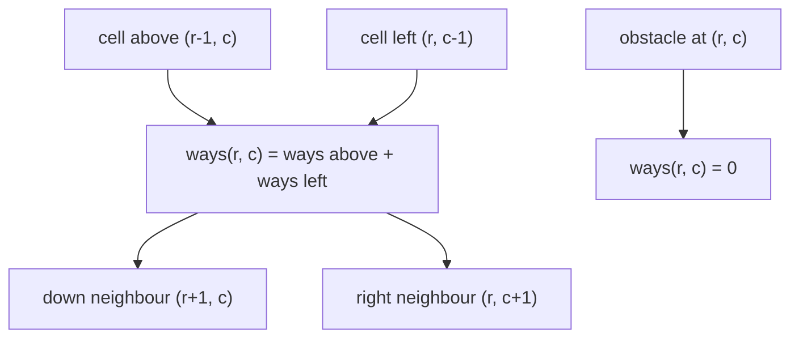
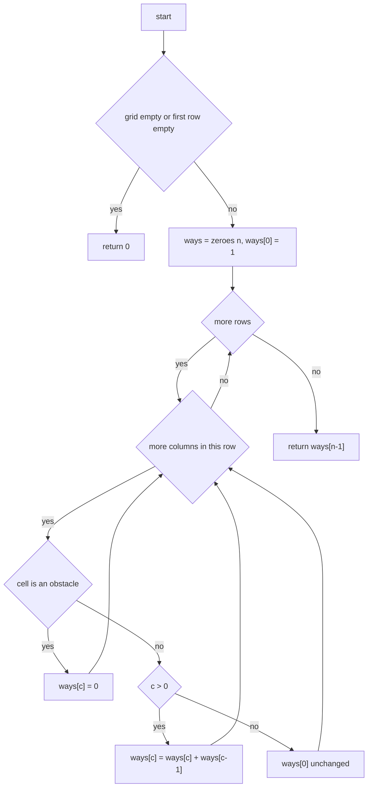
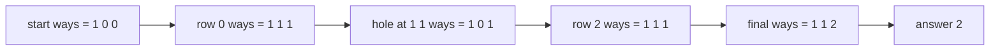

# 265 — Count number of ways in matrix with obstacles (DP).

> **Tier:** Intermediate · **CTCI chapter:** Ch 8 — Recursion and Dynamic Programming
> **Task spec:** [265-count-number-of-ways-in-matrix-with-obstacles-dp.md](../../../tasks/intermediate/265-count-number-of-ways-in-matrix-with-obstacles-dp.md)
> **Solutions:** [Python](../../../solutions/python/intermediate/265-count-number-of-ways-in-matrix-with-obstacles-dp/solution.py) ·
> [Java](../../../solutions/java/intermediate/265-count-number-of-ways-in-matrix-with-obstacles-dp/Solution.java) ·
> [JavaScript](../../../solutions/javascript/intermediate/265-count-number-of-ways-in-matrix-with-obstacles-dp/solution.js) ·
> [C#](../../../solutions/csharp/intermediate/265-count-number-of-ways-in-matrix-with-obstacles-dp/Solution.cs)

## 1. Problem restatement

**Input:** an `m x n` matrix `grid` whose cells hold `0` (free) or `1` (obstacle). A path starts at
the top-left cell and ends at the bottom-right cell; each step moves either *right* or *down* —
monotone moves only, never left and never up. A path may not step on an obstacle.

**Output:** the number of distinct monotone paths from `grid[0][0]` to `grid[m-1][n-1]`.

The task spec is one line long, so the contract is fixed by the assertions the four solution files
ship with:

| Grid | Result | Why |
| --- | --- | --- |
| `[[0,0,0],[0,0,0],[0,0,0]]` | `6` | the classic 3x3 count |
| `[[0,0,0],[0,1,0],[0,0,0]]` | `2` | the single hole forces a route around it |
| `[[0,1],[0,0]]` | `1` | only down, then right |
| `[[1,0],[0,0]]` | `0` | the start cell is blocked |
| `[[0,0],[0,1]]` | `0` | the end cell is blocked |
| `[[0,0,0,0,0]]` | `1` | `1 x n`: the only monotone path is the whole row |
| `[]` | `0` | empty grid (documented) |

On an obstacle-free `m x n` grid the answer is the closed form `C(m+n-2, m-1)`: the Python
solution asserts `1, 1, 2, 6, 28, 20` for `(1,1)`, `(1,5)`, `(2,2)`, `(3,3)`, `(3,7)`, `(4,4)`, and
the same table is asserted in Java, JavaScript and C#. Every one of those numbers is *counted*, not
estimated — they are what `count_ways` returns.

## 2. Intuition

The naive idea is the recursive enumeration that ships as `count_ways_brute` / `countWaysBrute`:
stand on a cell, recurse right and down, add the two results, return `1` on the goal and `0` on an
obstacle.

```text
function enumerate(grid, r, c)
    if grid[r][c] = 1 then return 0
    if r = m - 1 and c = n - 1 then return 1
    total ← 0
    if r + 1 < m then total ← total + enumerate(grid, r + 1, c)
    if c + 1 < n then total ← total + enumerate(grid, r, c + 1)
    return total
end
```

That is correct but exponential: a free 3x3 grid visits the same cell up to `C(r+c, r)` times, and
the total work grows like the answer itself, which is `C(m+n-2, m-1)` — the `(3,7)` row already
asks for 28 paths and `(4,4)` for 20; a 20x20 grid would ask for `C(38,19) = 35345263800` visits,
and the solutions only run the brute force on grids up to 5x5 for exactly this reason.

The key insight is that **the number of ways to reach a cell depends only on its top and left
neighbours**:

```text
ways(r, c) = ways(r-1, c) + ways(r, c-1)      and      ways(r, c) = 0 if grid[r][c] = 1
```

because every path to `(r, c)` ends with a move from above or a move from the left, and those two
sets are disjoint. The recurrence is a pure function of two other cells, so it can be evaluated in
a fixed order and never recomputed.



And because a row only ever reads *itself* (the left neighbour) and the *previous* row (the cell
above), the whole table collapses into one vector of `n` counters that is overwritten row by row.
That is what the four solutions actually do: `ways[c]` is "ways to reach column `c` of the row I am
processing", and by the time row `r` writes `ways[c] += ways[c-1]`, `ways[c]` still holds the value
from row `r-1` and `ways[c-1]` already holds the fresh value from row `r`.

## 3. Algorithm

1. If the grid is empty, or its first row is empty, return `0`.
2. Let `n` be the number of columns.
3. Allocate `ways` with `n` zeroes and set `ways[0] = 1` (*the start is reachable by the empty
   path*).
4. For every row of the grid, left to right over its columns `c`:
   - if the cell is an obstacle, set `ways[c] = 0` — nothing can pass through it;
   - otherwise, if `c > 0`, add `ways[c-1]` to `ways[c]`; this leaves `ways[c]` holding
     `above + left`.
5. Return `ways[n-1]`.

```text
function count_ways(grid)
    if grid is empty then return 0
    n ← number of columns of grid
    ways ← array of n zeroes
    ways[0] ← 1
    for each row in grid do
        for c ← 0 to n - 1 do
            if row[c] = 1 then
                ways[c] ← 0
            else if c > 0 then
                ways[c] ← ways[c] + ways[c - 1]
        end
    end
    return ways[n - 1]
end
```

Step 4 is the only subtle line. When the loop reaches column `c`, the slot `ways[c]` has not been
touched yet in this row, so it is still "ways from above"; the slot `ways[c-1]` *has* been touched,
so it is "ways from the left". The single assignment therefore computes the recurrence without a
second array — the in-place update is the trick that turns `O(m*n)` space into `O(n)`.



## 4. Worked example

Take the classic obstacle grid

```text
0 0 0
0 1 0
0 0 0
```

and follow `ways` after each cell. The vector starts as `[1, 0, 0]`.

| Row | Col | Cell | Rule applied | `ways` after |
| --- | --- | --- | --- | --- |
| 0 | 0 | 0 | `c = 0`, untouched | `[1, 0, 0]` |
| 0 | 1 | 0 | `ways[1] += ways[0]` | `[1, 1, 0]` |
| 0 | 2 | 0 | `ways[2] += ways[1]` | `[1, 1, 1]` |
| 1 | 0 | 0 | `c = 0`, untouched | `[1, 1, 1]` |
| 1 | 1 | 1 | obstacle | `[1, 0, 1]` |
| 1 | 2 | 0 | `ways[2] += ways[1]` | `[1, 0, 1]` |
| 2 | 0 | 0 | `c = 0`, untouched | `[1, 0, 1]` |
| 2 | 1 | 0 | `ways[1] += ways[0]` | `[1, 1, 1]` |
| 2 | 2 | 0 | `ways[2] += ways[1]` | `[1, 1, 2]` |

The answer is `ways[2] = 2`, matching the assertion. Read the middle row again: row 1 sees
`[1, 1, 1]` on entry, the hole wipes slot 1, and `ways[1] = 0` then contributes nothing to slot 2 —
which is exactly "paths through the hole" being deleted. The two surviving paths are
`right right down down` and `down down right right`.



The brute force reaches the same answer by a different route, and its call tree shows where the DP
saves work. `(1,2)` is computed once from `(0,2)` (its other predecessor `(1,1)` is blocked), and
`(2,2)` is reached from `(1,2)` and `(2,1)`, so the recursive version re-enters the `(2,2)` subtree
once per predecessor. The rolling vector computes each of the nine cells exactly once.

## 5. Complexity

Let `m` be the number of rows, `n` the number of columns, and `P = C(m+n-2, m-1)` the number of
monotone paths on an obstacle-free grid.

| Measure | Bound | Why it holds |
| --- | --- | --- |
| Time, all cases | `O(m*n)` | the double loop visits each cell once; a cell costs one comparison plus one addition |
| Space, rolling DP | `O(n)` | one vector of counters plus the loop indices; the grid is read only |
| Space, explicit 2D DP | `O(m*n)` | the table kept by `unique_paths_with_obstacles_2d` in [266](../../../tasks/intermediate/266-unique-paths-in-grid-with-obstacles-dp.md) |
| Time, recursive enumeration | `O(P)` | one leaf per path, and the tree has about twice as many nodes as leaves |
| Time, closed form cross-check | `O(m)` | `comb(m+n-2, m-1)` is computed by a loop of `m-1` multiply-divide steps, `O(1)` space |
| Space, closed form cross-check | `O(1)` | two running integers |

The DP is optimal in time: every cell can influence the answer, so no algorithm that reads the
whole grid can beat `O(m*n)`. It is *not* optimal in space — an obstacle-free grid does not need the
grid at all, just the closed form. The obstacle forces the scan.

## 6. Pitfalls and edge cases

- **Empty grid or empty first row.** All four solutions return `0` before touching `grid[0]`, and
  every solution file asserts both `[]` and `[[]]`. Returning "no paths" is the documented choice;
  do not raise.
- **Blocked start.** `ways[0] = 1` is the initialisation, but the first cell of the first row is
  processed like any other, so `grid[0][0] = 1` overwrites it with `0` and every later value in the
  row stays `0`. Asserted as `[[1,0],[0,0]] → 0`.
- **Blocked end.** The goal is zeroed the same way: `[[0,0],[0,1]] → 0`. There is no special case
  for the goal in the code, and none is needed.
- **Single row or single column.** `1 x n` and `n x 1` grids have exactly one monotone path, so the
  answer is `1` when no cell is blocked and `0` as soon as one is. All four assert
  `[[0,0,0,0,0]] → 1` and the blocked variants.
- **`c > 0` guard.** Without it, column 0 would read `ways[-1]`, which is the *last* column in
  Python and Java (a wrong "wrap-around" answer), `undefined` in JavaScript and an exception in C#.
  Every solution has the guard.
- **In-place update order.** `ways[c] += ways[c-1]` must read the *updated* `ways[c-1]` and the
  *stale* `ways[c]`. Swapping the roles — or iterating right to left — turns the recurrence into a
  different, wrong one.
- **Ragged input.** The loop uses `grid[0].length` for every row, so a short row would read out of
  bounds. The documented contract is a rectangle.
- **Type width.** Java, JavaScript and C# carry `long`/`number` counters; the count grows like the
  binomial coefficient, so wide grids need the 64-bit versions and JavaScript is only exact below
  `2^53`. Python is arbitrary precision. The closed form in JavaScript additionally wraps its
  floating-point result in `Math.round` to undo the division rounding.
- **Rectangular versus square.** Nothing in the algorithm assumes `m = n`; the asserted sizes
  `(1,5)`, `(3,7)` and `(4,4)` cover both.
- **Agreement with task 266.** `count_ways_265` is re-exported by [266](../../../tasks/intermediate/266-unique-paths-in-grid-with-obstacles-dp.md)
  and asserted equal to its 2D DP on eight shared grids plus 300 random ones — the two
  implementations must not drift.

## 7. Variants and follow-ups

- **Explicit 2D table.** [266-unique-paths-in-grid-with-obstacles-dp.md](../../../tasks/intermediate/266-unique-paths-in-grid-with-obstacles-dp.md)
  keeps the full `m x n` table instead of the rolling vector; same recurrence, `O(m*n)` space, and
  it is the version that is easy to debug because every intermediate value is visible.
- **Minimum instead of sum.** [267-minimum-path-sum-in-grid-dp.md](../../../tasks/intermediate/267-minimum-path-sum-in-grid-dp.md)
  replaces the addition with `min` and adds the cell weight. The rolling-vector trick survives; the
  initialisation does not (`ways[0] = 1` becomes `dp[0] = grid[0][0]`).
- **Obstacles with a shortest path.** [270-implement-a-algorithm-for-grid-pathfinding.md](../../../tasks/intermediate/270-implement-a-algorithm-for-grid-pathfinding.md)
  drops monotonicity entirely and searches the four-direction grid with A*, using the same
  "1 marks an obstacle" grid convention.
- **Count in a different shape.** The recurrence is the lattice-path identity `C(m+n-2, m-1)`; the
  four solutions assert that identity directly, so any grid problem whose answer must reduce to a
  binomial coefficient can be cross-checked the same way.

## 8. Check yourself

1. Why can the rolling vector be updated in place, without a second array or a `previous` variable?

<details><summary>Show answer</summary>

Because the two values the recurrence needs sit in different slots and are read at different times:
`ways[c]` has not been written in this row yet (so it is the value from row `r-1`, i.e. "from
above"), while `ways[c-1]` was written earlier in this same row (so it is "from the left"). The
assignment `ways[c] += ways[c-1]` reads the stale slot and the fresh slot and writes one of them.

</details>

2. `count_ways([[0,1],[1,0]])` returns `0`. Which line of the algorithm produces that?

<details>
<summary>Show answer</summary>

The obstacle branch. After row 0, `ways = [1, 0]` (the hole at `(0,1)` zeroes slot 1). Row 1 starts
with `(1,0)`: it is an obstacle, so `ways[0] = 0`. The goal `(1,1)` is free, so it executes
`ways[1] += ways[0] = 0 + 0 = 0`. The answer is `0` because both moves out of the start are
blocked.

</details>

3. How many recursive calls does `count_ways_brute` make on an obstacle-free 4x4 grid, and what does
the DP return?

<details><summary>Show answer</summary>

The brute force returns `20` — the asserted value of `C(4+4-2, 4-1) = C(6,3)` — and it makes on the
order of twice that many calls, one per prefix path plus the leaves. The DP returns the same `20`
after exactly `4 * 4 = 16` cell updates.

</details>

4. What happens if the in-place update is written as `ways[c] = ways[c] + ways[c-1]` but the inner
loop runs right to left?

<details><summary>Show answer</summary>

The recurrence breaks. Right-to-left, `ways[c-1]` is still the stale value from the previous row
when it is read, so the sum becomes "above + above-left" instead of "above + left". On the free 3x3
grid the corrupted walk produces `[1, 1, 1]` on row 0 and then doubles wrongly, and the asserted
value `6` would no longer appear. Order matters: the left neighbour must already be final.

</details>

5. The Python solution asserts `count_ways(grid) == count_ways_brute(grid)` for 300 random 5x5
grids with a 30% obstacle density. Why keep an exponential function in the file at all?

<details><summary>Show answer</summary>

It is an independent oracle. The brute force enumerates paths literally and shares no code with the
DP, so agreement on random inputs is evidence that the recurrence and the in-place update are
right — in particular that obstacles are zeroed rather than merely skipped. It is never called by
`count_ways`; it exists for the test block, which is why it is documented as "cross-checks only".

</details>
