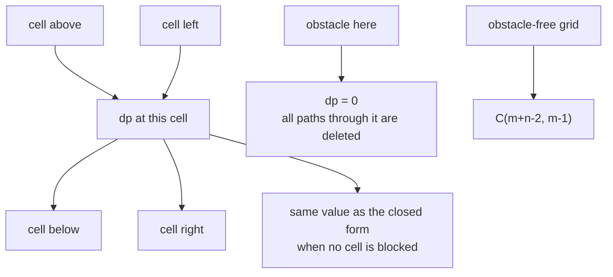
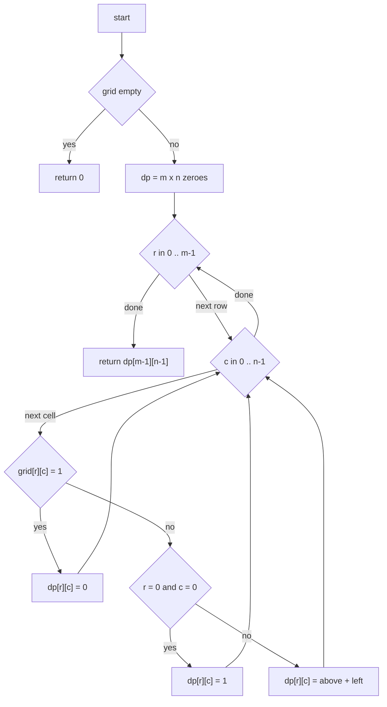
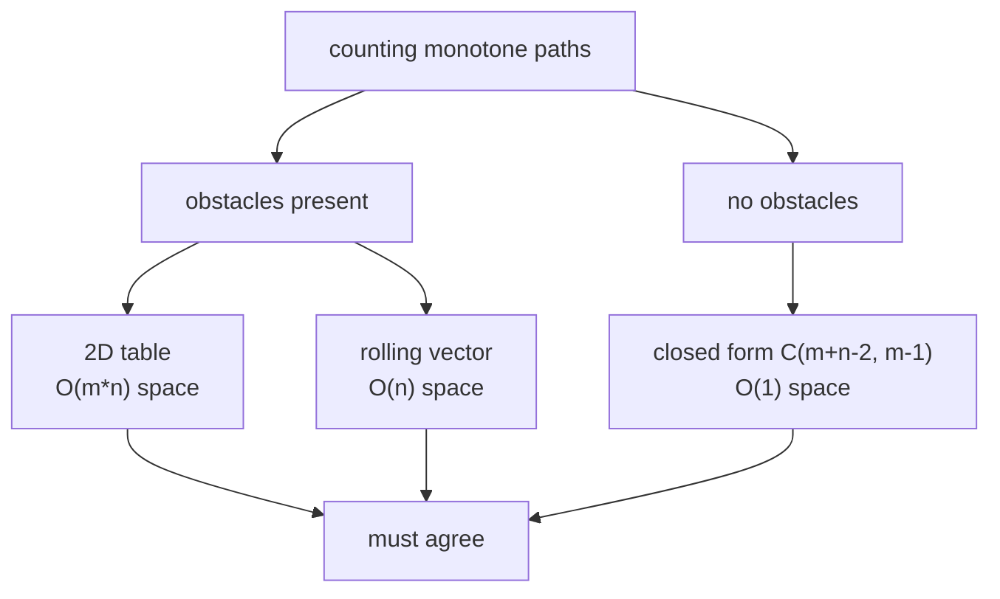

# 266 — Unique paths in grid with obstacles (DP).

> **Tier:** Intermediate · **CTCI chapter:** Ch 8 — Recursion and Dynamic Programming
> **Task spec:** [266-unique-paths-in-grid-with-obstacles-dp.md](../../../tasks/intermediate/266-unique-paths-in-grid-with-obstacles-dp.md)
> **Solutions:** [Python](../../../solutions/python/intermediate/266-unique-paths-in-grid-with-obstacles-dp/solution.py) ·
> [Java](../../../solutions/java/intermediate/266-unique-paths-in-grid-with-obstacles-dp/Solution.java) ·
> [JavaScript](../../../solutions/javascript/intermediate/266-unique-paths-in-grid-with-obstacles-dp/solution.js) ·
> [C#](../../../solutions/csharp/intermediate/266-unique-paths-in-grid-with-obstacles-dp/Solution.cs)

## 1. Problem restatement

**Input:** an `m x n` matrix `grid` of `0` (free) and `1` (obstacle). Paths go from `grid[0][0]` to
`grid[m-1][n-1]` using right and down moves only, and may not step on an obstacle.

**Output:** the number of such monotone paths. The name comes from the obstacle-free special case,
where the count is the binomial coefficient `C(m+n-2, m-1)`; obstacles can only *lower* it, because
a blocked cell simply deletes every path that used it.

The four solutions each ship **two** counters and assert that they agree, which is the real content
of this task:

| Function | What it does |
| --- | --- |
| `unique_paths_with_obstacles_2d` | keeps the full `m x n` DP table |
| `count_ways_265` | task [265](../../../tasks/intermediate/265-count-number-of-ways-in-matrix-with-obstacles-dp.md)'s rolling `O(n)` counter, same recurrence |
| `unique_paths_no_obstacles` | closed form `C(m+n-2, m-1)` for grids without holes |
| `unique_paths_brute` | recursive enumeration, cross-checks only |

Asserted values (identical in all four languages):

| Grid | Result | Why |
| --- | --- | --- |
| 3x3 free | `6` | matches `C(4,2)` |
| `[[0,0,0],[0,1,0],[0,0,0]]` | `2` | the classic hole case |
| `[[0,0],[1,0]]` | `1` | detour right, then down |
| `[[0,0],[0,1]]` | `0` | goal blocked |
| `[[1,0],[0,0]]` | `0` | start blocked |
| `[[0,1],[1,0]]` | `0` | both moves blocked |
| `[[0,0,0,0,0]]` | `1` | `1 x n` has a single monotone path |

## 2. Intuition

Enumerate the paths and count them — that is `unique_paths_brute`. On an obstacle-free 3x7 grid it
returns `28`, which is the assertion; but the recursion is exponential, while `28` is also just
`C(8,2)`. The enumerate-and-count approach pays for the structure of the grid without using it.

The structure is that the answer for a cell depends on exactly two other cells. Every path ending at
`(r, c)` arrives either from `(r-1, c)` or from `(r, c-1)`, and no path can end with both, so

```text
dp(r, c) = dp(r-1, c) + dp(r, c-1)        with dp(r, c) = 0 on an obstacle
```

and `dp(0, 0) = 1` — the empty prefix is one way to stand on the start, provided the start is free.
The bottom-right entry of that table is the answer. This is the same recurrence as
[265](../../../tasks/intermediate/265-count-number-of-ways-in-matrix-with-obstacles-dp.md); what
266 adds is the *second* implementation and the closed form, so the recurrence itself is pinned
down from three directions: a table, a rolling vector, and a combinatorial identity.



Because the recurrence only ever looks one row up and one column left, the whole table is not
needed: a vector of `n` counters, overwritten row by row, is enough. `count_ways_265` is that
vector; the table version exists because it is the one you can print and inspect when a test fails.

## 3. Algorithm

The 2D table version, which is what `unique_paths_with_obstacles_2d` / `UniquePathsWithObstacles2d`
does:

1. Return `0` if the grid is empty or its first row is empty.
2. Allocate `dp` with `m` rows of `n` zeroes.
3. Scan cells in row-major order (top row left to right, then the next row, and so on):
   - obstacle → leave `dp[r][c] = 0`;
   - start cell → `dp[r][c] = 1`;
   - otherwise → `dp[r][c] = dp[r-1][c]` (zero if `r = 0`) `+ dp[r][c-1]` (zero if `c = 0`).
4. Return `dp[m-1][n-1]`.

```text
function unique_paths_with_obstacles_2d(grid)
    if grid is empty then return 0
    m ← number of rows of grid
    n ← number of columns of grid
    dp ← table of m rows and n columns, all zeroes
    for r ← 0 to m - 1 do
        for c ← 0 to n - 1 do
            if grid[r][c] = 1 then
                dp[r][c] ← 0
            else if r = 0 and c = 0 then
                dp[r][c] ← 1
            else
                from_above ← dp[r - 1][c] if r > 0 else 0
                from_left ← dp[r][c - 1] if c > 0 else 0
                dp[r][c] ← from_above + from_left
        end
    end
    return dp[m - 1][n - 1]
end
```

Two details carry the whole correctness argument. The obstacle branch comes **first**, so a blocked
start or a blocked goal is zeroed before the `dp[r][c] = 1` initialisation can fire — that is why
`[[1,0],[0,0]]` and `[[0,0],[0,1]]` both return `0` without a special case. And the missing
neighbours are treated as `0` rather than skipped, which is what makes the first row and the first
column behave like ordinary cells.



The rolling variant replaces steps 2-4 with a vector `ways` of `n` counters seeded `ways[0] = 1`,
then for each row and each column `c`: obstacle → `ways[c] = 0`, otherwise if `c > 0` →
`ways[c] += ways[c-1]`. The two are asserted equal on eight shared grids and on 300 random ones.

## 4. Worked example

Trace the 2D table on the trickiest grid in the shared list:

```text
0 0 0 0
1 0 0 0
0 0 1 0
0 0 0 0
```

| Row | Col | Cell | Rule | `dp` row after |
| --- | --- | --- | --- | --- |
| 0 | 0 | 0 | start | `[1, 1, 1, 1]` (filled left to right) |
| 1 | 0 | 1 | obstacle | `[0, 1, 2, 3]` |
| 2 | 0 | 0 | `dp[2][0] = dp[1][0]` | `[0, 1, 0, 3]` |
| 3 | 0 | 0 | `dp[3][0] = dp[2][0]` | `[0, 1, 1, 4]` |

Reading the table row by row: row 1 is `0, 1, 2, 3` — the hole at `(1,0)` kills the left edge, and
the values grow as `1, 2, 3` along the rest of the row. Row 2 has a hole at `(2,2)`: the cell
`(2,1)` still gets `1` from above, `(2,2)` is `0`, and `(2,3)` gets `3` from above plus `0` from the
left. Row 3 accumulates: `(3,1) = 1`, `(3,2) = 1`, and the goal `(3,3) = dp[2][3] + dp[3][2] =
3 + 1 = 4`.

The rolling vector walks the same grid and finishes at `[0, 1, 1, 4]`:

| Row | `ways` entering | obstacle/update applied | `ways` leaving |
| --- | --- | --- | --- |
| 0 | `[1,0,0,0]` | prefix sums along the row | `[1,1,1,1]` |
| 1 | `[1,1,1,1]` | `ways[0]` zeroed, then sums | `[0,1,2,3]` |
| 2 | `[0,1,2,3]` | `ways[2]` zeroed, then sums | `[0,1,0,3]` |
| 3 | `[0,1,0,3]` | sums | `[0,1,1,4]` |

Both counters answer `4`, and so does `unique_paths_brute`, which visits the same four paths one
leaf at a time.


The last slot is the only one that ever matters, but the whole vector has to be carried, because
slot `c-1` of the next row depends on slot `c-1` of this one.

## 5. Complexity

Let `m` and `n` be the grid dimensions and `P = C(m+n-2, m-1)` the obstacle-free path count.

| Measure | Bound | Why it holds |
| --- | --- | --- |
| Time, 2D DP | `O(m*n)` | one visit per cell, constant work each |
| Time, rolling DP | `O(m*n)` | same walk, same work |
| Time, brute force | `O(P)` | one recursive call per leaf, roughly twice as many nodes |
| Space, 2D DP | `O(m*n)` | the full table; the version kept for debugging |
| Space, rolling DP | `O(n)` | one row of counters, the grid is read-only |
| Space, closed form | `O(1)` | `comb(m+n-2, m-1)` loops `m-1` times with two running numbers |
| Time, closed form | `O(m)` | only usable while no cell is blocked |

`O(m*n)` time is a lower bound for any algorithm that must look at the obstacle pattern, and the
rolling DP hits it with one row of memory. The comparison the solutions actually lean on is
`O(m*n)` versus `O(P)`: for a 20x20 free grid the brute force would recurse `C(38,19)` times, while
the DP performs 400 cell updates.

## 6. Pitfalls and edge cases

- **Empty grid / empty first row.** Both return `0` before any indexing; asserted as `[]` and
  `[[]]`. The Python and JavaScript files sit the guard in front of the DP, the Java and C# files in
  front of their `grid[0]` access.
- **Blocked start and blocked goal.** Handled by the ordering of the branches, not by special
  cases. If the obstacle test is moved after the start test, `[[1,0],[0,0]]` wrongly returns
  something other than `0`.
- **Obstacles only subtract.** Because paths cannot cross a blocked cell, the count on a grid with
  holes is never *larger* than on the same grid without them; the shared list asserts equality of
  the two counters rather than a comparison, but the monotonicity is a useful sanity check.
- **`1 x n` and `n x 1`.** Exactly one monotone path exists, so the answer is `1` or `0`; the
  asserted `[[0,0,0,0,0]] → 1` covers it.
- **Zero-size dimensions in the closed form.** `unique_paths_no_obstacles` returns `0` for `m <= 0`
  or `n <= 0`, matching the DP's "empty input" answer instead of raising from `comb`.
- **Floating-point division in JavaScript.** `uniquePathsNoObstacles` computes the binomial
  coefficient with `result * (n - 1 + i) / i` and wraps the result in `Math.round`, because the
  intermediate values are not always exactly representable. The Java, C# and Python versions use
  integer arithmetic (`math.comb` in Python) and need no rounding.
- **Overflow.** The counters are 64-bit in Java and C#; JavaScript `number` is exact below `2^53`,
  Python is arbitrary precision. A wide obstacle-free grid overflows a 32-bit accumulator, which is
  why no solution uses `int`.
- **Don't mutate the grid.** Both counters read the grid only. Nothing writes obstacles into the
  table, so the caller's matrix is unchanged and the two counters can be run back to back on the
  same object — which is exactly what the random cross-check does.
- **Random cross-check harness.** Python and Java use a seeded `Random`, JavaScript and C# use a
  deterministic LCG, so the 300 comparisons are reproducible rather than flaky.

## 7. Variants and follow-ups

- **The rolling version is the production one.** It is task
  [265](../../../tasks/intermediate/265-count-number-of-ways-in-matrix-with-obstacles-dp.md); this
  task keeps both so the equality of the vector and the table stays tested.
- **Shortest instead of counted.** [267-minimum-path-sum-in-grid-dp.md](../../../tasks/intermediate/267-minimum-path-sum-in-grid-dp.md)
  swaps `+` for `min` and weights the cells; the monotone structure survives and so does the
  rolling vector.
- **Weighted cells with obstacles.** Give each free cell a positive cost, take the minimum, and the
  same table answers "cheapest monotone route"; the closed form disappears because weights break
  the combinatorics.
- **No obstacles at all.** Then the answer is the binomial coefficient and no scan is needed —
  which is why the tests assert the DP equals the closed form on six grid sizes.



## 8. Check yourself

1. Why does the 2D DP never add a bounds check for the first row and the first column?

<details><summary>Show answer</summary>

Because the missing neighbour is treated as `0`, not skipped: `from_above` is `0` when `r = 0` and
`from_left` is `0` when `c = 0`. Adding zero is exactly "there is no contribution from that side",
which is the correct base case for the first row and first column.

</details>

2. The rolling vector is seeded `ways[0] = 1` before the loop, while the 2D table sets `dp[0][0] = 1`
inside the loop. Do they still agree on `[[1,0],[0,0]]`?

<details><summary>Show answer</summary>

Yes, both return `0`. The rolling version's `1` is immediately overwritten because the first cell it
processes is the obstacle `(0,0)`, which sets `ways[0] = 0`; the 2D version checks the obstacle
branch before the start branch, so `dp[0][0]` is never set to `1`. Both agree with the brute force
on the 300 random grids.

</details>

3. What does the closed form return for `(3, 7)`, and how many cell updates does the DP need to
produce the same number?

<details><summary>Show answer</summary>

`C(3+7-2, 3-1) = C(8,2) = 28`, which is the asserted value. The DP needs `3 * 7 = 21` cell updates
to reach `28`; the rolling version needs the same 21 updates but only 7 counters instead of 21.

</details>

4. Why is there no way to make the 2D DP faster than `O(m*n)`?

<details><summary>Show answer</summary>

Every cell can influence the answer, so any correct algorithm must read each cell at least once,
which is `Ω(m*n)`. The only escape is when there are no obstacles at all, in which case the grid
carries no information and the closed form answers in `O(m)`.

</details>

5. What happens if you run `unique_paths_with_obstacles_2d` and then `count_ways_265` on the same
grid object?

<details><summary>Show answer</summary>

Nothing surprising: both read the grid and neither writes to it, so the second call sees the
original obstacles. That is what makes the cross-check loop meaningful — the two counters are run
back to back on one mutable array and must agree.

</details>
