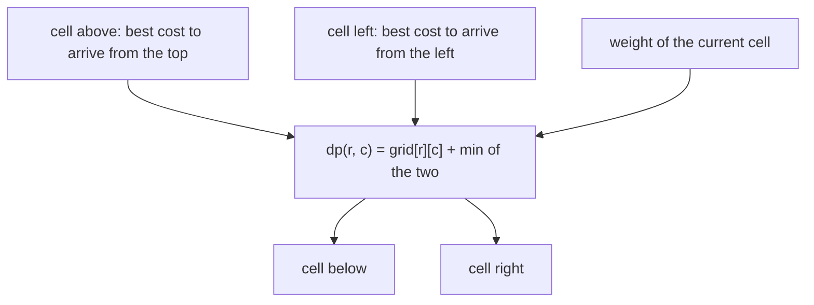
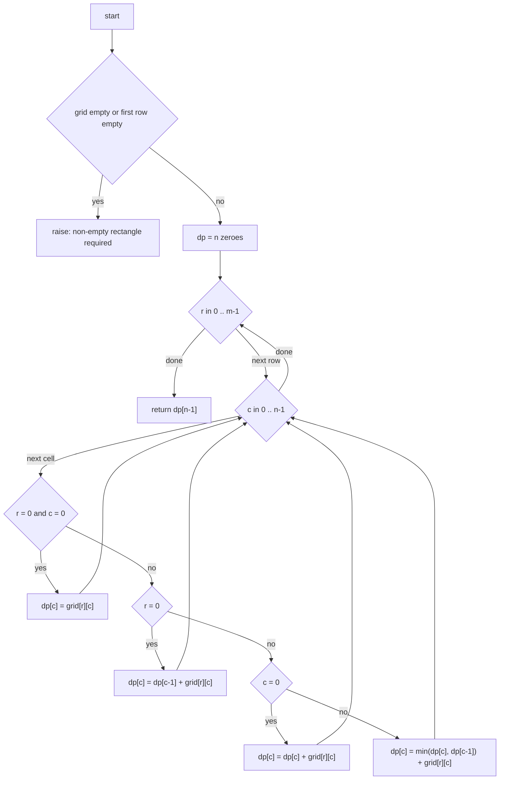
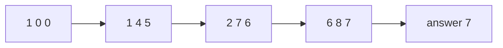
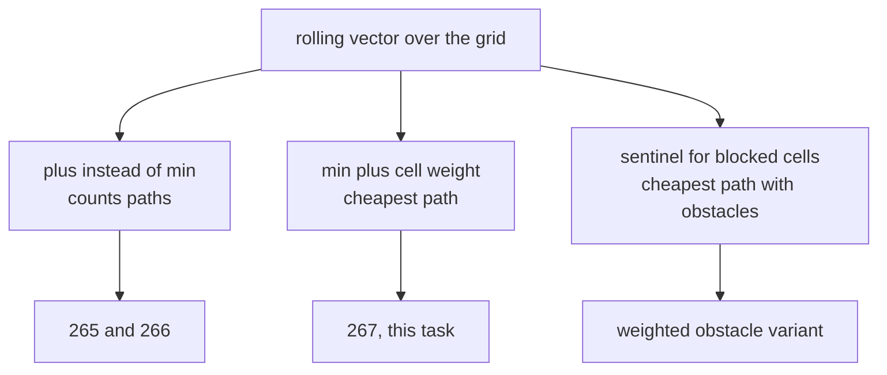

# 267 — Minimum path sum in grid (DP).

> **Tier:** Intermediate · **CTCI chapter:** Ch 8 — Recursion and Dynamic Programming
> **Task spec:** [267-minimum-path-sum-in-grid-dp.md](../../../tasks/intermediate/267-minimum-path-sum-in-grid-dp.md)
> **Solutions:** [Python](../../../solutions/python/intermediate/267-minimum-path-sum-in-grid-dp/solution.py) ·
> [Java](../../../solutions/java/intermediate/267-minimum-path-sum-in-grid-dp/Solution.java) ·
> [JavaScript](../../../solutions/javascript/intermediate/267-minimum-path-sum-in-grid-dp/solution.js) ·
> [C#](../../../solutions/csharp/intermediate/267-minimum-path-sum-in-grid-dp/Solution.cs)

## 1. Problem restatement

**Input:** an `m x n` grid of integers — the *cost* of stepping on each cell. Paths start at
`grid[0][0]`, end at `grid[m-1][n-1]`, and use right and down moves only.

**Output:** the minimum possible sum of the cell values along such a path, **counting the start and
the end cell**. The grid is not necessarily non-negative.

Asserted values, identical in all four languages:

| Grid | Result | Path |
| --- | --- | --- |
| `[[1,3,1],[1,5,1],[4,2,1]]` | `7` | `1+3+1+1+1` |
| `[[5]]` | `5` | the single cell is both start and end |
| `[[-3]]` | `-3` | negatives are allowed |
| `[[1,2,3]]` | `6` | `1 x n`: one path, so its sum |
| `[[1],[2],[3]]` | `6` | `n x 1`: one path |
| `[[1,2,3],[4,100,6]]` | `12` | steps over the huge cell: `1+2+3+6` |
| `[[1,100],[1,1]]` | `3` | goes down first, then right |
| `[[1,-3],[1,-5]]` | `-7` | the cheap route goes through both negatives |

A grid that is empty — or whose first row is empty — **raises**: `ValueError` in Python,
`IllegalArgumentException` in Java, a plain `Error` in JavaScript and `ArgumentException` in C#. All
four files assert that both empty shapes raise. That is the documented contract, and it is the
opposite of the neighbouring counting tasks, which return `0` for an empty grid.

## 2. Intuition

The naive idea is to enumerate every monotone path with the recursion that ships as
`min_path_sum_brute` / `MinPathSumBrute`: return the cell value at the goal, otherwise return the
cell value plus the smaller of "best from below" and "best from the right". It is correct — the
files assert it against the fast version on 300 random grids — but it recomputes the same suffix
costs over and over, and the number of monotone paths is exponential in `m + n`.

The insight is the same one that drives [266](../../../tasks/intermediate/266-unique-paths-in-grid-with-obstacles-dp.md)
and [265](../../../tasks/intermediate/265-count-number-of-ways-in-matrix-with-obstacles-dp.md), with
`min` replacing `+`:

```text
dp(r, c) = grid[r][c] + min(dp(r-1, c), dp(r, c-1))
```

The cost of the best path *through* a cell is the cell's own cost plus the cheaper of the two ways
of arriving there. Sums of disjoint predecessor sets add, minima of them compare — the shape of the
recurrence is identical, which is why the same rolling vector works.



The one real difference from the counting tasks is the **first row and first column**. There,
`min` over a single existing predecessor degenerates: the first row can only be entered from the
left, so its prefix sums are forced, and the first column can only be entered from above. A
recurrence that blindly takes `min` of two values would compare against an uninitialised `0` and
happily choose a free ride. The solutions handle this with three explicit branches — `r = 0`,
`c = 0`, and everything else — instead of a sentinel.

## 3. Algorithm

1. If the grid is empty, or the first row is empty, raise (the documented contract).
2. Let `n` be the number of columns and allocate `dp` with `n` zeroes.
3. For each row `r`, left to right over columns `c`:
   - `r = 0` and `c = 0`: `dp[0] = grid[0][0]` — the start costs its own value;
   - `r = 0`: `dp[c] = dp[c-1] + grid[r][c]` — only the left neighbour exists;
   - `c = 0`: `dp[0] = dp[0] + grid[r][c]` — only the top neighbour exists;
   - otherwise: `dp[c] = min(dp[c], dp[c-1]) + grid[r][c]`.
4. Return `dp[n-1]`.

```text
function min_path_sum(grid)
    if grid is empty then raise "grid must be a non-empty rectangle"
    n ← number of columns of grid
    dp ← array of n zeroes
    for r ← 0 to number of rows - 1 do
        for c ← 0 to n - 1 do
            if r = 0 and c = 0 then
                dp[c] ← grid[r][c]
            else if r = 0 then
                dp[c] ← dp[c - 1] + grid[r][c]
            else if c = 0 then
                dp[c] ← dp[c] + grid[r][c]
            else
                dp[c] ← minimum of dp[c] and dp[c - 1] + grid[r][c]
        end
    end
    return dp[n - 1]
end
```

The rolling vector works for the same reason as in the counting version: at column `c` in row `r`,
the slot `dp[c]` still holds the value from row `r-1` (the "from above" candidate, which is exactly
what `min` must consider once the weight is added) and `dp[c-1]` already holds the fresh value from
row `r` (the "from the left" candidate). One array, `n` slots.



## 4. Worked example

Trace `min_path_sum([[1,3,1],[1,5,1],[4,2,1]])`, whose asserted answer is `7`. The vector starts as
`[0, 0, 0]`.

| Step | Cell | Value | Rule | `dp` after |
| --- | --- | --- | --- | --- |
| 1 | `(0,0)` | 1 | start | `[1, 0, 0]` |
| 2 | `(0,1)` | 3 | first row | `[1, 4, 0]` |
| 3 | `(0,2)` | 1 | first row | `[1, 4, 5]` |
| 4 | `(1,0)` | 1 | first column | `[2, 4, 5]` |
| 5 | `(1,1)` | 5 | `min(4, 2) + 5` | `[2, 7, 5]` |
| 6 | `(1,2)` | 1 | `min(5, 7) + 1` | `[2, 7, 6]` |
| 7 | `(2,0)` | 4 | first column | `[6, 7, 6]` |
| 8 | `(2,1)` | 2 | `min(7, 6) + 2` | `[6, 8, 6]` |
| 9 | `(2,2)` | 1 | `min(6, 8) + 1` | `[6, 8, 7]` |

The answer is `dp[2] = 7`, matching the assertion. Watch step 6: the slot held `5` (the cost of the
path along the top row) and the left neighbour held `7` (down, then right through the `5`), so the
minimum is `5` and the cell adds `1` — the route across the top. Step 8 is the mirror image: above
is `7`, left is `6`, so the route down the first column wins.



The recursive brute force reaches the same `7` by exploring every suffix. Its call tree re-enters
`(1,2)` and `(2,1)` more than once; the rolling vector touches each of the nine cells exactly once
and keeps only three numbers alive.

## 5. Complexity

Let `m` be the number of rows, `n` the number of columns, and `P = C(m+n-2, m-1)` the number of
monotone paths.

| Measure | Bound | Why it holds |
| --- | --- | --- |
| Time, all cases | `O(m*n)` | one pass over the grid, one comparison and one addition per inner cell |
| Space, rolling DP | `O(n)` | `n` counters; the grid is only read |
| Space, recursive enumeration | `O(m+n)` | the recursion depth is the length of a path; the work is `O(P)` |
| Time, recursive enumeration | `O(P)` | one call per path, roughly twice as many nodes as leaves |
| Best case, time | `O(m*n)` | every cell must be read, since any cell can be on the optimal route |
| Access to negatives | no extra cost | `min` does not care about signs, so negative cells need no special handling |

`O(m*n)` is also a lower bound: to know the cheapest route you must look at every cell at least
once. The space is where the choice is real — the table version of the same recurrence would take
`O(m*n)`, and this task shows the vector is enough.

## 6. Pitfalls and edge cases

- **Empty input raises, it does not return.** `min_path_sum([])` and `min_path_sum([[]])` throw, and
  each of the four files asserts the throw (Java and C# count the two caught exceptions and check
  the total is `2`; JavaScript uses `assert.throws` with a `/non-empty/` regex). A silent `0` would
  be indistinguishable from a legitimate zero-cost grid.
- **First row and first column are forced.** They must be prefix sums, never minima. Treating the
  missing neighbour as `0` and taking `min(dp[c], 0)` yields the *uninitialised* `0` and produces a
  wrong, too-small answer for grids with positive values. That is why the code has three branches
  rather than one.
- **Start and end are both paid for.** `[[5]] → 5` and the classic trace both include the two
  corners; a version that returns `0` for the single-cell grid would disagree with every assertion.
- **Negative values.** Allowed, and asserted: `[[1,-3],[1,-5]] → -7`. Sums can be negative, and a
  greedy "always move to the smaller neighbour" is still wrong — the DP is what makes it correct.
- **Single row or single column.** There is exactly one path, so the answer is the whole row or
  column sum; `[[1,2,3]] → 6` and `[[1],[2],[3]] → 6` pin it down.
- **Large intermediate values.** Java, JavaScript and C# accumulate in 64-bit (`long`, `number`);
  a long monotone path of large weights overflows a 32-bit accumulator. Python is unbounded.
- **Ragged grids.** The loop reads `grid[0].length` for every row; a shorter row would read out of
  bounds. The documented shape is a rectangle, and the exception message says so.
- **In-place row update.** As in the counting tasks, `dp[c]` must be read *before* it is
  overwritten and `dp[c-1]` *after*; iterating right to left silently corrupts the recurrence.
- **The brute force is an oracle, not a fallback.** It is never called from `min_path_sum`; it
  exists so the 300 random comparisons in the test block have an independent implementation to
  disagree with.

## 7. Variants and follow-ups

- **Count instead of minimize.** [265](../../../tasks/intermediate/265-count-number-of-ways-in-matrix-with-obstacles-dp.md)
  and [266](../../../tasks/intermediate/266-unique-paths-in-grid-with-obstacles-dp.md) use `+` and
  handle obstacles by zeroing; here every cell is enterable, so no obstacle branch is needed.
- **Obstacles plus costs.** Mark blocked cells with a sentinel infinity (or skip them), and the same
  rolling vector answers "cheapest monotone route avoiding obstacles".
- **Any-direction search.** [270-implement-a-algorithm-for-grid-pathfinding.md](../../../tasks/intermediate/270-implement-a-algorithm-for-grid-pathfinding.md)
  drops monotonicity and uses A* with a heuristic; the DP is only valid while moves are monotone,
  because the recurrence depends on the topological order of the cells.
- **Costs from a matrix of operations.** The iteration order `row by row, left to right` is a
  topological order of the DAG of monotone moves; any other DAG needs its own order.



## 8. Check yourself

1. Why can the recurrence not simply be `dp[c] = min(dp[c], dp[c-1]) + grid[r][c]` for every cell?

<details><summary>Show answer</summary>

Because in the first row `dp[c]` still holds `0` — nothing has been written above it — and a `min`
against `0` would pretend the cell can be reached for free from outside the grid. The same happens
in the first column. Those two edges need their single existing predecessor used directly, which is
why the code has explicit `r = 0` and `c = 0` branches instead of a sentinel value.

</details>

2. Trace step 8 of the worked example: what are the two candidates and which wins?

<details><summary>Show answer</summary>

At `(2,1)` the value is `2`, `dp[1]` holds `7` (down the left column, right through the `5`) and
`dp[0]` holds `6` (down the left column twice, i.e. `1+1+4`). The minimum is `6`, so
`dp[1] = 6 + 2 = 8`. The cell above wins here; one step later the tie is broken the other way.

</details>

3. `[[1,100],[1,1]]` returns `3`. Which path, and what would a greedy walk do?

<details><summary>Show answer</summary>

The path is down-down-right: `1 + 1 + 1 = 3`. A greedy walk from the start sees `100` to the right
and `1` below, moves down, then at `(1,0)` sees `1` to the right and takes it — that happens to be
optimal here, but greedy is not generally correct, which is why the DP carries the whole vector.

</details>

4. The four solutions raise on an empty grid while tasks 265 and 266 return `0`. Why the
inconsistency, and does it matter?

<details><summary>Show answer</summary>

There is no meaningful minimum for an empty grid — every candidate is equally absent — so raising is
the honest answer, and the files assert both `[]` and `[[]]`. A count, by contrast, has a defensible
empty value: zero paths. The inconsistency is documented in the source docstrings; what matters is
that each task asserts its own choice instead of leaving it to chance.

</details>

5. How many comparisons does the rolling DP make on an `m x n` grid, and how many would the 2D table
version make?

<details><summary>Show answer</summary>

The same number: one `min` per interior cell, so `(m-1)*(n-1)`, with the first row and first column
costing only an addition each. The two versions differ in memory (`O(n)` versus `O(m*n)`), not in
arithmetic work.

</details>
