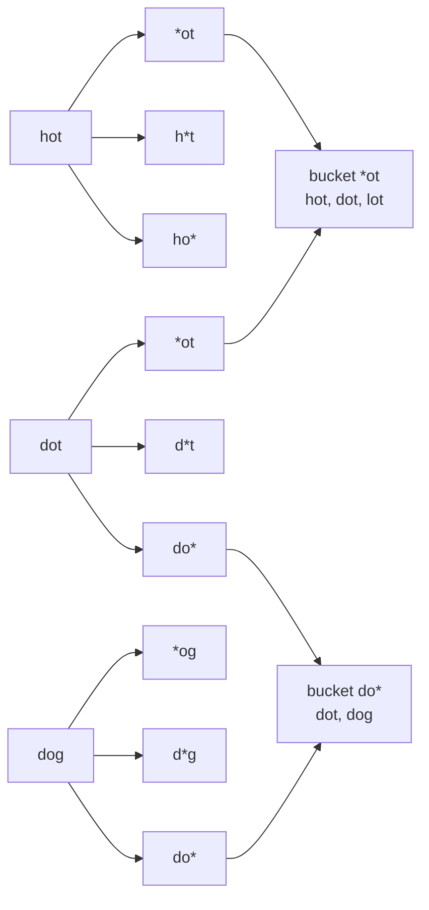
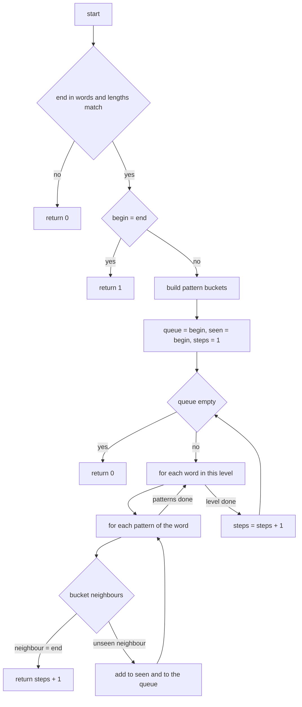
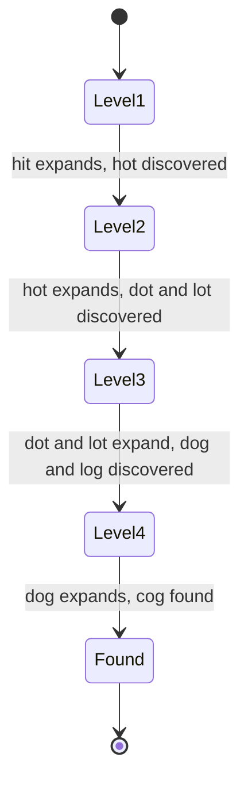
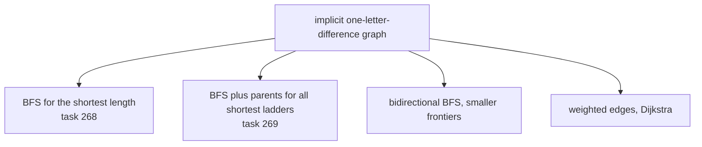

# 268 — Word ladder shortest transformation (BFS).

> **Tier:** Intermediate · **CTCI chapter:** Ch 4 — Trees and Graphs
> **Task spec:** [268-word-ladder-shortest-transformation-bfs.md](../../../tasks/intermediate/268-word-ladder-shortest-transformation-bfs.md)
> **Solutions:** [Python](../../../solutions/python/intermediate/268-word-ladder-shortest-transformation-bfs/solution.py) ·
> [Java](../../../solutions/java/intermediate/268-word-ladder-shortest-transformation-bfs/Solution.java) ·
> [JavaScript](../../../solutions/javascript/intermediate/268-word-ladder-shortest-transformation-bfs/solution.js) ·
> [C#](../../../solutions/csharp/intermediate/268-word-ladder-shortest-transformation-bfs/Solution.cs)

## 1. Problem restatement

**Input:** a `begin` word, an `end` word, and a `word_list` of allowed intermediate words. Each
transformation changes **exactly one letter** of the current word, and every word on the ladder
after the first step must be in `word_list` (the `begin` word itself is allowed to be outside it).

**Output:** the **length of the shortest transformation sequence**, counted in words — `begin` and
`end` included — or `0` when no sequence exists. The docstrings state this explicitly: "Return
value: 0 when no sequence exists (documented choice; LeetCode 127 agrees)."

| Call | Result | Why |
| --- | --- | --- |
| `ladder_length("hit", "cog", ["hot","dot","dog","lot","log","cog"])` | `5` | `hit → hot → dot → dog → cog` |
| `ladder_length("hit", "cog", ["hot","dot","dog","lot","log"])` | `0` | `end` is not in the list |
| `ladder_length("hit", "hot", ["hot","dot","dog"])` | `2` | one step, two words |
| `ladder_length("a", "c", ["a","b","c"])` | `2` | one-letter words work the same way |
| `ladder_length("hot", "hot", ["hot"])` | `1` | begin equals end |
| `ladder_length("hot", "hot", ["dog"])` | `0` | "end not in list wins over equality" |
| `ladder_length("ab", "abc", ["abc"])` | `0` | different lengths can never match |
| `ladder_length("ab", "cd", ["ac","bd"])` | `0` | no ladder connects them |
| `ladder_length("lost", "cost", ["most","fost","cost","cast"])` | `2` | the one-letter change is direct |
| `ladder_length("aaaa", "aaab", ["aaaa","aaab"])` | `2` | four-letter words are not special |

Note the order of the two guards: `hot → hot` with an empty-ish list returns `0`, not `1`, because
the `end not in words` check runs first. That row is asserted in all four languages.

## 2. Intuition

Model the words as a graph: an edge joins two words that differ in exactly one letter. The answer is
the shortest path from `begin` to `end` *plus one* (the count of nodes rather than of edges), and
shortest paths in an unweighted graph mean **breadth-first search**, explored level by level.

The naive implementation — the `ladder_length_oracle` that ships in all four files for cross-checks
— asks, for every node it pops, "which words in the list differ from this one in exactly one
position?" and scans the *whole* list, comparing letter by letter. With `N` words of length `L`
that is `O(N * L)` work per node and `O(N^2 * L)` overall, and the same pairs are tested over and
over.

The insight that fixes it is a **wildcard bucket index**. For each word and each position, replace
that position with `*` and use the pattern as a key:

```text
hot → "*ot", "h*t", "ho*"
dot → "*ot", "d*t", "do*"
dog → "*og", "d*g", "do*"
```

Two words differ in exactly one letter **if and only if** they share at least one pattern. So instead
of scanning the list, a node generates its `L` patterns, looks each one up in the index, and finds
all its neighbours — regardless of how many words are in the list. Building the index costs `O(N * L)`
once, and each node's neighbour enumeration costs `O(L)` lookups plus the size of the buckets.



The graph is never materialised: patterns are generated on the fly from the current word, and the
bucket values are the edges. That is what makes the search implicit — `O(N * L)` memory for the
index instead of `O(N^2)` for an adjacency list.

## 3. Algorithm

1. `words ← set(word_list)` — duplicates collapse into one word.
2. If `end` is not in `words`, or `begin` and `end` have different lengths, return `0`.
3. If `begin = end`, return `1`.
4. Build the bucket index: for each word of the right length and each position `i`, add the word
   under the pattern `word[:i] + "*" + word[i+1:]`.
5. Put `begin` in a queue with `seen = {begin}` and `steps = 1` (the begin word counts as level 1).
6. While the queue is not empty: process the entire current level —
   - for each position `i` of the current word, form the pattern and fetch its bucket;
   - for each neighbour in the bucket: return `steps + 1` if it is `end`; otherwise add it to the
     queue and to `seen` if it is new.
   Then increment `steps` and continue with the next level.
7. If the queue empties without reaching `end`, return `0`.

```text
function ladder_length(begin, end, word_list)
    words ← set of word_list
    if end is not in words or length(begin) ≠ length(end) then return 0
    if begin = end then return 1
    length ← length(begin)
    buckets ← empty map from pattern to list of words
    for each word in words do
        if length(word) = length then
            for i ← 0 to length - 1 do
                pattern ← word with position i replaced by "*"
                append word to buckets[pattern]
        end
    end
    queue ← [begin]
    seen ← {begin}
    steps ← 1
    while queue is not empty do
        level ← all words currently in queue
        for each word in level do
            for i ← 0 to length - 1 do
                pattern ← word with position i replaced by "*"
                for each neighbour in buckets[pattern] do
                    if neighbour = end then return steps + 1
                    if neighbour is not in seen then
                        add neighbour to seen
                        append neighbour to queue
        end
        steps ← steps + 1
    end
    return 0
end
```

Two properties make this correct. **Level-by-level processing** means `steps` is exactly the number
of words in the ladder when the frontier holds the words at distance `steps`; returning `steps + 1`
the moment `end` appears among the neighbours of a frontier word is therefore the shortest length,
and the early return is safe because BFS explores in non-decreasing distance order. **`seen` is
populated on insertion, not on removal**, so a word that is reachable by several routes is enqueued
once and never explored twice.



## 4. Worked example

Trace `ladder_length("hit", "cog", ["hot","dot","dog","lot","log","cog"])`, asserted to be `5`.

The index, restricted to the buckets that matter: `*ot` holds `hot, dot, lot`; `h*t` holds `hot`;
`do*` holds `dot, dog`; `d*t` holds `dot`; `lo*` holds `lot, log`; `l*t` holds `lot`; `*og` holds
`dog, log, cog`; `d*g` holds `dog`; `l*g` holds `log`; `c*g` holds `cog`; `co*` holds `cog`. The
`begin` word `hit` contributes nothing to the index — only the list does — so its patterns `*it`,
`h*t`, `hi*` match only `hot`.

| Level (`steps`) | Frontier | Word processed | Patterns tried | Newly discovered |
| --- | --- | --- | --- | --- |
| 1 | `hit` | `hit` | `*it`, `h*t`, `hi*` | `hot` |
| 2 | `hot` | `hot` | `*ot`, `h*t`, `ho*` | `dot`, `lot` (`hot` already seen) |
| 3 | `dot`, `lot` | `dot` | `*ot`, `d*t`, `do*` | `dog` |
| 3 | `dot`, `lot` | `lot` | `*ot`, `l*t`, `lo*` | `log` |
| 4 | `dog`, `log` | `dog` | `*og`, `d*g`, `do*` | `cog` is found in `*og` → return `4 + 1 = 5` |

The returned ladder is `hit → hot → dot → dog → cog`, five words, matching the assertion. Notice
that `dot` was reached twice as a *candidate* (`*ot` from `hot`, and `do*` from `dog` later) but was
only ever enqueued once, and that the early return happens inside the level loop, so the search never
processes level 5.



The levels are also the reason the answer is `5` rather than `4`: `cog` is discovered while the
frontier is at `steps = 4`, so its own ladder length is `4 + 1`.

## 5. Complexity

Let `N` be the number of words in the list and `L` the word length.

| Measure | Bound | Why it holds |
| --- | --- | --- |
| Time, index build | `O(N*L)` | one pattern per (word, position) pair, each a string of length `L` |
| Time, BFS | `O(N*L)` | each word is dequeued once and produces `L` patterns; bucket contents total `O(N*L)` entries |
| Time, total | `O(N*L)` | the two phases add up, not multiply |
| Space, index | `O(N*L)` | `N*L` patterns, each with a word reference |
| Space, frontier and `seen` | `O(N)` | each word is enqueued at most once |
| Time, naive oracle | `O(N^2 * L)` | every popped node rescans the whole list, comparing up to `L` characters per word |
| Space, naive oracle | `O(N)` | the queue, distances and the `seen` set |

The `O(N*L)` term for the search is independent of how dense the graph is: a word with thousands of
neighbours is handled by `L` bucket lookups, and the cost of enumerating them is charged to the
bucket entries, which were paid for at build time. The naive version pays `O(N*L)` *per node*
whether or not there is a neighbour to find.

## 6. Pitfalls and edge cases

- **`end` not in `word_list`.** Returns `0` immediately, and this check precedes the `begin = end`
  check. That ordering is asserted: `ladder_length("hot", "hot", ["dog"]) == 0`.
- **`begin == end`.** Returns `1` — the sequence is the single word. But only after `end` was
  verified to be in the list.
- **Length mismatch.** `("ab", "abc")` returns `0` in both directions; the bucket index also skips
  any list word whose length differs from `begin`, so the index is sized to one word length.
- **`begin` is not in the index.** The buckets are built from `words` only, so the begin word does
  not appear as its own neighbour; without that, a self-loop of length 1 could be reported. The
  begin word is still added to `seen`, so it can never be re-enqueued.
- **Duplicates in `word_list`.** `set(word_list)` collapses them; the asserted case
  `["hot","hot","dot","dog","lot","log","cog"]` still returns `5`, and the random harness injects a
  duplicate entry with probability one half in every language.
- **`seen` on insertion, not on dequeue.** Marking a word as seen when it is dequeued instead lets
  the same word enter the queue many times and inflates the frontier; BFS stays correct but the
  `O(N)` queue bound is lost.
- **Level boundaries.** The Java and C# versions snapshot `queue.size()` and loop down to zero; the
  JavaScript version builds a fresh `next` array; Python iterates `range(len(queue))` over a
  `deque`. All three implement "process exactly the current level", which is what makes `steps`
  meaningful. Mixing levels silently under-counts.
- **Word length of one.** `("a", "c", ["a","b","c"])` returns `2`; the pattern of a one-letter word
  is just `"*"`, and the bucket holds every one-letter word. No special case is required.
- **Case and alphabet.** Comparison is exact code-unit equality, as in the language's string type;
  the random harness uses the alphabet `abc` and words of length `3`, and one assertion covers
  four-letter words.
- **No path at all.** The queue drains and `0` is returned; `("ab", "cd", ["ac","bd"])` is the
  asserted case — `ab` and `cd` are one letter from `ac` and `bd` respectively, but no ladder leads
  from `ab` to `cd`.
- **The oracle exists for cross-checks.** `ladder_length_oracle` is a second, deliberately naive BFS
  that shares no code with the bucket version; the tests compare the two on 300 random inputs, which
  is what keeps the index honest.

## 7. Variants and follow-ups

- **Report the ladder, not just its length.** [269-word-ladder-all-shortest-sequences-bfs-backtracking.md](../../../tasks/intermediate/269-word-ladder-all-shortest-sequences-bfs-backtracking.md)
  keeps the parent pointers (or the layer-by-layer predecessor map) so every shortest sequence can
  be rebuilt — the BFS skeleton here is the first half of that task.
- **Bidirectional BFS.** Expand from `begin` and `end` alternately and stop when the frontiers
  touch; the answer is the sum of the two depths. The bucket index is reused unchanged, and the
  frontier sizes drop from `b^d` to `2 * b^(d/2)`.
- **Different edge rules.** "Replace one character" can become "insert", "delete" or "swap adjacent
  letters" — the graph changes, the BFS does not.
- **Weights on the transformations.** If changing the `i`-th letter costs `w(i)`, BFS becomes
  Dijkstra and the same buckets provide the neighbours.
- **Graph traversal neighbours in this chapter.** [274-check-if-graph-is-bipartite-bfs-coloring.md](../../../tasks/intermediate/274-check-if-graph-is-bipartite-bfs-coloring.md)
  is a plain BFS too, but it uses the colour of a node as the state instead of a distance.



## 8. Check yourself

1. Why is a wildcard bucket index faster than comparing every pair of words?

<details><summary>Show answer</summary>

Because the index turns "which words are one letter away?" into `L` hash lookups. Two words differ in
exactly one letter precisely when they share a wildcard pattern, and each pattern's bucket already
holds the adjacency set that would otherwise have to be computed by scanning and comparing every
list entry — `O(N*L)` per node in the oracle versus `O(L)` lookups here.

</details>

2. Why does the answer count words instead of moves, and where exactly is the `+1`?

<details><summary>Show answer</summary>

`steps` is initialised to `1` for `begin`, so it always equals the number of words in the ladder
that the current frontier sits on. When `end` is discovered among the neighbours of a frontier word,
that word's own length is `steps`, so `end` ends a ladder of `steps + 1` words — the `+ 1` in
`return steps + 1`. Equivalently, an edge count plus one.

</details>

3. `ladder_length("hot", "hot", ["dog"])` returns `0` rather than `1`. Which line decides that?

<details><summary>Show answer</summary>

The guard `if end not in words ... return 0`, which runs before the `begin = end` test. The test
`ladder_length("hot", "hot", ["hot"]) == 1` shows the other order of outcomes, and all four solution
files assert both rows, so the precedence is part of the contract.

</details>

4. Does the BFS explore `cog` itself, or does it stop one level early?

<details><summary>Show answer</summary>

It stops one level early. `cog` is never enqueued: the inner loop tests `neighbour == end` and
returns immediately, so the last level is never expanded. That is why `steps` is `4` at the moment of
the return and the printed ladder has five words `hit, hot, dot, dog, cog`.

</details>

5. How much memory would an explicit adjacency list take instead of the bucket index?

<details><summary>Show answer</summary>

Up to `O(N^2)` entries, because in a dense word graph almost every pair of same-length words shares a
pattern. The wildcard index stores `N*L` entries and represents the same edges implicitly: the
neighbours of a word are the union of the `L` buckets its patterns name, computed on demand.

</details>
