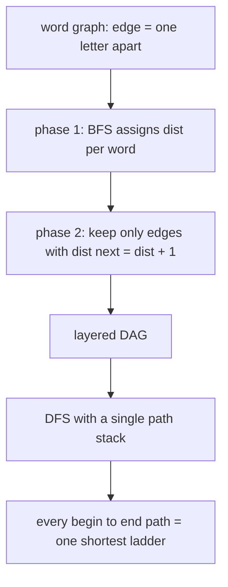
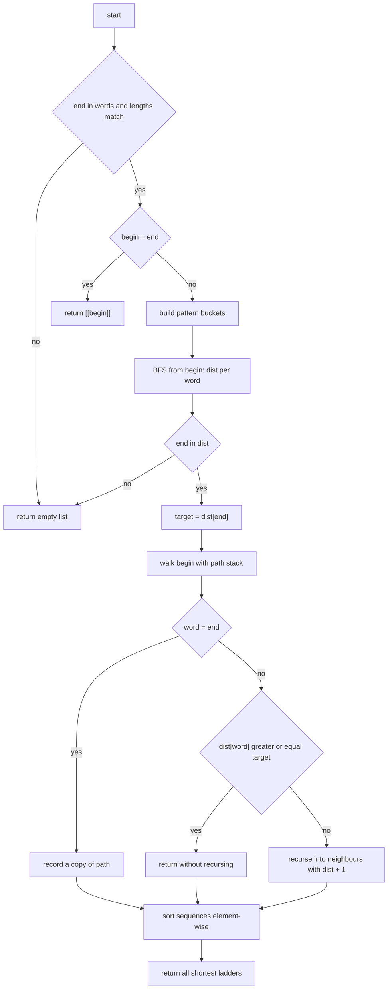
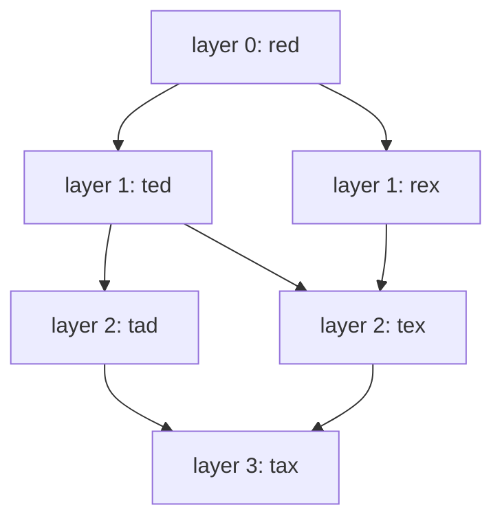
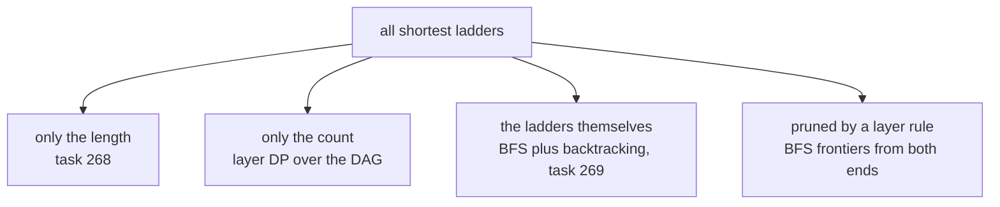

# 269 — Word ladder all shortest sequences (BFS + backtracking).

> **Tier:** Intermediate · **CTCI chapter:** Ch 4 — Trees and Graphs
> **Task spec:** [269-word-ladder-all-shortest-sequences-bfs-backtracking.md](../../../tasks/intermediate/269-word-ladder-all-shortest-sequences-bfs-backtracking.md)
> **Solutions:** [Python](../../../solutions/python/intermediate/269-word-ladder-all-shortest-sequences-bfs-backtracking/solution.py) ·
> [Java](../../../solutions/java/intermediate/269-word-ladder-all-shortest-sequences-bfs-backtracking/Solution.java) ·
> [JavaScript](../../../solutions/javascript/intermediate/269-word-ladder-all-shortest-sequences-bfs-backtracking/solution.js) ·
> [C#](../../../solutions/csharp/intermediate/269-word-ladder-all-shortest-sequences-bfs-backtracking/Solution.cs)

## 1. Problem restatement

**Input:** `begin`, `end` and a `word_list`. Each step changes exactly one letter of the current
word; every word after the first step must come from `word_list`.

**Output:** **every** shortest transformation sequence, each as the full list of words from `begin`
to `end` inclusive. The sequences are *sorted element-wise lexicographically*, so the output does not
depend on hash iteration order — that is a documented guarantee, not an accident.

| Call | Result |
| --- | --- |
| `find_ladders("hit", "cog", ["hot","dot","dog","lot","log","cog"])` | `[[hit,hot,dot,dog,cog], [hit,hot,lot,log,cog]]` |
| `find_ladders("red", "tax", ["ted","tex","red","tax","tad","den","rex","pee"])` | three sequences (below) |
| `find_ladders("ab", "ba", ["bb","aa","ba"])` | `[[ab,aa,ba], [ab,bb,ba]]` |
| `find_ladders("lost", "cost", ["most","fost","cost","cast"])` | `[[lost,cost]]` |
| `find_ladders("a", "c", ["a","b","c"])` | `[[a,c]]` |
| `find_ladders("hot", "hot", ["hot"])` | `[[hot]]` |
| `find_ladders("hit", "cog", ["hot","dot","dog","lot","log"])` | `[]` (end unreachable / not in list) |
| `find_ladders("hot", "hot", ["dog"])` | `[]` ("end not in list wins") |
| `find_ladders("ab", "abc", ["abc"])` | `[]` (length mismatch) |

The `red → tax` case is the one that shows why the problem is subtler than counting: the answer is

```text
[[red, rex, tex, tax],
 [red, ted, tad, tax],
 [red, ted, tex, tax]]
```

— three distinct ladders, all of length four, and two of them pass through `ted`. Note the distance
convention the files use: `dist[begin] = 0` counts **edges**, so a ladder reporting `k` words has
`dist[end] = k - 1`. Task [268](../../../tasks/intermediate/268-word-ladder-shortest-transformation-bfs.md)
returns that `k` directly.

## 2. Intuition

Returning one shortest path is a plain BFS ([268](../../../tasks/intermediate/268-word-ladder-shortest-transformation-bfs.md)).
Returning *all* of them is not: a BFS pops a node once and moves on, so the moment a word is reached
it stops mattering *how* it was reached, and the alternative routes are lost. The naive answer is to
enumerate simple paths and keep the shortest — that is exactly the `find_ladders_brute` oracle, and
on a dense word graph it is exponential in the number of words.

The insight is to separate two questions that the brute force answers simultaneously:

1. **how far** is each word from `begin`? — one BFS computes `dist[v]` for every reachable `v`, and
   crucially, `dist[v]` is the *minimum* distance.
2. **which edges can lie on a shortest path?** — only those with `dist[v] = dist[u] + 1`.

Keeping just those edges turns the word graph into a **layered DAG**: every edge moves from layer
`d` to layer `d + 1`. All shortest ladders are exactly the paths of that DAG from `begin` to `end`,
and each of them can be collected by a depth-first walk with a backtracking stack. The layering also
does two jobs for free: it prunes every non-shortest continuation, and it makes the DFS
**self-avoiding** — distance strictly increases along an edge, so a word can never reappear inside one
path, and no separate `visited` set is needed for the recursion.



The wildcard bucket index is the same trick as in task 268: a word's neighbours are found by looking
up its `L` patterns (`h*t`, `ho*`, `*ot`) in a map built once from the word list, so no pair of words
is ever compared.

## 3. Algorithm

1. `words ← set(word_list)`. If `end` is absent, or the lengths differ, return `[]`.
2. If `begin = end`, return `[[begin]]`.
3. Build the wildcard bucket index for the list words of the right length.
4. **BFS:** set `dist[begin] = 0`, queue `begin`. Pop a word, generate its patterns, and for every
   neighbour not yet in `dist`, set `dist[neighbour] = dist[word] + 1` and enqueue it. (First
   discovery wins, which is what makes these minimum distances.)
5. If `end` has no distance, return `[]`. Otherwise `target ← dist[end]`.
6. **Backtracking DFS** from `begin` with `path = [begin]`:
   - if the word is `end`, copy `path` into the result and return;
   - if `dist[word] ≥ target`, return (nothing below can still reach `end` in time);
   - otherwise, for every neighbour with `dist[neighbour] = dist[word] + 1`, push it, recurse, pop it.
7. Sort the collected sequences element-wise lexicographically and return them.

```text
function find_ladders(begin, end, word_list)
    words ← set of word_list
    if end is not in words or length(begin) ≠ length(end) then return []
    if begin = end then return [[begin]]
    length ← length(begin)
    buckets ← map from pattern to list of words, built from words
    dist ← map with dist[begin] = 0
    queue ← [begin]
    while queue is not empty do                       # phase 1: minimum distances
        word ← remove first element of queue
        for i ← 0 to length - 1 do
            pattern ← word with position i replaced by "*"
            for each neighbour in buckets[pattern] do
                if neighbour is not in dist then
                    dist[neighbour] ← dist[word] + 1
                    append neighbour to queue
                end
            end
        end
    end
    if end is not in dist then return []
    target ← dist[end]
    result ← []
    path ← [begin]
    walk(begin)                                       # phase 2: backtracking
    sort result element-wise lexicographically
    return result
end

procedure walk(word)
    if word = end then
        append a copy of path to result
        return
    end
    if dist[word] ≥ target then return
    for i ← 0 to length - 1 do
        pattern ← word with position i replaced by "*"
        for each neighbour in buckets[pattern] do
            if dist[neighbour] = dist[word] + 1 then
                append neighbour to path
                walk(neighbour)
                remove last element of path            # backtrack
            end
        end
    end
end
```

The two phases have different jobs and different costs. Phase 1 is `O(N*L)` and answers "how far".
Phase 2 is proportional to the number of shortest ladders (times their length) and answers "which
ones" — it is output-sensitive, so it can be large, but it never explores an edge that cannot be part
of a shortest ladder.



## 4. Worked example

Trace `find_ladders("red", "tax", ["ted","tex","red","tax","tad","den","rex","pee"])`.

**Phase 1 — BFS distances.** From `red` the patterns `*ed` and `re*` reach `ted` and `rex` at
distance 1; from `ted` the patterns `t*d` and `te*` reach `tad` and `tex` at distance 2; from `tad`
and `tex` the pattern `t*x`/`ta*` reaches `tax` at distance 3. `den` and `pee` are never reached
(they share no pattern with anything on the frontier), so they simply never enter `dist`.

| Layer | Words | Reached via |
| --- | --- | --- |
| 0 | `red` | the begin word, `dist = 0` |
| 1 | `ted`, `rex` | `*ed`, `re*` |
| 2 | `tad`, `tex` | `t*d` and `te*` from `ted`; `*ex` from `rex` |
| 3 | `tax` | `ta*` from `tad`, `t*x` from `tex` |

**Phase 2 — DFS along edges with `dist[next] = dist[now] + 1`.** `target = 3`.

| Step | Path stack | Word | Layer | Action |
| --- | --- | --- | --- | --- |
| 1 | `[red]` | `red` | 0 | neighbours at layer 1: `ted`, `rex` |
| 2 | `[red, ted]` | `ted` | 1 | neighbours at layer 2: `tad`, `tex` |
| 3 | `[red, ted, tad]` | `tad` | 2 | neighbour at layer 3: `tax` |
| 4 | `[red, ted, tad, tax]` | `tax` | 3 | equals `end` → record, pop back to `tad` |
| 5 | `[red, ted, tex]` | `tex` | 2 | neighbour at layer 3: `tax` |
| 6 | `[red, ted, tex, tax]` | `tax` | 3 | record, pop back to `ted`, then to `red` |
| 7 | `[red, rex]` | `rex` | 1 | neighbour at layer 2: `tex` |
| 8 | `[red, rex, tex]` | `tex` | 2 | neighbour at layer 3: `tax` |
| 9 | `[red, rex, tex, tax]` | `tax` | 3 | record, unwind the whole stack |

Three sequences collected. The `dist[word] >= target` guard never fires here because every word on a
layer below `target` has a next layer to go to; it matters on graphs where a shortest-path edge leads
into a dead end, where it stops the DFS from wandering into words that can no longer reach `end` on
time. After the element-wise sort the result is the asserted

```text
[[red, rex, tex, tax], [red, ted, tad, tax], [red, ted, tex, tax]]
```



Read the diagram as the layered DAG: every path from `red` to `tax` in it is one answer, and the
three paths are exactly the three recorded sequences. Note that `tex` has two parents and `tax` two —
words may be shared, but layers are never skipped, which is what keeps every recorded path shortest.

## 5. Complexity

Let `N` be the number of list words, `L` the word length, and `K` the number of shortest ladders with
`d = dist[end]` the number of edges in each of them.

| Measure | Bound | Why it holds |
| --- | --- | --- |
| Time, index build | `O(N*L)` | one pattern per (word, position) pair |
| Time, BFS | `O(N*L)` | every word is dequeued once and generates `L` patterns |
| Time, DFS | `O(K * d * L)` | each step of each recorded ladder does `L` pattern lookups plus bucket scans |
| Time, total | `O(N*L + K*d*L)` | the phases add; the DFS term is output-sensitive |
| Space, index plus `dist` | `O(N*L)` | the buckets dominate |
| Space, recursion | `O(d)` | the path stack is one ladder long, and the DFS depth equals `d` |
| Time, naive oracle | exponential in `N` | it enumerates all simple paths before filtering by length |
| Space, output | `O(K*d)` | every ladder is materialised as a list of words |

The DFS depth is bounded by `d` even on huge graphs, because `dist` increases by one per recursion
level — that is the same property that removes the need for a `visited` set.

## 6. Pitfalls and edge cases

- **`end` not in `word_list`.** `[]`, checked before the `begin = end` shortcut; the asserted pair
  `find_ladders("hot","hot",["hot"]) == [[hot]]` versus `find_ladders("hot","hot",["dog"]) == []`
  pins the precedence down.
- **`begin = end`.** Returns `[[begin]]` — a single-word sequence, not `[]` and not a self-loop.
- **Length mismatch.** `[]`, in both directions; the bucket index also skips list words of the wrong
  length, so the index only describes one layer size.
- **Unreachable `end`.** `[]` after the BFS, because `end` never entered `dist`. `den` and `pee` in
  the worked example illustrate words that are in the list but have no `dist` at all; the DFS can
  never step on them.
- **Duplicate shortest ladders.** The layering rule makes them impossible: `dist` strictly increases
  along `path`, so one route cannot reach the same word at two different layers, and each edge is
  visited at most once per recorded route. The asserted `hit → cog` result has exactly two
  sequences, one through `dog` and one through `log`.
- **Determinism.** Hash iteration order differs between languages and runs, so the collected list is
  sorted **element-wise** (`result.sort()` in Python, a `comparePaths` comparator in JavaScript,
  `sortPaths` in Java and `SortPaths` in C#). Comparing only lengths, or sorting joined strings,
  would not reproduce the asserted order.
- **Cutting the DFS too early.** The guard is `dist[word] >= target`; using `> target` lets the DFS
  step past the target layer and find longer routes, and using `>= target` on the *neighbour* before
  pushing (`dist[next] >= target` without the equality test on `end`) drops valid ladders. The
  solution tests equality with `dist[word] + 1`, which is what the layering argument requires.
- **`begin` is not in the bucket index.** Buckets are built from the list only, so `begin` is never
  its own neighbour; its neighbours come from its own patterns, and because `dist[begin] = 0` is
  preset, the BFS cannot re-enqueue it either.
- **The oracle is not used in production.** `find_ladders_brute` enumerates simple paths, bounds their
  length by `len(words) + 1` and keeps the shortest; it exists only so the 200 random comparisons
  have an independent implementation to disagree with.
- **Sorting in Python.** `result.sort()` on a list of lists compares element-wise and then by length —
  the same order the other three languages implement by hand.

## 7. Variants and follow-ups

- **Just the length.** [268-word-ladder-shortest-transformation-bfs.md](../../../tasks/intermediate/268-word-ladder-shortest-transformation-bfs.md)
  is the same BFS without phase 2, plus the `steps + 1` word-count convention; `dist[end] + 1` here
  equals its answer.
- **Count without listing.** If only `K` is wanted, a forward pass over the layered DAG accumulates
  `ways[v] = sum of ways[u]` over layer edges — the counting DP of
  [266](../../../tasks/intermediate/266-unique-paths-in-grid-with-obstacles-dp.md) in disguise —
  and avoids materialising every ladder.
- **One ladder of each shape.** Interchangeable words inside a layer can be swapped freely; keeping
  only one route per layer pattern is the classic follow-up question.
- **Bidirectional BFS.** Using frontier intersection to find `target`, then layering forwards only
  along the levels that actually meet, cuts the BFS phase on dense graphs.



## 8. Check yourself

1. Why does the layered DFS not need a `visited` set?

<details><summary>Show answer</summary>

Because `dist` strictly increases by one along every edge the DFS is willing to follow, so a word seen
earlier in the current path has a strictly smaller distance and cannot be reached again from a deeper
position. The layer order alone forbids cycles inside a path, which is what a `visited` set would
otherwise have to enforce.

</details>

2. In the `red → tax` trace, how many times is `tax` recorded, and why are there not more?

<details><summary>Show answer</summary>

Three times, once per incoming layer-3 edge that lies on a layer-respecting route: `tad` contributes
one ladder through `red, ted, tad`, and `tex` contributes two, one through `ted` and one through
`rex`. The DAG has exactly three distinct `begin`-to-`end` paths, so it cannot produce more.

</details>

3. What would change if the DFS followed every neighbour instead of only `dist[next] = dist[now] + 1`?

<details><summary>Show answer</summary>

It would find longer ladders as well as shortest ones, and it would need a `visited` guard to avoid
walking in circles between two words that are one letter apart. Filtering by length afterwards would
work but would cost exponentially more time — that is precisely `find_ladders_brute`.

</details>

4. Why is the result sorted element-wise rather than by length?

<details><summary>Show answer</summary>

Every recorded sequence already has the same length, so sorting by length is a no-op and leaves the
order dependent on hash iteration order — different runs and different languages would return the
ladders in different orders. Element-wise comparison against the asserted lists is what makes the
output reproducible, and Java, JavaScript and C# all implement the same comparator.

</details>

5. The BFS stores `dist[begin] = 0`, but the returned ladders have four words in the `red → tax`
case. Where does the missing `+1` come from?

<details><summary>Show answer</summary>

`dist` counts edges, so `target = 3` for `red → tax`; the ladder has `target + 1 = 4` words because it
contains both endpoints. Task 268 counts words directly, so `dist[end] + 1` there equals its
returned length — the two conventions differ by exactly this one.

</details>
