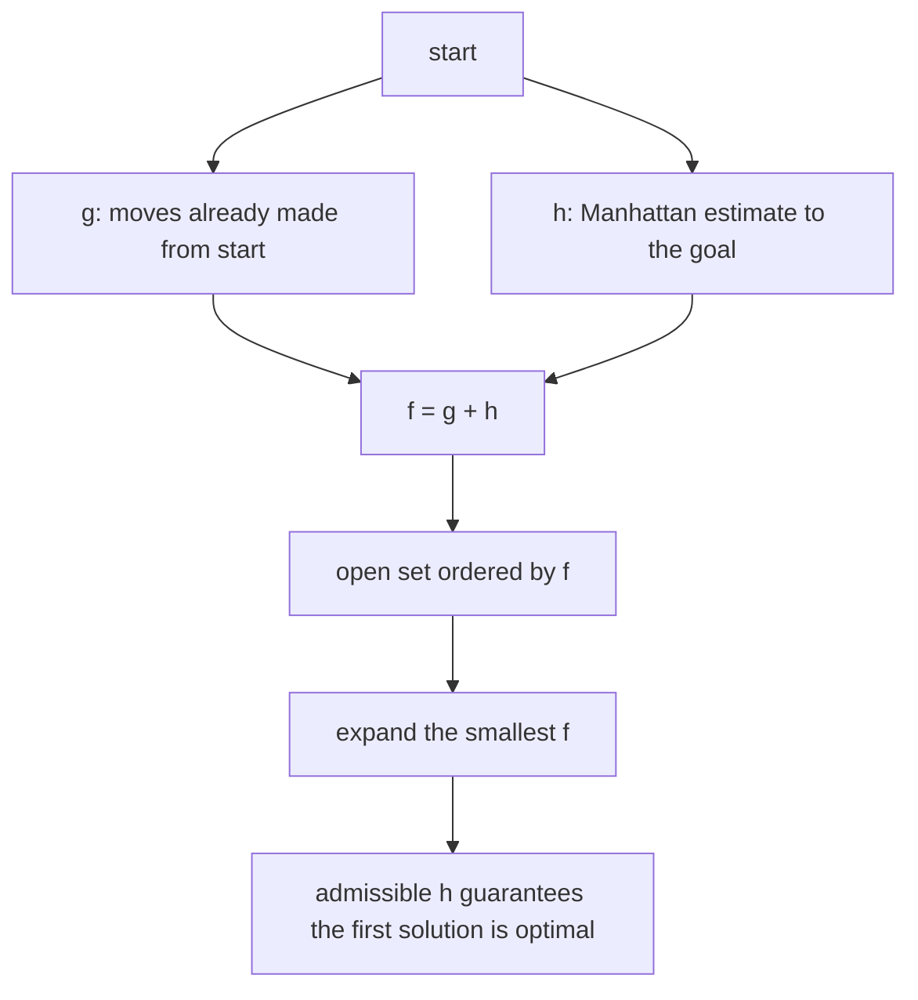
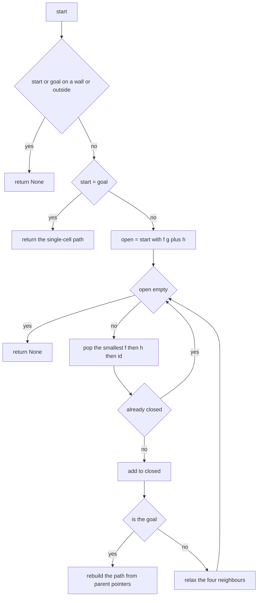
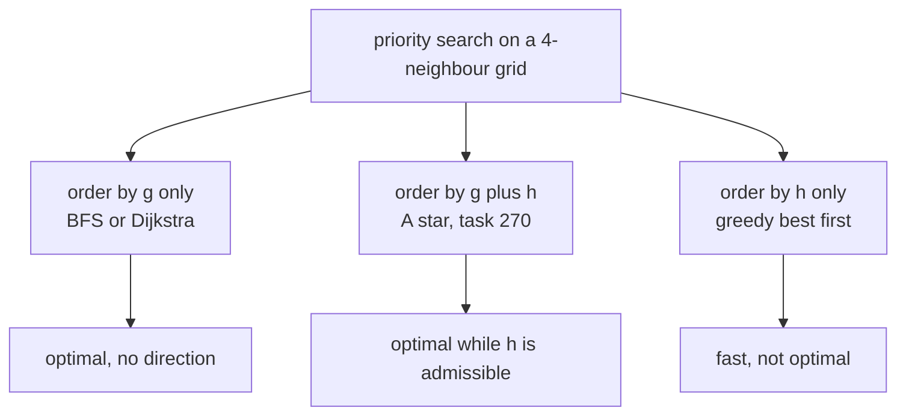

# 270 — Implement A* algorithm for grid pathfinding.

> **Tier:** Intermediate · **CTCI chapter:** Ch 4 — Trees and Graphs
> **Task spec:** [270-implement-a-algorithm-for-grid-pathfinding.md](../../../tasks/intermediate/270-implement-a-algorithm-for-grid-pathfinding.md)
> **Solutions:** [Python](../../../solutions/python/intermediate/270-implement-a-algorithm-for-grid-pathfinding/solution.py) ·
> [Java](../../../solutions/java/intermediate/270-implement-a-algorithm-for-grid-pathfinding/Solution.java) ·
> [JavaScript](../../../solutions/javascript/intermediate/270-implement-a-algorithm-for-grid-pathfinding/solution.js) ·
> [C#](../../../solutions/csharp/intermediate/270-implement-a-algorithm-for-grid-pathfinding/Solution.cs)

## 1. Problem restatement

**Input:** a grid where `0` is walkable and `1` is a **wall**, plus a `start` and a `goal` cell given
as `(row, col)` pairs. Moves are the four axis neighbours (up, down, left, right), each costing `1`.

**Output:** the **minimum-move path including both endpoints** as a list of cells, or `None` when no
path exists — which includes the cases where `start` or `goal` lies on a wall. `astar_cost` returns
the number of moves, `len(path) - 1`.

| Call | Result | Why |
| --- | --- | --- |
| `astar_cost(serpentine, (0,0), (4,4))` | `8` | down the left edge, then along the bottom |
| `astar_cost(detour, (0,0), (2,0))` | `8` | around the wall row; Manhattan is only `2` |
| `astar_cost(detour, (2,0), (0,0))` | `8` | the same route backwards |
| `astar_cost(open_grid, (0,0), (3,5))` | `8` | on an open grid the answer *is* the Manhattan distance |
| `astar_cost(blocked, (0,0), (0,2))` | `None` | unreachable; `bfs_cost` returns `-1` for the same query |
| `astar(serpentine, (2,2), (2,2))` | `[(2,2)]` | start equals goal: a one-cell path, cost `0` |
| `astar(serpentine, (1,1), (0,0))` | `None` | start on a wall |
| `astar(serpentine, (0,0), (1,1))` | `None` | goal on a wall |

Two fixtures carry the weight of the tests: `serpentine`, a 5x5 grid with two full wall rows except
for their end cells, and `detour`, a 3x4 grid whose middle row is `1 1 1 0` — the shortest route
around it is eight moves while the heuristic estimates two.

## 2. Intuition

Plain breadth-first search already solves this: unit move costs mean the first time BFS reaches the
goal it has found a shortest path. What BFS lacks is *direction* — it expands a ring in every
direction, including away from the goal. Dijkstra fixes the "weighted" case but still expands by
distance travelled, blind to where the goal is.

A* orders the open set by an **estimate of the total path cost through a node**:

```text
f(cell) = g(cell) + h(cell)
```

where `g` is the cost already spent (the BFS distance from `start`) and `h` is a heuristic estimate
of what remains. The solution uses the **Manhattan distance** to the goal,
`|r - gr| + |c - gc|`. Two properties make it safe:

- **Admissible** — it never overestimates the true remaining cost, because one grid move changes the
  Manhattan distance by *at most* one, whatever the walls. That is exactly the condition under which
  A* returns an optimal path.
- **Consistent** — the drop in `h` across any edge, `h(u) - h(v) ≤ 1 = cost(u, v)`, is the triangle
  inequality form; with a consistent heuristic a node never needs re-expansion after it is closed.

The files assert both halves of the argument rather than trusting them: for every reachable cell the
test block checks `manhattan(cell, goal) <= dist[cell]` against exact BFS distances, and on an open
grid it checks equality — there the heuristic is exact and A* is answering a question it already
knows.



The second design decision is **determinism**. Many cells share the same `f`, so the order in which
the heap breaks ties decides which of several equally short paths comes back. All four solutions use
the same three-level key — `(f, h, row-major cell id r*cols + c)` — so with equal `f` the cell
*h closer to the goal* expands first, and remaining ties are settled by cell index. The returned path
is therefore fully determined by the input, not by the heap's internal order.

## 3. Algorithm

1. If `start` or `goal` is outside the grid or on a wall, return `None`.
2. If `start = goal`, return the single-cell path.
3. Push `start` with `g = 0`, `h = manhattan(start, goal)`, key `(f, h, id)`; set `g[start] = 0` and
   leave `parent` empty. Keep `closed` empty.
4. While the open set is not empty:
   - pop the entry with the smallest `(f, h, id)`;
   - if it is already in `closed`, skip it — this is **lazy deletion** of stale heap entries;
   - mark it closed; if it is the goal, walk `parent` back to `start` and return the reversed path;
   - for each of the four neighbours that is in bounds, walkable and not closed:
     compute `tentative = g[current] + 1`; if it improves the neighbour's `g`, record it, set the
     parent, and push `(tentative + h(neighbour), h(neighbour), id(neighbour))`.
5. If the open set drains, return `None`.

```text
function astar(grid, start, goal)
    if start or goal is out of bounds or on a wall then return None
    if start = goal then return [start]
    cols ← number of columns of grid
    open ← priority queue ordered by (f, h, row-major id)
    push start with g = 0 and h = manhattan(start, goal)
    g ← map with g[start] = 0
    parent ← empty map
    closed ← empty set
    while open is not empty do
        current ← pop the smallest entry of open
        if current is in closed then continue          # stale entry
        add current to closed
        if current = goal then return the path rebuilt from parent
        for each neighbour of current in the four directions do
            if neighbour is out of bounds or on a wall or in closed then continue
            tentative ← g[current] + 1
            if tentative < g.get(neighbour, infinity) then
                g[neighbour] ← tentative
                parent[neighbour] ← current
                push neighbour with f = tentative + manhattan(neighbour, goal)
            end
        end
    end
    return None
end
```

The `closed` set does double duty. It stops the search from stepping back onto an expanded cell, and
it lets the heap hold **duplicates**: a cell may be pushed several times before it is popped, and the
skip on line "if current is in closed" discards the older, more expensive copies. That keeps the
implementation simple — no decrease-key operation is needed — at the price of a slightly larger open
set. A grid has `O(V)` edges, so the number of successful relaxations, and hence the heap size, stays
`O(V)`.



## 4. Worked example

Trace `astar(detour, (0, 0), (2, 0))`, whose asserted cost is `8`.

```text
row 0:  0 0 0 0
row 1:  1 1 1 0
row 2:  0 0 0 0
```

`h(0,0) = 2`, so the estimate is optimistic by six moves; the optimal route is right along the top
row, down the right column and left along the bottom row.

| Pop | `g` | `h` | `f` | Neighbours relaxed (with their `f`) |
| --- | --- | --- | --- | --- |
| `(0,0)` | 0 | 2 | 2 | `(0,1)` → `f = 4` (`g=1`, `h=3`) |
| `(0,1)` | 1 | 3 | 4 | `(0,2)` → `f = 6` |
| `(0,2)` | 2 | 4 | 6 | `(0,3)` → `f = 8` |
| `(0,3)` | 3 | 5 | 8 | `(1,3)` → `f = 8` (`g=4`, `h=4`) |
| `(1,3)` | 4 | 4 | 8 | `(2,3)` → `f = 8` |
| `(2,3)` | 5 | 3 | 8 | `(2,2)` → `f = 8` |
| `(2,2)` | 6 | 2 | 8 | `(2,1)` → `f = 8` |
| `(2,1)` | 7 | 1 | 8 | `(2,0)` → `f = 8` |
| `(2,0)` | 8 | 0 | 8 | goal reached → rebuild |

Every entry on the route has `f = 8`: the one wasted move is always offset by the heuristic falling
by one, which is the consistency property in numbers. The relaxed cells that are *not* on the route
never exist here — with `g` rising by one and `h` falling by one, no detour can produce a smaller
`f`, so the open set stays a chain. The parent pointers then give

```text
[(0,0), (0,1), (0,2), (0,3), (1,3), (2,3), (2,2), (2,1), (2,0)]
```

nine cells, cost `8`, matching both `astar_cost` and the BFS oracle.


For contrast, on the open 4x6 grid `astar_cost(open_grid, (0,0), (3,5))` is exactly
`manhattan((0,0), (3,5)) = 8` — with no walls the heuristic is not an estimate at all, and the test
block asserts `manhattan(cell, goal) == dist[cell]` for every cell of that grid.

## 5. Complexity

Let `V = rows * cols` be the number of cells and `E = O(V)` the number of grid edges (at most four
per cell).

| Measure | Bound | Why it holds |
| --- | --- | --- |
| Time, worst case | `O(V log V)` | each cell is expanded once; each expansion may push up to four entries, and heap operations cost `log V` |
| Time, open grid | `O(V log V)` | the heuristic is exact, so no cell off a shortest route is ever closed, but the bound is unchanged |
| Space | `O(V)` | `g`, `parent`, `closed` and the open set are all indexed by cell |
| Time, BFS oracle | `O(V)` | one queue, no heap |
| Space, BFS oracle | `O(V)` | the distance table it computes for the assertions |
| Path length | `O(V)` | a shortest path never repeats a cell |
| Rebuild step | `O(dist)` | walking `parent` from goal to start |

A* is usually described as trading the guarantee of BFS for speed; with an admissible heuristic it
does not trade anything — the returned cost is asserted equal to the exact BFS cost on the four
fixture grids and on 300 random ones. What it is not is asymptotically better in the worst case:
when the walls force a long detour, as in `detour` where `h` starts at `2` and the true cost is `8`,
A* must still expand its way around.

## 6. Pitfalls and edge cases

- **Start or goal on a wall.** Both return `None` before any search — the `free` check includes
  `grid[r][c] == 0`, and the fixtures assert `astar(serpentine, (1,1), (0,0)) is None` and
  `astar(serpentine, (0,0), (1,1)) is None`. Note that the corresponding `bfs_cost` query returns
  `-1` rather than `None`; the cost helpers use different sentinels, and the tests normalise them
  (`got if got is not None else -1`).
- **Start equals goal.** Returns `[(2,2)]`, a one-cell path with cost `0`. Returning `None` here
  would break `valid_path`, which requires `path[0] == start` and `path[-1] == goal`.
- **Unreachable goal.** The open set drains and `None` comes back; `blocked` — a grid where
  `(0,0)` and `(1,0)` form a dead end — is the asserted case.
- **Admissibility is what buys optimality.** Replace Manhattan with a heuristic that can overestimate
  (for example `2 * manhattan`) and A* still terminates but may return a non-shortest path. The
  solution asserts `manhattan <= exact` on every reachable cell of three obstacle grids, which is the
  property that rules this out.
- **Consistency and re-expansion.** With `h(u) - h(v) <= 1` a closed node never needs reopening, so
  skipping closed neighbours is safe. With an inconsistent heuristic that skip can lose the optimal
  path.
- **Tie-breaking.** Equal `f` values are common (every cell of the open-grid example has `f = 8`).
  Ordering by `(f, h, id)` makes the output deterministic; ordering by `f` alone makes the returned
  route depend on heap internals.
- **Stale entries.** A cell can be pushed more than once before it is popped. Dropping the
  `if current in closed: continue` line means the goal is still found, but `parent` may be overwritten
  after the path was recorded, and the loop may expand cells several times.
- **Closed-set check on neighbours.** Checking it before relaxing is an optimisation; the `tentative
  < g` test does the real work, because a consistent heuristic never offers a better route to a
  closed node.
- **Path orientation.** `parent` points from a cell back to `start`; the path is rebuilt by walking
  up and prepending (`path.reverse()`, `addFirst`, `unshift`), so the returned list runs start → goal.
- **Ragged or empty grids.** `cols` is `grid[0].length if rows else 0`, and `free` bounds-checks both
  coordinates, so an empty grid simply finds nothing.
- **Random cross-check.** 300 random grids (2..6 cells per side, 30% walls) compare `astar_cost` with
  `bfs_cost` and validate the returned path with `valid_path`, which checks the endpoints, that every
  cell is walkable, and that consecutive cells differ by exactly one in Manhattan distance.

## 7. Variants and follow-ups

- **A* with `h = 0`.** The ordering key degenerates to `g`, which is Dijkstra's algorithm on unit
  weights — and on unit weights that is BFS with a heap. The oracle used here is the array-backed
  version without the heap.
- **Greedy best-first search.** Keep only `h`; the search rushes at the goal and can return a path
  that is far from optimal. Comparing it against A* on the `detour` grid shows the difference: greedy
  commits to the first move toward the goal.
- **Other heuristics.** Diagonal moves make Chebyshev distance admissible; weighted terrain makes
  `w * manhattan` a lower bound only when the cheapest move costs at least `w`.
- **Monotone movement.** If only right and down moves are allowed the problem is the DP of
  [265](../../../tasks/intermediate/265-count-number-of-ways-in-matrix-with-obstacles-dp.md),
  [266](../../../tasks/intermediate/266-unique-paths-in-grid-with-obstacles-dp.md) and
  [267](../../../tasks/intermediate/267-minimum-path-sum-in-grid-dp.md) — no search needed, because
  the cells already form a topological order.
- **Graph instead of grid.** The same open/closed loop works on any graph with a heuristic; the
  Manhattan estimate is what makes it a grid algorithm.



## 8. Check yourself

1. Why does the Manhattan heuristic keep A* optimal on a grid with walls?

<details><summary>Show answer</summary>

Because it never overestimates. Any route from a cell to the goal needs at least the Manhattan
distance in moves — each move changes exactly one coordinate by one — and walls can only make the
true distance larger than that bound. An admissible heuristic guarantees that whenever A* pops the
goal, no unexplored route can be cheaper.

</details>

2. In the worked example every popped cell has `f = 8`. What would a popped cell with `f = 9` mean?

<details><summary>Show answer</summary>

That the search has been forced onto a route with a wasted move: `g` grew by one more than `h` fell.
If the goal were still unpopped, popping an `f = 9` entry would prove that no route of cost `8`
exists. On this grid the goal is reached with `f = 8`, matching `bfs_cost == 8`.

</details>

3. Why is a `closed` set enough, with no decrease-key operation on the heap?

<details><summary>Show answer</summary>

Because the implementation tolerates duplicate entries and discards them lazily: a better `g` for a
cell pushes a new entry, and the older entry is skipped when it surfaces after the cell has been
closed. The heap may hold up to `O(V)` entries, but no key ever needs to be located and lowered.

</details>

4. What does `astar_cost` return when the goal is on a wall, and what does the BFS oracle return for
the same query?

<details><summary>Show answer</summary>

`astar_cost` returns `None`, because `astar` bails out before the loop; `bfs_distances_from` marks the
goal cell `-1`, so `bfs_cost` returns `-1`. The random cross-check normalises `None` to `-1` before
comparing, which is why the two conventions can coexist.

</details>

5. Would ordering the heap by `f` alone change the *cost* of the returned path?

<details><summary>Show answer</summary>

No. Optimality depends on `f` and on the heuristic being admissible, not on how ties are broken — any
tie-break still pops a minimum-`f` entry first. What it would change is *which* shortest path comes
back, and with it the determinism the tests rely on; that is why `h` and the row-major id are in the
key.

</details>
