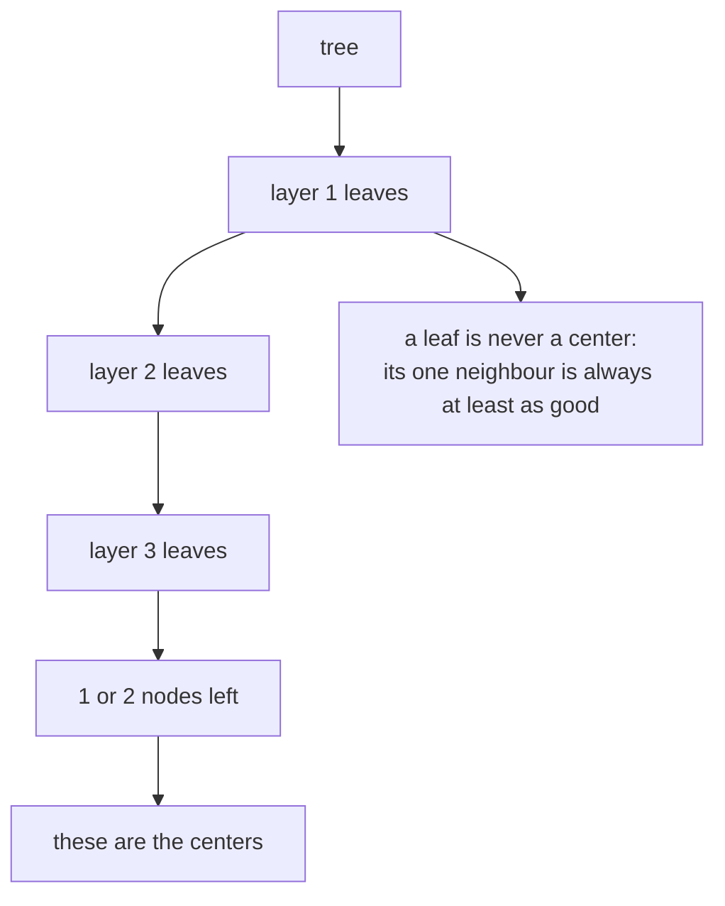
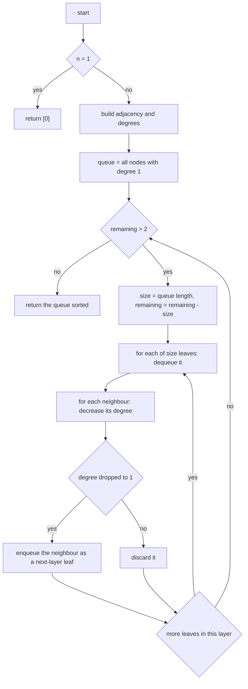
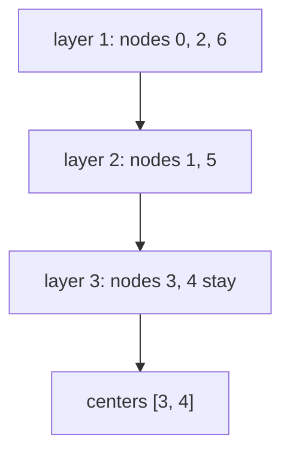
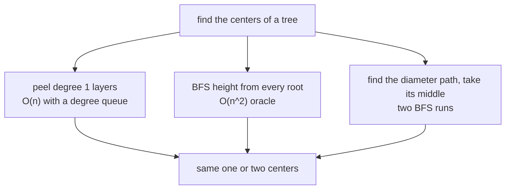

# 271 — Minimum height trees (find centers of undirected tree).

> **Tier:** Intermediate · **CTCI chapter:** Ch 4 — Trees and Graphs
> **Task spec:** [271-minimum-height-trees-find-centers-of-undirected-tree.md](../../../tasks/intermediate/271-minimum-height-trees-find-centers-of-undirected-tree.md)
> **Solutions:** [Python](../../../solutions/python/intermediate/271-minimum-height-trees-find-centers-of-undirected-tree/solution.py) ·
> [Java](../../../solutions/java/intermediate/271-minimum-height-trees-find-centers-of-undirected-tree/Solution.java) ·
> [JavaScript](../../../solutions/javascript/intermediate/271-minimum-height-trees-find-centers-of-undirected-tree/solution.js) ·
> [C#](../../../solutions/csharp/intermediate/271-minimum-height-trees-find-centers-of-undirected-tree/Solution.cs)

## 1. Problem restatement

**Input:** `n`, the number of nodes of an undirected tree labelled `0 .. n-1`, and `edges`, a list of
`n - 1` pairs. Rooting the tree at any node gives some height; a node whose rooted tree has the
smallest height is called a **center**.

**Output:** all centers, sorted ascending. There are always **one or two** of them — for a path of
even length the two middle nodes tie, otherwise the single middle node wins.

| Call | Result | Why |
| --- | --- | --- |
| `min_height_trees(6, [(0,1),(1,2),(2,3),(3,4),(4,5)])` | `[2, 3]` | a path of six nodes has two middle nodes |
| `min_height_trees(4, [(0,1),(0,2),(0,3)])` | `[0]` | a star's center is the hub |
| `min_height_trees(1, [])` | `[0]` | a single node is its own center |
| `min_height_trees(2, [(0,1)])` | `[0, 1]` | both nodes tie |
| `min_height_trees(7, [(0,1),(1,2),(1,3),(3,4),(4,5),(5,6)])` | `[3, 4]` | the asserted `best == 3` comes from the oracle |

The docstring states the whole idea in two lines: "Peel leaves layer by layer; the 1 or 2 nodes left
are the centers, i.e. the roots of the minimum-height trees. O(n) with a degree queue."

## 2. Intuition

The direct definition suggests the brute force that ships as `brute_force_centers` /
`BruteForceCenters`: root the tree at every node, run a BFS to measure its height, and keep the
argmin. That is correct — it is the oracle the 7-node fixture is checked against, with `best == 3`
asserted — but it costs `O(n)` per root, so `O(n^2)` overall.

The structural insight is that **a node of degree 1 cannot be a center** unless the tree has at most
two nodes. A leaf has exactly one neighbour, so rooting anywhere at the leaf gives a height of at
least `1 + height(neighbour)`, while rooting one step inward never does worse. Repeatedly applying
that argument peels the tree from the outside like an onion:

1. collect every current degree-1 node;
2. remove that whole layer at once, decrementing the degrees of their neighbours;
3. a neighbour whose degree drops to 1 becomes a leaf of the next layer.

When at most two nodes are left, no further peeling can improve anything — those nodes are exactly
the centers. Peeling whole layers at once is what makes the answer come out right: removing one node
at a time would let a stale layer decide the outcome, while removing a layer at a time means every
remaining node has the same eccentricity structure.



The height of the tree rooted at a center is also the tree's **radius**: `best == 3` for the 7-node
fixture, which the brute force computes independently by measuring BFS heights from every node. The
peeling never computes a height at all — it only needs degrees — which is why it runs in `O(n)` while
the oracle runs in `O(n^2)`.

## 3. Algorithm

1. If `n = 1`, return `[0]` — the single node is its own center and there are no edges to peel.
2. Build the adjacency lists and the `degree` array by walking the edge list once.
3. Put every node with `degree = 1` into a queue; remember `remaining = n`.
4. While `remaining > 2`:
   - let `size` be the current queue length and subtract it from `remaining` (the whole layer leaves
     at once);
   - for each of the `size` leaves: for each neighbour, decrement its degree and, if it just reached
     `1`, enqueue it.
5. Return the queue's contents, sorted ascending.

```text
function min_height_trees(n, edges)
    if n = 1 then return [0]
    adj ← empty adjacency lists for 0 .. n - 1
    degree ← zeroes for 0 .. n - 1
    for each pair (a, b) in edges do
        append b to adj[a]
        append a to adj[b]
        degree[a] ← degree[a] + 1
        degree[b] ← degree[b] + 1
    end
    leaves ← queue of every node with degree = 1
    remaining ← n
    while remaining > 2 do
        size ← number of nodes currently in leaves
        remaining ← remaining - size
        for i ← 1 to size do
            leaf ← remove first node of leaves
            for each neighbour in adj[leaf] do
                degree[neighbour] ← degree[neighbour] - 1
                if degree[neighbour] = 1 then
                    append neighbour to leaves
            end
        end
    end
    return leaves sorted ascending
end
```

Two statements deserve attention. `remaining -= size` uses the **queue length before the layer is
peeled**, so the loop condition reflects how many nodes are still unpeeled — Python, Java, C# and
JavaScript all snapshot the size first, which is why the queue can be mutated inside the loop
without disturbing the count. And `if degree[neighbour] = 1` fires only on the transition to `1`: a
node whose degree falls from 3 to 2 is not a leaf yet, and one whose degree falls from 2 to 1 joins
the *next* layer, never the current one.



## 4. Worked example

Trace `min_height_trees(7, [(0,1),(1,2),(1,3),(3,4),(4,5),(5,6)])`, the fixture whose centers
`[3, 4]` the brute force confirms.

The tree: node `1` connects to `0`, `2` and `3`; then a path `3 - 4 - 5 - 6`. Degrees are
`0:1, 1:3, 2:1, 3:2, 4:2, 5:2, 6:1`, so the first leaf layer is `{0, 2, 6}` and `remaining = 7`.

| Layer | `size` | `remaining` before | Leaves peeled | Degree changes | Queue afterwards |
| --- | --- | --- | --- | --- | --- |
| 1 | 3 | 7 | `0`, `2`, `6` | `1` 3→2→1, `5` 2→1 | `[1, 5]` |
| 2 | 2 | 4 | `1`, `5` | `3` 2→1, `4` 2→1 | `[3, 4]` |
| — | — | 2 | loop exits | — | `[3, 4]` |

Peeling `0` calls `degree[1] = 3 - 1 = 2`, which is not yet a leaf; peeling `2` takes it to `1` and
`node 1` joins the queue. The order inside the layer does not matter, only that the whole layer is
removed before the next one is formed. After two layers, `remaining` is `2`, the condition
`remaining > 2` fails, and the two survivors `3` and `4` are returned sorted.



The oracle agrees. Rooting at `3` gives distances `1` from `3` to `1` and `4`, `2` to `0`, `2` and
`5`, `3` to `6` — a height of `3`, the asserted `best`. Rooting at `4` gives the mirror image, also
`3`. Every other root is worse: node `1` reaches `6` in four steps for a height of `4`, and nodes
`0`, `2`, `5` and `6` reach the far end of the tree in five steps. So `3` and `4` are the only
minimizers, and the assertion `len(min_height_trees(7, sample)) <= 2` records the general fact that a
tree has at most two centers.

## 5. Complexity

Let `n` be the number of nodes and `m = n - 1` the number of edges of the tree.

| Measure | Bound | Why it holds |
| --- | --- | --- |
| Time, build | `O(n)` | one pass over the edge list, appending both directions |
| Time, peeling | `O(n)` | each node is enqueued at most once and its adjacency scanned exactly once |
| Time, total | `O(n)` | the two phases add |
| Space | `O(n)` | adjacency lists (2(n-1) entries), the degree array and the queue |
| Time, brute-force oracle | `O(n^2)` | a BFS from each of the `n` roots, each costing `O(n)` |
| Space, brute-force oracle | `O(n)` per root plus the height array |
| Output size | `1` or `2` | a tree always has one or two centers |

The peeling is linear because each edge is traversed once — from the leaf end, when that leaf is
removed — and each node's degree is decremented exactly once per incident edge. That is the whole
reason the task is interesting: the definition is quadratic, the structure is linear.

## 6. Pitfalls and edge cases

- **A single node.** `n = 1` with an empty edge list returns `[0]` and must not enter the peel loop;
  with `n = 1` there are no degree-1 nodes and `remaining > 2` is false anyway, but the explicit
  branch is what the Python, Java, JavaScript and C# files all use.
- **Two nodes.** `n = 2` returns `[0, 1]`; both have degree `1`, `remaining = 2`, so the loop is
  skipped and both leaves are the answer.
- **Layer-at-a-time removal.** `remaining -= size` must use the size of the layer, not the size of
  the queue after new leaves were pushed. Counting the new leaves in the same layer makes the loop
  exit one layer too late and returns the wrong nodes.
- **Transition to degree 1, not "degree is odd".** The test is `--degree[neighbour] == 1`. A node
  whose degree falls from 3 to 2 keeps working and is peeled in a later layer; with `<= 1` and a
  multi-edge input it could be enqueued twice.
- **Star shape.** `min_height_trees(4, [(0,1),(0,2),(0,3)])` returns `[0]`: the hub's degree falls
  `3 → 2 → 1` while its leaves are peeled, and it becomes the only remaining node. This is the case
  that proves the loop must stop at `remaining <= 2`, not at `remaining == 1`.
- **A path.** An even-length path returns two centers (`[2, 3]` for six nodes) and an odd-length path
  returns one; the two middle nodes tie exactly.
- **Sorted output.** The queue's order depends on insertion, so the result is sorted before being
  returned (`sorted`, `Collections.sort`, `sort((a, b) => a - b)`, `outList.Sort()`), which is what
  makes `[2, 3]` and `[3, 4]` reproducible.
- **Adjacency is undirected.** Both `adj[a].push(b)` and `adj[b].push(a)` are required, along with
  both degree increments; a directed build would peel nothing.
- **Input is a tree, not a general graph.** The peeling argument relies on connectivity and on
  `m = n - 1`; on a graph with cycles the "center" notion is different and the remaining nodes after
  peeling are not the answer.
- **The oracle's bookkeeping.** `brute_force_centers` returns a tuple `(centers, best)` in Python and
  JavaScript and a `(Centers, Best)` pair in C#; the Java oracle packs `best` into the last slot of
  the returned `int[]`. Each file adapts that to its own assertion style, so the tests compare centers
  only after stripping the extra value.
- **Where `best == 3` comes from.** The number is computed by the oracle (BFS level count), not by the
  peeling; the tests assert that the peeling result equals the oracle's center list, which is the
  cross-check that matters.

## 7. Variants and follow-ups

- **Radius and diameter.** The height at a center is the tree's radius, and for a tree the diameter is
  `2 * radius` (odd-length paths give `2 * radius - 1`). The classic follow-up is to find the diameter
  by two BFS runs and take the middle of that path — an alternative route to the same two centers.
- **Height at every node.** The oracle's table of BFS heights is the definition; it is `O(n^2)` and
  needs no structural insight, which is why it is kept in the files as the reference.
- **Peeling general graphs.** The same degree-queue technique computes a graph's 2-core; the peeling
  stops at `remaining <= 2` only for trees.
- **Related traversals in this chapter.** [274-check-if-graph-is-bipartite-bfs-coloring.md](../../../tasks/intermediate/274-check-if-graph-is-bipartite-bfs-coloring.md)
  and [280-count-connected-components-in-directed-graph-strongly-connected.md](../../../tasks/intermediate/280-count-connected-components-in-directed-graph-strongly-connected.md)
  also process a graph layer by layer, but they carry colours or finishing times instead of degrees.



## 8. Check yourself

1. Why can a node of degree 1 never be a center of a tree with more than two nodes?

<details><summary>Show answer</summary>

Its only neighbour is at distance 1, and the rest of the tree hangs off that neighbour; rooting at
the neighbour removes that step from every path, so its height is strictly smaller than the leaf's.
If the leaf's neighbour were itself degree 1, the tree has exactly two nodes, which is the only case
where both endpoints tie.

</details>

2. In the 7-node trace, why is node `1` not in the first leaf layer even though it loses a neighbour
there?

<details><summary>Show answer</summary>

Because its degree falls `3 → 2` when `0` is peeled, and a leaf is a node of degree exactly `1`. Only
when `2` is also peeled does the degree reach `1`, and the enqueue happens at that transition — so
node `1` belongs to layer 2.

</details>

3. What happens if `remaining -= size` is replaced by `remaining -= 1` per peeled leaf?

<details><summary>Show answer</summary>

Layer bookkeeping drifts. Removing two leaves in a layer would subtract two from `remaining` but the
loop would be entered with the wrong remaining count; the loop can stop one layer too late and return
nodes that are not centers, or one leaf short of the two-node answer. The subtraction has to happen
once per layer, using the layer's size.

</details>

4. The star test asserts `[0]`. Walk the loop: when does the hub become a leaf?

<details><summary>Show answer</summary>

The star has leaves `1, 2, 3` and hub `0` with degree 3, `remaining = 4`. Peeling the layer sets
`remaining = 1` and decrements the hub three times: `3 → 2` (no), `2 → 1` (enqueue `0`), `1 → 0`. The
loop then exits because `remaining` is `1`, which is at most two, and the queue holds the hub alone.

</details>

5. The peeling never computes a height, yet it proves which roots are minimal. What is the invariant?

<details><summary>Show answer</summary>

Every peeled layer holds nodes that are strictly farther from the "middle" than the nodes of the next
layer — each node of layer `k + 1` is at least as central as the neighbours it is attached to. After
removing all layers but the last one or two, the survivors are those with minimal eccentricity. The
degree queue is just an efficient way of maintaining that invariant one layer at a time.

</details>
