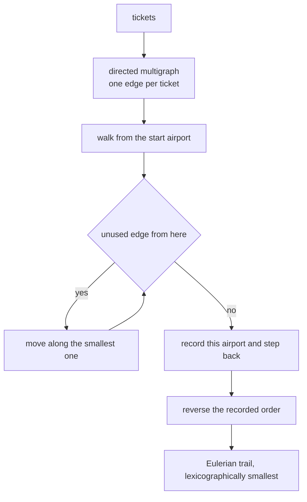
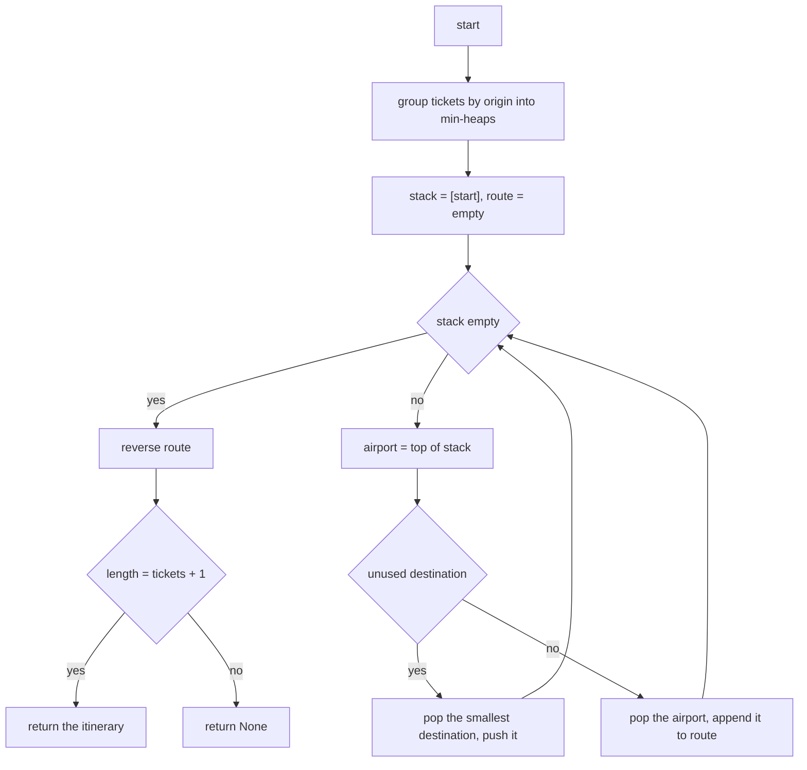
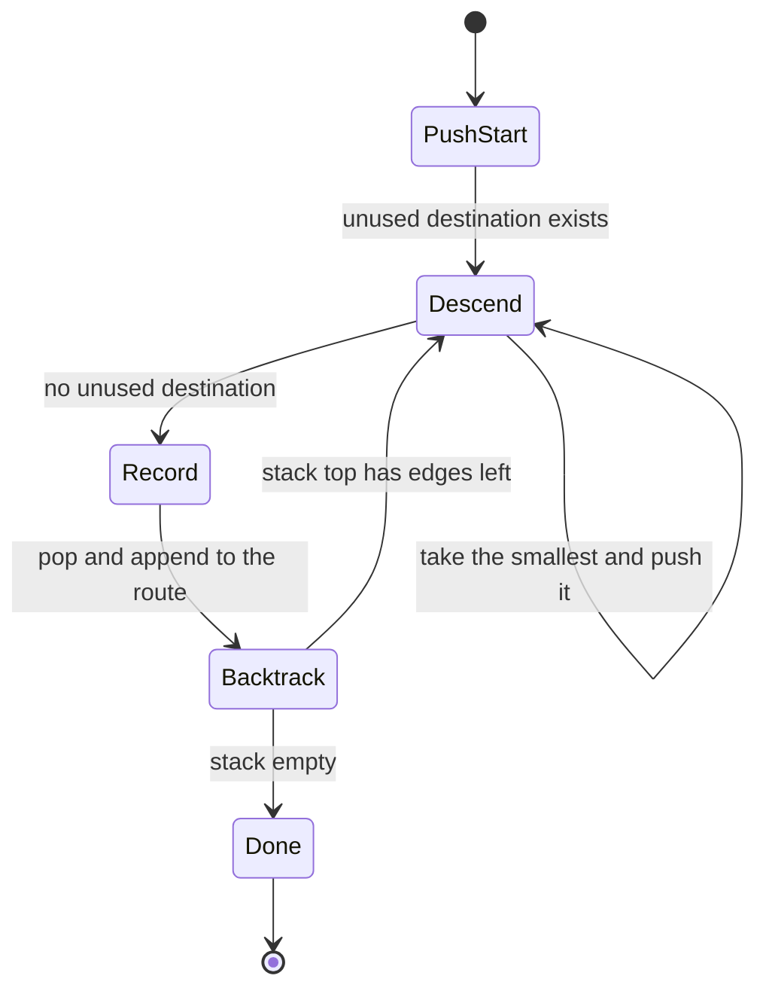
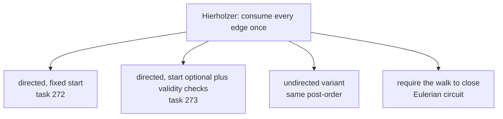

# 272 — Reconstruct itinerary problem (Eulerian path / Hierholzer).

> **Tier:** Intermediate · **CTCI chapter:** Ch 4 — Trees and Graphs
> **Task spec:** [272-reconstruct-itinerary-problem-eulerian-path-hierholzer.md](../../../tasks/intermediate/272-reconstruct-itinerary-problem-eulerian-path-hierholzer.md)
> **Solutions:** [Python](../../../solutions/python/intermediate/272-reconstruct-itinerary-problem-eulerian-path-hierholzer/solution.py) ·
> [Java](../../../solutions/java/intermediate/272-reconstruct-itinerary-problem-eulerian-path-hierholzer/Solution.java) ·
> [JavaScript](../../../solutions/javascript/intermediate/272-reconstruct-itinerary-problem-eulerian-path-hierholzer/solution.js) ·
> [C#](../../../solutions/csharp/intermediate/272-reconstruct-itinerary-problem-eulerian-path-hierholzer/Solution.cs)

## 1. Problem restatement

**Input:** `tickets`, a list of `[origin, destination]` airport pairs, and a `start` airport that
defaults to `"JFK"`. Each ticket must be used **exactly once**; the itinerary is the sequence of
airports visited, beginning at `start`.

**Output:** the airport sequence — one longer than the ticket list — or `None` when the tickets
cannot all be used. Among the valid sequences, the **lexicographically smallest** one is required.

| Tickets | Result |
| --- | --- |
| `[(MUC,LHR), (JFK,MUC), (SFO,SJC), (LHR,SFO)]` | `[JFK, MUC, LHR, SFO, SJC]` |
| `[(JFK,SFO), (JFK,ATL), (SFO,ATL), (ATL,JFK), (ATL,SFO)]` | `[JFK, ATL, JFK, SFO, ATL, SFO]` |
| `[(A,B)]` with `start="A"` | `[A, B]` |
| `[]` with `start="JFK"` | `[JFK]` |
| `[(A,B), (C,D)]` with `start="A"` | `None` — the graph is disconnected |
| `[(A,B)]` with `start="C"` | `None` — nothing leaves the start |
| `[(JFK,B), (JFK,A), (A,JFK)]` | `[JFK, A, JFK, B]` — smallest destination first |

Using every ticket exactly once is the definition of an **Eulerian path** of the directed multigraph
whose vertices are airports and whose edges are tickets. As the docstring puts it: "Tickets are
edges; the puzzle asks for the Eulerian path that is lexicographically smallest."

## 2. Intuition

A brute force would backtrack over ticket permutations — factorial, and it would still need a
tie-break rule to pick the smallest result. The graph view collapses the search: the answer exists
iff the graph has a walk that traverses every edge once, and Euler's degree conditions decide that in
one pass over the edge list.

The classic failure of a purely greedy walk is the reason Hierholzer's algorithm exists. Take

```text
JFK -> SFO, JFK -> ATL, SFO -> ATL, ATL -> JFK, ATL -> SFO
```

A greedy walk from `JFK` that always takes the alphabetically smallest destination goes
`JFK → ATL → JFK → SFO → ATL` and is then stuck: all tickets are used except `ATL → SFO`, but the
walk already left `ATL`. The fix is not to avoid such dead ends but to record them *last*:
Hierholzer's walk only appends a vertex to the answer when it has no unused outgoing edge left, and
the recorded order is then reversed.



The walk is a depth-first traversal that consumes edges, and the "record on the way out" step is a
**post-order** visit. Reversing it turns the deepest dead end into the last airport of the answer and
the start into the first — which is exactly the itinerary, and exactly the order the assertions
expect.

Two more pieces make it robust. Each airport keeps its unused destinations in a **min-heap**, so the
"smallest unused destination first" rule costs `O(log d)` instead of a scan. And the length check at
the end (`len(route) == len(tickets) + 1`) is the connectivity test: if some tickets sat in a
component the walk never entered — or the start had no outgoing ticket at all — the walk covers
fewer edges and the function returns `None` rather than a truncated itinerary.

## 3. Algorithm

1. Group the tickets by origin: for every `(origin, destination)` append `destination` to
   `adjacency[origin]`, then heapify (or sort) each list so the smallest destination pops first.
2. Put `start` on a stack; keep an empty `route` list.
3. While the stack is not empty:
   - look at the top airport;
   - if it still has an unused destination, pop the smallest one from its heap and push it;
   - otherwise pop it and append it to `route` — this is the post-order visit.
4. Reverse `route`.
5. Return `route` if it holds `len(tickets) + 1` airports, else `None`.

```text
function find_itinerary(tickets, start)
    adjacency ← map from airport to a min-heap of destinations
    for each pair (origin, destination) in tickets do
        append destination to adjacency[origin]
    end
    for each heap in adjacency do
        heapify heap
    end
    route ← []
    stack ← [start]
    while stack is not empty do
        airport ← last element of stack
        if adjacency[airport] is not empty then
            push the smallest destination of adjacency[airport] onto stack
        else
            append the airport popped from stack to route
    end
    reverse route
    if length(route) = length(tickets) + 1 then return route else return None
end
```

The iterative form replaces the recursion of textbook Hierholzer; they compute the same post-order,
but the loop cannot overflow the call stack on a long itinerary. Note that a vertex may be pushed
onto the stack several times — once per unused departure — and each time it is finally popped, its
current position in the answer is recorded. No edge is ever examined twice: the heap pop removes it.



## 4. Worked example

Trace the reconstruction itinerary, the case with the dead end:
`tickets = [(JFK,SFO), (JFK,ATL), (SFO,ATL), (ATL,JFK), (ATL,SFO)]`, `start = "JFK"`. The sorted
adjacency is `JFK: [ATL, SFO]`, `SFO: [ATL]`, `ATL: [JFK, SFO]`.

| Step | Stack (top at right) | Unused destinations of the top | Action | `route` so far |
| --- | --- | --- | --- | --- |
| 1 | `[JFK]` | `ATL, SFO` | take `ATL` | `[]` |
| 2 | `[JFK, ATL]` | `JFK, SFO` | take `JFK` | `[]` |
| 3 | `[JFK, ATL, JFK]` | `SFO` | take `SFO` | `[]` |
| 4 | `[JFK, ATL, JFK, SFO]` | `ATL` | take `ATL` | `[]` |
| 5 | `[JFK, ATL, JFK, SFO, ATL]` | `SFO` | take `SFO` | `[]` |
| 6 | `[…, SFO]` | none | record `SFO`, pop | `[SFO]` |
| 7 | `[…, ATL]` | none | record `ATL`, pop | `[SFO, ATL]` |
| 8 | `[…, SFO]` | none | record `SFO`, pop | `[SFO, ATL, SFO]` |
| 9 | `[…, JFK]` | none | record `JFK`, pop | `[SFO, ATL, SFO, JFK]` |
| 10 | `[JFK, ATL]` | none | record `ATL`, pop | `[SFO, ATL, SFO, JFK, ATL]` |
| 11 | `[JFK]` | none | record `JFK`, pop | `[SFO, ATL, SFO, JFK, ATL, JFK]` |

Reversing gives `[JFK, ATL, JFK, SFO, ATL, SFO]`, which is six airports for five tickets — the
asserted answer. Now compare the two readings of the same data: the *walk* visited
`JFK → ATL → JFK → SFO → ATL → SFO`, and the *post-order* recorded the airports in reverse. Step 5
is the interesting one: `ATL` is on the stack twice, once as the first stop and once as the last,
because the walk left it and came back. A single greedy pass would have had to give up at step 5 —
`ATL`'s remaining `SFO` ticket was only reachable because the walk had returned to `ATL` first.



The finished route has `len(tickets) + 1 = 6` entries, so the final length check passes. Contrast
`find_itinerary([(A,B),(C,D)], start="A")`: the walk from `A` reaches `B`, records `B` and then `A`,
leaving a route of two airports for two tickets, which fails the check and returns `None`. The same
happens when `start` is `"C"` and the only ticket is `A → B`: the stack holds `C` alone, `C` has no
heap, and the route has one entry instead of two.

## 5. Complexity

Let `E` be the number of tickets (edges) and `A` the number of distinct airports (vertices), with
`A <= 2E + 1`.

| Measure | Bound | Why it holds |
| --- | --- | --- |
| Time, build | `O(E)` | one append per ticket plus one heapify per origin (total `O(E)`) |
| Time, walk | `O(E log E)` | each ticket is popped once from a heap of at most `E` entries |
| Time, total | `O(E log E)` | the walk dominates; with sorted lists plus a moving pointer it is the same order |
| Space, adjacency | `O(E)` | one heap entry per ticket |
| Space, stack and route | `O(E)` | the stack holds at most `E + 1` airports and the route exactly `E + 1` |
| Time with unsorted neighbours | `O(E²)` | finding the smallest unused destination by scanning re-introduces the scan per step |

The heap is what keeps the lexicographic rule cheap: the smallest unused destination is `O(log d)`
away where `d` is that airport's out-degree, rather than an `O(d)` scan. Sorting the lists once and
advancing a pointer — the variant used in JavaScript and C#, and in task
[273](../../../tasks/intermediate/273-find-eulerian-trail-in-directed-graph-hierholzer.md) — has the
same `O(E log E)` build and `O(1)` per step.

## 6. Pitfalls and edge cases

- **No tickets.** `find_itinerary([], "JFK")` returns `["JFK"]` — a one-airport itinerary for zero
  tickets, which is exactly `len(tickets) + 1`. Returning `None` here would be wrong.
- **Single ticket.** `[(A,B)]` with `start="A"` gives `[A, B]`; the length check is `2 == 1 + 1`.
- **Disconnected tickets.** `[(A,B), (C,D)]` from `A` covers one edge and returns `None`; the walk
  cannot reach `C`. This is why the length check is part of the algorithm and not just a sanity
  assertion.
- **Start with no outgoing ticket.** `[(A,B)]` with `start="C"`: `C` has no adjacency entry, the
  route comes back with a single airport, and the length check returns `None`. This task performs no
  separate validation of `start`; the length check is the only guard.
- **Duplicate tickets and ties.** Duplicates are separate heap entries, so `JFK → B` twice is two
  tickets. On a tie the smallest destination wins, which the asserted `[(JFK,B), (JFK,A), (A,JFK)] →
  [JFK, A, JFK, B]` case pins down; returning `[JFK, B, ...]` is impossible because `B` has no
  outgoing ticket.
- **Lexicographically smallest vs greedy.** The post-order walk is not a greedy path — it is a
  greedy *edge consumption* with the answer assembled backwards. A greedy path that commits to the
  smallest next hop without the post-order step produces the wrong itinerary on the reconstruction
  case, as the trace in section 4 shows.
- **Multiple airports with the same name.** Airport codes are plain strings, so `"JFK"` must match
  exactly; there is no normalisation, and the start default is the literal `"JFK"`.
- **Order of the reversed route.** `route.reverse()` happens *after* the loop; forgetting it yields
  the itinerary backwards, which would still `use_all_tickets` but fail every expected sequence.
- **`uses_all_tickets` is the independent check.** It builds a multiset of consecutive pairs from the
  route and compares it with the multiset of tickets, so a route that visits the right airports in
  the wrong order cannot pass. Both asserted itineraries are checked this way in all four languages.
- **Empty strings as airport names.** The heap comparison is a plain string comparison, so `""`
  sorts before any real code; nothing in the tests relies on that, but it is legal input.
- **Self-loops.** A ticket `(A, A)` is an edge from a vertex to itself; Hierholzer handles it (the
  heap entry is popped and pushed) and the balance is unaffected, as `out` and `in` both grow by one.

## 7. Variants and follow-ups

- **General directed Eulerian trail.** [273-find-eulerian-trail-in-directed-graph-hierholzer.md](../../../tasks/intermediate/273-find-eulerian-trail-in-directed-graph-hierholzer.md)
  removes the "fixed start, must use every ticket" framing: it validates the degree conditions and
  weak connectivity first, accepts an optional start, and returns `None` when no trail exists.
- **Undirected Eulerian path.** "Use every edge once" on an undirected multigraph needs the *same*
  degree parity check with `odd` degrees allowed only at the two ends, and the walk must not reuse an
  edge in the opposite direction.
- **Eulerian circuit.** If the trail must return to `start`, add the condition that every vertex is
  balanced; the algorithm is unchanged.
- **Large itineraries.** The iterative stack keeps memory at `O(E)` and avoids recursion depth limits;
  the recursive formulation is shorter but risks a stack overflow on long ticket lists.
- **Related traversals.** [271](../../../tasks/intermediate/271-minimum-height-trees-find-centers-of-undirected-tree.md)
  peels a tree instead of walking it, and the connectivity step here resembles the component search
  in [280](../../../tasks/intermediate/280-count-connected-components-in-directed-graph-strongly-connected.md).



## 8. Check yourself

1. Why is the answer assembled in post-order and then reversed, instead of being built forward?

<details><summary>Show answer</summary>

Because the walk deliberately walks into dead ends to consume their edges: a vertex is finished only
when no unused departure remains, and that moment is when its final position in the itinerary is
known. Appending on the way out and reversing puts the start first and the dead ends last, which is
the correct itinerary order. Building forward would commit to hops the walk may have to undo.

</details>

2. In the section 4 trace, at which step does the walk *leave* a vertex that it later returns to, and
   does that break anything?

<details><summary>Show answer</summary>

`ATL` is entered at step 2, left at step 3 (taking `ATL → JFK`) and re-entered at step 4 via
`SFO → ATL`. Nothing breaks: vertices may repeat freely in an Eulerian trail; only edges are
restricted to once each. The heap at `ATL` still held `SFO` when the walk came back, which is what
let the last ticket be used.

</details>

3. What exactly makes `find_itinerary([(A,B), (C,D)], start="A")` return `None`?

<details><summary>Show answer</summary>

The length check. The walk consumes only `A → B`, records `B` then `A`, and produces a route of two
airports for two tickets; `2 == 2 + 1` is false, so `None` is returned. The disconnected component
`C → D` was never entered, and there is no separate connectivity pre-pass in this task.

</details>

4. Why is a min-heap per airport enough to guarantee the lexicographically smallest itinerary?

<details><summary>Show answer</summary>

Combined with the post-order rule, always taking the smallest unused destination is the standard
construction of the lexicographically smallest Eulerian trail. The heap makes "smallest unused" a
`O(log d)` operation; the post-order step guarantees no ticket is stranded, which is precisely the
condition that a purely greedy walk violates.

</details>

5. What is the complexity of the walk if the destinations were kept in a plain unsorted list?

<details><summary>Show answer</summary>

`O(E²)` in the worst case: every step would scan the airport's list to find the smallest unused
destination, and a high-degree airport could be scanned many times. Sorting once and advancing a
pointer, or heapifying, brings the per-step cost down to a constant plus a `log` factor.

</details>
