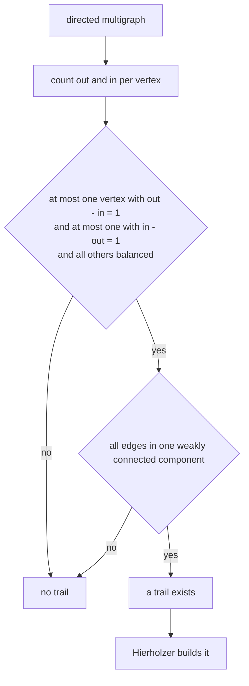
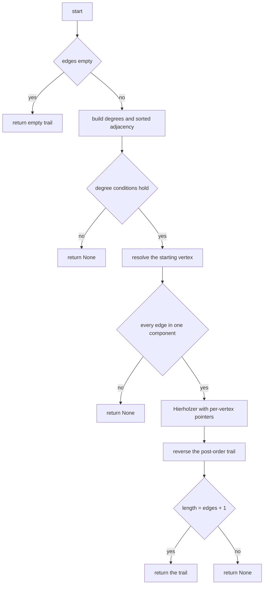
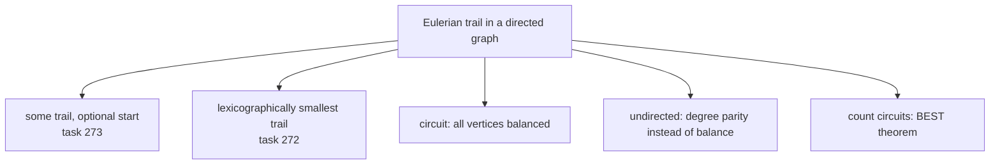

# 273 — Find Eulerian trail in directed graph (Hierholzer).

> **Tier:** Intermediate · **CTCI chapter:** Ch 4 — Trees and Graphs
> **Task spec:** [273-find-eulerian-trail-in-directed-graph-hierholzer.md](../../../tasks/intermediate/273-find-eulerian-trail-in-directed-graph-hierholzer.md)
> **Solutions:** [Python](../../../solutions/python/intermediate/273-find-eulerian-trail-in-directed-graph-hierholzer/solution.py) ·
> [Java](../../../solutions/java/intermediate/273-find-eulerian-trail-in-directed-graph-hierholzer/Solution.java) ·
> [JavaScript](../../../solutions/javascript/intermediate/273-find-eulerian-trail-in-directed-graph-hierholzer/solution.js) ·
> [C#](../../../solutions/csharp/intermediate/273-find-eulerian-trail-in-directed-graph-hierholzer/Solution.cs)

## 1. Problem restatement

**Input:** `n` vertices labelled `0 .. n-1`, a list of directed `edges` given as `[from, to]` pairs,
and an optional `start` vertex.

**Output:** the vertex sequence of an **Eulerian trail** — a walk that uses every edge exactly once —
or `None` when no such trail exists. Two documented special returns: `[]` when there are no edges at
all, and the docstring's own summary is "Returns the vertex sequence of an Eulerian trail, `[]` for
no edges, or `None` if impossible."

| Call | Result |
| --- | --- |
| `find_eulerian_trail(3, [(0,1), (1,2), (2,0)])` | `[0, 1, 2, 0]` — a circuit, vertices balanced |
| `find_eulerian_trail(3, [(0,1), (1,2), (2,0)], start=1)` | `[1, 2, 0, 1]` — any vertex may start a circuit |
| `find_eulerian_trail(3, [(0,1), (1,2)])` | `[0, 1, 2]` — an open trail from the unbalanced start |
| `find_eulerian_trail(4, [(0,1), (1,2), (2,0), (0,3)])` | `[0, 1, 2, 0, 3]` |
| `find_eulerian_trail(4, [(0,1), (0,2), (2,0), (0,3)])` | `None` — vertex `0` has `out - in = 2` |
| `find_eulerian_trail(4, [(0,1), (2,3)])` | `None` — two disconnected components |
| `find_eulerian_trail(3, [])` | `[]` — nothing to do |
| `find_eulerian_trail(3, [(1,2), (2,0)], start=1)` | `[1, 2, 0]` — an explicit valid start |

Every non-`None` result is also verified by the `uses_all_edges` helper, which compares the multiset
of consecutive pairs of the trail with the multiset of edges — a trail cannot pass on airport-like
name ordering alone.

## 2. Intuition

Euler's theorem answers existence before any search happens. In a directed multigraph a trail that
uses every edge exactly once exists if and only if:

1. **Degree balance.** At most one vertex has `out - in = 1` (the trail's start), at most one has
   `in - out = 1` (the trail's end), and every other vertex has `out = in`.
2. **Connectivity.** Every edge lies in a single weakly connected component — ignoring directions,
   all vertices that touch an edge must be connected.

The reasoning is a counting argument on the walk itself: every time the walk passes *through* a
vertex it consumes one incoming and one outgoing edge, so such a vertex must be balanced; only the
first vertex can have one extra departure and only the last vertex one extra arrival. The
connectivity condition is separate because a balanced, degree-correct graph can still be split into
two cycles — `[(0,1), (1,0)]` plus `[(2,3), (3,2)]` satisfies every balance condition and has no
single trail.



Once existence is settled, the trail is built with **Hierholzer's algorithm**, the same post-order
walk as task [272](../../../tasks/intermediate/272-reconstruct-itinerary-problem-eulerian-path-hierholzer.md):
descend along unused edges, record each vertex when it runs out of unused departures, then reverse.
Here the walk uses a **pointer per vertex** into a sorted adjacency list instead of a heap, because
the trail only has to be *some* trail — the ordering is used to make the output deterministic, not to
optimise it lexicographically.

A subtlety specific to this task is the `start` parameter. Omitting it means "pick a valid start":
the unique unbalanced-from vertex if one exists, otherwise the smallest vertex that has any outgoing
edge. Passing it explicitly means "start here" — but only a legitimate start is accepted: if the
graph has an unbalanced start vertex, the caller's choice must match it, and the chosen vertex must
have `out - in` equal to `0` or `1`.

## 3. Algorithm

1. If `edges` is empty, return `[]`.
2. Build `out_degree`, `in_degree` and one adjacency list per vertex; sort each adjacency list so the
   walk is deterministic.
3. Collect `starts` (vertices with `out - in = 1`) and `ends` (vertices with `in - out = 1`). If
   either list has more than one element, or any vertex differs from balance without being in one of
   the two lists, return `None`.
4. Resolve the starting vertex: the caller's `start` if given, else `starts[0]` if it exists, else the
   smallest vertex with `out_degree > 0`. A caller-supplied start is rejected when it contradicts an
   unbalanced start vertex, or when its own `out - in` is neither `0` nor `1`.
5. Weak connectivity: build an undirected copy of the edges, flood-fill from the start, and return
   `None` if any vertex that touches an edge was not reached.
6. Hierholzer with a per-vertex pointer: push the start; while the stack is non-empty, if the top
   vertex's pointer has not reached the end of its list, advance the pointer and push the destination;
   otherwise pop the vertex and append it to the trail. Reverse the trail.
7. Return the trail if it has `len(edges) + 1` vertices, else `None`.

```text
function find_eulerian_trail(n, edges, start)
    if edges is empty then return []
    build out_degree, in_degree and adjacency lists; sort every adjacency list
    starts ← vertices with out_degree - in_degree = 1
    ends ← vertices with in_degree - out_degree = 1
    if size(starts) > 1 or size(ends) > 1 then return None
    for v ← 0 to n - 1 do
        if out_degree[v] ≠ in_degree[v] and v is not in starts and v is not in ends then
            return None
    end
    if start is not given then
        from ← starts[0] if starts is not empty else smallest vertex with out_degree > 0
    else
        if starts is not empty and start ≠ starts[0] then return None
        if out_degree[start] - in_degree[start] is neither 0 nor 1 then return None
        from ← start
    end
    if any vertex with an edge is not reachable from from in the undirected copy then return None
    pointer ← zeroes for every vertex
    trail ← []
    stack ← [from]
    while stack is not empty do
        u ← last element of stack
        if pointer[u] < length(adjacency[u]) then
            v ← adjacency[u][pointer[u]]
            pointer[u] ← pointer[u] + 1
            push v onto stack
        else
            append the vertex popped from stack to trail
    end
    reverse trail
    if length(trail) = length(edges) + 1 then return trail else return None
end
```

Step 5 is what rejects the two-disjoint-cycles input, and step 7 is the second line of defence: even
with the degree and connectivity checks passing, a walk that could not consume every edge would show
up as a short trail. Both checks are cheap and independent, so the function fails closed.



## 4. Worked example

Trace `find_eulerian_trail(4, [(0,1), (1,2), (2,0), (0,3)])`, whose asserted trail is
`[0, 1, 2, 0, 3]`.

**Validity first.** Out-degrees are `0:2, 1:1, 2:1, 3:0`; in-degrees are `0:1, 1:1, 2:1, 3:1`. So
`out - in` is `+1` for vertex `0` (the start), `0` for `1` and `2`, and `-1` for vertex `3` (the
end). One start, one end, everyone else balanced — the conditions hold. The undirected copy is a
single component, so `start = 0` is confirmed.

Sorted adjacency: `0 → [1, 3]`, `1 → [2]`, `2 → [0]`, `3 → []`.

| Step | Stack | `pointer` for the top | Action | `trail` |
| --- | --- | --- | --- | --- |
| 1 | `[0]` | `pointer[0] = 0 < 2` | take edge `0 → 1` | `[]` |
| 2 | `[0, 1]` | `pointer[1] = 0 < 1` | take edge `1 → 2` | `[]` |
| 3 | `[0, 1, 2]` | `pointer[2] = 0 < 1` | take edge `2 → 0` | `[]` |
| 4 | `[0, 1, 2, 0]` | `pointer[0] = 1 < 2` | take edge `0 → 3` | `[]` |
| 5 | `[0, 1, 2, 0, 3]` | `pointer[3] = 0 = 0` | no edges: record `3` | `[3]` |
| 6 | `[0, 1, 2, 0]` | `pointer[0] = 2 = 2` | no edges: record `0` | `[3, 0]` |
| 7 | `[0, 1, 2]` | `pointer[2] = 1 = 1` | record `2` | `[3, 0, 2]` |
| 8 | `[0, 1]` | `pointer[1] = 1 = 1` | record `1` | `[3, 0, 2, 1]` |
| 9 | `[0]` | `pointer[0] = 2 = 2` | record `0` | `[3, 0, 2, 1, 0]` |

Reversing gives `[0, 1, 2, 0, 3]` — five vertices for four edges, matching the assertion. The
pointer is what makes this linear: vertex `0` appears twice on the stack, and the same pointer keeps
track of how far along `[1, 3]` the walk has progressed, so no edge is offered twice.


Now compare the two rejected fixtures. `[(0,1), (0,2), (2,0), (0,3)]` gives vertex `0` an
`out - in` of `2`, and the per-vertex loop returns `None` before any walk. `[(0,1), (2,3)]` is
perfectly balanced component by component — each edge is its own balanced piece — but the
flood-fill from vertex `0` never reaches `2` or `3`, so the connectivity check rejects it.

## 5. Complexity

Let `V = n` be the number of vertices and `E` the number of edges.

| Measure | Bound | Why it holds |
| --- | --- | --- |
| Time, degrees | `O(E + V)` | one pass over the edges plus one over the vertices |
| Time, sorting adjacency | `O(E log E)` | each list of total size `E` |
| Time, connectivity | `O(V + E)` | one flood-fill over the undirected copy |
| Time, Hierholzer | `O(V + E)` | each pointer advances once and each vertex is popped once |
| Time, total | `O(V + E log E)` | dominated by the sort |
| Space | `O(V + E)` | adjacency, the undirected copy, pointers, stack and trail |
| Trail length | exactly `E + 1` | a valid trail visits one vertex per edge plus the endpoint |

Without the sort the complexity drops to `O(V + E)`, which is optimal — the trail itself is `E`
edges long, so any algorithm must at least touch every edge. The sort is kept for deterministic
output, and it is the only term above linear.

## 6. Pitfalls and edge cases

- **No edges.** Returns `[]`, not `None` and not a single vertex. `find_eulerian_trail(3, []) == []`
  is asserted in all four languages.
- **Balanced graph with an explicit start.** A circuit may start anywhere: with a supplied `start` and
  no unbalanced vertex, the code accepts any start as long as its `out - in` is `0` or `1`, and the
  walk still covers every edge (`start=1` gives `[1, 2, 0, 1]`, `start=2` gives `[2, 0, 1, 2]`).
- **Contradicting the unbalanced start.** If the graph has an unbalanced start vertex and the caller
  passes a different one, the function returns `None` — no trail starts anywhere else.
- **Two starts or two ends.** `len(starts) > 1` or `len(ends) > 1` is an immediate rejection; the
  counting argument allows only the first and last vertex of the walk to be unbalanced.
- **Unbalanced but not by one.** A vertex with `out - in = 2` fails the per-vertex loop even though
  `starts` and `ends` are empty; the asserted `[(0,1), (0,2), (2,0), (0,3)]` case is exactly this.
- **Disconnected edges.** The weakly-connected-component flood-fill is the only place components are
  considered, and it is skipped when there are no active vertices. The asserted
  `[(0,1), (2,3)]` case shows that per-component balance is not enough.
- **Vertex `0` with no incident edges.** Vertices are numbered `0 .. n-1` but only "active" vertices
  (those with `out_degree > 0` or `in_degree > 0`) are required to be reachable; isolated vertices do
  not invalidate a trail.
- **Duplicate edges.** The adjacency list stores one entry per edge, and `pointer[u]` walks them one
  at a time, so parallel edges `a → b` twice become two consecutive steps. The trail must have
  `len(edges) + 1` vertices, so no parallel edge can be silently merged.
- **Self-loops.** An `(a, a)` edge pushes `a` again and advances the pointer; balance is unaffected
  because both degrees grow by one.
- **Determinism.** Sorting the adjacency lists makes the produced trail reproducible; the length check
  is what guarantees the returned walk is actually Eulerian, regardless of the order chosen.
- **`start` outside `0 .. n-1`.** Nothing validates the range, so it would index out of bounds; the
  documented contract assumes a vertex label.
- **`uses_all_edges` as the oracle.** Even `[]` for the empty input and `None` for rejections are
  normalised by the checker, so every accepted trail is verified against the edge multiset.

## 7. Variants and follow-ups

- **Lexicographically smallest trail.** [272-reconstruct-itinerary-problem-eulerian-path-hierholzer.md](../../../tasks/intermediate/272-reconstruct-itinerary-problem-eulerian-path-hierholzer.md)
  is the same walk with a min-heap per vertex and a fixed start, which turns "some trail" into "the
  smallest itinerary".
- **Eulerian circuit.** Require `out = in` for every vertex; the start is then arbitrary, and the
  return value ends where it began — exactly the asserted cycle case `[0, 1, 2, 0]`.
- **Undirected graphs.** Replace `out - in` with the degree parity test (0 or 2 odd-degree vertices)
  and forbid reusing an edge in either direction.
- **Bonus: count distinct trails.** The number of Eulerian circuits is given by the BEST theorem; the
  degrees and connectivity computed here are half of its inputs.
- **Related traversals.** [274-check-if-graph-is-bipartite-bfs-coloring.md](../../../tasks/intermediate/274-check-if-graph-is-bipartite-bfs-coloring.md)
  also runs a flood-fill and then reasons about parity, and
  [280](../../../tasks/intermediate/280-count-connected-components-in-directed-graph-strongly-connected.md)
  counts components of a directed graph with the stronger notion of strong connectivity.



## 8. Check yourself

1. Why must every vertex except the two ends be balanced?

<details><summary>Show answer</summary>

Because a walk that uses each edge once enters and leaves every internal vertex the same number of
times: each visit consumes exactly one incoming and one outgoing edge. Only the first vertex of the
walk has an extra departure and only the last an extra arrival, which is what makes the degree
difference of `+1` and `-1` appear at most once each.

</details>

2. `[(0,1), (1,0), (2,3), (3,2)]` is balanced everywhere. Why does the function still return `None`?

<details><summary>Show answer</summary>

The balance conditions are necessary but not sufficient. The flood-fill over the undirected copy from
vertex `0` reaches only `0` and `1`, leaving active vertices `2` and `3` unreachable, so no single
walk can cover all four edges. Disconnected balanced cycles are exactly why the connectivity pass
exists.

</details>

3. In the section 4 trace, which vertex is pushed onto the stack twice, and what keeps its two visits
   from reusing an edge?

<details><summary>Show answer</summary>

Vertex `0`: once as the start and once when the cycle `0 → 1 → 2 → 0` returns to it. The `pointer[0]`
counter advances past `1` after the first departure, so the second visit sees `3` as the next unused
edge and, after that, the end of the list. Each edge is offered exactly once because the pointer only
moves forward.

</details>

4. What does the code return for `find_eulerian_trail(3, [(1,2), (2,0)], start=1)`, and what would it
   return with `start=0`?

<details><summary>Show answer</summary>

With `start=1` it returns `[1, 2, 0]`: vertex `1` has `out - in = 1`, so it is the legitimate start.
With `start=0` the degree check rejects the call, because the graph has an unbalanced start vertex
`1` and the caller asked for a different one; the type check `out - in in (0, 1)` would also fail for
vertex `0`, whose difference is `-1`.

</details>

5. Why does the function check the trail length after the walk, when the degree and connectivity
   conditions were already verified?

<details><summary>Show answer</summary>

It is a cheap, independent safety net. The checks are performed on hand-built structures (degrees and
a separate undirected copy), so the length comparison against `len(edges) + 1` verifies the walk
actually consumed every edge — the property the whole task is about. Any bug in the earlier phases
turns into a `None` instead of a wrong trail.

</details>
