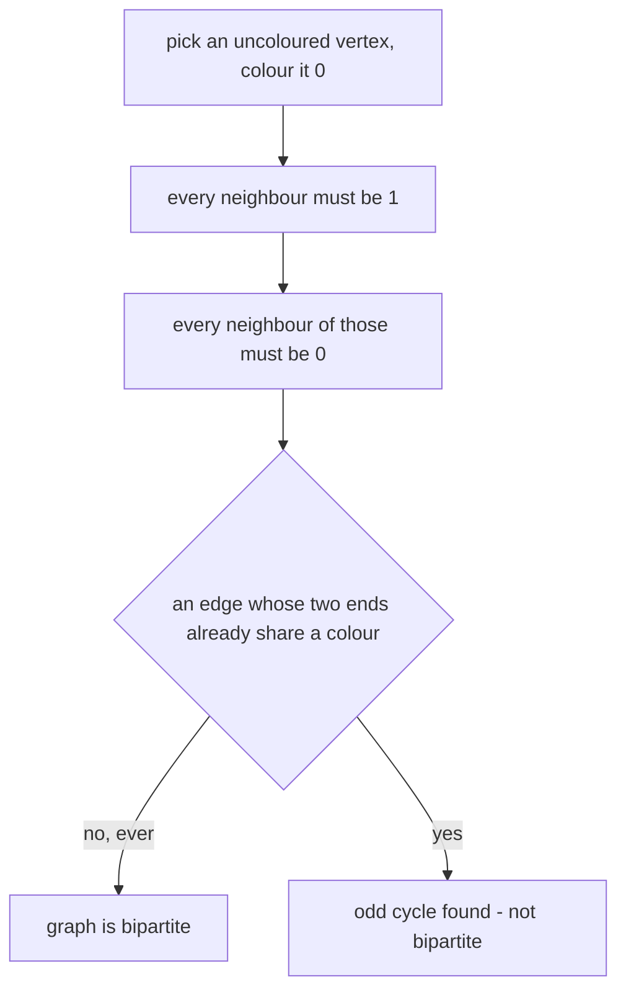
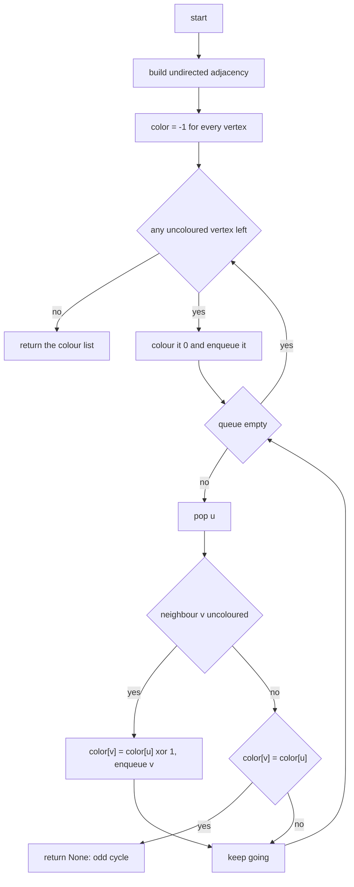
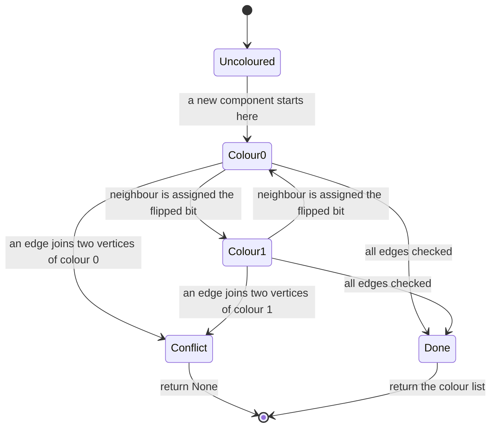
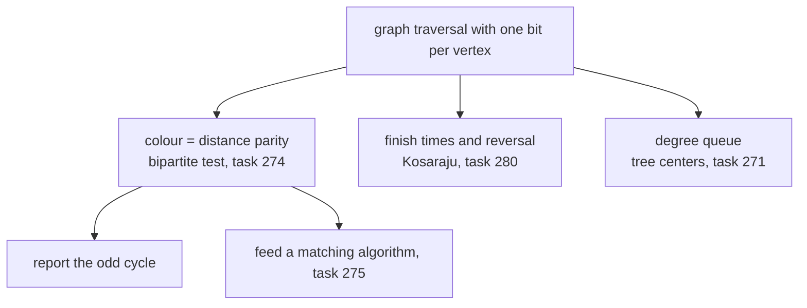

# 274 — Check if graph is bipartite (BFS coloring).

> **Tier:** Intermediate · **CTCI chapter:** Ch 4 — Trees and Graphs
> **Task spec:** [274-check-if-graph-is-bipartite-bfs-coloring.md](../../../tasks/intermediate/274-check-if-graph-is-bipartite-bfs-coloring.md)
> **Solutions:** [Python](../../../solutions/python/intermediate/274-check-if-graph-is-bipartite-bfs-coloring/solution.py) ·
> [Java](../../../solutions/java/intermediate/274-check-if-graph-is-bipartite-bfs-coloring/Solution.java) ·
> [JavaScript](../../../solutions/javascript/intermediate/274-check-if-graph-is-bipartite-bfs-coloring/solution.js) ·
> [C#](../../../solutions/csharp/intermediate/274-check-if-graph-is-bipartite-bfs-coloring/Solution.cs)

## 1. Problem restatement

**Input:** `n`, the number of vertices of an undirected graph, and `edges`, a list of `[u, v]` pairs.
Self-loops are allowed and so are disconnected graphs.

**Output:** `two_color` returns a colour list of `0`s and `1`s — one entry per vertex — such that
every edge joins two differently coloured vertices, or `None` when no such colouring exists.
`is_bipartite` is the boolean wrapper: `two_color(...) is not None`. The docstring says it in one
line: "Returns the colour list (0/1) or None when the graph is not bipartite."

| Call | Result | Why |
| --- | --- | --- |
| `is_bipartite(4, [(0,1),(1,2),(2,3),(3,0)])` | `True` | an even cycle alternates cleanly |
| `is_bipartite(3, [(0,1),(1,2),(2,0)])` | `False` | a triangle cannot be two-coloured |
| `is_bipartite(3, [(0,1),(1,2)])` | `True` | a path is a tree, and every tree is bipartite |
| `is_bipartite(1, [(0,0)])` | `False` | a self-loop joins a vertex to itself |
| `is_bipartite(5, [])` | `True` | isolated vertices impose no constraint |
| `is_bipartite(7, [C4 on 0..3, triangle on 4..6])` | `False` | one component is odd |
| `is_bipartite(6, [(i,j) for i in 0..2, j in 3..5])` | `True` | `K3,3` is bipartite by construction |
| `is_bipartite(4, [all pairs])` | `False` | `K4` contains a triangle |

The colouring asserts are separate: for the even cycle the file checks `colors[0] != colors[1]`,
`colors[1] != colors[2]` and that every edge joins opposite colours, and it checks that the triangle
returns `None` rather than a list.

## 2. Intuition

A graph is bipartite when its vertices split into two sides with all edges crossing between them.
That is exactly the same statement as "the vertices can be painted with two colours so that no edge
is monochromatic", which is why the technique is called 2-colouring.

The naive approach is to try all `2ⁿ` colourings. The structure that kills that idea is that a colour
is not free once one vertex of a component is fixed: if `u` is colour `0`, every neighbour must be
colour `1`, and *their* neighbours must be `0` again. So a single choice per component determines
everything, and the only question is whether the forced colours ever disagree at an edge.



The obstruction has a clean characterisation: **a graph is bipartite if and only if it has no odd
cycle**. Walking around an even cycle the colours alternate and return to the start consistently;
walking around an odd cycle the parity is wrong and the last edge connects two vertices of the same
colour. A self-loop is the shortest odd cycle of all — length one — and a triangle is the next.

The BFS forest grows components one at a time. Each uncoloured vertex found in the outer loop starts
a new component and is coloured `0`; the queue then pushes colours outward level by level. Because
BFS visits vertices in non-decreasing distance from the root, the check `color[v] == color[u]` for an
already-coloured `v` catches precisely the edges that close an odd cycle.

## 3. Algorithm

1. Build the undirected adjacency lists — both `adjacency[a].append(b)` and `adjacency[b].append(a)`.
2. Initialise `color` with `-1` (uncoloured) for every vertex.
3. For every vertex `start` in order: if it is already coloured, continue; otherwise colour it `0` and
   start a BFS from it (a new component).
4. BFS: pop `u`; for each neighbour `v`:
   - if `v` is uncoloured, set `color[v] = color[u] ^ 1` and enqueue it;
   - otherwise, if `color[v] == color[u]`, return `None` — the edge joins equal colours.
5. When every component has been processed, return `color`.

```text
function two_color(n, edges)
    adjacency ← empty lists for 0 .. n - 1
    for each pair (a, b) in edges do
        append b to adjacency[a]
        append a to adjacency[b]
    end
    color ← array of -1 with n entries
    for start ← 0 to n - 1 do
        if color[start] ≠ -1 then continue
        color[start] ← 0
        queue ← [start]
        while queue is not empty do
            u ← remove first element of queue
            for each v in adjacency[u] do
                if color[v] = -1 then
                    color[v] ← color[u] exclusive-or 1
                    append v to queue
                else if color[v] = color[u] then
                    return None
            end
        end
    end
    return color
end
```

Two details carry the correctness. The outer loop over `start` is what makes the algorithm work on
**disconnected** graphs: each uncoloured vertex begins a fresh component with colour `0`, and because
components share no edges, the choices are independent — a graph is bipartite exactly when every
component is. And `color[u] ^ 1` flips the bit without a branch: `0 → 1`, `1 → 0`.



## 4. Worked example

Colour the even cycle `0 - 1 - 2 - 3 - 0` first, then watch the second component fail. Take
`n = 7` with the four cycle edges plus the triangle `4 - 5 - 6`.

**Component 1.** `start = 0` is uncoloured, so `color[0] = 0`.

| Step | Pop `u` | Neighbours | Action | `color` after |
| --- | --- | --- | --- | --- |
| 1 | `0` | `1`, `3` | both uncoloured → `1` | `[0, 1, -1, 1, -1, -1, -1]` |
| 2 | `1` | `0`, `2` | `0` differs from `1`; `2` gets `0` | `[0, 1, 0, 1, -1, -1, -1]` |
| 3 | `3` | `2`, `0` | `2` is `0` and `3` is `1`; `0` is `0` | unchanged |
| 4 | `2` | `1`, `3` | both are `1`, `2` is `0` | unchanged |

Every edge of the cycle joins opposite colours, so the component is fine. The alternating pattern
`0 1 0 1` is the whole reason an even cycle is bipartite: going all the way round returns an even
number of flips.

**Component 2.** `start = 4` is uncoloured, so `color[4] = 0`.

| Step | Pop `u` | Neighbours | Action | `color` after |
| --- | --- | --- | --- | --- |
| 1 | `4` | `5`, `6` | both uncoloured → `1` | `…, 0, 1, 1` |
| 2 | `5` | `4`, `6` | `4` is `0`; `6` is `1` and `color[5]` is `1` | **return `None`** |

The edge `5 - 6` closes the odd cycle: `5` and `6` are both colour `1`, so no valid 2-colouring
exists and the function returns `None` immediately, without finishing the queue. This is the asserted
`is_bipartite(7, [...]) == False` case.



A self-loop reaches the same conflict state in one step: `[(0, 0)]` makes `0` its own neighbour, and
since `color[0]` is already set, the equality test fires and the answer is `False` — the asserted
`is_bipartite(1, [(0,0)]) == False` row. Conversely `is_bipartite(5, [])` returns a list of five
zeroes: each isolated vertex starts a component, and no edge ever contradicts anything.

## 5. Complexity

Let `V = n` be the number of vertices and `E` the number of edges.

| Measure | Bound | Why it holds |
| --- | --- | --- |
| Time, build | `O(V + E)` | one adjacency entry per direction |
| Time, colouring | `O(V + E)` | each vertex is enqueued once, each edge examined once in each direction |
| Time, total | `O(V + E)` | the outer loop only inspects already-coloured vertices |
| Space | `O(V + E)` | adjacency lists plus the colour array and the queue |
| Early exit | `O(1)` extra | the conflict return happens inside the loop, so no second pass is needed |
| Time, brute-force alternative | `O(2^V * E)` | enumerate colourings and validate each |

Linear is optimal: the answer depends on every edge, so any correct algorithm reads them all, and the
colouring needs one bit per vertex. The graph is stored twice per edge (once in each direction), which
is the only constant-factor overhead.

## 6. Pitfalls and edge cases

- **Self-loops.** `[(0,0)]` returns `None`. Both copies of the loop land in `adjacency[0]`, and the
  second one compares `color[0]` with itself. A self-loop is an odd cycle of length one.
- **Odd cycles.** Any triangle, pentagon, or larger odd cycle makes the graph non-bipartite; the
  triangle `0-1-2` is the minimal asserted case.
- **Disconnected graphs.** The outer loop is not optional. Skipping unvisited components would leave
  them uncoloured and, worse, would answer for only one component; the asserted input
  "two components, one of them odd" fails exactly because the second component is entered.
- **Colour `-1` semantics.** `-1` means "uncoloured", so `color[v] == -1` must be tested *before* the
  equality test. Reversing the two branches treats uncoloured vertices as a colour and reports false
  conflicts.
- **`color[u] ^ 1` versus `1 - color[u]`.** Both flip a 0/1 bit; the xor form is used because it
  cannot produce a third value, which keeps "uncoloured" impossible to confuse with "colour 1".
- **Isolated vertices.** `is_bipartite(5, [])` is `True`; each vertex is its own component, coloured
  `0`, with no edges to check.
- **Complete graphs.** `K3,3` is bipartite and `K4` is not, and both are asserted: the first because
  it is built by crossing two independent triples, the second because it contains a triangle among
  its first three vertices.
- **Multi-edges.** Two parallel edges `u - v` are harmless: both must join opposite colours, and both
  do. The adjacency list simply holds the neighbour twice.
- **Return value of the wrapper.** `is_bipartite` is a one-liner over `two_color`; note that a valid
  colouring can legitimately contain all zeroes (the edgeless graph), so callers must test
  `is not None` / `!= null` rather than truthiness of the list.
- **Colour labels are arbitrary.** The pair `(0, 1)` can be swapped on any component independently;
  the tests assert only the inequality on edges, never a specific colour of a specific vertex.
- **Recursion is not needed.** The BFS queue keeps the algorithm iterative; a recursive DFS colouring
  would hit the call-stack limit on a long path.
- **Direction is irrelevant.** The adjacency lists are built in both directions, because a bipartite
  graph is defined on an undirected structure; using only `a → b` would leave many vertices
  unreachable and answer vacuously.

## 7. Variants and follow-ups

- **DFS instead of BFS.** The same colour propagation with a stack or recursion; either traversal
  works because the invariant is local to each edge, but the iterative BFS avoids deep recursion.
- **Distance parity.** If you already have BFS distances, an edge `(u, v)` with equal distances also
  breaks bipartiteness; the colour array is the same information in one bit.
- **Odd-cycle detection.** The first conflicting edge together with the BFS parents gives the actual
  odd cycle — the natural follow-up when you must *report* the obstruction instead of just failing.
- **Bipartite matching.** [275-maximum-bipartite-matching-hopcroft-karp-outline.md](../../../tasks/intermediate/275-maximum-bipartite-matching-hopcroft-karp-outline.md)
  assumes the input is bipartite; this task's colouring is the standard preprocessing step that
  produces the two sides.
- **Related traversals.** [271](../../../tasks/intermediate/271-minimum-height-trees-find-centers-of-undirected-tree.md)
  and [280](../../../tasks/intermediate/280-count-connected-components-in-directed-graph-strongly-connected.md)
  also process components one at a time; the difference is what state each carries per vertex.



## 8. Check yourself

1. Why is a graph bipartite exactly when it has no odd cycle?

<details><summary>Show answer</summary>

Around an even cycle the colours alternate and the walk returns to the start with the same colour it
left with, so the last edge joins opposite colours — consistent. Around an odd cycle the number of
flips is odd, so the vertex you return to would need both colours, and one of the edges on the cycle
must join equal colours. Hence any odd cycle obstructs a 2-colouring, and a graph without odd cycles
can always be coloured by BFS from any root.

</details>

2. In the worked example, which edge triggers the failure, and could the algorithm have detected the
   same component's non-bipartiteness later?

<details><summary>Show answer</summary>

The edge `5 - 6` inside the triangle triggers it: when `5` is popped, `6` already carries colour `1`,
and `5` carries `1` too. Any of the triangle's three edges would do just as well — the conflict is
detected as soon as two ends of an edge have been coloured, so the remaining walk is skipped
entirely.

</details>

3. What does `two_color(5, [])` return, and why is that not a bug?

<details><summary>Show answer</summary>

`[0, 0, 0, 0, 0]`. Each isolated vertex forms its own component and is seeded with colour `0`; since
there are no edges, nothing has to differ. It is a valid colouring, which is why callers must test the
return value against `None` rather than relying on the list being non-trivial.

</details>

4. Why does the algorithm need an outer loop over all vertices rather than a single BFS from vertex
   `0`?

<details><summary>Show answer</summary>

To cover disconnected graphs. Edges never cross components, so each component can be coloured
independently, and the graph is bipartite only if every component is. The asserted seven-vertex input
has an even cycle and a triangle; a single BFS from `0` would colour the cycle and never see the
triangle.

</details>

5. How would you modify the algorithm to *return* the odd cycle instead of `None`?

<details><summary>Show answer</summary>

Record the BFS parent of each vertex when it is first coloured. On the conflicting edge `(u, v)`, walk
up from `u` and from `v` to their lowest common ancestor in the BFS tree; the two upward paths plus
the edge form the odd cycle. The colouring logic itself does not change — only the failure branch grows
a reconstruction step.

</details>
