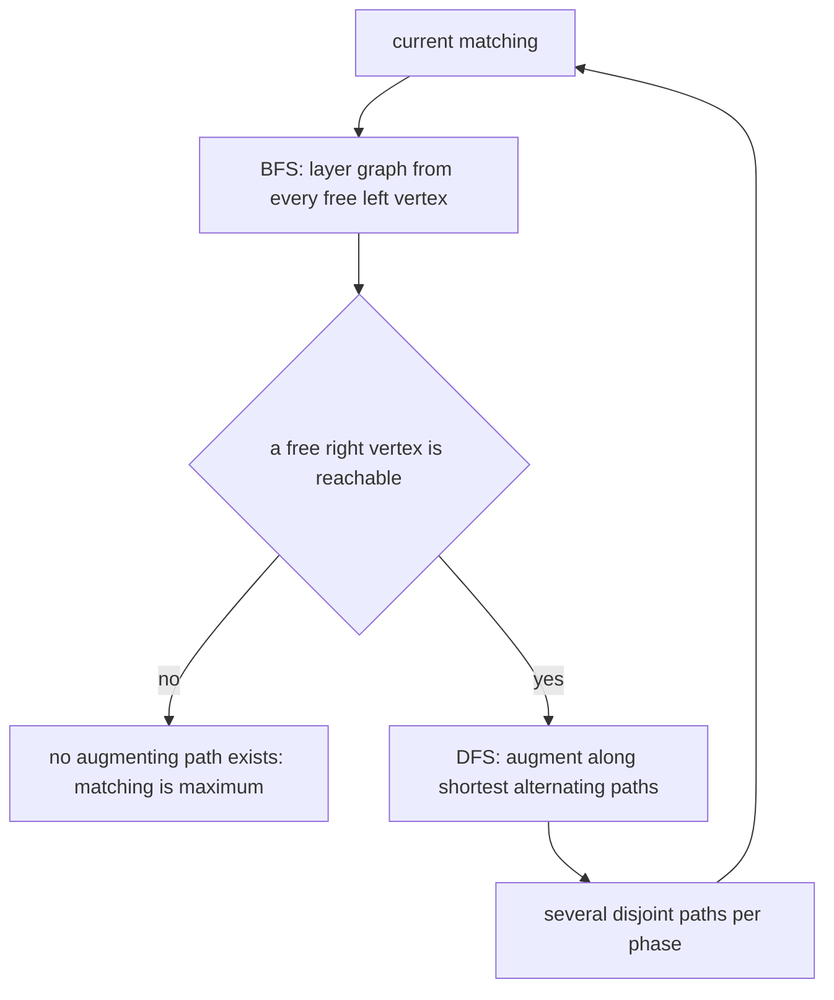
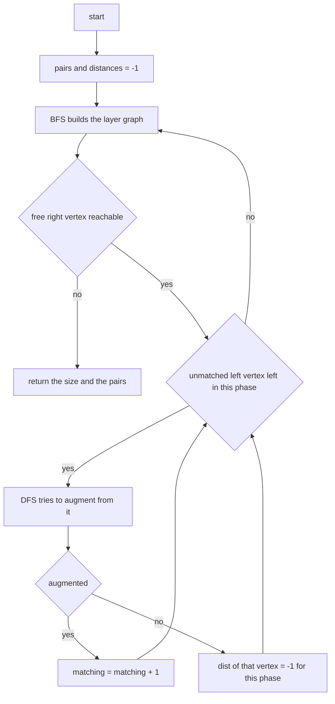
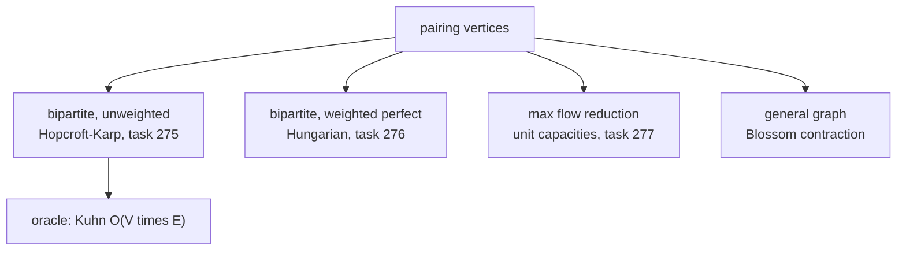

# 275 — Maximum bipartite matching (Hopcroft–Karp outline).

> **Tier:** Intermediate · **CTCI chapter:** Ch 4 — Trees and Graphs
> **Task spec:** [275-maximum-bipartite-matching-hopcroft-karp-outline.md](../../../tasks/intermediate/275-maximum-bipartite-matching-hopcroft-karp-outline.md)
> **Solutions:** [Python](../../../solutions/python/intermediate/275-maximum-bipartite-matching-hopcroft-karp-outline/solution.py) ·
> [Java](../../../solutions/java/intermediate/275-maximum-bipartite-matching-hopcroft-karp-outline/Solution.java) ·
> [JavaScript](../../../solutions/javascript/intermediate/275-maximum-bipartite-matching-hopcroft-karp-outline/solution.js) ·
> [C#](../../../solutions/csharp/intermediate/275-maximum-bipartite-matching-hopcroft-karp-outline/Solution.cs)

## 1. Problem restatement

**Input:** `nl` left vertices labelled `0 .. nl-1`, `nr` right vertices labelled `0 .. nr-1`, and for
each left vertex an adjacency list of the right vertices it may be paired with. The graph is already
known to be bipartite — the two sides are given, not discovered.

**Output:** `hopcroft_karp` returns the **size of a maximum matching** together with the matched
pairs `(left, right)`. A matching pairs left vertices with right vertices such that no vertex appears
in two pairs; maximum means no larger such set exists.

| Adjacency (left → right) | `nr` | Size | Why |
| --- | --- | --- | --- |
| `[[0,1,2],[0,1,2],[0,1,2]]` | 3 | `3` | `K3,3` has a perfect matching |
| `[[], [], []]` | 3 | `0` | no edges at all |
| `[[0,1],[0],[]]` | 2 | `2` | two left vertices onto two right vertices |
| `[[0],[0],[]]` | 1 | `1` | only one right vertex exists |
| `[[0],[0,1],[1]]` | 2 | `2` | a path through the two right vertices |
| `[[0,1],[1],[2]]` | 3 | `3` | a perfect matching along the diagonal |
| `[[0,1],[0]]` | 2 | `2` | needs an augmenting path; "greedy would stop at 1" |
| `[[0,1,2,3,4],[0]]` | 5 | `2` | the second left vertex can only use the contested one |

The last-but-one row is the heart of the task: a greedy pass that assigns `0 → 0` and then gives up
on the second left vertex finds a matching of size 1, while the maximum is 2. The docstring states
the algorithm: "BFS builds the alternating layer graph, DFS augments along vertex-disjoint shortest
paths, so one phase per phase-number instead of one augment per pass."

## 2. Intuition

Building a matching greedily and then stopping is not enough, and the reason is structural rather
than incidental: a greedy pass has no way to *undo* a pairing. What it needs is the notion of an
**augmenting path** — a route that starts at an unmatched left vertex, alternates between unmatched
and matched edges, and ends at an unmatched right vertex. Flipping every edge along such a path (drop
the matched ones, keep the others) increases the matching size by exactly one.

```text
u1 - v0 = u0 - v1
^^   ^^^^^^   ^^
unmatched  matched  unmatched edge to a free right vertex
```

In the example `[[0,1],[0]]`, `u0` is matched to `v0` after the first assignment, `u1` can only reach
`v0`, and the four-vertex path `u1 → v0 → u0 → v1` is augmenting: after flipping, `u1` takes `v0` and
`u0` moves to `v1`. The matching grows from 1 to 2 without ever undoing the *decision* to match `u0` —
only the choice of partner changes.

The classic augmenting-path algorithm (Kuhn, shipped here as the oracle) finds one such path per
left vertex and restarts the search each time, which is `O(V*E)`. **Hopcroft–Karp** improves that by
working in **phases**: a BFS builds a layered graph of shortest alternating paths from all free left
vertices at once, and a DFS then augments along *several* vertex-disjoint shortest paths in the same
phase. Because every phase increases the length of the shortest augmenting path by at least one, and
the length is bounded by `O(√V)`, there are only `O(√V)` phases — hence the `O(E√V)` bound.



The distance array is what keeps the phases honest. `dist[u]` is the BFS layer of a matched left
vertex, and the DFS only follows an edge `u → v` when `dist[pair_v[v]] == dist[u] + 1` — that is, when
the edge continues *on the shortest layer graph*. Edges that lead off the layers are ignored, so the
DFS cannot wander into a longer path, and setting `dist[u] = -1` on failure removes a vertex from the
rest of the phase.

## 3. Algorithm

1. `pair_u[u]` holds the right vertex matched to left `u`, and `pair_v[v]` the left vertex matched to
   right `v`; `-1` means unmatched. `dist[u]` is the BFS layer of left `u`.
2. **BFS phase:** put every unmatched left vertex in the queue with `dist = 0` and set `dist = -1` for
   the matched ones. Walk the layers: from `u` to each neighbour `v`; if `v` is unmatched, report that
   an augmenting path exists; otherwise, if `dist[pair_v[v]]` is still `-1`, set it to `dist[u] + 1`
   and enqueue it. Return whether anything reachable was free.
3. **DFS phase:** for each unmatched left vertex `u`, look for an augmenting path: for each neighbour
   `v`, accept it when `v` is free, or when the pair of `v` sits exactly one layer deeper and can
   itself be re-augmented recursively. On success, record `pair_u[u] = v` and `pair_v[v] = u` and
   count one more match. On failure, set `dist[u] = -1` so the rest of the phase skips it.
4. Repeat BFS and DFS until a BFS phase reports no reachable free right vertex.
5. Return the size and the pairs recovered from `pair_u`.

```text
function hopcroft_karp(nl, adj, nr)
    pair_u ← -1 for every left vertex
    pair_v ← -1 for every right vertex
    dist ← -1 for every left vertex
    matching ← 0
    while bfs() do
        for u ← 0 to nl - 1 do
            if pair_u[u] = -1 and dfs(u) then
                matching ← matching + 1
    end
    return matching and the pairs (u, pair_u[u]) for every matched u
end

function bfs()
    queue ← every unmatched left vertex, with dist = 0
    set dist[u] ← -1 for every matched left vertex
    reachable ← false
    while queue is not empty do
        u ← remove first element of queue
        for each v in adj[u] do
            w ← pair_v[v]
            if w = -1 then reachable ← true
            else if dist[w] = -1 then
                dist[w] ← dist[u] + 1
                append w to queue
    return reachable
end

function dfs(u)
    for each v in adj[u] do
        w ← pair_v[v]
        if w = -1 or (dist[w] = dist[u] + 1 and dfs(w)) then
            pair_u[u] ← v
            pair_v[v] ← u
            return true
    dist[u] ← -1
    return false
end
```

The recursion in `dfs` is the augmentation: when `dfs(w)` succeeds, the right vertex `v` is stolen
from `w` and `w` has already been re-matched further down the path. That is why the pair assignments
happen on the way *out* of the recursion — the deepest augmentation is recorded first, then each
level re-pairs, and the call stack unwinds into a valid matching.



## 4. Worked example

Trace `hopcroft_karp(2, [[0, 1], [0]], 2)`, asserted to be `2` — the case the file annotates with
"greedy would stop at 1".

**Phase 1.** BFS seeds both left vertices as free, so `dist = [0, 0]` and every neighbour is checked.
Both edges from `u0` and the edge from `u1` land on unmatched right vertices, so the phase reports
`reachable = true`. The DFS then walks the left vertices in order:

| DFS call | Neighbours tried | Decision | Pairing after |
| --- | --- | --- | --- |
| `dfs(0)` | `v0` | `pair_v[0] = -1`, so take it | `u0 → v0` |
| `dfs(1)` | `v0` | `pair_v[0] = 0`, and `dist[0] = 0 ≠ dist[1] + 1 = 1`, so the layer test fails | unchanged |

`matching` becomes `1`, and `dfs(1)` sets `dist[1] = -1` before returning false. A greedy algorithm
would stop here; the surrounding `while bfs()` loop does not.

**Phase 2.** Only `u1` is free, so the BFS seeds `dist = [-1, 0]` and walks: from `u1` the edge to
`v0` is matched to `u0`, so `dist[0] = dist[1] + 1 = 1` and `u0` joins the queue. From `u0`, the edge
to `v0` loops back, and the edge to `v1` lands on an *unmatched* right vertex — so `reachable = true`
again, now along a two-edge alternating path.

| DFS call | Neighbours tried | Decision | Pairing after |
| --- | --- | --- | --- |
| `dfs(1)` | `v0` | matched to `u0`, and `dist[0] = 1 = dist[1] + 1` → recurse | — |
| `dfs(0)` (inner) | `v0` | matched to itself and `dist[0] ≠ dist[0] + 1` → skip | — |
| `dfs(0)` (inner) | `v1` | `pair_v[1] = -1` → take it | `u0 → v1` |
| back in `dfs(1)` | `v0` | inner call returned true → take it | `u1 → v0` |

`matching` becomes `2`. **Phase 3.** Both left vertices are matched, so the BFS queue is empty and
`reachable` stays false; the loop ends and the result `(2, [(0, 1), (1, 0)])` comes back. The pair
list is the verification target: `is_valid_matching` checks it is a set of vertex-disjoint edges that
all exist in the adjacency, and `len(pairs) == size` is asserted as well.


The dashed reading is the flip: an augmenting path of length three edges turns into a matching of the
same three edges, with the two middle endpoints exchanging partners. That is the entire machinery of
matching algorithms — find such a path, flip it, repeat, and stop when none exists. Hopcroft–Karp only
adds the layer graph so that many flips happen per pass.

## 5. Complexity

Let `V = nl + nr` and `E` be the number of edges; let `M` be the matching size.

| Measure | Bound | Why it holds |
| --- | --- | --- |
| Time, one BFS phase | `O(E)` | each edge is examined once per phase |
| Time, one DFS phase | `O(E)` | the layer test prevents re-walking an edge within a phase |
| Number of phases | `O(√V)` | each phase lengthens the shortest augmenting path, which is bounded by `O(√V)` |
| Time, total | `O(E √V)` | phases times the cost of a phase |
| Space | `O(V + E)` | adjacency lists, the two pair arrays and the distance array |
| Time, Kuhn oracle | `O(V * E)` | one full search per left vertex |
| Space, Kuhn oracle | `O(V + E)` | a single `match_v` array plus the visited flags |

Hopcroft–Karp is the fastest of the classic matching algorithms for dense bipartite graphs, and the
gain comes entirely from batching: hopping along one augmenting path per pass (Kuhn) costs `O(V)`
searches, while the layered phases share the work and finish in `O(√V)` rounds. On the 200 random
6x6 graphs the two must agree exactly — that is what the cross-check asserts.

## 6. Pitfalls and edge cases

- **Greedy is not enough.** The asserted `[[0,1],[0]] → 2` case exists precisely because a single
  pass over the left vertices may leave a free left vertex stranded; only the re-augmentation in
  phase 2 fixes it.
- **Empty adjacency.** `[[], [], []]` gives size `0`, and the pairs list is empty. The wrapper must
  not report a "matching" of size zero as an error.
- **Unequal side sizes.** `nl` and `nr` are independent, and a matching can never exceed
  `min(nl, nr)`. Both `[[0],[0],[]]` with one right vertex → `1` and the random check `size <= 6`
  record this.
- **Right vertices contested by many left vertices.** `[[0,1,2,3,4],[0]]` with `nr = 5` gives `2`, not
  `1` and not `5`: one left vertex may take any of five, the other only `v0`, so the matching is
  limited by the narrower side of the conflict.
- **Layer test off by one.** The DFS condition is `dist[w] == dist[u] + 1`; using `>=`, or forgetting
  the test entirely, makes the DFS walk non-shortest paths, which can break the phase count and, with
  `dist[u] = -1` pruning, silently lose augmentations.
- **`dist[u] = -1` on failure.** This marks a left vertex as unusable *within the current phase*, so
  the loop over unmatched vertices does not retry it. Without it, a failed DFS may be retried
  repeatedly and the phase becomes quadratic.
- **Pair bookkeeping in both directions.** `pair_u` and `pair_v` must be updated together; a single
  inconsistency makes `pair_v[v] = u` point at a stale partner and the DFS loops.
- **Counting.** `matching` is incremented only when `dfs` returns true, and the returned pairs are
  derived from `pair_u`, so `len(pairs) == size` — asserted in all four files.
- **Java returns a flattened array.** `hopcroftKarp` in Java packs `{size, u, v, u, v, ...}` into one
  `int[]`; `isValidMatching` walks it in steps of two and re-checks `(result.length - 1) / 2 ==
  result[0]`.
- **Inputs are one-sided.** The adjacency list is indexed by left vertex and stores right vertices;
  the reverse mapping is always found through `pair_v`, never by scanning the left adjacency.
- **Deterministic random tests.** `randomGraphs` uses an LCG (`seed = (seed * 75 + 74) % 65537`) so
  Python, JavaScript, Java and C# generate the *same* 200 graphs; the cross-check then compares each
  size against the Kuhn oracle.
- **Kuhn is an oracle, not a fallback.** It is never called from `hopcroft_karp`; it exists so the
  fast implementation has an independent `O(V*E)` answer to agree with.

## 7. Variants and follow-ups

- **Weighted assignment.** [276-implement-hungarian-algorithm-assignment-basic.md](../../../tasks/intermediate/276-implement-hungarian-algorithm-assignment-basic.md)
  asks for the minimum-cost *perfect* matching, which the Hungarian algorithm solves with potentials
  instead of augmenting paths.
- **Maximum flow.** [277-maximum-flow-edmonds-karp.md](../../../tasks/intermediate/277-maximum-flow-edmonds-karp.md)
  generalises matching: add a source to every left vertex, a sink from every right vertex, unit
  capacities everywhere, and the max-flow value equals the matching size. Hopcroft–Karp is the
  special-purpose version of that reduction.
- **Minimum vertex cover / König's theorem.** The maximum matching size equals the minimum vertex
  cover size in bipartite graphs; the cover can be read off the final BFS layers.
- **Bipartiteness itself.** [274-check-if-graph-is-bipartite-bfs-coloring.md](../../../tasks/intermediate/274-check-if-graph-is-bipartite-bfs-coloring.md)
  is the check that a general graph can be split into the two sides this task assumes.
- **Non-bipartite matching.** On general graphs the same idea needs Blossom contraction, because
  odd cycles break the layer argument.



## 8. Check yourself

1. What is an augmenting path, and why does flipping one increase the matching by exactly one?

<details><summary>Show answer</summary>

It is a path that starts at an unmatched left vertex, ends at an unmatched right vertex, and
alternates unmatched and matched edges. Flipping exchanges the roles of the two kinds of edges: the
endpoints become matched, the interior stays matched but with swapped partners, and the unmatched
edges outnumber the matched ones by one — hence a net gain of one.

</details>

2. In the worked example, why does `dfs(1)` fail in phase 1 but succeed in phase 2?

<details><summary>Show answer</summary>

In phase 1 the only route from `u1` is `u1 → v0`, and `v0` is matched to `u0` whose `dist` is `0`,
while the layer test requires `dist[u0] == dist[u1] + 1 = 1`. The edge is not on the shortest layer
graph, so it is refused. In phase 2 the BFS has discovered the longer alternating route
`u1 → v0 → u0 → v1`, `dist[u0]` becomes `1`, the test passes, and the recursive call re-matches `u0`
to the free `v1`.

</details>

3. Why does the algorithm not need a "visited left vertex" array inside a phase?

<details><summary>Show answer</summary>

Because `dist` provides the bookkeeping. The BFS assigns each left vertex a layer exactly once, the
DFS only descends along edges where the layer increases, and a failed vertex is set to `-1` so it is
skipped for the rest of the phase. That is a strict monotone progress condition, which is stronger
than a visited flag.

</details>

4. How many phases can there be, and what bounds them?

<details><summary>Show answer</summary>

`O(√V)`. Each phase augments along shortest alternating paths, and after a phase the shortest
augmenting path strictly lengthens; since a shortest augmenting path has at most `O(√V)` edges before
the remaining matching can be completed in a few extra steps, the phase count is bounded by `O(√V)`.
That is where the `O(E√V)` bound comes from.

</details>

5. `hopcroft_karp(3, [[0,1,2],[0,1,2],[0,1,2]], 3)` returns `3`. What does the returned pair list tell
   you, and how is it validated?

<details><summary>Show answer</summary>

It returns three pairs, one per left vertex, forming a perfect matching of `K3,3`. `is_valid_matching`
checks that every pair exists in the adjacency, that no left vertex and no right vertex appears twice,
and the test also asserts `len(pairs) == size`. A matching that listed a non-edge or reused a vertex
would be rejected even if its count agreed with the oracle.

</details>
