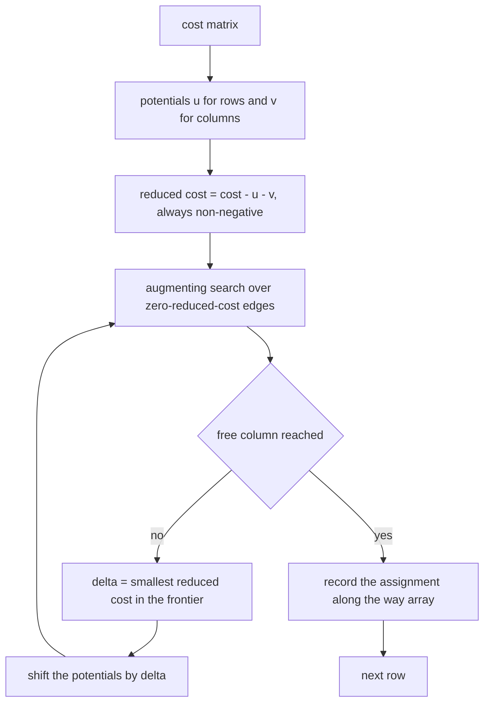
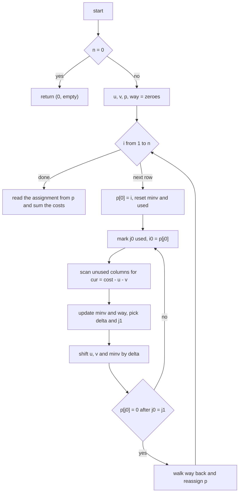
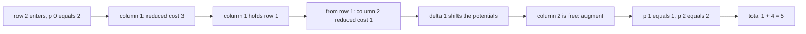
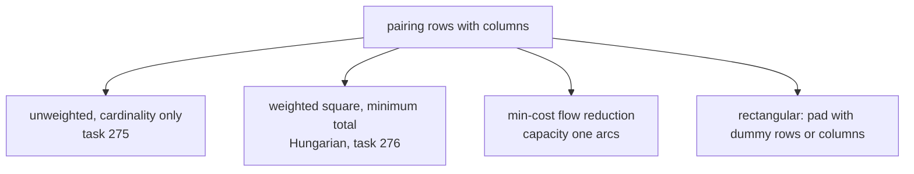

# 276 — Implement Hungarian algorithm (assignment) basic.

> **Tier:** Intermediate · **CTCI chapter:** Ch 4 — Trees and Graphs
> **Task spec:** [276-implement-hungarian-algorithm-assignment-basic.md](../../../tasks/intermediate/276-implement-hungarian-algorithm-assignment-basic.md)
> **Solutions:** [Python](../../../solutions/python/intermediate/276-implement-hungarian-algorithm-assignment-basic/solution.py) ·
> [Java](../../../solutions/java/intermediate/276-implement-hungarian-algorithm-assignment-basic/Solution.java) ·
> [JavaScript](../../../solutions/javascript/intermediate/276-implement-hungarian-algorithm-assignment-basic/solution.js) ·
> [C#](../../../solutions/csharp/intermediate/276-implement-hungarian-algorithm-assignment-basic/Solution.cs)

## 1. Problem restatement

**Input:** an `n x n` cost matrix. Row `i` is a worker, column `j` is a job, and `cost[i][j]` is what
it costs to assign worker `i` to job `j`.

**Output:** a `(total, assignment)` pair where `assignment[i]` is the column chosen for row `i`. The
assignment must be a **permutation** of the columns — every worker takes exactly one distinct job —
and the total must be **minimal** among all `n!` permutations.

| Input | Result | Note |
| --- | --- | --- |
| `[[1, 2], [3, 4]]` | `(5, [0, 1])` | the diagonal is cheapest |
| `[[10, 19], [20, 11]]` | `21` | each worker takes their closer job |
| `[[1, 2, 3], [4, 5, 6], [7, 8, 9]]` | `15` | `1 + 5 + 9` |
| `[[7]]` | `(7, [0])` | the 1x1 case |
| `[]` | `(0, [])` | no workers, no jobs |
| `[[9,1,1],[1,9,1],[1,1,9]]` | `3` | the anti-diagonal avoids every expensive cell |

The docstring names the formulation: "JV / e-maxx formulation: potentials `u` and `v` are adjusted by
the shortest delta while a matching grows one row at a time, giving `O(n^3)`. Cross-checked against
brute-force permutations, which is feasible up to `n = 5`."

## 2. Intuition

The definition is a minimization over `n!` permutations — that is exactly the `brute_force` oracle the
files carry, and it is only usable up to `n = 5`, which is why the random tests stop there. The gap
between `n!` and `n³` is the whole point of the Hungarian algorithm.

Two observations make it work. First, the problem is a **perfect matching** on the complete bipartite
graph between workers and jobs, so augmenting-path thinking applies — but with costs, the shortest
augmenting path is not the one with fewest edges, it is the one with the smallest total cost.

Second, costs can be re-expressed through **potentials** `u[i]` and `v[j]`:

```text
reduced cost of (i, j) = cost[i][j] - u[i] - v[j]      with the invariant  reduced cost >= 0
```

Subtracting a constant from a whole row or a whole column does not change which permutation is
optimal, because every permutation uses exactly one cell from each row and each column. So instead of
searching over permutations, the algorithm keeps the invariant and drives one reduced cost to zero
per step, growing a matching row by row.



The "delta" is the bridge between the two observations: when the alternating search cannot reach a
free column along zero-cost edges, `delta` is the minimum reduced cost among the columns still
outside the tree, and subtracting it from the potentials makes that column reachable without breaking
non-negativity. This is the Hungarian algorithm — the dual of the assignment LP, updated one tight
constraint at a time.

## 3. Algorithm

The implementation follows the compact **JV / e-maxx** layout: everything is indexed from `1` (slot
`0` is a sentinel), and only `O(n)` arrays are used beyond the input matrix.

1. If `n = 0`, return `(0, [])`.
2. Keep `u` (row potentials), `v` (column potentials), `p` (the row currently assigned to each
   column, `0` meaning free) and `way` (the column's predecessor in the alternating tree).
3. For each row `i` from `1` to `n`:
   - set `p[0] = i` — a virtual free column that starts the alternating tree;
   - reset `minv[j] = ∞` (smallest reduced cost seen for column `j`) and `used = false` for all
     columns;
   - repeat:
     - mark `j0` used, let `i0 = p[j0]` be its current row;
     - for every unused column `j`, compute `cur = cost[i0-1][j-1] - u[i0] - v[j]`; if that improves
       `minv[j]`, record it and set `way[j] = j0`; track the smallest `minv[j]` as `delta` and the
       column that achieved it as `j1`;
     - shift the potentials: for used columns `u[p[j]] += delta` and `v[j] -= delta`; for unused
       columns `minv[j] -= delta`;
     - move to `j0 = j1`; if `p[j0] = 0` (a free column) the search stops;
   - walk `way` back from `j0` to `0`, reassigning `p[j0] = p[way[j0]]` — this is the augmentation.
4. Read the assignment from `p`: `p[j] - 1` is the row that took column `j - 1`.
5. Sum the chosen costs and return them with the assignment.

```text
function hungarian(cost)
    n ← number of rows of cost
    if n = 0 then return (0, [])
    u ← zeroes of length n + 1
    v ← zeroes of length n + 1
    p ← zeroes of length n + 1
    way ← zeroes of length n + 1
    for i ← 1 to n do
        p[0] ← i
        j0 ← 0
        minv ← infinity for every column
        used ← false for every column
        while true do
            used[j0] ← true
            i0 ← p[j0]
            delta ← infinity
            j1 ← -1
            for j ← 1 to n do
                if not used[j] then
                    cur ← cost[i0 - 1][j - 1] - u[i0] - v[j]
                    if cur < minv[j] then
                        minv[j] ← cur
                        way[j] ← j0
                    if minv[j] < delta then
                        delta ← minv[j]
                        j1 ← j
            for j ← 0 to n do
                if used[j] then
                    u[p[j]] ← u[p[j]] + delta
                    v[j] ← v[j] - delta
                else
                    minv[j] ← minv[j] - delta
            j0 ← j1
            if p[j0] = 0 then break
        end
        while j0 ≠ 0 do                       # augment along the way chain
            j1 ← way[j0]
            p[j0] ← p[j1]
            j0 ← j1
    end
    assignment ← -1 for every row
    for j ← 1 to n do
        if p[j] ≠ 0 then assignment[p[j] - 1] ← j - 1
    return (sum of cost[i][assignment[i]], assignment)
end
```

The inner loop is the alternating search: moving from a used column `j0` to its row `i0 = p[j0]`, then
scanning all unused columns for a cheaper connection. Every iteration marks one more column used, so
the repeat loop finishes in at most `n` rounds. The potential shift keeps the invariant
`u[i] + v[j] ≤ cost[i][j]` true for every cell, which is why no reduced cost ever becomes negative.



## 4. Worked example

Trace `hungarian([[1, 2], [3, 4]])`, asserted to be `(5, [0, 1])`. Slots are 1-indexed: column `0` is
the sentinel, real columns are `1` and `2`, and `p[j]` holds the row assigned to column `j`.

**Row `i = 1`.** `p[0] = 1`, `j0 = 0`, `minv = [∞, ∞, ∞]`, `used = [false, false, false]`.

| Round | `j0` used | `i0` | Reduced costs found | `delta`, `j1` | Potentials after the shift |
| --- | --- | --- | --- | --- | --- |
| 1 | `j0 = 0` | `1` | `minv[1] = 1 - 0 - 0 = 1`; `minv[2] = 2` | `delta = 1`, `j1 = 1` | `u[1] = 1`, `v[0] = -1`, `minv = [∞, 0, 1]` |

`j0` becomes `1` and `p[1] = 0`, so the search stops. The `way` walk sets `p[1] = p[0] = 1`: row `1`
takes column `1`, which is the cheap cell `cost[0][0] = 1`.

**Row `i = 2`.** `p[0] = 2`, `minv` and `used` are reset.

| Round | `j0` used | `i0` | Reduced costs found | `delta`, `j1` | Potentials after the shift |
| --- | --- | --- | --- | --- | --- |
| 1 | `j0 = 0` | `2` | `minv[1] = 3 - 0 - 0 = 3`; `minv[2] = 4` | `delta = 3`, `j1 = 1` | `u[2] = 3`, `v[0] = -4`, `minv = [∞, 0, 1]` |
| 2 | `j0 = 1` (holds row `1`) | `1` | `minv[2] = 2 - 1 - 0 = 1`, unchanged | `delta = 1`, `j1 = 2` | `u[2] = 4`, `u[1] = 2`, `v[0] = -5`, `v[1] = -1` |

Round 1 moves into column `1`, which is already occupied by row `1` — that is the alternating tree
growing. Round 2 scans from row `1` and finds that column `2` is a free column reachable with the
remaining reduced cost `1`, so `j1 = 2`, `p[2] = 0`, and the search ends. The `way` chain is
`way[2] = 0` (recorded in round 1), and the augmentation sets `p[2] = p[0] = 2` — row `2` takes column
`2`, cost `4`. Column `1` keeps row `1`, cost `1`.

The assignment is `[0, 1]` with total `5`, matching the assertion. The trace also shows why `delta`
matters: without the shift the second row could not use either column, since both reduced costs were
still above zero when the tree first looked at them.



The anti-diagonal case `[[9,1,1],[1,9,1],[1,1,9]]` runs the same machinery and returns `3`: the
algorithm has to walk past every expensive `9`, and the potentials end up so that the three `1`s are
the only zero-reduced-cost cells of a perfect matching.

## 5. Complexity

Let `n` be the number of rows and columns.

| Measure | Bound | Why it holds |
| --- | --- | --- |
| Time, total | `O(n³)` | `n` rows, each search doing at most `n` rounds, each round scanning `n` columns |
| Space, extra | `O(n)` | `u`, `v`, `p`, `way`, `minv`, `used` are all length `n + 1` |
| Space, input | `O(n²)` | the cost matrix itself |
| Time, brute-force oracle | `O(n!)` | one sum per permutation, which is why the tests stop at `n = 5` |
| Time, naive greedy | not correct | choosing the cheapest cell per row can block a later row |
| Output size | `O(n)` | one column index per row |

`O(n³)` is the classic bound for the JV formulation, and it is achieved here by not materialising any
`n x n` auxiliary structure: `minv` and `way` are one-dimensional, and the row potential
`u[p[j]] += delta` line is what replaces a per-cell dual update. Storing the potentials instead of a
full reduced-cost matrix is the reason the extra space is linear.

## 6. Pitfalls and edge cases

- **Empty matrix.** `hungarian([])` returns `(0, [])` — zero workers is a valid input with cost `0`,
  not an error. All four files return early before touching potentials.
- **One by one.** `[[7]]` returns `(7, [0])`; the sentinel column and the single real column are
  enough for the search to work, and the assignment array has one entry.
- **Ties.** `[[1, 2], [3, 4]]` has a unique optimum, but `[[1, 2], [1, 4]]`-style inputs do not; the
  tests assert the total and, where it is unique, the exact assignment. The random check asserts the
  total against brute force and that the assignment is a permutation — never a specific permutation,
  because ties can be broken several ways.
- **Non-negative invariant.** The shift is applied to used columns (`u[p[j]] += delta`, `v[j] -=
  delta`) and subtracted from `minv` elsewhere. Getting the sign wrong makes some reduced cost
  negative and the algorithm can then accept a non-optimal assignment.
- **`way` must be recorded on improvement.** `way[j] = j0` is set only inside the `cur < minv[j]`
  branch; recording it unconditionally would keep a predecessor that does not correspond to the
  minimum, and the augmentation would rewire the assignment incorrectly.
- **Sentinel slot.** Slot `0` is the virtual free column that seeds each row's search. Its potential
  `v[0]` is a real accumulator — the trace shows it reaching `-5` — and the loop bounds are
  `j = 1 .. n` for scanning and `j = 0 .. n` for the shift for exactly this reason.
- **Assignment completeness.** Every row must end up with a column; the tests assert
  `sorted(assignment) == list(range(n))` / a `seen` array, so a duplicated or missing column would be
  caught even if the total happened to match.
- **Integer widths.** Java and C# accumulate in `long` and use `Long.MAX_VALUE / 4` as their infinity,
  so adding `delta` cannot overflow; JavaScript uses `Number.POSITIVE_INFINITY`; Python uses
  `float("inf")` alongside integer costs. On a large matrix a 32-bit total can overflow.
- **Rectangular matrices.** The algorithm is written for square input. The standard trick is to pad
  with zero-cost dummy rows or columns and then discard the dummy assignments.
- **Negative costs.** Nothing in the formulation requires non-negative entries; the invariant is about
  reduced costs, not about raw ones. The shipped tests all use non-negative values, so treat negative
  input as untested.
- **Deterministic random tests.** `lcg_matrix` / `LcgMatrix` use `seed = (seed * 75 + 74) % 65537`
  with `seed % 20` entries, so all four languages generate the same 15 matrices per size `2, 3, 4, 5`
  and each one is compared against its own brute-force optimum.

## 7. Variants and follow-ups

- **Maximum-cardinality matching without costs.** [275-maximum-bipartite-matching-hopcroft-karp-outline.md](../../../tasks/intermediate/275-maximum-bipartite-matching-hopcroft-karp-outline.md)
  drops the costs: unit reduced costs everywhere, and the answer is a size rather than a total. The
  augmenting idea is shared; the potentials are not needed.
- **Assignment as min-cost flow.** Add a source, a sink and capacity-one arcs with the cost matrix as
  the arc costs; successive shortest augmenting paths, or a full min-cost flow solver, gives the same
  optimum. [277-maximum-flow-edmonds-karp.md](../../../tasks/intermediate/277-maximum-flow-edmonds-karp.md)
  is the unweighted counterpart of that reduction.
- **Rectangular assignment.** Pad to square with dummy rows/columns, or cap the search at
  `min(rows, columns)` augmentations.
- **Maximization.** Negate the matrix, or reverse the invariant to `cost[i][j] <= u[i] + v[j]` and
  maximise `delta` instead of minimising it.
- **Large sparse instances.** The augmentation-per-row structure is what makes the algorithm a
  candidate for sparse implementations, where only the finite cells are stored.



## 8. Check yourself

1. Why can you subtract a constant from an entire row without changing the optimal assignment?

<details><summary>Show answer</summary>

Because every permutation chooses exactly one cell from that row. Subtracting the same amount from all
`n` cells reduces every feasible total by that amount, so the ordering of the totals — and therefore
the argmin — is unchanged. The same argument applies to a column. That is what lets the algorithm
work with "reduced" costs through the potentials.

</details>

2. What is `delta`, and why is it subtracted from the potentials?

<details><summary>Show answer</summary>

`delta` is the smallest reduced cost among the columns not yet in the alternating tree. Subtract it
from the potentials of the tree's columns (and shift `minv` for the rest), and every column in the
tree stays at reduced cost zero while at least one new column becomes reachable at reduced cost zero.
So the tree grows without ever making a reduced cost negative — that is `u[i] + v[j] <= cost[i][j]`
preserved.

</details>

3. In the worked example, how does row 2 end up on column 2 rather than both rows competing for
   column 1?

<details><summary>Show answer</summary>

The second row's search moves into column 1, discovers it is held by row 1, and continues from row 1
rather than failing. Row 1 can reach column 2 at a reduced cost of `1`, which becomes the new `delta`;
after the shift, `p[2] = 2` and row 1 keeps column 1. The `way` array records that column 2's
predecessor is the sentinel of this search, which is what makes the chain close.

</details>

4. Why does the file cross-check against brute force only up to `n = 5`?

<details><summary>Show answer</summary>

`brute_force` enumerates all `n!` permutations: `5! = 120` is trivial, `8! = 40320` is still fine, but
the test budget is set at `n <= 5` with 15 matrices per size, which is enough to cover the interesting
shapes without the harness becoming the slow part. The quadratic-to-cubic algorithm itself has no such
limit.

</details>

5. What do the tests check besides the total cost?

<details><summary>Show answer</summary>

That the assignment is a permutation: `sorted(assignment) == list(range(size))` in Python and
JavaScript, and a `seen` array in Java and C#. They also recompute the total from the assignment and
the matrix (`sum(matrix[i][assignment[i]])`) and compare it with the returned total and with the
brute-force optimum, so a self-consistent but wrong answer cannot pass.

</details>
