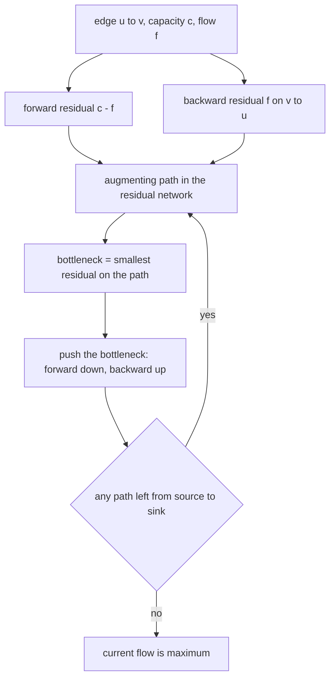
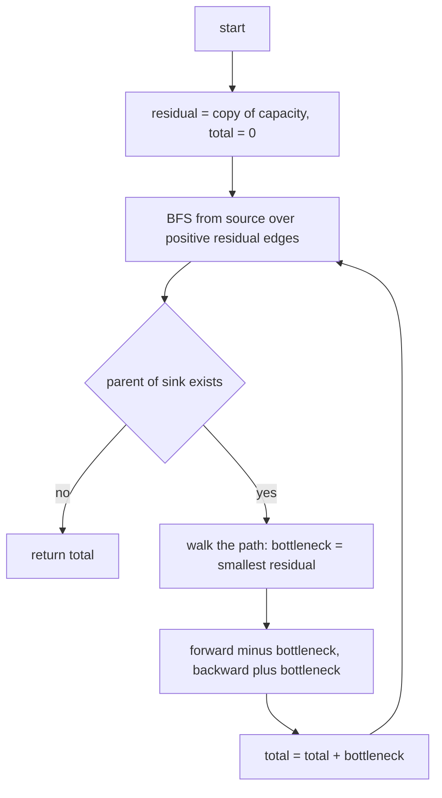
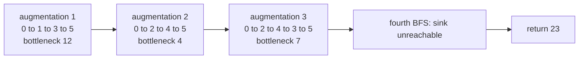
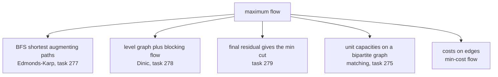

# 277 — Maximum flow (Edmonds–Karp).

> **Tier:** Intermediate · **CTCI chapter:** Ch 4 — Trees and Graphs
> **Task spec:** [277-maximum-flow-edmonds-karp.md](../../../tasks/intermediate/277-maximum-flow-edmonds-karp.md)
> **Solutions:** [Python](../../../solutions/python/intermediate/277-maximum-flow-edmonds-karp/solution.py) ·
> [Java](../../../solutions/java/intermediate/277-maximum-flow-edmonds-karp/Solution.java) ·
> [JavaScript](../../../solutions/javascript/intermediate/277-maximum-flow-edmonds-karp/solution.js) ·
> [C#](../../../solutions/csharp/intermediate/277-maximum-flow-edmonds-karp/Solution.cs)

## 1. Problem restatement

**Input:** `n` vertices, a capacity matrix where `capacity[i][j]` is the capacity of the directed edge
`i → j` (`0` when the edge does not exist), a `source` vertex and a `sink` vertex.

**Output:** the value of a **maximum flow** — the largest amount that can be pushed from `source` to
`sink` without exceeding any edge's capacity and without losing or gaining anything at intermediate
vertices.

| Input | Result | Why |
| --- | --- | --- |
| the CLRS figure, 6 vertices, 10 edges | `23` | the canonical max-flow value |
| diamond `0→1 (3), 0→2 (2), 1→3 (2), 2→3 (3)` | `4` | the two routes share the full capacity |
| path `0→1 (3), 1→2 (5)` | `3` | the bottleneck is `0 → 1` |
| `0→1 (1)` with sink `2` | `0` | the sink is unreachable |
| no edges at all | `0` | nothing to push |
| crossing `0→1 (1), 0→2 (1), 1→2 (1), 1→3 (1), 2→3 (1)` | `2` | two vertex-disjoint routes of capacity one |
| `0→1 (2), 0→1 (3), 1→2 (4)` | `4` | parallel edges add up to `5`, capped by `1 → 2` |

`matrix_from_edges` builds the capacity matrix and **adds** the capacities of duplicate edges, which
is what makes the last row `2 + 3` on one cell. The docstring gives the reason for the algorithm
choice: "BFS finds the augmenting path with the fewest edges in the residual network, which makes the
bound `O(V*E^2)` and also makes the algorithm immune to the classic bad-path blowup."

## 2. Intuition

The naive max-flow algorithm (Ford–Fulkerson) keeps finding *any* path with spare capacity and pushes
as much as possible along it. That is correct but not efficient: on carefully constructed graphs with
irrational or even integer capacities it takes a number of augmentations proportional to the
capacity value rather than to the graph size. The fix is a rule about *which* path to take.

Two ideas make Edmonds–Karp work:

1. **The residual network.** Each edge `u → v` with capacity `c` and current flow `f` contributes a
   forward residual of `c - f` and a **backward** residual of `f` on `v → u`. The backward edge is not
   a real pipe; it is the option to *cancel* flow already sent. Without it, a bad early routing could
   never be undone.
2. **Shortest augmenting path.** Run BFS on the residual network and augment along a path with the
   fewest edges. Then the distance from the source to every vertex in the residual network is
   non-decreasing across augmentations, which bounds the number of augmentations by `O(V*E)` — no
   capacity-sized loop is possible.



The backward edge is what makes the second assertion row interesting: in the `crossing` graph,
`0 → 1 → 3` and `0 → 2 → 3` are two disjoint routes, and the middle edge `1 → 2` is the kind of link
that forces an algorithm without cancellation to settle for less. Storing the residual as a full
matrix — `residual[u][v] -= bottleneck` and `residual[v][u] += bottleneck` on the same two lines —
keeps both directions consistent without a separate flow array.

## 3. Algorithm

1. Copy the capacity matrix into `residual`; `total = 0`.
2. Repeatedly:
   - BFS from `source` over edges with **positive residual**, recording `parent[v]` for each newly
     reached vertex, and stop as soon as the `sink` is reached (or the queue drains);
   - if the sink has no parent, no augmenting path exists — return `total`;
   - walk `sink → source` through `parent` twice: once to find the smallest residual on the path (the
     `bottleneck`), and once to update it — subtract from the forward direction, add to the backward;
   - add the bottleneck to `total`.
3. Return `total`.

```text
function edmonds_karp(n, capacity, source, sink)
    residual ← a copy of capacity
    total ← 0
    while true do
        parent ← -1 for every vertex
        parent[source] ← source
        queue ← [source]
        while queue is not empty and parent[sink] = -1 do
            u ← remove first element of queue
            for v ← 0 to n - 1 do
                if parent[v] = -1 and residual[u][v] > 0 then
                    parent[v] ← u
                    append v to queue
        if parent[sink] = -1 then return total
        bottleneck ← infinity
        v ← sink
        while v ≠ source do
            u ← parent[v]
            bottleneck ← minimum of bottleneck and residual[u][v]
            v ← u
        v ← sink
        while v ≠ source do
            u ← parent[v]
            residual[u][v] ← residual[u][v] - bottleneck
            residual[v][u] ← residual[v][u] + bottleneck
            v ← u
        total ← total + bottleneck
    end
end
```

`parent[source] = source` is the sentinel that stops the walk back, and it doubles as the "visited"
marker: a vertex is enqueued only when `parent[v] = -1`, so BFS never revisits. The loop condition
`while queue is not empty and parent[sink] = -1` ends the BFS early once the sink is reached, which
keeps the path as short as BFS found it.



## 4. Worked example

Trace the CLRS graph, whose asserted maximum flow is `23`. Edges: `0→1 (16)`, `0→2 (13)`,
`1→2 (10)`, `2→1 (4)`, `1→3 (12)`, `3→2 (9)`, `2→4 (14)`, `4→3 (7)`, `3→5 (20)`, `4→5 (4)`, with
`source = 0` and `sink = 5`.

| Augmentation | BFS path | Residuals on the path | Bottleneck | `total` |
| --- | --- | --- | --- | --- |
| 1 | `0 → 1 → 3 → 5` | `16`, `12`, `20` | `12` | `12` |
| 2 | `0 → 2 → 4 → 5` | `13`, `14`, `4` | `4` | `16` |
| 3 | `0 → 2 → 4 → 3 → 5` | `9`, `10`, `7`, `8` | `7` | `23` |
| 4 | none — BFS from `0` reaches `1`, `2`, `4` but never `3` or `5` | — | — | return `23` |

The first two paths are the three-edge routes and BFS prefers whichever it meets first in neighbour
order: from `0` the level-1 vertices are `1` and `2`, and `1 → 3 → 5` completes in three steps.
After augmentation 1 the edge `1 → 3` is saturated (`12 - 12 = 0`), so the second BFS must route via
`2` and `4`, where `4 → 5` is the bottleneck at `4`.

Augmentation 3 is the interesting one. The remaining `7` units cannot use `1 → 3` (saturated) or
`4 → 5` (saturated), and BFS finds the four-edge route `0 → 2 → 4 → 3 → 5`, where the bottleneck is
the new edge `4 → 3` with capacity `7`. The whole `23` is `12 + 4 + 7`.



The final BFS is the termination condition in action: from `0` the residual edges are `0→1` (4 left)
and `0→2` (2 left); `1` and `2` lead to `4`, and `4` has `4→2` and nothing onward, because `4→3` and
`4→5` are both used up. BFS exhausts the queue without setting `parent[5]`, so `total = 23` is
returned. On the `crossing` fixture the same loop returns `2`, and the `doubled` fixture shows the
parallel-edge convention: `0→1 (2)` plus `0→1 (3)` becomes one cell holding `5`, capped by
`1→2 (4)`, so the answer is `4` rather than `5`.

## 5. Complexity

Let `V` be the number of vertices and `E` the number of edges (capacity matrix cells with positive
capacity).

| Measure | Bound | Why it holds |
| --- | --- | --- |
| Number of augmentations | `O(V*E)` | Edmonds–Karp's shortest-path rule makes the BFS distance to any vertex non-decreasing, and each augmentation saturates at least one edge on a shortest level |
| Time, one BFS | `O(V²)` | the matrix form scans every vertex pair; `O(V + E)` with adjacency lists |
| Time, total (this implementation) | `O(V³ * E)` | `O(V*E)` augmentations times `O(V²)` per BFS |
| Time, list-based formulation | `O(V*E²)` | the bound quoted in the docstring, with `O(V+E)` BFS and `O(V*E)` augmentations |
| Space | `O(V²)` | the residual matrix is the only auxiliary structure |
| Time, Ford–Fulkerson with DFS | not polynomial in the capacities | an adversarial graph makes it augment one unit at a time |

The matrix representation is what the task chose for clarity: the residual update is two lines on two
cells, and no edge list has to be searched to find the reverse of an edge. The price is that the BFS
scans `V` candidates per vertex instead of its neighbours.

## 6. Pitfalls and edge cases

- **Unreachable sink.** `0→1 (1)` with `sink = 2` returns `0`: the first BFS never sets
  `parent[sink]`, and the function returns immediately. The same happens with an empty graph.
- **Source equal to sink.** Nothing in the code prevents it; `parent[source] = source` is set before
  the BFS, so the first check `parent[sink] = -1` fails and the function returns `0`. It is not
  asserted, so treat it as an unspecified input.
- **Parallel edges.** `matrix_from_edges` does `capacity[u][v] += cap`, so duplicate pairs add up
  rather than overwrite. That is asserted: `0→1 (2)` plus `0→1 (3)` gives a `5`-capacity cell.
- **Backward edges are mandatory.** Removing the `residual[v][u] += bottleneck` line keeps the
  algorithm running but loses cancellations, and it can return a flow below the maximum — the graph
  where an early path blocks a better routing is exactly what the `crossing` fixture is for.
- **Early exit is part of the path length.** The BFS stops as soon as `parent[sink]` is set, so the
  recorded path is the shortest in edges. Continuing the BFS after the sink is found would not change
  the path, but the `parent` chain is only guaranteed shortest for the first discovery of the sink.
- **Bottleneck of `0` cannot happen.** Every edge on the path was entered through
  `residual[u][v] > 0`, so the minimum is at least `1` for integer capacities and the loop always
  makes progress; with real capacities termination is still guaranteed by the distance rule.
- **The walk-back twice.** The bottleneck must be computed *before* any residual is modified;
  updating while scanning would shrink the path under the walk and produce a wrong bottleneck on the
  second visit of an edge.
- **Residual matrix is a copy.** `capacity` is left untouched — `residual = [row[:] for row in
  capacity]` in Python, `clone()` in Java and C#, `map(row => row.slice())` in JavaScript — so the
  caller's matrix can be reused for a second query, which is what the last assertion does when it
  compares the flow against the sum of the source row.
- **Source-capacity bound.** `edmonds_karp(6, clrs, 0, 5) <= total_out` is asserted as a sanity check:
  the flow can never exceed the total capacity leaving the source, since every unit must cross that
  cut.
- **Integer widths.** Java and C# use `int` capacities with `int.MaxValue` as infinity; capacities and
  totals must fit in 32 bits there, while Python and JavaScript are unbounded or float-based.
- **Zero-capacity edges.** A capacity of `0` means "no edge" to the BFS, so there is no way to
  distinguish "absent" from "present with zero capacity" — the task deliberately does not need to.

## 7. Variants and follow-ups

- **Level graph and blocking flows.** [278-dinic-s-algorithm-for-max-flow-basic.md](../../../tasks/intermediate/278-dinic-s-algorithm-for-max-flow-basic.md)
  replaces "one shortest path per BFS" with "all paths in the level graph per phase", which is
  `O(V²E)`.
- **Min-cut from the residual.** [279-min-cut-using-max-flow-s-t-cut-extraction.md](../../../tasks/intermediate/279-min-cut-using-max-flow-s-t-cut-extraction.md)
  takes the final residual network of exactly this algorithm and marks the vertices still reachable
  from the source; that set and its complement form a minimum cut whose capacity equals the flow.
- **Matching as flow.** [275-maximum-bipartite-matching-hopcroft-karp-outline.md](../../../tasks/intermediate/275-maximum-bipartite-matching-hopcroft-karp-outline.md)
  is the special case with a source onto the left side, unit capacities, and a sink from the right
  side.
- **Min-cost flow.** Attach costs to the edges and augment along shortest *cost* paths instead of
  shortest *edge count* paths; the assignment problem of
  [276](../../../tasks/intermediate/276-implement-hungarian-algorithm-assignment-basic.md) is a
  min-cost flow with capacity one.
- **Better worst cases.** Push–relabel and capacity scaling are the classic alternatives when the
  graph is large and dense.



## 8. Check yourself

1. Why does the residual network need backward edges?

<details><summary>Show answer</summary>

So that a flow already sent can be cancelled. Pushing along `v → u` with the residual of the forward
edge means "reduce the flow on `u → v`", which frees capacity elsewhere. Without backward edges the
algorithm could commit to a routing that blocks the optimum, and no later augmentation could repair
it.

</details>

2. In the CLRS trace, why does the third augmentation have four edges when the first had three?

<details><summary>Show answer</summary>

Because the three-edge routes are used up: `1 → 3` is saturated after the first augmentation
(`12 - 12 = 0`) and `4 → 5` after the second (`4 - 4 = 0`). The only remaining residual route is
`0 → 2 → 4 → 3 → 5`, whose bottleneck is the untouched edge `4 → 3` with capacity `7`. `12 + 4 + 7 =
23`, which is the asserted answer.

</details>

3. What exactly terminates the algorithm, and why is that the optimality certificate?

<details><summary>Show answer</summary>

A BFS that leaves `parent[sink] = -1`, meaning no path from source to sink exists in the residual
network. Max-flow min-cut duality says a flow is maximum exactly when the residual network has no
augmenting path; equivalently, the vertices reachable from the source then form a cut whose capacity
equals the flow value, which is what task 279 extracts.

</details>

4. `matrix_from_edges(3, [(0,1,2), (0,1,3), (1,2,4)])` produces a capacity matrix with `5` at
   `[0][1]`. What is the flow, and what would it be if the second edge overwrote the first?

<details><summary>Show answer</summary>

The flow is `4`, limited by `1 → 2`; the asserted value is `4`. If `capacity[0][1]` were overwritten,
it would hold `3` (or `2`, depending on order) and the answer would be `3` or `2`. The documented
convention is addition, matching how parallel edges behave in the original graph.

</details>

5. Why does the implementation copy the capacity matrix instead of working in place?

<details><summary>Show answer</summary>

Because the residual network is *not* the capacity matrix — it changes with every augmentation, while
the capacities are the caller's description of the problem. Keeping them intact lets the caller (and
the test block) reuse the matrix, for example to compute the total capacity out of the source and
check the flow against it.

</details>
