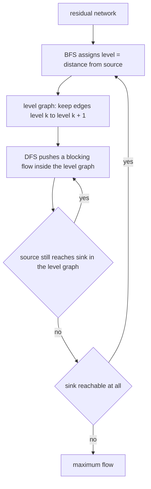
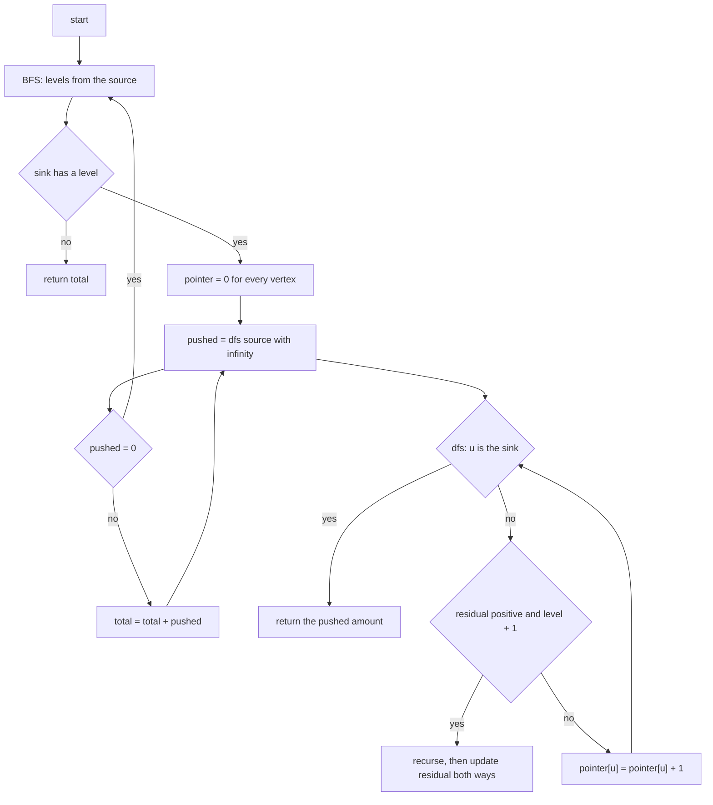
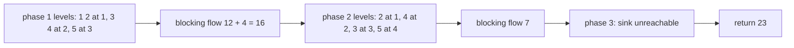
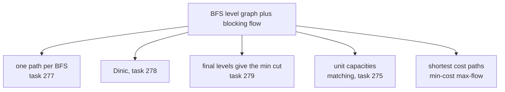

# 278 — Dinic’s algorithm for max flow (basic).

> **Tier:** Intermediate · **CTCI chapter:** Ch 4 — Trees and Graphs
> **Task spec:** [278-dinic-s-algorithm-for-max-flow-basic.md](../../../tasks/intermediate/278-dinic-s-algorithm-for-max-flow-basic.md)
> **Solutions:** [Python](../../../solutions/python/intermediate/278-dinic-s-algorithm-for-max-flow-basic/solution.py) ·
> [Java](../../../solutions/java/intermediate/278-dinic-s-algorithm-for-max-flow-basic/Solution.java) ·
> [JavaScript](../../../solutions/javascript/intermediate/278-dinic-s-algorithm-for-max-flow-basic/solution.js) ·
> [C#](../../../solutions/csharp/intermediate/278-dinic-s-algorithm-for-max-flow-basic/Solution.cs)

## 1. Problem restatement

**Input:** `n` vertices, a capacity matrix where `capacity[i][j]` is the capacity of the directed edge
`i → j` (`0` when there is no edge), a `source` and a `sink`.

**Output:** the value of a maximum flow from source to sink. The signature and the fixtures match
task [277](../../../tasks/intermediate/277-maximum-flow-edmonds-karp.md) exactly, so the two
implementations must agree on every graph — and the file asserts it: the CLRS figure gives `23` for
both, and 150 random 6-node graphs are compared one by one.

| Input | Result | Note |
| --- | --- | --- |
| the CLRS figure, 6 vertices | `23` | `dinic` and `edmonds_karp` both return it |
| diamond `0→1(3), 0→2(2), 1→3(2), 2→3(3)` | `4` | two branches, fully used |
| crossing graph, 4 vertices | `2` | needs the residual backward edge |
| `0→1 (1)` with sink `2` | `0` | sink unreachable |
| the 8-vertex "layered" network | — | asserted equal to both the Edmonds–Karp value *and* the brute-force min cut |
| 150 + 40 random LCG graphs | — | asserted equal to Edmonds–Karp and to the enumerated min cut |

The docstring describes the design: "Each phase builds the BFS level graph and then repeatedly pushes
a blocking flow with DFS plus a per-vertex pointer, so a vertex is scanned once per phase.
`O(V^2 * E)`."

## 2. Intuition

Edmonds–Karp ([277](../../../tasks/intermediate/277-maximum-flow-edmonds-karp.md)) answers "which path
should I use?" with a BFS and augments along exactly **one** path per search. Dinic asks a better
question: *given the BFS distances, how much can be pushed along all shortest paths at once?*

The BFS assigns every vertex a **level** — its distance from the source in the residual network — and
the edges that go from level `k` to level `k + 1` form the **level graph**. Every shortest augmenting
path lies entirely inside that subgraph. A **blocking flow** is a flow in the level graph that
saturates every source-to-sink route in it; once it is found, no further augmenting path of that
length exists, so the next phase must be strictly longer.



Two implementation details turn "push a blocking flow" into a linear scan. The DFS keeps a
**pointer per vertex** that only moves forward, so a vertex's candidate list is walked once per phase
rather than restarted for every push; and the DFS returns as soon as it has pushed *something*, which
lets the outer loop call it repeatedly instead of exhaustively exploring. The `while pointer[u] < n`
condition with `pointer[u]++` on failure is what gives the level graph its one-pass property: an edge
that cannot carry flow now will not be reconsidered until the next phase.

## 3. Algorithm

1. Copy the capacity matrix into `residual`; `total = 0`.
2. **Phase:** BFS from the source over edges with positive residual, filling `level[v]` with the
   shortest distance; if `level[sink] = -1`, return `total`.
3. Reset `pointer` to zero for every vertex.
4. **Push loop:** call `dfs(source, ∞)` repeatedly, adding each non-zero result to `total`, until a
   call returns `0`.
5. Back to step 2 for the next phase.

The DFS:

- if `u` is the sink, return `pushed` — this is the amount that reached the sink;
- otherwise, while `pointer[u] < n`: let `v = pointer[u]`. If `residual[u][v] > 0` **and**
  `level[v] = level[u] + 1`, recurse with `min(pushed, residual[u][v])`; if the recursive call returns
  a positive amount, update the residual in both directions and return it; in every other case
  advance `pointer[u]`;
- return `0` when the pointer runs off the end.

```text
function dinic(n, capacity, source, sink)
    residual ← a copy of capacity
    total ← 0
    while true do
        level ← -1 for every vertex
        level[source] ← 0
        BFS from source over edges with residual > 0, setting level[v] ← level[u] + 1
        if level[sink] = -1 then return total
        pointer ← zeroes for every vertex
        while true do
            pushed ← dfs(source, infinity)
            if pushed = 0 then break
            total ← total + pushed
    end
end

function dfs(u, pushed)
    if u = sink then return pushed
    while pointer[u] < n do
        v ← pointer[u]
        if residual[u][v] > 0 and level[v] = level[u] + 1 then
            here ← dfs(v, minimum of pushed and residual[u][v])
            if here > 0 then
                residual[u][v] ← residual[u][v] - here
                residual[v][u] ← residual[v][u] + here
                return here
        pointer[u] ← pointer[u] + 1
    return 0
end
```

The `level[v] = level[u] + 1` test is the whole optimisation: it confines the DFS to the level graph,
so it can never waste work on a path that is not among the shortest. Note that the pointer is only
advanced when an edge fails; after a successful push the function returns immediately, leaving the
pointer in place so the same edge can be used again if it still has residual capacity.



## 4. Worked example

Trace `dinic(6, clrs, 0, 5)` on the CLRS graph, whose asserted answer is `23` — the same value
Edmonds–Karp reaches in three augmentations.

**Phase 1.** BFS levels from `0`: `0 → 0`; `1` and `2` at level `1`; `3` and `4` at level `2` (via
`1 → 3` and `2 → 4`); `5` at level `3` (via `3 → 5`). The level graph therefore keeps only the edges
between consecutive levels: `0→1`, `0→2`, `1→3`, `2→4`, `3→5`, and the useless `1→2`, `2→1`, `3→2`,
`4→3`, `4→5` are excluded because they do not increase the level.

| Push | DFS path inside the level graph | Amount | Residual edges updated | `total` |
| --- | --- | --- | --- | --- |
| 1 | `0 → 1 → 3 → 5` | `12` (bottleneck `1→3`) | `0→1` 16→4, `1→3` 12→0, `3→5` 20→8 | `12` |
| 2 | `0 → 2 → 4 → 5` | `4` (bottleneck `4→5`) | `0→2` 13→9, `2→4` 14→10, `4→5` 4→0 | `16` |
| 3 | none — `1→3` and `4→5` are saturated and no level-respecting route remains | `0` | — | `16` |

The third call returns `0` immediately: `dfs(1, …)` finds its pointer past `3` (residual zero) and
past `4` (no edge), so the outer loop breaks and the phase ends with `16`.

**Phase 2.** The residual network has changed, so the BFS is recomputed. `1` and `2` are still at
level `1`, but `3` is now at level `3` — reachable only through `4`, which sits at level `2` — and `5`
is at level `4`. That is the shape change the level graph needs.

| Push | DFS path | Amount | Bottleneck | `total` |
| --- | --- | --- | --- | --- |
| 1 | `0 → 2 → 4 → 3 → 5` | `7` | `4→3` (7 units left) | `23` |
| 2 | none — `0 → 2` has 2 units left but `2 → 4` leads nowhere else in the level graph | `0` | — | `23` |

**Phase 3.** The BFS finds no route from `0` to `5`, so `level[sink] = -1` and the function returns
`23`. Two phases, three pushes, the same answer Edmonds–Karp took three BFS searches to reach.



The fixtures also cross-check the value from a completely different direction: `min_cut_brute_force`
enumerates every `s`-`t` cut by trying all `2^(n-2)` assignments of the middle vertices, and the tests
assert `dinic(...) == min_cut_brute_force(...)` on the CLRS graph, on the 8-vertex layered network and
on 40 more random graphs. Max-flow min-cut duality means the two must match.

## 5. Complexity

Let `V` be the number of vertices and `E` the number of edges.

| Measure | Bound | Why it holds |
| --- | --- | --- |
| Number of phases | `O(V)` | each phase lengthens the shortest augmenting path, which is bounded by `V - 1` |
| Time, one BFS | `O(V²)` | the matrix form scans every vertex pair; `O(V + E)` with adjacency lists |
| Time, one blocking flow | `O(V*E)` amortised | the per-vertex pointers advance at most `V` times per phase, each advance testing one edge |
| Time, total | `O(V² * E)` | the bound quoted in the docstring: `O(V)` phases times `O(V*E)` |
| Space | `O(V²)` | the residual matrix, plus linear `level` and `pointer` arrays |
| Time, Edmonds–Karp oracle | `O(V³ * E)` with this matrix form | `O(V*E)` augmentations, each with an `O(V²)` BFS |

The pointer is the reason a phase is not quadratic in the number of pushes: a vertex's candidate list
is scanned once, and a successful push returns immediately, so the work is charged to edge
advances rather than to path searches. On graphs where Edmonds–Karp needs many augmentations of the
same length, Dinic does them in one phase.

## 6. Pitfalls and edge cases

- **Unreachable sink.** `dinic(3, matrix_from_edges(3, [(0,1,1)]), 0, 2) == 0`: the first BFS leaves
  `level[2] = -1` and the function returns immediately, before any DFS.
- **Empty graph.** No edges at all behaves the same way — level of the sink stays `-1`.
- **Backward residual edges are still mandatory.** The update
  `residual[v][u] += here` is on the same line pair as Edmonds–Karp's, and the `crossing` fixture
  (asserted `2`) is the graph that punishes an implementation that forgets it.
- **The level test is not optional.** Dropping `level[v] = level[u] + 1` turns the DFS into an
  arbitrary-path search: it still terminates (the residual shrinks) but the phase count argument
  collapses and the algorithm degenerates toward Ford–Fulkerson.
- **Pointer advancement rules.** `pointer[u]++` happens only when the edge cannot be used *now*; a
  successful push returns without advancing. Advancing after a successful push would skip an edge
  that still has capacity, and never advancing would loop forever.
- **Sink short-circuit.** `if u = sink then return pushed` is what makes the returned amount the flow
  of the whole path; without it the DFS would try to push further out of the sink.
- **`push` of zero is the phase terminator.** The push loop is `while pushed != 0`; a `0` means the
  level graph has no route left, which is exactly the definition of a completed blocking flow.
- **`infinity` for the first call.** Python uses `float("inf")`, JavaScript `Infinity`, Java and C#
  `Integer.MAX_VALUE`; the value only has to exceed any real capacity so the first `min` picks the
  edge residual.
- **Integer arithmetic in Java and C#.** Capacities and totals are `int`; a network whose flow exceeds
  `2³¹ - 1` needs `long` there, while Python and JavaScript are unbounded or double-based.
- **Self-loops.** `lcg_capacities` skips `u = v`; a self-loop would otherwise be able to appear in the
  residual, and while Dijkstra-style reasoning tolerates it, the level test ignores it because
  `level[u] = level[u] + 1` is never true.
- **Determinism of the tests.** `lcg_capacities` advances `seed = (seed * 75 + 74) % 65537` and adds
  an edge when `seed % 4 == 0` with capacity `seed % 10`, starting from `seed = 97531`; all four
  languages generate the same 150 graphs and compare Dinic with Edmonds–Karp on each.
- **Min-cut oracle cost.** `min_cut_brute_force` enumerates `2^(n-2)` cuts, which is why it is only
  run on `n = 6` and `n = 8` inputs; it is an independent verification of the *value*, not a
  production routine.

## 7. Variants and follow-ups

- **One augmenting path per BFS.** [277-maximum-flow-edmonds-karp.md](../../../tasks/intermediate/277-maximum-flow-edmonds-karp.md)
  is the simpler algorithm this one improves; the level array is replaced by a parent array that
  records a single path.
- **Min cut from the last level array.** [279-min-cut-using-max-flow-s-t-cut-extraction.md](../../../tasks/intermediate/279-min-cut-using-max-flow-s-t-cut-extraction.md)
  does not need the flow decomposition at all — the set of vertices whose level is not `-1` in the
  final BFS is one side of a minimum cut.
- **Unit-capacity networks.** On unit capacities Dinic runs in `O(E√E)`, which makes it a competitor
  of [275](../../../tasks/intermediate/275-maximum-bipartite-matching-hopcroft-karp-outline.md)'s
  Hopcroft–Karp on matching problems.
- **Costs on the edges.** Min-cost max-flow keeps the phase idea but augments along shortest *cost*
  paths, using potentials to keep the reduced costs non-negative.
- **Adjacency lists with edge indices.** Real implementations store each edge with its reverse in the
  same array and flip `e` to `e ^ 1`; the matrix form here is simpler at the cost of an `O(V²)` scan
  per BFS.



## 8. Check yourself

1. What is a blocking flow, and why does it end a phase?

<details><summary>Show answer</summary>

It is a flow in the level graph that leaves no source-to-sink path with residual capacity in that
subgraph — every route is saturated. Since only level-respecting edges are used, all those routes are
shortest augmenting paths; when none is left, the next augmenting path in the residual network must be
strictly longer, which is why the next phase recomputes the levels.

</details>

2. In the CLRS trace, why does phase 1 deliver `16` in two pushes while Edmonds–Karp delivers `12`
   then `4` in two separate searches?

<details><summary>Show answer</summary>

Because Dinic keeps the level graph across pushes. Both routes `0 → 1 → 3 → 5` and `0 → 2 → 4 → 5`
have the same length and live in the same level graph, so after the first push the DFS simply
continues from the source and finds the second route. Edmonds–Karp recomputes the whole BFS for each
path.

</details>

3. Why is `pointer[u]++` skipped when the recursive DFS returns a positive amount?

<details><summary>Show answer</summary>

Because the edge may still have residual capacity and could carry more flow in a later push of the
same phase. Only when the edge cannot be used right now (no residual, or the level test fails, or the
recursion found nothing) does the pointer move on. Advancing on success would abandon usable
capacity until the next phase.

</details>

4. How do the tests verify a value that is not just compared against another flow algorithm?

<details><summary>Show answer</summary>

`min_cut_brute_force` enumerates all `2^(n-2)` vertex subsets containing the source and computes the
capacity of each cut; max-flow min-cut duality says the minimum of those equals the maximum flow. The
tests assert `dinic == min_cut_brute_force` on the CLRS graph, on the 8-vertex layered network and on
40 random graphs, so the flow value is confirmed by an argument about cuts rather than by another
flow implementation.

</details>

5. What is the difference between the number of phases and the number of pushes?

<details><summary>Show answer</summary>

A phase is one BFS plus the blocking flow built from it; the pushes are the individual `dfs` calls
inside a phase, and there can be many per phase (two in phase 1 and one in phase 2 of the CLRS trace).
The phase count is bounded by `O(V)` because the shortest augmenting path length strictly increases;
the number of pushes is bounded by `O(E)` per phase, since each push saturates at least one edge or
advances a pointer.

</details>
